<!-- source: DeepWiki mcp.deepwiki.com · repo PennyLaneAI/pennylane · page 5.4 Symbolic Operations and Composition · fetched 2026-10-21 -->

# Symbolic Operations and Composition

<details>
<summary>Relevant source files</summary>

The following files were used as context for generating this wiki page:

- [pennylane/ops/identity.py](pennylane/ops/identity.py)
- [pennylane/ops/op_math/adjoint.py](pennylane/ops/op_math/adjoint.py)
- [pennylane/ops/op_math/composite.py](pennylane/ops/op_math/composite.py)
- [pennylane/ops/op_math/controlled.py](pennylane/ops/op_math/controlled.py)
- [pennylane/ops/op_math/controlled_decompositions.py](pennylane/ops/op_math/controlled_decompositions.py)
- [pennylane/ops/op_math/controlled_ops.py](pennylane/ops/op_math/controlled_ops.py)
- [pennylane/ops/op_math/pow.py](pennylane/ops/op_math/pow.py)
- [pennylane/ops/op_math/prod.py](pennylane/ops/op_math/prod.py)
- [pennylane/ops/op_math/sprod.py](pennylane/ops/op_math/sprod.py)
- [pennylane/ops/op_math/sum.py](pennylane/ops/op_math/sum.py)
- [pennylane/ops/op_math/symbolicop.py](pennylane/ops/op_math/symbolicop.py)
- [pennylane/ops/qubit/attributes.py](pennylane/ops/qubit/attributes.py)
- [pennylane/ops/qubit/non_parametric_ops.py](pennylane/ops/qubit/non_parametric_ops.py)
- [pennylane/ops/qubit/parametric_ops_multi_qubit.py](pennylane/ops/qubit/parametric_ops_multi_qubit.py)
- [pennylane/ops/qubit/parametric_ops_single_qubit.py](pennylane/ops/qubit/parametric_ops_single_qubit.py)
- [pennylane/ops/qubit/special_unitary.py](pennylane/ops/qubit/special_unitary.py)
- [tests/ops/op_math/test_adjoint.py](tests/ops/op_math/test_adjoint.py)
- [tests/ops/op_math/test_composite.py](tests/ops/op_math/test_composite.py)
- [tests/ops/op_math/test_controlled.py](tests/ops/op_math/test_controlled.py)
- [tests/ops/op_math/test_controlled_decompositions.py](tests/ops/op_math/test_controlled_decompositions.py)
- [tests/ops/op_math/test_controlled_ops.py](tests/ops/op_math/test_controlled_ops.py)
- [tests/ops/op_math/test_pow_op.py](tests/ops/op_math/test_pow_op.py)
- [tests/ops/op_math/test_prod.py](tests/ops/op_math/test_prod.py)
- [tests/ops/op_math/test_sprod.py](tests/ops/op_math/test_sprod.py)
- [tests/ops/op_math/test_sum.py](tests/ops/op_math/test_sum.py)
- [tests/ops/op_math/test_symbolic_op.py](tests/ops/op_math/test_symbolic_op.py)
- [tests/ops/qubit/test_attributes.py](tests/ops/qubit/test_attributes.py)
- [tests/ops/qubit/test_non_parametric_ops.py](tests/ops/qubit/test_non_parametric_ops.py)
- [tests/ops/qubit/test_parametric_ops.py](tests/ops/qubit/test_parametric_ops.py)
- [tests/ops/qubit/test_special_unitary.py](tests/ops/qubit/test_special_unitary.py)
- [tests/ops/test_identity.py](tests/ops/test_identity.py)

</details>


This page documents the symbolic operator framework that enables lazy evaluation, algebraic manipulation, and composition of quantum operations in PennyLane. These abstractions allow operators to be wrapped and combined without immediate evaluation, supporting features like automatic simplification, Pauli representation optimization, and flexible decomposition strategies.

For concrete operator arithmetic operations (Prod, Sum, SProd, Pow), see [Operator Arithmetic](#5.3). For controlled and adjoint transformations, see [Controlled and Adjoint Operations](#5.2).

## Architecture Overview

The symbolic operations framework consists of two primary base classes that extend `Operator`:

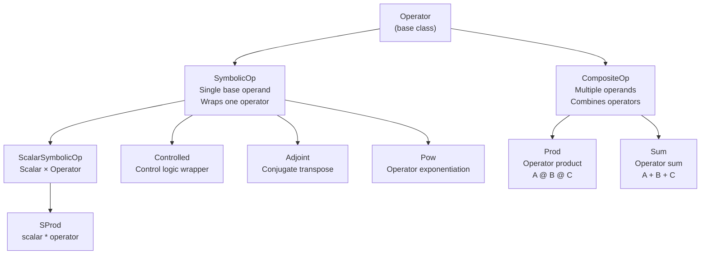

**Sources:** [pennylane/ops/op_math/symbolicop.py:1-330](), [pennylane/ops/op_math/composite.py:1-450]()

## SymbolicOp Base Class

`SymbolicOp` is an abstract base class for operators that wrap a single base operator. It provides a common interface for lazy evaluation and operator manipulation.

### Core Structure

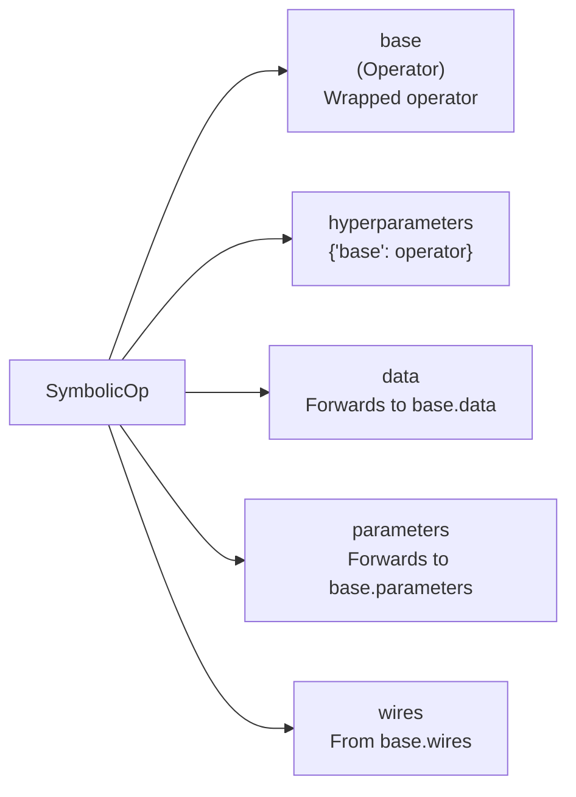

Key properties automatically forwarded from the base operator:

| Property | Description | Source |
|----------|-------------|--------|
| `data` | Trainable parameters | `base.data` |
| `parameters` | List of parameters | `base.parameters` |
| `num_params` | Parameter count | `base.num_params` |
| `wires` | Wire labels | `base.wires` |
| `batch_size` | Batch dimension | `base.batch_size` |
| `ndim_params` | Parameter dimensions | `base.ndim_params` |

**Sources:** [pennylane/ops/op_math/symbolicop.py:31-165]()

### Data and Parameter Management

The `SymbolicOp` class implements property forwarding to enable seamless parameter updates:

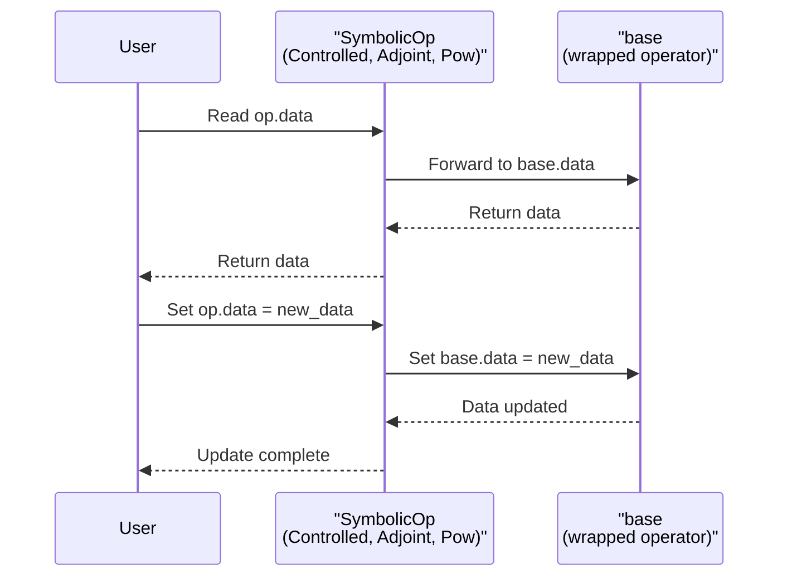

This forwarding mechanism allows operations like `Controlled(RX(1.2, 0), 1)` to support gradient computation and parameter updates transparently through the wrapper.

**Sources:** [pennylane/ops/op_math/symbolicop.py:85-119]()

## CompositeOp Base Class

`CompositeOp` extends `SymbolicOp` to handle operators composed of multiple operands (factors, summands, etc.). It provides infrastructure for managing collections of operators with shared properties.

### Operand Management

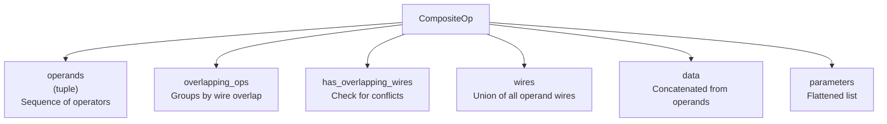

**Key properties:**

| Property | Type | Description |
|----------|------|-------------|
| `operands` | `tuple[Operator]` | Immutable sequence of operators |
| `overlapping_ops` | `tuple[tuple[Operator]]` | Groups operators by wire overlap |
| `has_overlapping_wires` | `bool` | True if any operands share wires |
| `wires` | `Wires` | Union of all operand wires |
| `num_wires` | `int` | Total number of unique wires |

**Sources:** [pennylane/ops/op_math/composite.py:98-280]()

### Iteration and Access

`CompositeOp` implements container protocols for convenient access:

```python
# Indexing
op[0]          # First operand
op[-1]         # Last operand

# Iteration
for operand in op:
    process(operand)

# Length
len(op)        # Number of operands
```

**Sources:** [pennylane/ops/op_math/composite.py:187-219]()

## ScalarSymbolicOp

`ScalarSymbolicOp` extends `SymbolicOp` specifically for scalar multiplication operators. It adds a `scalar` hyperparameter alongside the base operator.

### Structure

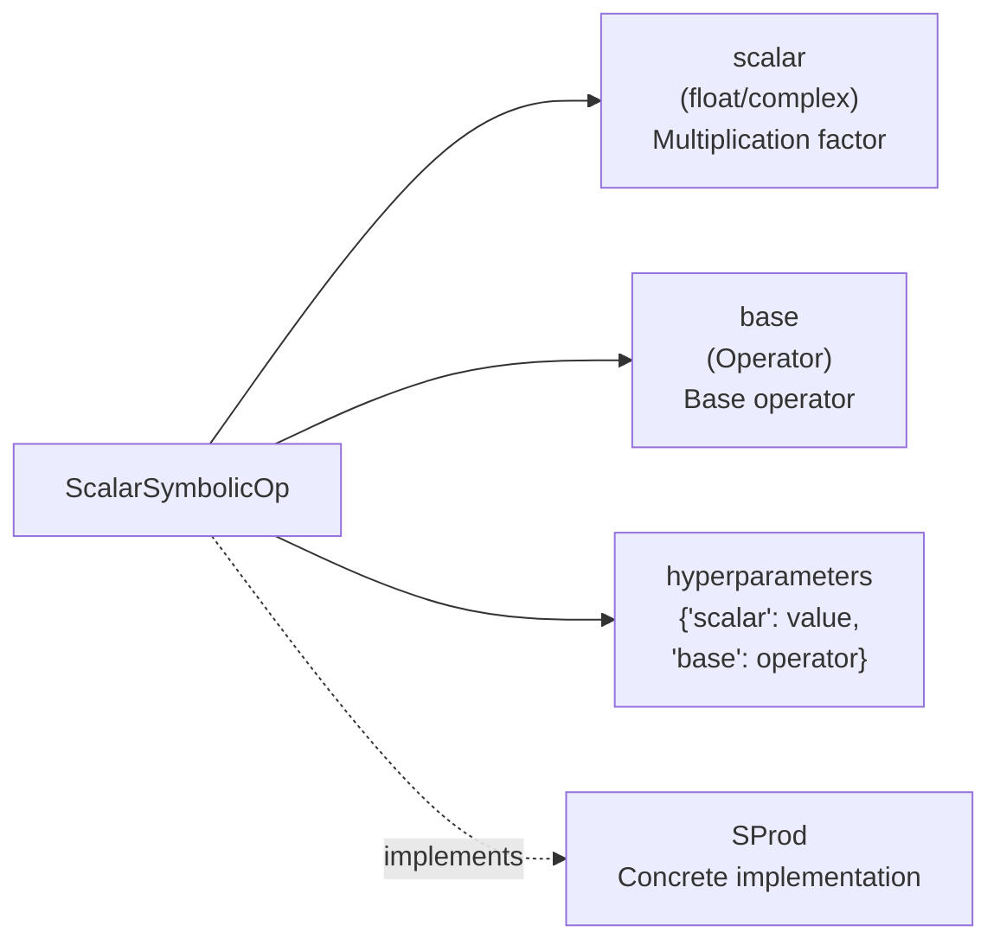

The `SProd` class is the concrete implementation that uses `ScalarSymbolicOp` to represent `scalar * operator`.

**Sources:** [pennylane/ops/op_math/symbolicop.py:168-233](), [pennylane/ops/op_math/sprod.py:1-350]()

## Pauli Representation System

The `pauli_rep` property provides an optimized representation for operators expressible as linear combinations of Pauli operators. This enables efficient simplification and matrix computation.

### PauliSentence Hierarchy

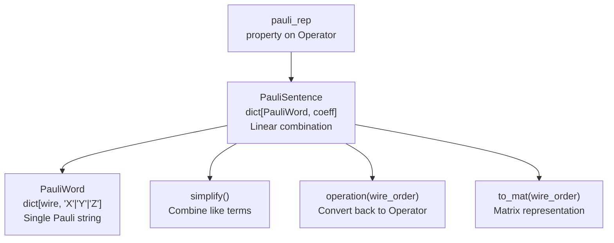

### Example: Pauli Representation Construction

For composite operators, `pauli_rep` is built recursively:

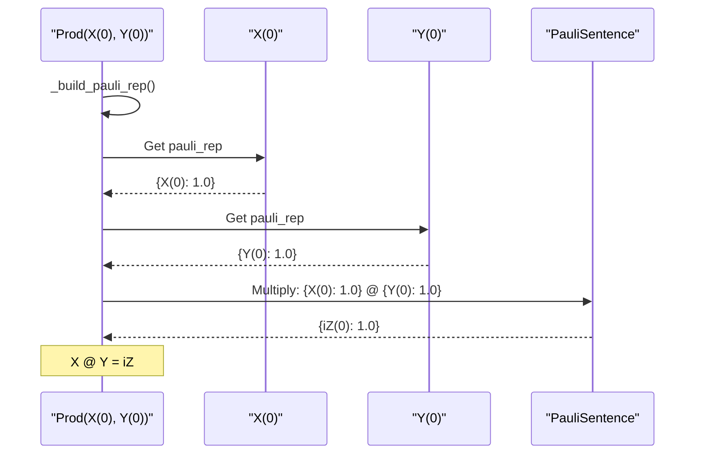

**Sources:** [pennylane/ops/op_math/composite.py:350-380](), [pennylane/ops/op_math/prod.py:367-371]()

## The `terms()` Method

The `terms()` method returns a standardized representation of an operator as `(coefficients, operators)` tuples, enabling uniform handling across different operator types.

### Return Format

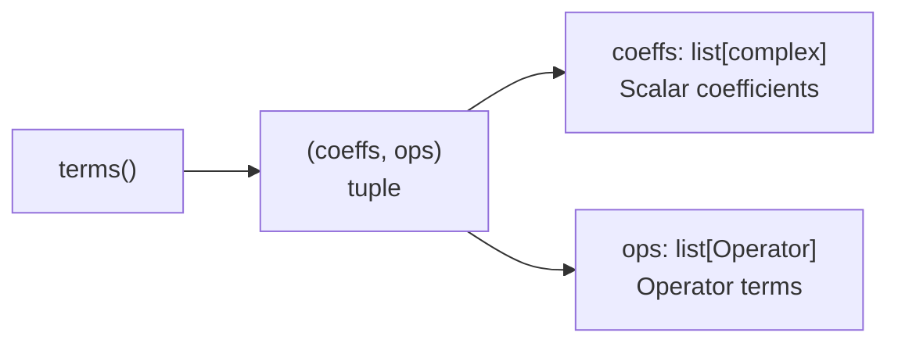

### Implementation Hierarchy

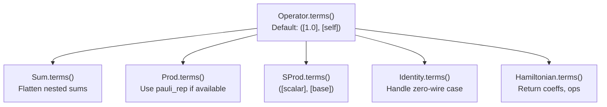

### Examples by Operator Type

| Operator | `terms()` Result |
|----------|-----------------|
| `X(0)` | `([1.0], [X(0)])` |
| `s_prod(2.0, X(0))` | `([2.0], [X(0)])` |
| `sum(X(0), Y(0))` | `([1.0, 1.0], [X(0), Y(0)])` |
| `prod(X(0), Y(0))` | `([1j], [Z(0)])` if pauli_rep available |
| `prod(H(0), X(1))` | `([1.0], [prod(H(0), X(1))])` |

**Sources:** [pennylane/operation.py:3200-3220](), [pennylane/ops/op_math/sum.py:280-320](), [pennylane/ops/op_math/prod.py:450-510](), [pennylane/ops/op_math/sprod.py:180-210]()

## The `simplify()` Method

The `simplify()` method attempts to reduce operator expressions to simpler forms by applying algebraic identities, combining like terms, and flattening nested structures.

### Simplification Pipeline

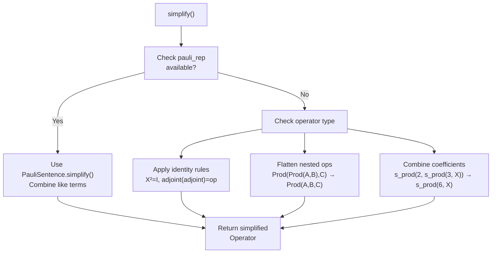

### Simplification Examples

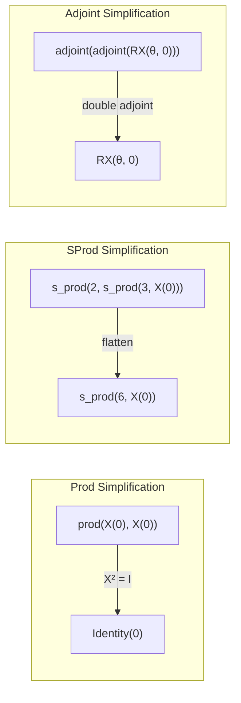

**Sources:** [pennylane/ops/op_math/prod.py:388-413](), [pennylane/ops/op_math/sum.py:340-380](), [pennylane/ops/op_math/sprod.py:240-280](), [pennylane/ops/op_math/adjoint.py:200-240]()

## Matrix Computation

Symbolic operators implement `matrix()` methods that compute the matrix representation by composing or combining the matrices of their operands.

### Matrix Computation Strategies

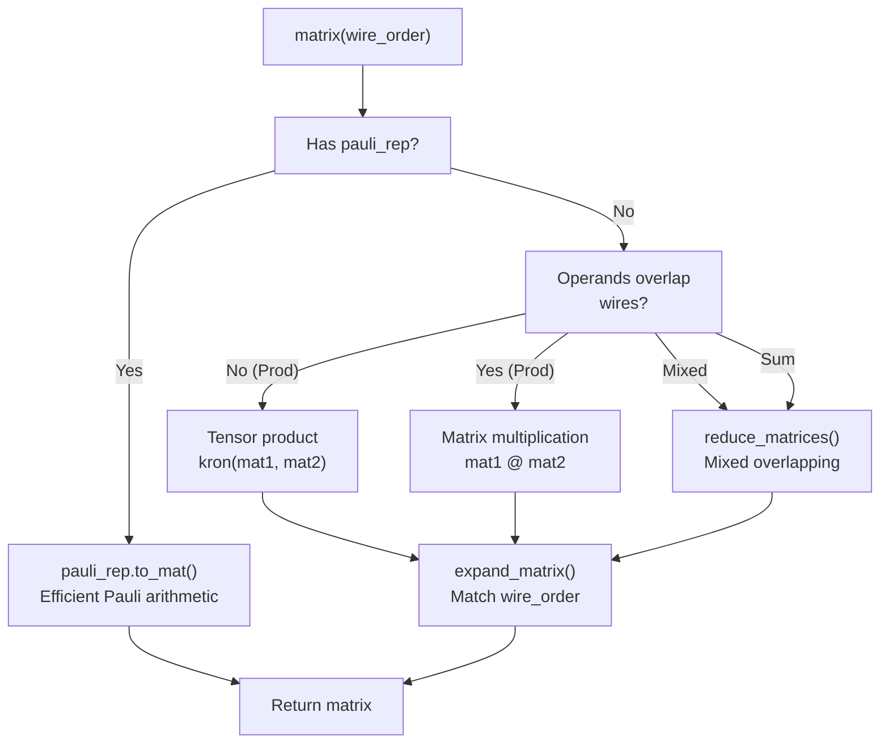

### Implementation by Type

| Operator Type | Matrix Strategy |
|--------------|-----------------|
| `Controlled` | Block diagonal with control logic [controlled.py:756-788]() |
| `Adjoint` | Conjugate transpose of base [adjoint.py:180-195]() |
| `SProd` | Scalar multiplication [sprod.py:160-170]() |
| `Prod` | Kronecker or matmul based on overlap [prod.py:288-316]() |
| `Sum` | Element-wise addition [sum.py:300-330]() |
| `Pow` | Fractional matrix power [pow.py:220-250]() |

### Sparse Matrix Support

Many symbolic operators also implement `sparse_matrix()` for efficient sparse representations:

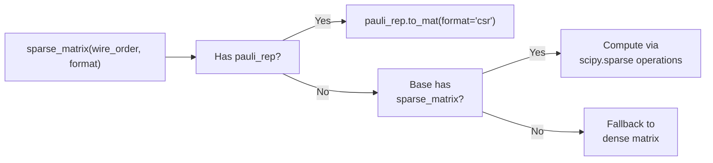

**Sources:** [pennylane/ops/op_math/controlled.py:793-816](), [pennylane/ops/op_math/prod.py:318-335](), [pennylane/ops/op_math/sum.py:330-360]()

## Operator-Specific Implementations

Each concrete symbolic operator extends the base classes with specific semantics:

### Controlled

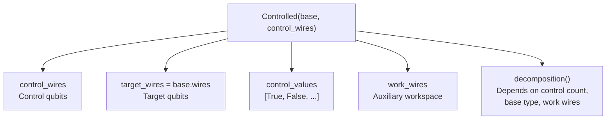

**Key features:**
- Wraps any operator with control logic
- Supports multi-control with mixed control values
- Decomposes using work wires for efficiency
- Flattens nested controlled ops

**Sources:** [pennylane/ops/op_math/controlled.py:433-946]()

### Adjoint

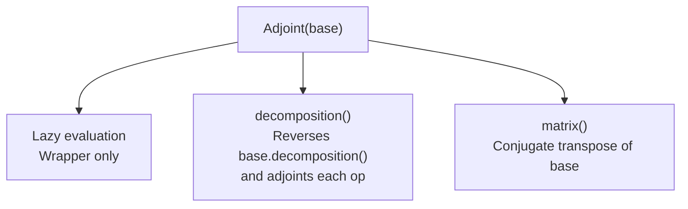

**Key features:**
- Lazy wrapper that defers to `base.adjoint()` when possible
- Falls back to reversing and adjointing decomposition
- Matrix is conjugate transpose

**Sources:** [pennylane/ops/op_math/adjoint.py:140-280]()

### Pow

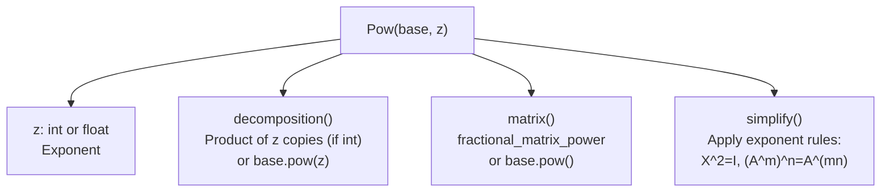

**Key features:**
- Integer exponents decompose to products
- Fractional exponents use matrix fractional power
- Simplifies using exponent algebra

**Sources:** [pennylane/ops/op_math/pow.py:60-380]()

### Prod

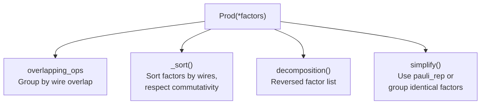

**Key features:**
- Represents tensor product or matrix product
- Automatically groups overlapping vs non-overlapping factors
- Simplifies using Pauli arithmetic when available

**Sources:** [pennylane/ops/op_math/prod.py:150-640]()

### Sum

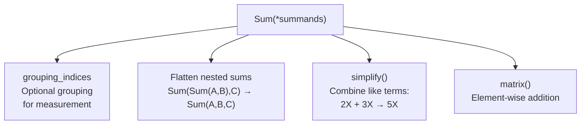

**Key features:**
- Represents linear combination of operators
- Supports grouping for efficient measurement
- Simplifies by combining like terms

**Sources:** [pennylane/ops/op_math/sum.py:124-450]()

### SProd

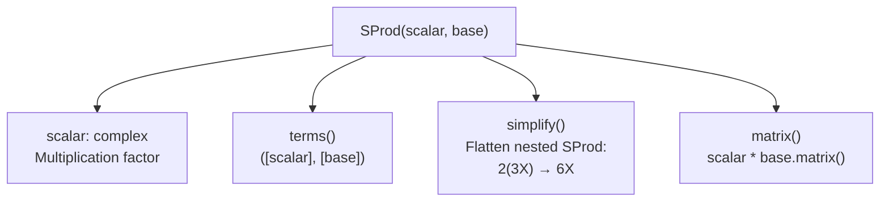

**Key features:**
- Represents scalar multiplication
- Flattens nested scalar products
- Efficiently combines with other SProd operations

**Sources:** [pennylane/ops/op_math/sprod.py:90-350]()

## Recursion Handling

Symbolic operators can nest arbitrarily deep, which can cause issues with Python's recursion limit. The `@handle_recursion_error` decorator provides graceful error messages:

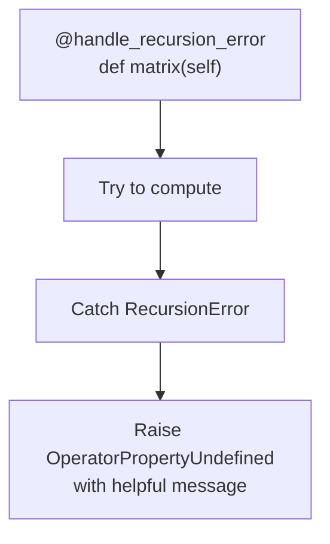

This decorator is applied to methods like `matrix()`, `sparse_matrix()`, and `simplify()` that may recurse deeply.

**Sources:** [pennylane/ops/op_math/composite.py:31-52]()

## Integration with Queuing

Symbolic operators integrate with PennyLane's queuing system to control when operands are recorded:

```mermaid
sequenceDiagram
    participant User
    participant Queue as "QueuingManager"
    participant Symbolic as "SymbolicOp"
    participant Base as "base operator"
    
    Note over Queue: Recording active
    User->>Base: Create base = RX(θ, 0)
    Base->>Queue: Append to queue
    
    User->>Symbolic: Create op = Controlled(base, 1)
    Symbolic->>Queue: Remove base from queue
    Note over Symbolic: Base stored in hyperparameters
    Symbolic->>Queue: Append Controlled op
    
    User->>Symbolic: Call op.decomposition()
    Symbolic->>Queue: Re-queue decomposed ops
```

When a symbolic operator is created, it typically removes its base/operands from the queue and stores them internally, then re-adds them during decomposition.

**Sources:** [pennylane/ops/op_math/controlled.py:369-379](), [pennylane/ops/op_math/composite.py:140-160]()

---

