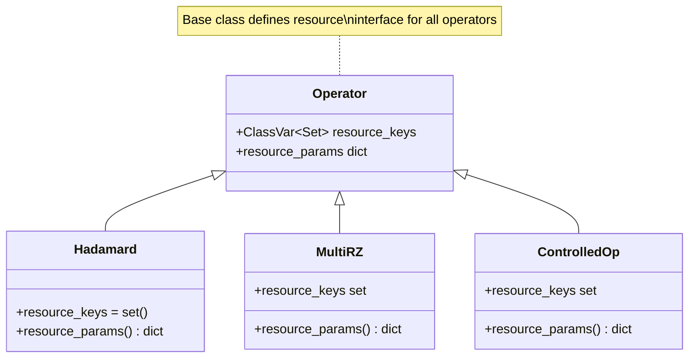
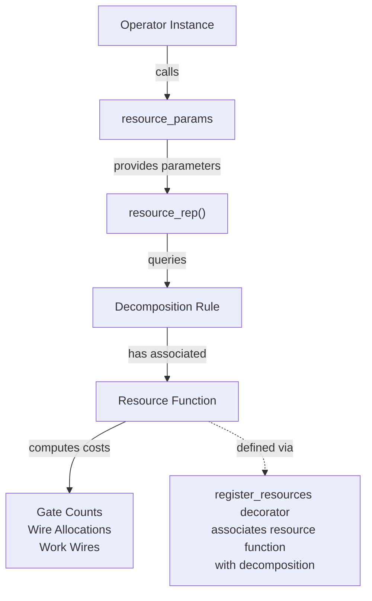
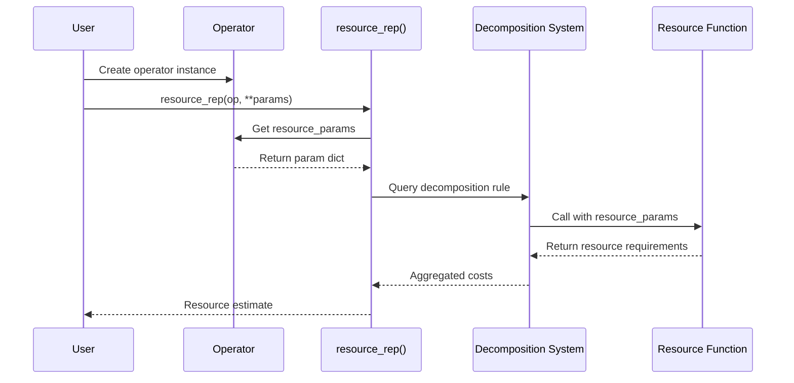
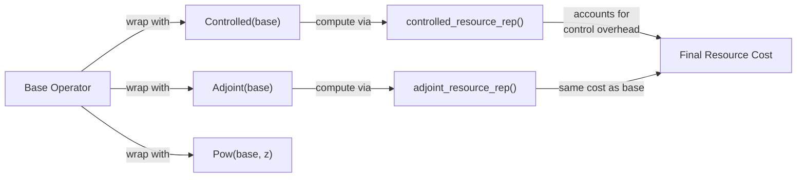
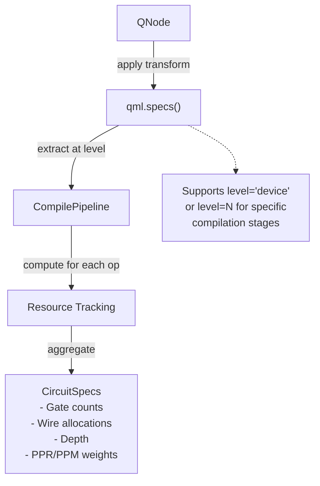

<!-- source: DeepWiki mcp.deepwiki.com · repo PennyLaneAI/pennylane · page 5.5 Resource Estimation · fetched 2026-10-21 -->

# Resource Estimation

<details>
<summary>Relevant source files</summary>

The following files were used as context for generating this wiki page:

- [doc/development/deprecations.rst](doc/development/deprecations.rst)
- [doc/releases/changelog-dev.md](doc/releases/changelog-dev.md)
- [pennylane/__init__.py](pennylane/__init__.py)
- [pennylane/operation.py](pennylane/operation.py)
- [pennylane/ops/identity.py](pennylane/ops/identity.py)
- [pennylane/ops/op_math/adjoint.py](pennylane/ops/op_math/adjoint.py)
- [pennylane/ops/op_math/controlled.py](pennylane/ops/op_math/controlled.py)
- [pennylane/ops/op_math/controlled_decompositions.py](pennylane/ops/op_math/controlled_decompositions.py)
- [pennylane/ops/op_math/controlled_ops.py](pennylane/ops/op_math/controlled_ops.py)
- [pennylane/ops/qubit/attributes.py](pennylane/ops/qubit/attributes.py)
- [pennylane/ops/qubit/non_parametric_ops.py](pennylane/ops/qubit/non_parametric_ops.py)
- [pennylane/ops/qubit/parametric_ops_multi_qubit.py](pennylane/ops/qubit/parametric_ops_multi_qubit.py)
- [pennylane/ops/qubit/parametric_ops_single_qubit.py](pennylane/ops/qubit/parametric_ops_single_qubit.py)
- [pennylane/ops/qubit/special_unitary.py](pennylane/ops/qubit/special_unitary.py)
- [pennylane/workflow/__init__.py](pennylane/workflow/__init__.py)
- [pennylane/workflow/_setup_transform_program.py](pennylane/workflow/_setup_transform_program.py)
- [pennylane/workflow/construct_execution_config.py](pennylane/workflow/construct_execution_config.py)
- [pennylane/workflow/execution.py](pennylane/workflow/execution.py)
- [pennylane/workflow/get_compile_pipeline.py](pennylane/workflow/get_compile_pipeline.py)
- [pennylane/workflow/qnode.py](pennylane/workflow/qnode.py)
- [pennylane/workflow/resolution.py](pennylane/workflow/resolution.py)
- [tests/ops/op_math/test_adjoint.py](tests/ops/op_math/test_adjoint.py)
- [tests/ops/op_math/test_controlled.py](tests/ops/op_math/test_controlled.py)
- [tests/ops/op_math/test_controlled_decompositions.py](tests/ops/op_math/test_controlled_decompositions.py)
- [tests/ops/op_math/test_controlled_ops.py](tests/ops/op_math/test_controlled_ops.py)
- [tests/ops/qubit/test_attributes.py](tests/ops/qubit/test_attributes.py)
- [tests/ops/qubit/test_non_parametric_ops.py](tests/ops/qubit/test_non_parametric_ops.py)
- [tests/ops/qubit/test_parametric_ops.py](tests/ops/qubit/test_parametric_ops.py)
- [tests/ops/qubit/test_special_unitary.py](tests/ops/qubit/test_special_unitary.py)
- [tests/ops/test_identity.py](tests/ops/test_identity.py)
- [tests/test_operation.py](tests/test_operation.py)
- [tests/test_qnode.py](tests/test_qnode.py)
- [tests/test_qnode_legacy.py](tests/test_qnode_legacy.py)
- [tests/workflow/interfaces/execute/test_execute.py](tests/workflow/interfaces/execute/test_execute.py)
- [tests/workflow/test_get_compile_pipeline.py](tests/workflow/test_get_compile_pipeline.py)
- [tests/workflow/test_resolve_execution_config.py](tests/workflow/test_resolve_execution_config.py)

</details>


The resource estimation system enables operators in PennyLane to declare which parameters affect their computational resource requirements and provides mechanisms for computing resource costs during circuit decomposition and compilation. This system is integrated with the graph-based decomposition framework to track gate counts, wire allocations, and other resources.

For information about circuit decomposition, see [Circuit Decomposition](#3.3). For quantum operations and operator properties, see [Operators and Operation System](#2.1).

---

## Overview

Resource estimation in PennyLane consists of two key components:

1. **Operator-level resource specification** - Operators declare resource-relevant parameters via `resource_keys` and `resource_params`
2. **Decomposition-integrated tracking** - The decomposition system uses resource functions to compute costs when breaking down operators into primitive gates

The system supports both exact resource computation and lightweight estimator implementations optimized for large-scale analysis.

**Sources:** [pennylane/operation.py:689-703](), [pennylane/__init__.py:36-42]()

---

## Operator Resource Specification

### Resource Keys and Parameters

Every `Operator` subclass defines which parameters affect its resource requirements through two mechanisms:



**`resource_keys`**: A class-level `set` defining parameter names that affect resource requirements. Most simple gates have `resource_keys = set()` since they have no resource-relevant parameters.

**`resource_params`**: An instance property returning a `dict` mapping resource keys to their current values for this operator instance.

**Sources:** [pennylane/operation.py:689-703](), [pennylane/ops/qubit/non_parametric_ops.py:75-101](), [pennylane/ops/identity.py:61-65]()

---

## Integration with Decomposition System

### Resource Functions in Decomposition Rules

The decomposition system tracks resources by associating resource functions with decomposition rules:



The `register_resources` decorator from `pennylane.decomposition` associates resource cost functions with decomposition rules. When `resource_rep` is called on an operator, it uses the operator's `resource_params` as arguments to the resource function.

**Sources:** [pennylane/__init__.py:36-42](), [pennylane/decomposition/__init__.py](), [doc/releases/changelog-dev.md:517-527]()

---

## Resource Estimation Workflow

### Computing Resource Requirements



The workflow:

1. User creates an operator instance with specific parameters
2. Calls `resource_rep(op, **kwargs)` where kwargs match the operator's `resource_keys`
3. System retrieves operator's `resource_params`
4. Decomposition system looks up associated resource function
5. Resource function computes costs (gate counts, wire allocations, etc.)
6. Results are returned to the user

**Sources:** [pennylane/operation.py:689-703](), [pennylane/__init__.py:36-42]()

---

## Resource Keys by Operator Type

| Operator Class | Resource Keys | Purpose |
|---------------|---------------|---------|
| `Hadamard` | `set()` | No resource-relevant parameters |
| `Identity` | `set()` | No resource-relevant parameters |
| `RX`, `RY`, `RZ` | `set()` | Rotation angle doesn't affect gate count |
| `MultiRZ` | Varies by implementation | Number of qubits may affect decomposition |
| `ControlledOp` | Depends on base + controls | Control count affects decomposition complexity |

Simple gates typically have empty `resource_keys` because their decomposition is independent of parameter values. Complex templates and controlled operations may have keys for:
- Number of wires/qubits
- Number of control qubits
- Work wire configuration
- Specific structural parameters

**Sources:** [pennylane/ops/qubit/non_parametric_ops.py:75-76](), [pennylane/ops/identity.py:61-62](), [pennylane/operation.py:689-703]()

---

## Estimator Module

### Lightweight Resource Estimation

PennyLane provides specialized lightweight operator representations optimized for resource estimation without full simulation overhead:

```python
# Available under qml.estimator module
qml.estimator.HybridQRAM
qml.estimator.SelectOnlyQRAM  
qml.estimator.BasisEmbedding
qml.estimator.BasisState
```

These implementations:
- Provide fast resource computation without matrix construction
- Are suitable for large-scale algorithm analysis
- Implement the same resource interface as their full operator counterparts

The `qml.estimator.Resources` class provides a container for resource information with rich display support in Jupyter notebooks.

**Sources:** [doc/releases/changelog-dev.md:269-273](), [doc/releases/changelog-dev.md:336-337]()

---

## Decomposition-Specific Resource Tracking

### Resource Functions for Controlled and Adjoint Operations

The operator arithmetic module provides helper functions for computing resources of derived operations:



- `controlled_resource_rep`: Computes resource cost for controlled versions of operators, accounting for additional decomposition overhead from control qubits
- `adjoint_resource_rep`: Computes resources for adjoint operations (typically same as base operation)
- Resource functions integrated into decomposition rules via `add_decomps` and `register_resources`

**Sources:** [pennylane/ops/qubit/non_parametric_ops.py:24-36](), [pennylane/ops/identity.py:24](), [pennylane/ops/op_math/controlled.py:29-36]()

---

## Example: Resource Keys Implementation

### Simple Operator (No Resource Keys)

```python
class Hadamard(Operation):
    resource_keys = set()  # No parameters affect resources
    
    @property
    def resource_params(self) -> dict:
        return {}  # Empty dict for operators with no resource keys
```

All non-parametric gates like `Hadamard`, `PauliX`, `PauliY`, `PauliZ`, `S`, `T` follow this pattern because their decomposition is parameter-independent.

### Complex Operator (With Resource Keys)

For operators where parameters affect decomposition complexity (such as multi-controlled gates or templates), `resource_keys` would contain the relevant parameter names:

```python
# Hypothetical example - actual implementation varies
class ComplexTemplate(Operation):
    resource_keys = {"n_qubits", "depth"}
    
    @property  
    def resource_params(self) -> dict:
        return {
            "n_qubits": len(self.wires),
            "depth": self.hyperparameters["depth"]
        }
```

When `resource_rep` is called, it passes these parameters to the associated resource function to compute accurate gate counts.

**Sources:** [pennylane/ops/qubit/non_parametric_ops.py:75-101](), [pennylane/ops/identity.py:61-65]()

---

## Integration with Specs and Circuit Analysis

### Using Resource Estimation with Specs

The `qml.specs` transform uses resource estimation to provide detailed circuit metrics:



`qml.specs` leverages the resource estimation system to report:
- Total gate counts by type
- Wire allocations
- Circuit depth (when computed)
- Special metrics like PPR (Pauli Preparation Rotation) and PPM (Pauli Preparation Measurement) weights

**Sources:** [doc/releases/changelog-dev.md:281-318](), [pennylane/resource/specs.py]()

---

## Migration from Resources to Estimator Module

### Historical Context

Prior to v0.45, resource estimation functions were located in `qml.resources`. These have been migrated to `qml.estimator`:

| Old Location (Deprecated) | New Location |
|--------------------------|--------------|
| `qml.resources.estimate_shots` | `qml.estimator.estimate_shots` |
| `qml.resources.estimate_error` | `qml.estimator.estimate_error` |
| `qml.resources.FirstQuantization` | `qml.estimator.FirstQuantization` |
| `qml.resources.DoubleFactorization` | `qml.estimator.DoubleFactorization` |

The new `qml.estimator` module provides a unified interface for resource estimation across different quantum algorithm primitives.

**Sources:** [doc/development/deprecations.rst:203-212](), [doc/releases/changelog-dev.md:561-567]()

---

## Summary

The resource estimation system in PennyLane:

1. **Defines a standard interface** via `resource_keys` and `resource_params` on all operators
2. **Integrates with decomposition** through `register_resources` and `resource_rep` functions  
3. **Supports lightweight estimation** via specialized implementations in `qml.estimator`
4. **Powers circuit analysis** through `qml.specs` and related transforms
5. **Handles operator math** via `controlled_resource_rep`, `adjoint_resource_rep`, and similar helpers

This system enables both exact resource computation for small circuits and efficient estimation for large-scale quantum algorithm analysis without requiring full quantum simulation.

**Sources:** [pennylane/operation.py:689-703](), [pennylane/__init__.py:36-42](), [doc/releases/changelog-dev.md:269-273]()

---

