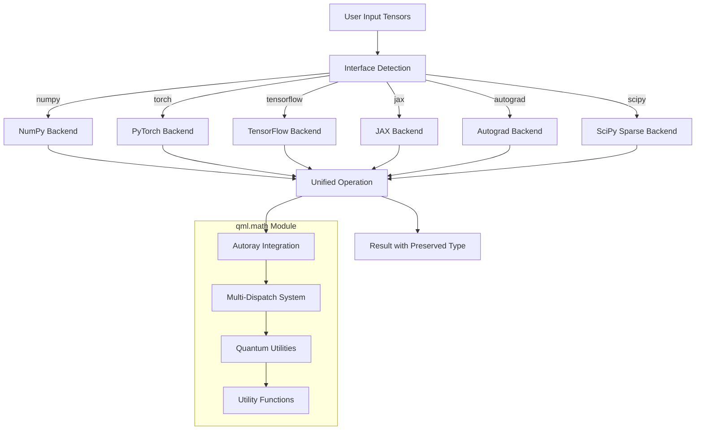
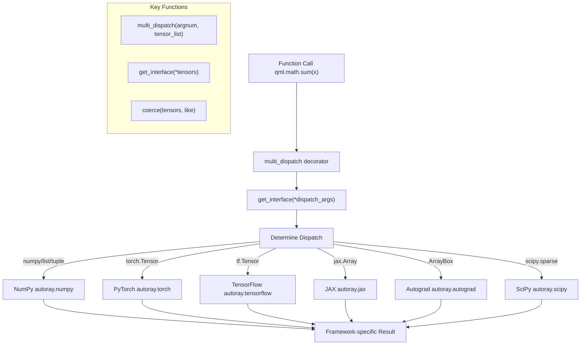
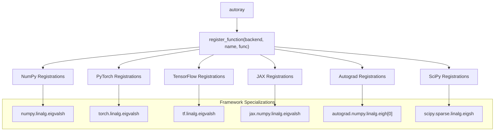
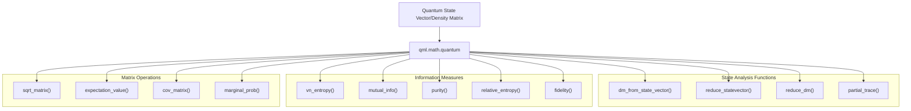
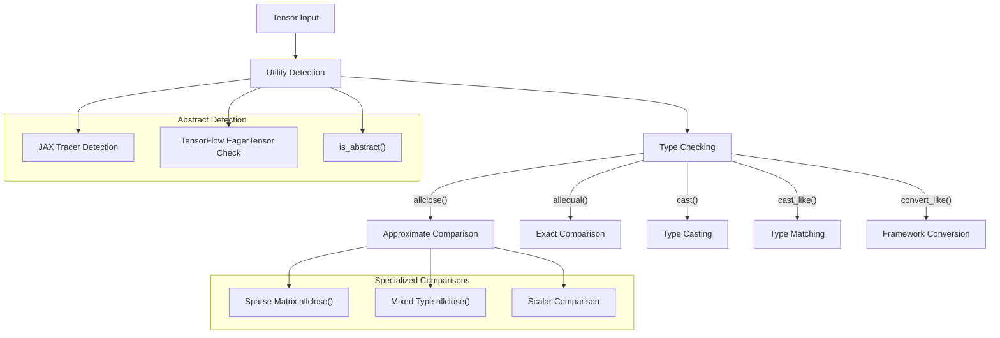
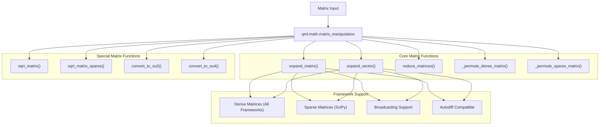

<!-- source: DeepWiki mcp.deepwiki.com · repo PennyLaneAI/pennylane · page 6 Mathematical Framework · fetched 2026-10-21 -->

# Mathematical Framework

<details>
<summary>Relevant source files</summary>

The following files were used as context for generating this wiki page:

- [pennylane/math/__init__.py](pennylane/math/__init__.py)
- [pennylane/math/multi_dispatch.py](pennylane/math/multi_dispatch.py)
- [pennylane/math/quantum.py](pennylane/math/quantum.py)
- [pennylane/math/single_dispatch.py](pennylane/math/single_dispatch.py)
- [pennylane/math/utils.py](pennylane/math/utils.py)
- [tests/gpu/test_gpu_torch.py](tests/gpu/test_gpu_torch.py)
- [tests/math/test_density_matrices.py](tests/math/test_density_matrices.py)
- [tests/math/test_entropies_math.py](tests/math/test_entropies_math.py)
- [tests/math/test_fidelity_math.py](tests/math/test_fidelity_math.py)
- [tests/math/test_functions.py](tests/math/test_functions.py)
- [tests/math/test_multi_dispatch.py](tests/math/test_multi_dispatch.py)
- [tests/measurements/test_mutual_info.py](tests/measurements/test_mutual_info.py)
- [tests/measurements/test_vn_entropy.py](tests/measurements/test_vn_entropy.py)

</details>


This document covers PennyLane's mathematical framework that enables framework-agnostic computation across different machine learning libraries. The framework provides unified tensor operations that work seamlessly with NumPy, PyTorch, TensorFlow, JAX, and Autograd while preserving differentiability and device placement. This mathematical foundation underpins all of PennyLane's quantum computing operations.

## Overview of Framework-Agnostic Mathematics

PennyLane's mathematical framework provides a unified interface for tensor operations that automatically dispatch to the appropriate backend based on the input tensor types. This system enables PennyLane to work with tensors from different frameworks while maintaining end-to-end differentiability.

The framework supports:

1. **Multi-framework compatibility**: Seamless operation with NumPy, PyTorch, TensorFlow, JAX, and Autograd
2. **Automatic dispatch**: Determines the appropriate backend based on tensor types
3. **Type preservation**: Maintains tensor types and device placement throughout operations
4. **Differentiability**: Preserves gradient information across framework boundaries
5. **Quantum-specific utilities**: Specialized functions for quantum state manipulation

**High-Level Architecture**



Sources:
- [pennylane/math/__init__.py:14-35]()
- [pennylane/math/multi_dispatch.py:14-28]()

## Multi-Dispatch System

The multi-dispatch system is the core of PennyLane's framework-agnostic mathematics. It automatically determines which backend implementation to use based on the input tensor types and ensures consistent behavior across different frameworks.

**Multi-Dispatch Architecture**



### Core Multi-Dispatch Functions

The multi-dispatch system provides several key functions for tensor manipulation:

| Function | Purpose | Key Features |
|----------|---------|--------------|
| `array(*args, like=None)` | Create arrays | Preserves device placement for PyTorch |
| `concatenate(values, axis=0)` | Concatenate tensors | Handles device migration |
| `stack(values, axis=0)` | Stack tensors | Framework-aware stacking |
| `block_diag(values)` | Block diagonal matrices | Sparse matrix support |
| `kron(tensor1, tensor2)` | Kronecker product | Device-aware for PyTorch |
| `dot(tensor1, tensor2)` | Dot product | Multi-dimensional support |
| `matmul(tensor1, tensor2)` | Matrix multiplication | Type coercion |

Sources:
- [pennylane/math/multi_dispatch.py:61-157]()
- [pennylane/math/multi_dispatch.py:32-44]()
- [pennylane/math/multi_dispatch.py:160-179]()

## Autoray Integration and Single Dispatch

PennyLane leverages Autoray for backend-agnostic array operations and extends it with quantum-specific functionality through single dispatch registrations. The system registers specialized implementations for each supported framework.

**Autoray Registration System**



### Key Framework Adaptations

Different frameworks require specialized handling for optimal performance and compatibility:

#### PyTorch Adaptations
- Device preservation for CUDA tensors
- Custom implementations for functions not directly available
- Handling of non-leaf tensor operations

#### TensorFlow Adaptations  
- Abstract tensor handling for `@tf.function` compatibility
- Custom implementations for missing operations
- Type casting and shape handling

#### JAX Adaptations
- JIT compatibility through concrete/abstract tensor detection
- Handling of tracer objects during transformations
- Support for JAX's functional programming model

#### SciPy Sparse Matrix Support
- Specialized sparse matrix operations
- Custom matrix power implementations
- Efficient handling of large sparse systems

Sources:
- [pennylane/math/single_dispatch.py:42-971]()
- [pennylane/math/single_dispatch.py:148-188]()
- [pennylane/math/single_dispatch.py:631-892]()

## Quantum Mathematical Utilities

The `qml.math.quantum` module provides specialized functions for quantum state manipulation and analysis. These functions work across all supported frameworks while preserving differentiability.

**Quantum State Manipulation Flow**



### Key Quantum Functions

| Function | Purpose | Framework Support |
|----------|---------|-------------------|
| `dm_from_state_vector(state)` | Convert state vector to density matrix | All frameworks |
| `reduce_statevector(state, indices)` | Compute reduced density matrix | All frameworks |
| `partial_trace(matrix, indices)` | Trace out subsystems | All frameworks |
| `vn_entropy(state, indices)` | Von Neumann entropy | All frameworks |
| `mutual_info(state, indices0, indices1)` | Mutual information | All frameworks |
| `purity(state, indices)` | Purity of quantum state | All frameworks |
| `fidelity(state0, state1)` | Quantum fidelity | All frameworks |

### Specialized Implementations

The quantum utilities include framework-specific optimizations:

- **Autograd/TensorFlow**: Uses non-repeating indices for `einsum` operations to support backpropagation
- **JAX**: JIT-compatible implementations with proper abstract shape handling  
- **PyTorch**: Maintains gradient flow through complex quantum operations
- **SciPy**: Efficient sparse matrix operations for large quantum systems

Sources:
- [pennylane/math/quantum.py:14-95]()
- [pennylane/math/quantum.py:176-336]()
- [pennylane/math/quantum.py:395-496]()

## Utility Functions and Type Handling

The mathematical framework includes utility functions for type management, comparison operations, and tensor manipulation that work consistently across all supported frameworks.

**Type Management System**



### Core Utility Functions

| Function | Purpose | Special Handling |
|----------|---------|------------------|
| `allclose(a, b, rtol, atol)` | Approximate equality | SciPy sparse matrices, mixed types |
| `allequal(tensor1, tensor2)` | Exact equality | Framework-agnostic comparison |
| `cast(tensor, dtype)` | Type casting | NumPy dtype translation |
| `cast_like(tensor1, tensor2)` | Match tensor2's type | Handles ArrayBox unwrapping |
| `convert_like(tensor1, tensor2)` | Convert to tensor2's framework | Device preservation |
| `is_abstract(tensor)` | Abstract tensor detection | JAX tracers, TF eager mode |

### Specialized Sparse Matrix Support

The framework includes sophisticated handling for SciPy sparse matrices:

```python
# Sparse-dense comparison with proper tolerance handling
def _allclose_mixed(a, b, rtol, atol, b_is_sparse=True):
    # Efficient comparison avoiding dense conversion for large matrices
    # Maintains asymmetric tolerance reference
```

### Framework Detection

The interface detection system identifies tensor frameworks through a priority-based approach:

```python
def get_interface(*tensors):
    # Priority: torch > tensorflow > jax > autograd > numpy
    # Handles mixed framework scenarios with warnings
```

Sources:
- [pennylane/math/utils.py:28-223]()
- [pennylane/math/utils.py:327-447]()
- [pennylane/math/interface_utils.py:108-115]()

## Matrix Manipulation and Linear Algebra

The framework includes specialized matrix manipulation functions that handle broadcasting, permutations, and expansions while maintaining framework compatibility.

**Matrix Operations Architecture**



### Matrix Expansion and Permutation

Key functions for quantum circuit matrix operations:

| Function | Purpose | Framework Support |
|----------|---------|-------------------|
| `expand_matrix(mat, wires, wire_order)` | Expand matrix to larger Hilbert space | Dense + Sparse |
| `expand_vector(vec, original_wires, wire_order)` | Expand state vector | All frameworks |
| `reduce_matrices(mats, reduce_func, openfermion_format)` | Reduce matrix collections | All frameworks |
| `_permute_dense_matrix(mat, wires, wire_order)` | Permute matrix dimensions | All frameworks |
| `_permute_sparse_matrix(mat, wires, wire_order)` | Permute sparse matrix | SciPy sparse |

### Special Matrix Operations

Advanced matrix functions for quantum computations:

- **Matrix Square Root**: `sqrt_matrix()` and `sqrt_matrix_sparse()` with Denman-Beavers iteration
- **SU(N) Conversion**: `convert_to_su2()` and `convert_to_su4()` for special unitary groups
- **Batch Processing**: Broadcasting support for batched matrix operations

Sources:
- [pennylane/math/matrix_manipulation.py:28-183]()
- [pennylane/math/matrix_manipulation.py:216-354]()
- [pennylane/math/quantum.py:1346-1523]()

## Advanced Mathematical Features

The mathematical framework provides advanced features for specialized quantum computations and optimized performance across different scenarios.

### Gradient and Jacobian Support

The framework provides differentiation utilities that work with the multi-dispatch system:

```python
# Framework-agnostic gradient computation
grad_fn = qml.math.grad(objective_function)
jacobian_fn = qml.math.jacobian(objective_function)
```

### Specialized Quantum Measures

Advanced quantum information measures with framework-agnostic implementations:

| Measure | Function | Applications |
|---------|----------|--------------|
| Von Neumann Entropy | `vn_entropy(state, indices)` | Entanglement quantification |
| Mutual Information | `mutual_info(state, indices0, indices1)` | Quantum correlations |
| Relative Entropy | `relative_entropy(state0, state1)` | State distinguishability |
| Trace Distance | `trace_distance(state0, state1)` | State similarity |
| Quantum Fidelity | `fidelity(state0, state1)` | State overlap |

### Performance Optimizations

The framework includes several performance optimizations:

- **Lazy Evaluation**: Deferred computation for complex tensor operations
- **Device Awareness**: CUDA tensor support with automatic device management
- **Memory Efficiency**: Sparse matrix operations for large quantum systems
- **JIT Compatibility**: JAX and TensorFlow compilation support

Sources:
- [pennylane/math/grad.py:14-48]()
- [pennylane/math/quantum.py:976-1345]()
- [pennylane/math/fidelity.py:14-279]()

## Architectural Components

The mathematical framework consists of several interconnected components that work together to provide framework-agnostic tensor operations.

**Core Architecture**

```mermaid
classDiagram
    class MathModule {
        +sum, conj, transpose, sqrt
        +zeros, moveaxis, mean, round
        +shape, flatten, reshape
        +get_dtype_name(x)
        +is_real_obj_or_close(obj)
    }
    
    class MultiDispatch {
        +multi_dispatch(argnum, tensor_list)
        +array(*args, like)
        +concatenate(values, axis)
        +stack(values, axis)
        +dot(tensor1, tensor2)
        +kron(tensor1, tensor2)
    }
    
    class SingleDispatch {
        +register_function(backend, name, func)
        +_builtins_ndim(x)
        +_coerce_types_torch(tensors)
        +_scatter_element_add_numpy(tensor, index, value)
    }
    
    class QuantumMath {
        +dm_from_state_vector(state)
        +reduce_statevector(state, indices)
        +partial_trace(matrix, indices)
        +vn_entropy(state, indices)
        +mutual_info(state, indices0, indices1)
        +fidelity(state0, state1)
    }
    
    class Utils {
        +allclose(a, b, rtol, atol)
        +allequal(tensor1, tensor2)
        +cast(tensor, dtype)
        +cast_like(tensor1, tensor2)
        +convert_like(tensor1, tensor2)
        +is_abstract(tensor)
    }
    
    class MatrixManipulation {
        +expand_matrix(mat, wires, wire_order)
        +expand_vector(vec, original_wires, wire_order)
        +reduce_matrices(mats, reduce_func)
        +sqrt_matrix(A, check_state)
        +convert_to_su2(A)
    }
    
    MathModule --> MultiDispatch: uses
    MultiDispatch --> SingleDispatch: uses
    MathModule --> QuantumMath: includes
    MathModule --> Utils: includes
    MathModule --> MatrixManipulation: includes
    
    SingleDispatch --> "Autoray": registers
    QuantumMath --> Utils: uses
    MatrixManipulation --> Utils: uses
```

### Component Interactions

The mathematical framework components interact through well-defined interfaces:

1. **MathModule**: Central interface that users interact with, providing unified access to all mathematical operations
2. **MultiDispatch**: Handles framework detection and dispatching for tensor operations  
3. **SingleDispatch**: Manages framework-specific implementations via Autoray registrations
4. **QuantumMath**: Specialized quantum state and information processing functions
5. **Utils**: Core utility functions for type handling and comparisons
6. **MatrixManipulation**: Linear algebra operations with broadcasting and sparse matrix support

Sources:
- [pennylane/math/__init__.py:178-272]()
- [pennylane/math/multi_dispatch.py:61-238]()
- [pennylane/math/single_dispatch.py:30-971]()
- [pennylane/math/quantum.py:14-95]()
- [pennylane/math/utils.py:14-295]()
- [pennylane/math/matrix_manipulation.py:28-183]()

## Conclusion

PennyLane's differentiation and optimization system provides a comprehensive framework for training quantum machine learning models. The system supports multiple gradient calculation methods, interfaces with classical ML frameworks, and offers advanced features for quantum-specific optimization. By leveraging these capabilities, users can efficiently train variational quantum algorithms for a wide range of applications.

The system's design priorities include:

1. **Hardware compatibility**: Methods like parameter-shift and SPSA work on real quantum hardware
2. **Framework integration**: Seamless integration with TensorFlow, PyTorch, JAX, and other frameworks
3. **Flexibility**: Multiple gradient methods suited for different types of circuits and measurements
4. **Performance**: Optimized implementations for efficient training of quantum models

This modular architecture allows PennyLane to adapt to different quantum computing platforms and classical ML frameworks while maintaining a consistent API for users.

---

