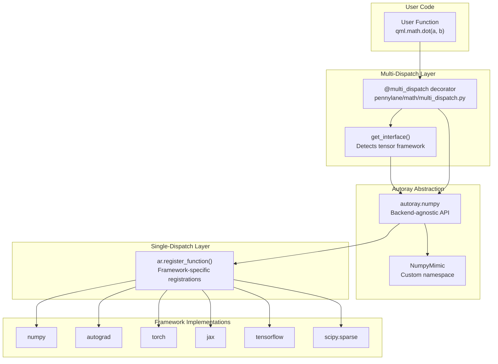
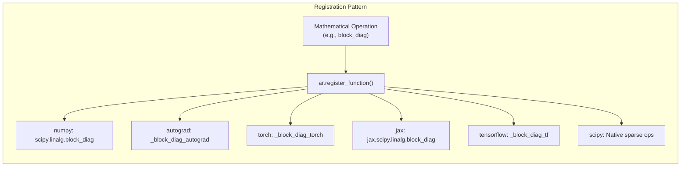
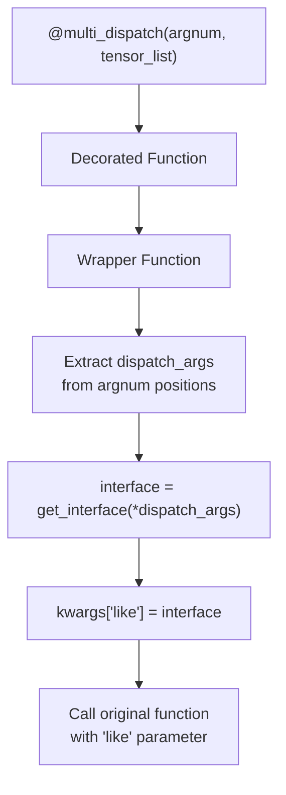
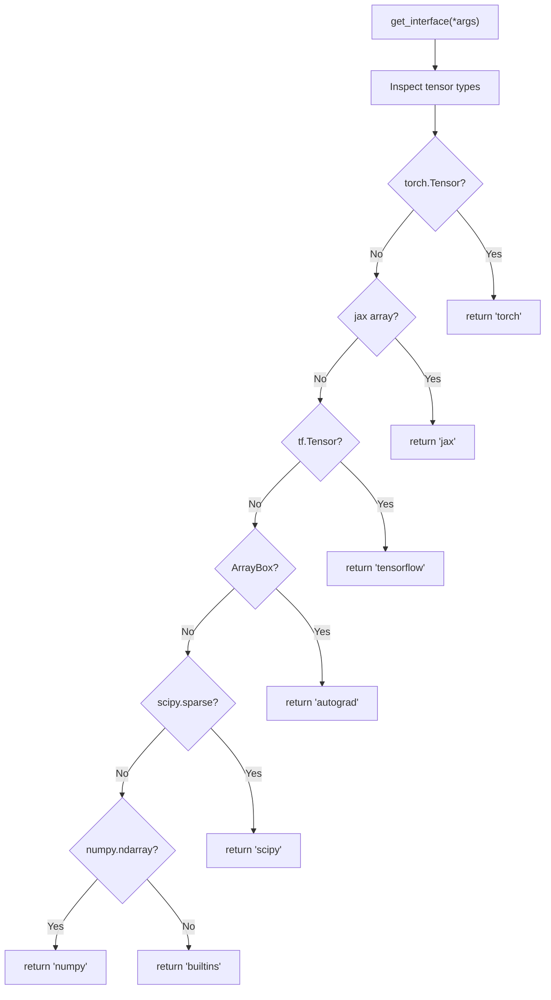
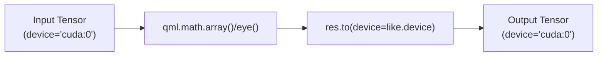
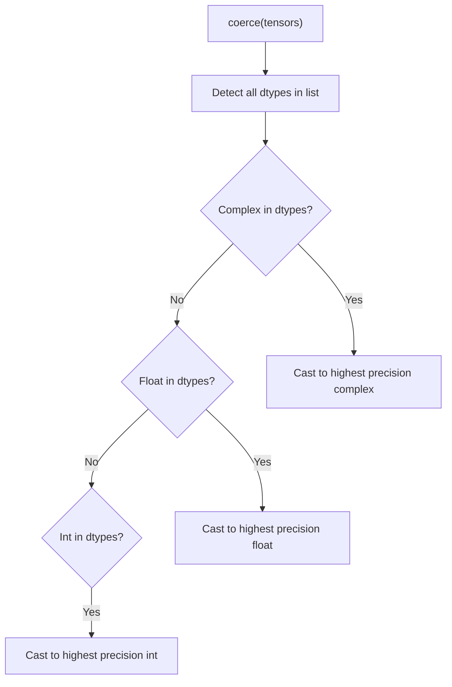

<!-- source: DeepWiki mcp.deepwiki.com · repo PennyLaneAI/pennylane · page 6.1 Multi-Dispatch Math System · fetched 2026-10-21 -->

# Multi-Dispatch Math System

<details>
<summary>Relevant source files</summary>

The following files were used as context for generating this wiki page:

- [pennylane/math/__init__.py](pennylane/math/__init__.py)
- [pennylane/math/multi_dispatch.py](pennylane/math/multi_dispatch.py)
- [pennylane/math/quantum.py](pennylane/math/quantum.py)
- [pennylane/math/single_dispatch.py](pennylane/math/single_dispatch.py)
- [pennylane/math/utils.py](pennylane/math/utils.py)
- [tests/gpu/test_gpu_torch.py](tests/gpu/test_gpu_torch.py)
- [tests/math/test_density_matrices.py](tests/math/test_density_matrices.py)
- [tests/math/test_entropies_math.py](tests/math/test_entropies_math.py)
- [tests/math/test_fidelity_math.py](tests/math/test_fidelity_math.py)
- [tests/math/test_functions.py](tests/math/test_functions.py)
- [tests/math/test_multi_dispatch.py](tests/math/test_multi_dispatch.py)
- [tests/measurements/test_mutual_info.py](tests/measurements/test_mutual_info.py)
- [tests/measurements/test_vn_entropy.py](tests/measurements/test_vn_entropy.py)

</details>


## Purpose and Scope

The multi-dispatch math system provides a unified, framework-agnostic interface for mathematical operations across NumPy, Autograd, JAX, PyTorch, TensorFlow, and SciPy. This system enables PennyLane to work seamlessly with different automatic differentiation frameworks without requiring users to change their code when switching between frameworks.

For quantum-specific mathematical operations built on top of this system, see [Quantum Information Functions](#6.2). For the operator system that utilizes these math functions, see [Operators and Operation System](#2.1).

**Sources:** [pennylane/math/__init__.py:14-34]()

## Architecture Overview



**Diagram: Multi-Dispatch Architecture**

The system operates in three layers: (1) Multi-dispatch decorator automatically detects input tensor types, (2) Autoray provides the backend abstraction, and (3) Single-dispatch registrations map to framework-specific implementations.

**Sources:** [pennylane/math/multi_dispatch.py:1-158](), [pennylane/math/single_dispatch.py:1-42](), [pennylane/math/__init__.py:35-36]()

## Core Components

### Autoray Integration

PennyLane uses the `autoray` library as the foundation for framework dispatch. Autoray provides a NumPy-like interface that automatically dispatches to the appropriate backend based on tensor type.

| Component | Location | Purpose |
|-----------|----------|---------|
| `autoray.numpy` | Imported as `np` | Primary dispatch interface |
| `NumpyMimic` | [pennylane/math/__init__.py:188-201]() | Custom namespace with FFT support |
| `numpy_fft` | [pennylane/math/__init__.py:201]() | FFT submodule namespace |

Key autoray configuration:

```python
# Backend aliases
ar.autoray._BACKEND_ALIASES["pennylane"] = "autograd"
ar.autoray._MODULE_ALIASES["autograd"] = "pennylane.numpy"
```

**Sources:** [pennylane/math/__init__.py:35-36](), [pennylane/math/__init__.py:188-201](), [pennylane/math/single_dispatch.py:200-204]()

### Single Dispatch System

The single-dispatch system registers framework-specific implementations for operations that either don't exist in a framework or require custom behavior.



**Diagram: Single-Dispatch Registration Pattern**

Common registration categories:

| Category | Examples | Purpose |
|----------|----------|---------|
| Missing operations | `block_diag`, `scatter`, `scatter_element_add` | Operations not native to all frameworks |
| Type conversions | `to_numpy`, `asarray`, `coerce` | Framework-specific conversion logic |
| Shape/dimension | `ndim`, `shape`, `flatten` | Consistent shape handling |
| Linear algebra | `eigvalsh`, `expm`, `matrix_power` | Framework-specific linalg implementations |
| Sparse matrix ops | `linalg.inv`, `linalg.expm`, `linalg.eigs` | SciPy sparse specializations |

**Sources:** [pennylane/math/single_dispatch.py:42-975]()

#### Framework-Specific Registrations

**NumPy/Builtins:**
- Basic operations are identity functions since NumPy is the base
- `block_diag` dispatches to `scipy.linalg.block_diag`
- `scatter` and `scatter_element_add` use custom NumPy implementations

**Sources:** [pennylane/math/single_dispatch.py:148-193]()

**Autograd:**
- `block_diag`: Custom implementation using `qml.numpy` operations
- `to_numpy`: Unwraps `ArrayBox` objects recursively
- `scatter_element_add`: Uses `ravel_multi_index` since indexing assignment isn't supported
- `take`: Custom implementation handling autograd constraints
- `diagonal`: Uses `qml.numpy.diag`

**Sources:** [pennylane/math/single_dispatch.py:194-311]()

**TensorFlow:**
- Submodule aliases for `arcsin`, `arccos`, `arctan`, `kron`, `moveaxis`, etc.
- `diag`: Handles both 1D and 2D cases using `tf.linalg.diag_part`/`tf.linalg.diag`
- `fft.ifft2`: Custom implementation with validation for axes and norm parameters
- `block_diag`: Uses `LinearOperatorBlockDiag`
- `coerce`: Type coercion with complex/float/int priority handling

**Sources:** [pennylane/math/single_dispatch.py:313-634]()

**PyTorch:**
- `to_numpy`: Handles conjugate tensors and detaches from autograd graph
- `asarray`: Maps NumPy dtypes to PyTorch dtypes
- `take`: Custom implementation with negative index handling
- `coerce`: Handles multi-GPU scenarios with device migration
- `block_diag`: Efficient implementation using cumulative indexing
- `scatter_element_add`: Clones leaf tensors to enable in-place operations

**Sources:** [pennylane/math/single_dispatch.py:635-896]()

**JAX:**
- `to_numpy`: Uses `jax.core.concrete_or_error` with proper error handling for JIT
- `scatter`: Uses `.at[indices].set()` syntax
- `scatter_element_add`: Uses `.at[tuple(index)].add()` syntax
- `block_diag`: Dispatches to `jax.scipy.linalg.block_diag`
- `cond`: Uses `jax.lax.cond` for conditional operations

**Sources:** [pennylane/math/single_dispatch.py:898-975]()

**SciPy Sparse:**
- Prevents automatic densification of sparse matrices
- Custom `matrix_power` implementation (with fallback to brute-force for older SciPy)
- Sparse-specific linear algebra: `inv`, `expm`, `eigs`, `eigsh`, `svds`
- Shape operations: `trace`, `reshape`, `real`, `imag`

**Sources:** [pennylane/math/single_dispatch.py:62-147]()

### Multi-Dispatch Decorator

The `@multi_dispatch` decorator automates interface detection and function dispatch.



**Diagram: Multi-Dispatch Decorator Flow**

**Decorator Parameters:**

| Parameter | Type | Description |
|-----------|------|-------------|
| `argnum` | `list[int]` or `None` | Indices of arguments to inspect for dispatch (None = all arguments) |
| `tensor_list` | `list[int]` or `None` | Indices within `argnum` that are lists of tensors |

**Usage Pattern:**

```python
@multi_dispatch(argnum=[0, 1])
def dot(tensor1, tensor2, like=None):
    # 'like' is automatically populated by decorator
    x, y = np.coerce([tensor1, tensor2], like=like)
    return np.dot(x, y, like=like)
```

**Sources:** [pennylane/math/multi_dispatch.py:61-158]()

### Interface Detection



**Diagram: Interface Detection Logic**

Related functions:

| Function | Purpose | Location |
|----------|---------|----------|
| `get_interface()` | Detect framework from tensor types | [pennylane/math/interface_utils.py]() |
| `get_deep_interface()` | Detect framework from nested structures | [pennylane/math/interface_utils.py]() |
| `is_abstract()` | Check if tensor is abstract (JIT/traced) | [pennylane/math/utils.py:335-419]() |

**Sources:** [pennylane/math/multi_dispatch.py:27](), [pennylane/math/__init__.py:116-121]()

## Common Math Operations

The following table shows commonly used dispatched operations:

| Operation | Function | Description | Source |
|-----------|----------|-------------|--------|
| **Array Creation** | `array()` | Create array preserving device (Torch) | [pennylane/math/multi_dispatch.py:32-44]() |
| | `eye()` | Create identity matrix preserving device | [pennylane/math/multi_dispatch.py:47-58]() |
| **Linear Algebra** | `dot()` | Dot/matrix product with framework-specific behavior | [pennylane/math/multi_dispatch.py:344-407]() |
| | `matmul()` | Matrix multiplication with type coercion | [pennylane/math/multi_dispatch.py:332-342]() |
| | `tensordot()` | Tensor contraction | [pennylane/math/multi_dispatch.py:409-438]() |
| | `kron()` | Kronecker product with device handling | [pennylane/math/multi_dispatch.py:160-180]() |
| | `block_diag()` | Block diagonal matrix construction | [pennylane/math/multi_dispatch.py:182-209]() |
| | `svd()` | Singular value decomposition | [pennylane/math/multi_dispatch.py:74]() |
| | `norm()` | Vector/matrix norm | [pennylane/math/multi_dispatch.py:73]() |
| | `expm()` | Matrix exponential | [pennylane/math/multi_dispatch.py:64]() |
| **Array Manipulation** | `concatenate()` | Concatenate along axis | [pennylane/math/multi_dispatch.py:211-289]() |
| | `stack()` | Stack arrays along new axis | [pennylane/math/multi_dispatch.py:506-538]() |
| | `diag()` | Construct/extract diagonal | [pennylane/math/multi_dispatch.py:291-330]() |
| | `scatter()` | Scatter values to new array | [pennylane/math/multi_dispatch.py:714-739]() |
| | `scatter_element_add()` | In-place addition at indices | [pennylane/math/multi_dispatch.py:742-793]() |
| **Einstein Summation** | `einsum()` | Einstein summation convention | [pennylane/math/multi_dispatch.py:540-600]() |
| **Conditionals** | `where()` | Conditional element selection | [pennylane/math/multi_dispatch.py:602-675]() |
| **Utilities** | `ones_like()` | Array of ones with same shape/dtype | [pennylane/math/multi_dispatch.py:473-504]() |
| | `frobenius_inner_product()` | Frobenius inner product | [pennylane/math/multi_dispatch.py:677-712]() |
| | `get_trainable_indices()` | Find trainable parameter indices | [pennylane/math/multi_dispatch.py:440-471]() |

**Sources:** [pennylane/math/multi_dispatch.py](), [pennylane/math/__init__.py:55-83]()

### Simple Array Operations via Autoray

Many operations directly use autoray without additional dispatch:

```python
# From pennylane/math/__init__.py
sum = ar.numpy.sum
conj = ar.numpy.conj
transpose = ar.numpy.transpose
sqrt = ar.numpy.sqrt
zeros = ar.numpy.zeros
moveaxis = ar.numpy.moveaxis
mean = ar.numpy.mean
round = ar.numpy.round
shape = ar.numpy.shape
flatten = ar.numpy.flatten
reshape = ar.numpy.reshape
multiply = ar.numpy.multiply
toarray = ar.numpy.to_numpy
T = ar.numpy.transpose
```

**Sources:** [pennylane/math/__init__.py:125-138]()

## Special Cases and Framework-Specific Handling

### Device Management (PyTorch)

PyTorch operations preserve CUDA device placement:



**Diagram: PyTorch Device Preservation**

**Multi-GPU Handling:**

The `coerce` and `concatenate` functions handle multi-GPU scenarios:
- Detect all unique devices from input tensors
- If multiple GPUs detected, fail with error
- If CPU + GPU mix, migrate to GPU
- Ensure all tensors on same device before operations

**Sources:** [pennylane/math/multi_dispatch.py:42-44](), [pennylane/math/multi_dispatch.py:242-279](), [pennylane/math/single_dispatch.py:739-793]()

### Sparse Matrix Optimization (SciPy)

Special handling prevents unwanted densification of sparse matrices:

| Operation | Implementation | Benefit |
|-----------|----------------|---------|
| `to_numpy` | Identity function | Preserves sparse format |
| `coerce` | Identity function | No conversion overhead |
| `dot` | Native `.dot()` method | Sparse-optimized multiplication |
| `linalg.*` | Sparse-specific routines | Avoids densification |
| Matrix power | `scipy.sparse.linalg.matrix_power` or brute-force | Efficient sparse exponentiation |

**Sources:** [pennylane/math/single_dispatch.py:62-147]()

### Abstract Tensor Detection (JAX/TensorFlow)

The `is_abstract()` function detects when tensors are traced/JIT-compiled:

```python
# JAX
if isinstance(tensor, jax.core.Tracer):
    return not jax.core.is_concrete(tensor)

# TensorFlow  
return not isinstance(tf.convert_to_tensor(tensor), EagerTensor)
```

This enables conditional behavior during JIT compilation vs. eager execution.

**Sources:** [pennylane/math/utils.py:335-442]()

### Type Coercion Strategies

Different frameworks have different type coercion priorities:



**Diagram: Type Coercion Priority**

Priority order: `complex > float > int` with highest precision within each category.

**Sources:** [pennylane/math/single_dispatch.py:489-513](), [pennylane/math/single_dispatch.py:739-793]()

## Utility Functions

### Type Conversion

| Function | Purpose | Special Behavior |
|----------|---------|------------------|
| `cast(tensor, dtype)` | Cast to specific dtype | Accepts NumPy dtype specs, converts to framework equivalent |
| `cast_like(t1, t2)` | Cast t1 to dtype of t2 | Handles `ArrayBox`, abstract tensors |
| `convert_like(t1, t2)` | Convert t1 to type of t2 | Preserves Torch device, handles SciPy sparse |
| `unwrap(values)` | Convert to NumPy | Recursively unwraps, handles GPU tensors |

**Sources:** [pennylane/math/utils.py:228-333](), [pennylane/math/multi_dispatch.py:795-870]()

### Comparison Functions

| Function | Purpose | Special Handling |
|----------|---------|------------------|
| `allequal(t1, t2)` | Element-wise equality | Converts to NumPy for comparison |
| `allclose(a, b, rtol, atol)` | Approximate equality | Special sparse matrix logic, mixed dense/sparse comparison |

**Sparse Matrix Comparison:**
- `_allclose_sparse()`: Compare two sparse matrices without densification
- `_allclose_mixed()`: Compare dense and sparse with correct tolerance reference
- `_allclose_sparse_scalar()`: Compare sparse matrix to scalar value

**Sources:** [pennylane/math/utils.py:28-223]()

### Gradient Utilities

| Function | Purpose |
|----------|---------|
| `requires_grad(tensor, interface)` | Check if tensor tracks gradients |
| `get_trainable_indices(values)` | Find indices of trainable parameters in sequence |
| `detach(tensor)` | Detach from autograd graph |
| `in_backprop(tensor)` | Check if in backpropagation context |

**Sources:** [pennylane/math/multi_dispatch.py:440-471](), [pennylane/math/utils.py:445-537]()

## Usage Patterns

### Basic Usage

```python
import pennylane as qml
from pennylane import math

# Automatic interface detection
x = torch.tensor([1.0, 2.0])
y = torch.tensor([3.0, 4.0])
result = math.dot(x, y)  # Returns torch.Tensor

# Works with any framework
x_jax = jax.numpy.array([1.0, 2.0])
y_jax = jax.numpy.array([3.0, 4.0])
result_jax = math.dot(x_jax, y_jax)  # Returns JAX array
```

### Custom Multi-Dispatch Functions

```python
@math.multi_dispatch(argnum=[0], tensor_list=[0])
def custom_operation(tensors, like, coefficient=1.0):
    # 'like' parameter automatically populated
    # tensors[0] is treated as a list of tensors
    return coefficient * np.sum([math.dot(t, t) for t in tensors])

values = [np.array([1, 2, 3]) for _ in range(5)]
result = custom_operation(values)  # Works with any framework
```

**Sources:** [pennylane/math/multi_dispatch.py:99-125]()

### Handling Mixed Interfaces

```python
# Mixed NumPy and Torch
x = np.array([1, 2, 3])
y = torch.tensor([4, 5, 6])

# Concatenate automatically converts to common interface (torch)
result = math.concatenate([x, y])  # Returns torch.Tensor
```

**Sources:** [pennylane/math/multi_dispatch.py:211-289]()

### Framework Detection

```python
# Detect interface
interface = math.get_interface(tensor1, tensor2, tensor3)

# Check if abstract (during JIT)
if math.is_abstract(x):
    # Use static behavior during JIT
    pass
else:
    # Use dynamic behavior during eager execution
    pass
```

**Sources:** [pennylane/math/__init__.py:116-121](), [pennylane/math/utils.py:335-419]()

---

**Primary Sources:** [pennylane/math/single_dispatch.py](), [pennylane/math/multi_dispatch.py](), [pennylane/math/__init__.py](), [pennylane/math/utils.py](), [pennylane/math/interface_utils.py]()

---

