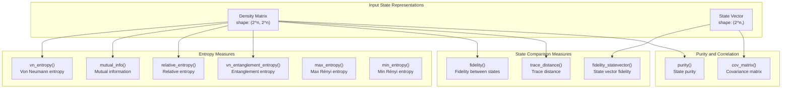
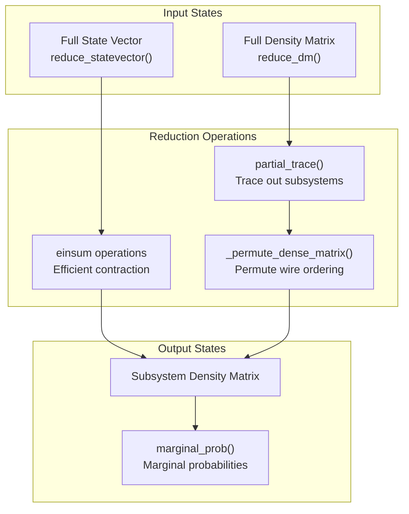
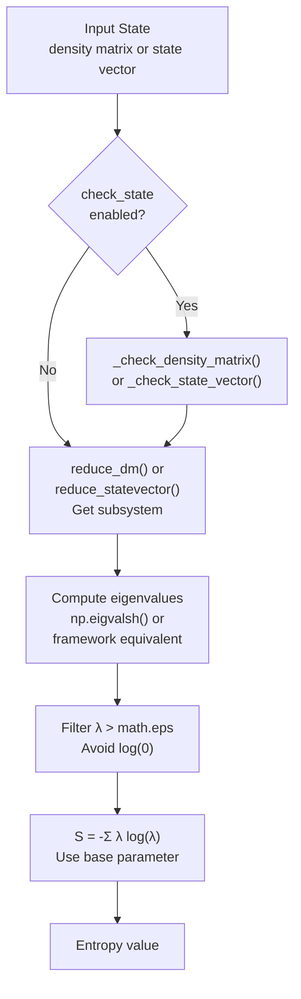
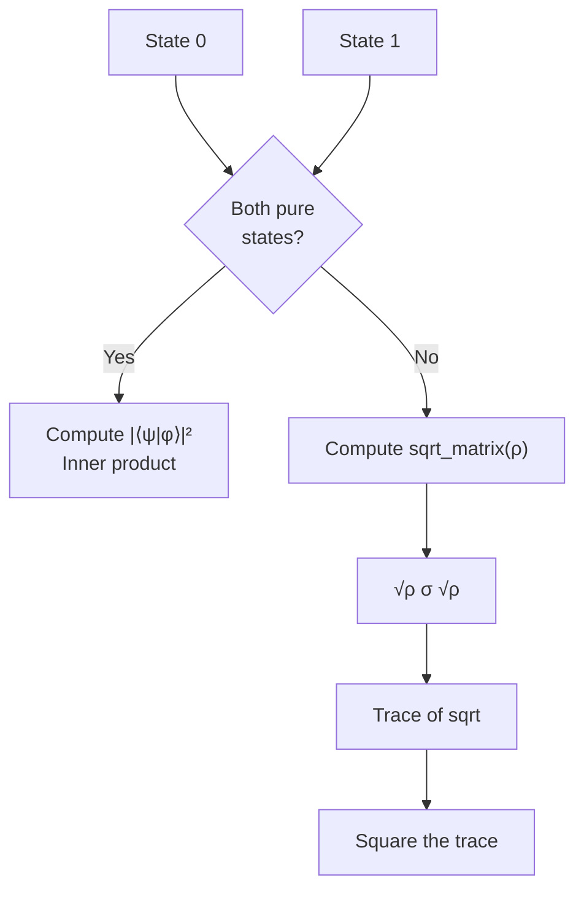
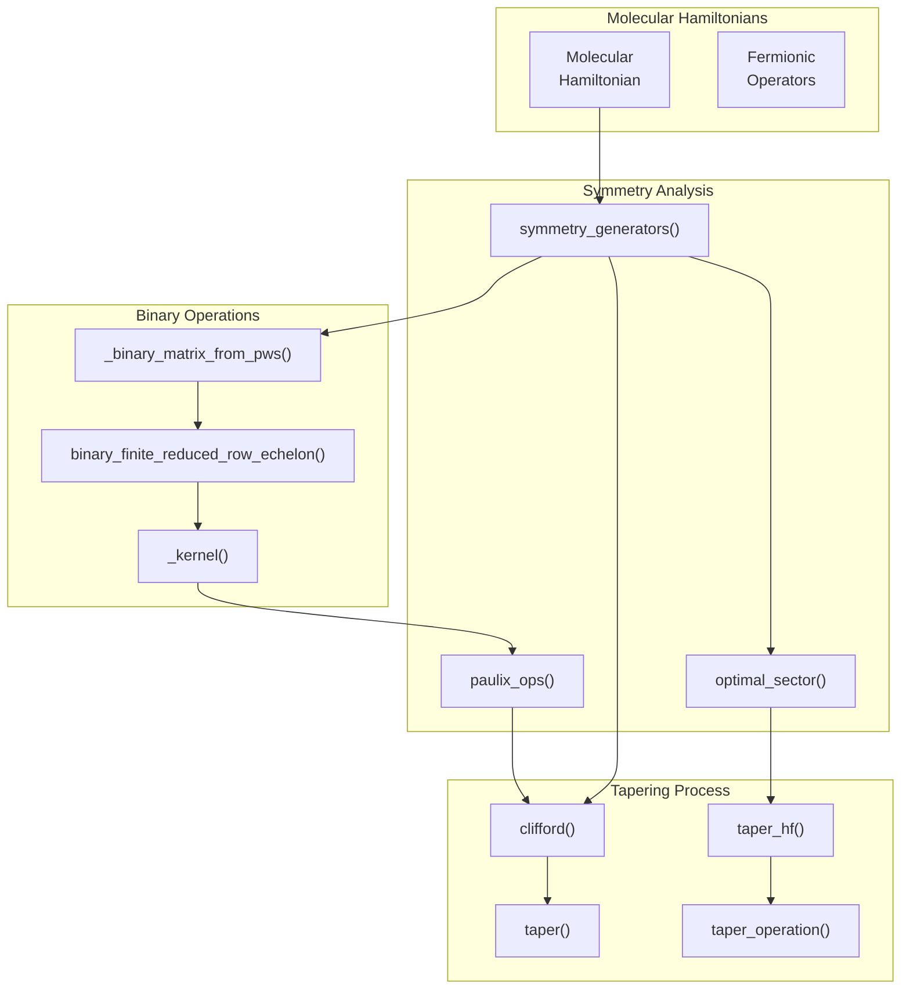

<!-- source: DeepWiki mcp.deepwiki.com · repo PennyLaneAI/pennylane · page 6.2 Quantum Information Functions · fetched 2026-10-21 -->

# Quantum Information Functions

<details>
<summary>Relevant source files</summary>

The following files were used as context for generating this wiki page:

- [pennylane/math/__init__.py](pennylane/math/__init__.py)
- [pennylane/math/multi_dispatch.py](pennylane/math/multi_dispatch.py)
- [pennylane/math/quantum.py](pennylane/math/quantum.py)
- [pennylane/math/single_dispatch.py](pennylane/math/single_dispatch.py)
- [pennylane/math/utils.py](pennylane/math/utils.py)
- [tests/gpu/test_gpu_torch.py](tests/gpu/test_gpu_torch.py)
- [tests/math/test_density_matrices.py](tests/math/test_density_matrices.py)
- [tests/math/test_entropies_math.py](tests/math/test_entropies_math.py)
- [tests/math/test_fidelity_math.py](tests/math/test_fidelity_math.py)
- [tests/math/test_functions.py](tests/math/test_functions.py)
- [tests/math/test_multi_dispatch.py](tests/math/test_multi_dispatch.py)
- [tests/measurements/test_mutual_info.py](tests/measurements/test_mutual_info.py)
- [tests/measurements/test_vn_entropy.py](tests/measurements/test_vn_entropy.py)

</details>


This document covers PennyLane's framework-agnostic quantum information functions for computing entropies, fidelities, and other quantum information measures. These functions operate on density matrices and state vectors, supporting all major machine learning frameworks (NumPy, JAX, PyTorch, TensorFlow, Autograd) through the multi-dispatch system.

For information about the multi-dispatch system that enables framework-agnostic computation, see [Multi-Dispatch Math System](#6.1). For quantum measurements that compute these quantities within QNodes, see [Measurement Processes](#2.4).

## Overview of Quantum Information Measures

PennyLane provides a comprehensive suite of quantum information functions that compute fundamental measures from quantum states. These functions are designed to work seamlessly across different machine learning frameworks:

**Quantum Information Measures Overview:**



All functions support batched computation and automatic differentiation through their respective frameworks.

Sources: [pennylane/math/quantum.py:1-1000](), [pennylane/math/__init__.py:84-103]()

## State Representation and Manipulation

Before computing quantum information measures, quantum states must be properly represented and potentially reduced to subsystems of interest.

### State Reduction Functions

**State Reduction Pipeline:**



**Core Functions:**

| Function | Purpose | Input Shape | Output Shape |
|----------|---------|-------------|--------------|
| `reduce_statevector(state, indices)` | Compute density matrix of subsystem from state vector | `(2^N,)` or `(batch, 2^N)` | `(2^k, 2^k)` or `(batch, 2^k, 2^k)` |
| `reduce_dm(density_matrix, indices)` | Extract subsystem density matrix | `(2^N, 2^N)` or `(batch, 2^N, 2^N)` | `(2^k, 2^k)` or `(batch, 2^k, 2^k)` |
| `partial_trace(matrix, indices)` | Trace out specified indices | `(2^N, 2^N)` or `(batch, 2^N, 2^N)` | `(2^(N-k), 2^(N-k))` |
| `dm_from_state_vector(state)` | Convert state vector to density matrix | `(2^N,)` | `(2^N, 2^N)` |
| `marginal_prob(prob, axis)` | Compute marginal probability distribution | `(2^N,)` | `(2^k,)` |

**Implementation Details:**

For Autograd and TensorFlow, `partial_trace` uses projector-based methods to avoid same-index summation issues in backpropagation:
- Constructs Kraus operators (identity projectors)
- Applies einsum with distinct indices
- Handles batched computation efficiently

For JAX and PyTorch, direct einsum with repeated indices is used for better performance.

Sources: [pennylane/math/quantum.py:176-249](), [pennylane/math/quantum.py:252-336](), [pennylane/math/quantum.py:395-495](), [pennylane/math/quantum.py:498-559]()

## Entropy Measures

Entropy functions quantify the uncertainty or mixedness of quantum states and correlations between subsystems.

### Von Neumann Entropy

**Function Signature:**
```python
vn_entropy(state, indices, base=None, c_dtype="complex128", check_state=False)
```

The von Neumann entropy is computed as S(ρ) = -Tr(ρ log ρ) = -Σᵢ λᵢ log(λᵢ), where λᵢ are the eigenvalues of the density matrix.

**Implementation Strategy:**



**Key Features:**
- Supports custom logarithm bases via `base` parameter (default: natural log)
- Uses `eigvalsh` for Hermitian matrices (more efficient than general eigenvalue solver)
- Filters near-zero eigenvalues to avoid numerical issues: `eigenvalues = eigenvalues[eigenvalues > math.eps]`
- Returns 0 for pure states (single eigenvalue = 1)

**Framework Dispatch:**
- NumPy: `np.linalg.eigvalsh`
- PyTorch: `torch.linalg.eigvalsh`
- JAX: `jax.numpy.linalg.eigvalsh`
- TensorFlow: `tf.linalg.eigvalsh` with real value extraction
- Autograd: `autograd.numpy.linalg.eigh` (returns eigenvalues and eigenvectors)

Sources: [pennylane/math/quantum.py:562-650](), [pennylane/math/single_dispatch.py:176-177](), [pennylane/math/single_dispatch.py:300-305]()

### Mutual Information

**Function Signature:**
```python
mutual_info(state, indices0, indices1, base=None, c_dtype="complex128", check_state=False)
```

Mutual information I(A:B) = S(ρ_A) + S(ρ_B) - S(ρ_AB) measures correlations between subsystems A and B.

**Implementation:**
1. Validate that subsystems don't overlap
2. Compute S(ρ_A) for subsystem A
3. Compute S(ρ_B) for subsystem B  
4. Compute S(ρ_AB) for combined system
5. Return I(A:B) = S(ρ_A) + S(ρ_B) - S(ρ_AB)

**Validation:**
```python
if len(set(indices0).intersection(indices1)) > 0:
    raise ValueError("Subsystems for computing mutual information must not overlap.")
```

Sources: [pennylane/math/quantum.py:653-744]()

### Relative Entropy and Other Measures

**Relative Entropy (Kullback-Leibler Divergence):**
```python
relative_entropy(state0, state1, base=None, c_dtype="complex128", check_state=False)
```

Computes S(ρ₀||ρ₁) = Tr(ρ₀ log ρ₀) - Tr(ρ₀ log ρ₁). Returns `inf` when support of ρ₀ is not contained in support of ρ₁.

**Entanglement Entropy:**
```python
vn_entanglement_entropy(state, indices0, indices1, base=None, c_dtype="complex128", check_state=False)
```

Measures entanglement as S(ρ_A) where ρ_A is the reduced density matrix. Equivalent to `vn_entropy` but emphasizes entanglement interpretation.

**Min and Max Entropy (Rényi Entropies):**
```python
max_entropy(state, indices, base=None, c_dtype="complex128", check_state=False)  # α→∞ limit
min_entropy(state, indices, base=None, c_dtype="complex128", check_state=False)  # α→0.5 limit
```

Sources: [pennylane/math/quantum.py:1002-1100](), [pennylane/math/quantum.py:829-907](), [pennylane/math/quantum.py:747-826]()

## Purity and Fidelity Measures

These functions quantify the "purity" of quantum states and similarity between states.

### Purity

**Function Signature:**
```python
purity(state, indices, c_dtype="complex128", check_state=False)
```

Purity γ = Tr(ρ²) measures how "mixed" a state is:
- γ = 1: Pure state
- γ = 1/d: Maximally mixed state (d = dimension)

**Implementation:**
```python
rho = reduce_dm(state, indices=indices, c_dtype=c_dtype, check_state=check_state)
purity_value = np.real(np.trace(np.matmul(rho, rho)))
```

Sources: [pennylane/math/quantum.py:910-988]()

### Fidelity

**State Vector Fidelity:**
```python
fidelity_statevector(state0, state1, check_state=False, c_dtype="complex128")
```

For pure states: F(|ψ⟩, |φ⟩) = |⟨ψ|φ⟩|²

**Density Matrix Fidelity:**
```python
fidelity(state0, state1, check_state=False, c_dtype="complex128")
```

For mixed states: F(ρ, σ) = [Tr(√(√ρ σ √ρ))]²

**Implementation Details:**



The function automatically handles both batched and unbatched inputs through broadcasting.

Sources: [pennylane/math/fidelity.py:1-300]()

### Trace Distance

**Function Signature:**
```python
trace_distance(state0, state1, check_state=False, c_dtype="complex128")
```

Trace distance T(ρ, σ) = ½ Tr|ρ - σ| is computed using:
1. Compute difference: Δ = ρ - σ
2. Compute eigenvalues of Δ
3. Return ½ Σᵢ |λᵢ|

Sources: [pennylane/math/quantum.py:991-999]()

## Utility Functions

### Matrix Square Root

**Functions:**
```python
sqrt_matrix(density_matrix, c_dtype="complex128")
sqrt_matrix_sparse(sparse_matrix)
```

Computes the principal square root of a positive semi-definite matrix. Critical for fidelity calculations.

**Implementation for Dense Matrices:**
1. Eigendecomposition: ρ = V D V†
2. Take square root of eigenvalues: D^(1/2)
3. Reconstruct: √ρ = V D^(1/2) V†

**Implementation for Sparse Matrices:**
Uses `scipy.sparse.linalg.expm` with the identity: √A = exp(½ log A)

Sources: [pennylane/math/quantum.py:1103-1179]()

### Covariance Matrix

**Function Signature:**
```python
cov_matrix(prob, obs, wires=None, diag_approx=False)
```

Computes the covariance matrix of commuting observables given the joint probability distribution in the shared eigenbasis.

**Mathematical Formula:**
```
Cov(A, B) = ⟨AB⟩ - ⟨A⟩⟨B⟩
```

**Implementation Strategy:**
1. Compute variances: Var(Oᵢ) = ⟨Oᵢ²⟩ - ⟨Oᵢ⟩² using marginal probabilities
2. If `diag_approx=True`, return diagonal matrix
3. Otherwise, compute off-diagonal covariances using joint probabilities
4. Use `math.scatter_element_add` for efficient matrix assembly

**Key Constraint:** Only works for **commuting observables** in a shared eigenbasis.

Sources: [pennylane/math/quantum.py:32-135]()

### Marginal Probability

**Function Signature:**
```python
marginal_prob(prob, axis)
```

Computes marginal probability distribution by summing over unwanted dimensions.

**Example:**
For a 2-qubit system with `prob.shape = (4,)`:
- `marginal_prob(prob, axis=[0])` returns probability for qubit 0: `(2,)`
- `marginal_prob(prob, axis=[1])` returns probability for qubit 1: `(2,)`

**Implementation:**
```python
prob = np.reshape(prob, [2] * num_wires)
prob = np.sum(prob, axis=inactive_wires)
return np.flatten(prob)
```

Sources: [pennylane/math/quantum.py:138-173]()

## Integration with Quantum Chemistry

The Pauli arithmetic system is extensively used in quantum chemistry applications, particularly for qubit tapering:



**Key Applications:**
- **Symmetry Detection**: `symmetry_generators()` finds Z₂ symmetries in molecular Hamiltonians
- **Qubit Reduction**: `taper()` reduces qubit requirements using symmetries
- **State Preparation**: `taper_hf()` prepares tapered Hartree-Fock states
- **Operation Tapering**: `taper_operation()` transforms quantum gates for reduced systems

**Performance Optimizations:**
- `_split_pauli_sentence()`: Memory-efficient processing of large Hamiltonians
- Binary matrix operations for symmetry analysis
- Specialized sparse matrix handling for molecular systems

Sources: [pennylane/qchem/tapering.py:73-124](), [pennylane/qchem/tapering.py:282-318](), [pennylane/qchem/tapering.py:209-222](), [pennylane/qchem/tapering.py:380-445]()

---

