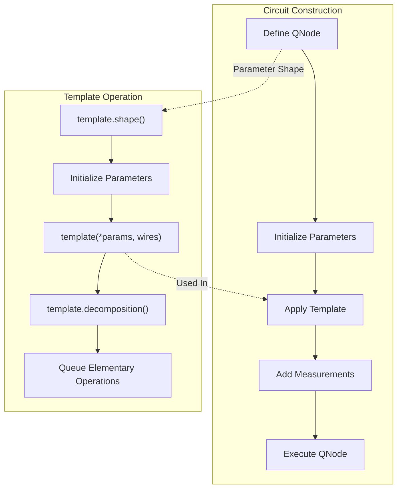
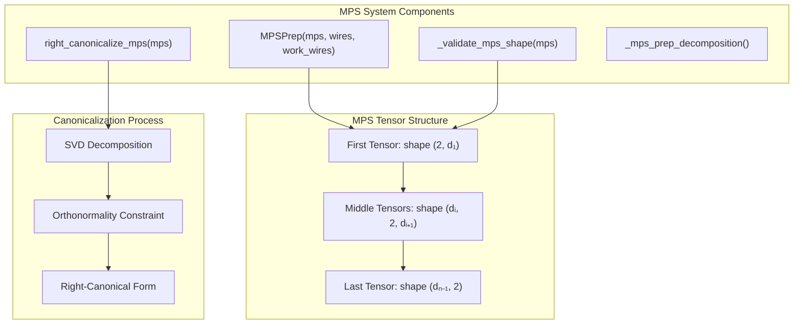
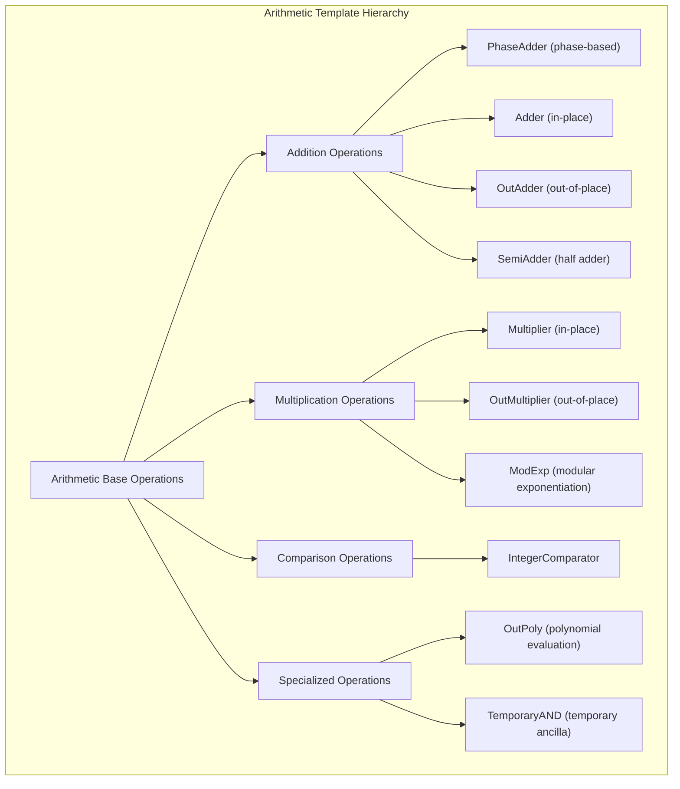
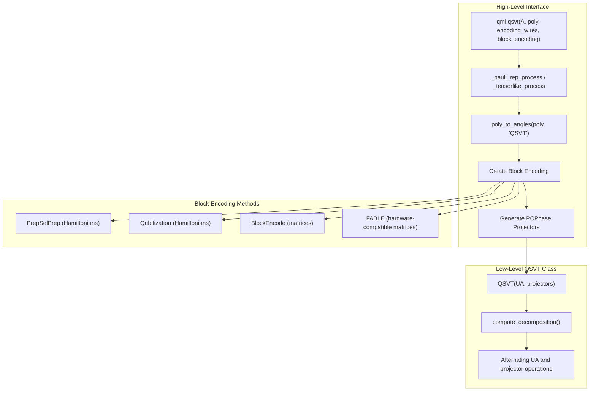
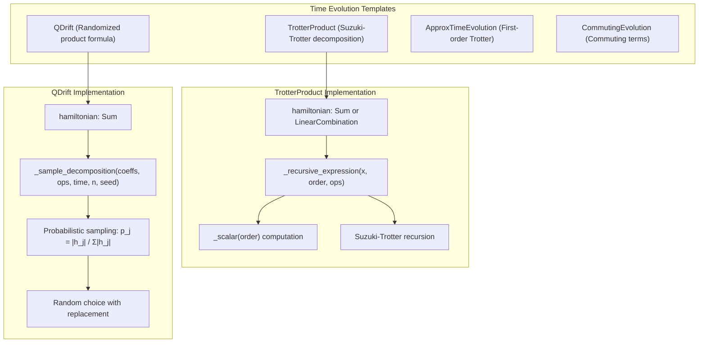

<!-- source: DeepWiki mcp.deepwiki.com · repo PennyLaneAI/pennylane · page 7 Templates and Advanced Features · fetched 2026-10-21 -->

# Templates and Advanced Features

<details>
<summary>Relevant source files</summary>

The following files were used as context for generating this wiki page:

- [doc/introduction/templates.rst](doc/introduction/templates.rst)
- [pennylane/data/attributes/pytree.py](pennylane/data/attributes/pytree.py)
- [pennylane/ops/functions/assert_valid.py](pennylane/ops/functions/assert_valid.py)
- [pennylane/ops/functions/equal.py](pennylane/ops/functions/equal.py)
- [pennylane/pytrees/pytrees.py](pennylane/pytrees/pytrees.py)
- [pennylane/templates/__init__.py](pennylane/templates/__init__.py)
- [pennylane/templates/core.py](pennylane/templates/core.py)
- [pennylane/templates/subroutines/__init__.py](pennylane/templates/subroutines/__init__.py)
- [pennylane/templates/subroutines/qchem/basis_rotation.py](pennylane/templates/subroutines/qchem/basis_rotation.py)
- [tests/capture/test_templates.py](tests/capture/test_templates.py)
- [tests/ops/functions/conftest.py](tests/ops/functions/conftest.py)
- [tests/ops/functions/test_equal.py](tests/ops/functions/test_equal.py)
- [tests/pytrees/test_pytrees.py](tests/pytrees/test_pytrees.py)
- [tests/templates/subroutines/qchem/test_basis_rotation.py](tests/templates/subroutines/qchem/test_basis_rotation.py)
- [tests/templates/test_subroutine.py](tests/templates/test_subroutine.py)

</details>


PennyLane provides a comprehensive library of quantum circuit templates and advanced quantum computing features. This includes pre-coded templates (ansätze), sophisticated algorithms like Quantum Singular Value Transformation (QSVT), time evolution methods, tensor network structures, and quantum arithmetic operations. This document covers both fundamental templates and advanced quantum computing capabilities.

## Template Architecture and Advanced Features

PennyLane organizes templates into functional categories, with emphasis on advanced quantum computing capabilities. Each template is implemented as a subclass of `Operation` with standardized interfaces for parameter handling and circuit decomposition.

### Advanced Template System Architecture

```mermaid
graph TD
    PL["PennyLane Templates"] --> ADV["Advanced Features"]
    PL --> BASIC["Basic Templates"]
    
    ADV --> QSVT["QSVT (Quantum Singular Value Transformation)"]
    ADV --> TIME["Time Evolution Methods"]
    ADV --> TN["Tensor Networks"]
    ADV --> ARITH["Quantum Arithmetic"]
    
    QSVT --> QSVT1["qml.QSVT"]
    QSVT --> QSVT2["qml.qsvt()"]
    QSVT --> QSVT3["poly_to_angles"]
    QSVT --> QSVT4["Block Encodings (PrepSelPrep, Qubitization, FABLE)"]
    
    TIME --> TIME1["TrotterProduct"]
    TIME --> TIME2["QDrift"]
    TIME --> TIME3["ApproxTimeEvolution"]
    TIME --> TIME4["CommutingEvolution"]
    
    TN --> TN1["MPSPrep (Matrix Product States)"]
    TN --> TN2["MPS/TTN/MERA"]
    TN --> TN3["right_canonicalize_mps()"]
    
    ARITH --> AR1["PhaseAdder/Adder"]
    ARITH --> AR2["Multiplier/OutMultiplier"]
    ARITH --> AR3["ModExp"]
    ARITH --> AR4["IntegerComparator"]
    
    BASIC --> EMB["Embeddings (AmplitudeEmbedding, AngleEmbedding)"]
    BASIC --> LAY["Layers (StronglyEntanglingLayers, BasicEntanglerLayers)"]
    BASIC --> STATE["State Prep (MottonenStatePreparation, ArbitraryStatePreparation)"]
    BASIC --> ALG["Algorithms (QFT, QuantumPhaseEstimation, GroverOperator)"]
```



Sources: [doc/introduction/templates.rst:8-16](), [pennylane/templates/subroutines/__init__.py:14-59](), [pennylane/templates/subroutines/qsvt.py:1-59](), [pennylane/templates/subroutines/trotter.py:1-35]()

### Template Usage in Quantum Circuits



Sources: [doc/introduction/templates.rst:377-402](https://github.com/PennyLaneAI/pennylane/blob/main/doc/introduction/templates.rst:377-402)

## Matrix Product State (MPS) Templates

PennyLane provides advanced tensor network templates, with particular focus on Matrix Product States for efficient quantum state preparation and manipulation.

### MPS Architecture and Implementation



### MPS Template Features

The `MPSPrep` template supports both native execution on `lightning.tensor` and gate-based decomposition on other devices.

**Key Components:**

| Component | Purpose | Implementation |
|-----------|---------|----------------|
| `MPSPrep` | MPS state preparation | Lines 227-427 |
| `right_canonicalize_mps` | Convert to right-canonical form | Lines 78-224 |
| `_validate_mps_shape` | Validate tensor dimensions | Lines 25-76 |

**MPS Tensor Requirements:**
- First tensor: `(2, bond_dim)` where `bond_dim` is power of 2
- Middle tensors: `(bond_dim_in, 2, bond_dim_out)` with matching dimensions
- Last tensor: `(bond_dim_in, 2)`
- Physical dimension always 2 (qubit systems)

**Right Canonicalization:**

For tensor A^(j), the right-canonical condition is:
```
∑_{d_{j,1}, d_{j,2}} A^{(j)}_{d_{j,0}, d_{j,1}, d_{j,2}} (A^{(j)}_{d'_{j,0}, d_{j,1}, d_{j,2}})* = δ_{d_{j,0}, d'_{j,0}}
```

### Tensor Network Templates

| Template | Description | Use Case |
|----------|-------------|----------|
| `MPS` | Matrix Product State circuit | 1D quantum systems, DMRG |
| `TTN` | Tree Tensor Network | Hierarchical quantum systems |
| `MERA` | Multi-scale Entanglement Renormalization | Critical systems, holography |
| `MPSPrep` | MPS state preparation | Efficient state initialization |

Sources: [pennylane/templates/state_preparations/state_prep_mps.py:227-427](), [pennylane/templates/state_preparations/state_prep_mps.py:78-224](), [pennylane/templates/state_preparations/state_prep_mps.py:25-76](), [tests/templates/test_state_preparations/test_state_prep_mps.py:29-427]()

## Fundamental Templates

PennyLane provides foundational templates for embedding data, creating parameterized layers, and preparing states.

### Embedding Templates

| Template | Purpose | Key Parameters |
|----------|---------|----------------|
| `AmplitudeEmbedding` | Encode features into amplitudes | `features`, `normalize`, `pad_with` |
| `AngleEmbedding` | Encode as rotation angles | `features`, `rotation` ("X"/"Y"/"Z") |
| `BasisEmbedding` | Encode binary data into basis states | `features` (binary array) |
| `IQPEmbedding` | IQP-style feature embedding | `features`, `n_repeats`, `pattern` |
| `QAOAEmbedding` | QAOA-inspired embedding | `features`, `weights`, `local_field` |

### Layer Templates

| Template | Architecture | Parameters |
|----------|--------------|------------|
| `BasicEntanglerLayers` | Rotation + entangling gates | `weights`, `rotation` gate type |
| `StronglyEntanglingLayers` | Three rotation angles per qubit | `weights`, `ranges`, `imprimitive` |
| `RandomLayers` | Randomly structured layers | `weights`, `ratio_imprim`, `rotations` |
| `SimplifiedTwoDesign` | Two-design approximation | `initial_layer_weights`, `weights` |

### State Preparation Templates

| Template | Method | Best For |
|----------|---------|----------|
| `MottonenStatePreparation` | Mottonen decomposition | Arbitrary pure states |
| `ArbitraryStatePreparation` | Parametric decomposition | Variational state prep |
| `QROMStatePreparation` | QROM-based preparation | Sparse amplitude vectors |
| `CosineWindow` | Cosine-weighted superposition | Smooth probability distributions |

Sources: [doc/introduction/templates.rst:20-90](), [doc/introduction/templates.rst:92-129]()

## Quantum Arithmetic and Algorithm Templates

PennyLane provides a comprehensive suite of quantum arithmetic operations and classical quantum algorithms implemented as templates.

### Quantum Arithmetic Operations



### Arithmetic Template Features

| Template | Operation | In-Place | Requires Work Wires |
|----------|-----------|----------|-------------------|
| `PhaseAdder` | a + b (phase encoding) | Yes | No |
| `Adder` | a + b → a + b | Yes | Yes |
| `OutAdder` | a + b → c | No | Yes |
| `Multiplier` | a × b → a × b | Yes | Yes |
| `OutMultiplier` | a × b → c | No | Yes |
| `ModExp` | a^b mod N | No | Yes |
| `IntegerComparator` | Compare integers | No | Yes |

### Quantum Algorithms

```mermaid
graph TD
    subgraph "Algorithm Categories"
        SEARCH["Search Algorithms"]
        TRANSFORM["Transform Algorithms"]  
        ESTIMATION["Estimation Algorithms"]
        MISC_ALG["Utility Algorithms"]
    end
    
    SEARCH --> S1["GroverOperator (amplitude amplification)"]
    SEARCH --> S2["AmplitudeAmplification (generalized Grover)"]
    SEARCH --> S3["Reflection (about arbitrary state)"]
    
    TRANSFORM --> T1["QFT (Quantum Fourier Transform)"]
    TRANSFORM --> T2["AQFT (Approximate QFT)"]
    
    ESTIMATION --> E1["QuantumPhaseEstimation"]
    ESTIMATION --> E2["QuantumMonteCarlo"]
    
    MISC_ALG --> M1["QROM (Quantum Read-Only Memory)"]
    MISC_ALG --> M2["Select (coherent database query)"]
    MISC_ALG --> M3["PrepSelPrep (Hamiltonian simulation)"]
    MISC_ALG --> M4["Qubitization (LCU block encoding)"]
```



### Quantum Chemistry Templates

| Template | Ansatz Type | Purpose |
|----------|-------------|---------|
| `UCCSD` | Unitary Coupled Cluster | Ground state chemistry |
| `AllSinglesDoubles` | Excitation-based | Flexible fermionic ansatz |
| `kUpCCGSD` | Generalized UCCSD | k-particle excitations |
| `FermionicSingleExcitation` | Single excitation | Building block for chemistry |
| `FermionicDoubleExcitation` | Double excitation | Building block for chemistry |
| `BasisRotation` | Orbital rotation | Basis optimization |

### Advanced Algorithm Templates

| Template | Algorithm | Key Features |
|----------|-----------|--------------|
| `QuantumPhaseEstimation` | Eigenvalue estimation | Controlled unitaries, inverse QFT |
| `QuantumMonteCarlo` | Monte Carlo integration | Amplitude estimation, function evaluation |
| `QROM` | Database access | Coherent data loading |
| `Select` | Linear combination of unitaries | Coherent superposition over operators |
| `Qubitization` | Hamiltonian block encoding | LCU method for simulation |

Sources: [doc/introduction/templates.rst:133-378](), [pennylane/templates/subroutines/__init__.py:19-59](), [pennylane/templates/subroutines/reflection.py:35-219]()

## Working with Templates

### Parameter Initialization

Templates that take weight parameters typically provide a `.shape()` method that returns the required tensor shape:

```python
# Get the shape of parameters needed for a template
shape = qml.BasicEntanglerLayers.shape(n_layers=2, n_wires=3)
# Initialize random weights
weights = np.random.random(size=shape)
# Use in a circuit
qml.BasicEntanglerLayers(weights=weights, wires=range(3))
```

Sources: [doc/introduction/templates.rst:377-402](https://github.com/PennyLaneAI/pennylane/blob/main/doc/introduction/templates.rst:377-402)

### Creating Custom Templates

Custom templates can be created as simple functions that apply quantum operations without returning a value:

```python
def MyTemplate(a, b, wires):
    c = np.sin(a) + b
    qml.RX(c, wires=wires[0])

# Use in a circuit
@qml.qnode(dev)
def circuit(a, b):
    MyTemplate(a, b, wires=range(n_wires))
    return qml.expval(qml.PauliZ(0))
```

For more complex templates, you can create a class that inherits from `qml.operation.Operation`.

Sources: [doc/introduction/templates.rst:403-439](https://github.com/PennyLaneAI/pennylane/blob/main/doc/introduction/templates.rst:403-439)

### Layering Function

The `qml.layer()` function creates a new template by repeating a sequence of quantum gates:

```python
@qml.qnode(dev)
def circuit(weights):
    # Repeat the template 3 times
    qml.layer(qml.StronglyEntanglingLayers, 3, weights, wires=range(4))
    return qml.expval(qml.PauliZ(0))
```

Sources: [doc/introduction/templates.rst:440-450](https://github.com/PennyLaneAI/pennylane/blob/main/doc/introduction/templates.rst:440-450)

## Specialized Templates and Utilities

## Quantum Singular Value Transformation (QSVT)

QSVT is a powerful framework for implementing polynomial transformations on quantum-encoded matrices. PennyLane provides both high-level (`qml.qsvt`) and low-level (`qml.QSVT`) interfaces.

### QSVT System Architecture



### QSVT Implementation Details

The `QSVT` class implements the core QSVT circuit decomposition. For even number of projectors (odd degree polynomial):

```
U_QSVT = Π_φ₁ U [∏_{k=1}^{(d-1)/2} Π_φ₂ₖ U† Π̃_φ₂ₖ₊₁ U] Π_φ_{d+1}
```

For odd number of projectors (even degree polynomial):

```
U_QSVT = [∏_{k=1}^{d/2} Π_φ₂ₖ₋₁ U† Π̃_φ₂ₖ U] Π_φ_{d+1}
```

Key functions and their roles:

| Function | Purpose | Location |
|----------|---------|----------|
| `qml.qsvt()` | High-level QSVT interface | Line 112-297 |
| `poly_to_angles()` | Convert polynomial to phase angles | Line 55, 80 |
| `QSVT` class | Low-level QSVT operator | Line 300-659 |
| `_pauli_rep_process()` | Handle Hamiltonian inputs | Line 39-67 |
| `_tensorlike_process()` | Handle matrix inputs | Line 70-109 |

### Block Encoding Selection

| Input Type | Recommended Block Encoding | Hardware Compatible |
|------------|---------------------------|-------------------|
| Hamiltonian (pauli_rep) | `"prepselprep"` or `"qubitization"` | Yes |
| Matrix (small, simulator) | `"embedding"` | No |
| Matrix (hardware) | `"fable"` | Yes |

Sources: [pennylane/templates/subroutines/qsvt.py:112-297](), [pennylane/templates/subroutines/qsvt.py:300-659](), [pennylane/templates/subroutines/qsvt.py:39-109](), [tests/templates/test_subroutines/test_qsvt.py:79-436]()

## Time Evolution Methods

PennyLane provides several sophisticated methods for quantum time evolution, ranging from exact methods to various approximation schemes.

### Time Evolution Architecture



### Trotter Product Formulas

The `TrotterProduct` class implements Suzuki-Trotter decomposition with different orders:

**Order 1 (Basic Trotter):**
```
S₁(t) = ∏ⱼ e^{it Oⱼ}
```

**Order 2 (Symmetric Trotter):**
```
S₂(t) = ∏ⱼ e^{it/2 Oⱼ} ∏ⱼ e^{it/2 O_{N-j}}
```

**Higher Orders (Recursive):**
```
S_m(t) = S_{m-2}(p_m t)² S_{m-2}((1-4p_m)t) S_{m-2}(p_m t)²
```

where `p_m = 1/(4 - 4^{1/(m-1)})`.

### Time Evolution Template Comparison

| Template | Method | Best For | Error Scaling |
|----------|---------|----------|---------------|
| `TrotterProduct` | Deterministic Suzuki-Trotter | High accuracy, structured Hamiltonians | O(t^{m+1}/n^m) for order m |
| `QDrift` | Randomized product formula | Large sparse Hamiltonians | O(λ²t²/n) where λ=Σ\|hⱼ\| |
| `ApproxTimeEvolution` | First-order Trotter | Simple cases, backwards compatibility | O(t²/n) |
| `CommutingEvolution` | Exact for commuting terms | Hamiltonians with commuting structure | Exact |

### Error Estimation

Both `TrotterProduct` and `QDrift` provide error bound methods:

**TrotterProduct Error Bounds:**
- `method="one-norm-bound"`: Based on operator norms
- `method="commutator-bound"`: Based on commutator analysis

**QDrift Error Bound:**
```
error ≈ 2λ²t²/n
```
where n is the number of samples.

Sources: [pennylane/templates/subroutines/trotter.py:78-412](), [pennylane/templates/subroutines/qdrift.py:76-271](), [pennylane/templates/subroutines/trotter.py:37-75](), [tests/templates/test_subroutines/test_trotter.py:1-36]()

### Utility Functions

PennyLane provides several utility functions for working with templates and quantum operations:

#### Comparison Functions

The `qml.equal()` and `qml.assert_equal()` functions compare operators, measurements, or tapes:

```python
# Check if two operators are equal
are_equal = qml.equal(qml.RX(0.1, wires=0), qml.RX(0.1, wires=0))  # True

# Assert that two operators are equal (raises AssertionError if not)
qml.assert_equal(qml.RX(0.1, wires=0), qml.RX(0.1, wires=0))
```

Sources: [pennylane/ops/functions/equal.py:41-152](https://github.com/PennyLaneAI/pennylane/blob/main/pennylane/ops/functions/equal.py:41-152), [pennylane/ops/functions/equal.py:157-211](https://github.com/PennyLaneAI/pennylane/blob/main/pennylane/ops/functions/equal.py:157-211)

#### Pulse Programming Utilities

For time-dependent Hamiltonians, PennyLane provides utility functions such as:

- `qml.pulse.constant`: Creates a time-independent coefficient
  ```python
  H = qml.pulse.constant * qml.X(0)  # H(params, t) = params * X
  ```

- `qml.pulse.rect`: Creates a coefficient that is non-zero only within specified time windows
  ```python
  # Returns f(p,t) within windows, 0 otherwise
  H = qml.pulse.rect(f, windows=[(1, 7)]) * qml.X(0)
  ```

Sources: [pennylane/pulse/convenience_functions.py:27-80](https://github.com/PennyLaneAI/pennylane/blob/main/pennylane/pulse/convenience_functions.py:27-80), [pennylane/pulse/convenience_functions.py:83-152](https://github.com/PennyLaneAI/pennylane/blob/main/pennylane/pulse/convenience_functions.py:83-152)

## Template Internals

Most templates in PennyLane are implemented as subclasses of `qml.operation.Operation`. The core functionality is provided by:

1. `__init__` method: Parses parameters and initializes the template
2. `decomposition` method: Generates the sequence of elementary gates
3. `shape` method: Returns the required shape of the weight parameters

The templates follow PennyLane's queuing system, with operations being added to the queue when the template is applied in a quantum function.

Sources: [tests/capture/test_templates.py:34-178](https://github.com/PennyLaneAI/pennylane/blob/main/tests/capture/test_templates.py:34-178)

## Conclusion

PennyLane's template system provides a rich set of pre-coded quantum circuit architectures that can significantly simplify the development of quantum algorithms. Combined with utility functions for parameter initialization, comparison, and time evolution, templates enable rapid prototyping and experimentation with quantum circuits.

---

