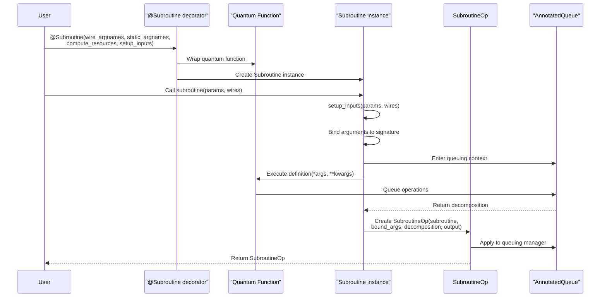
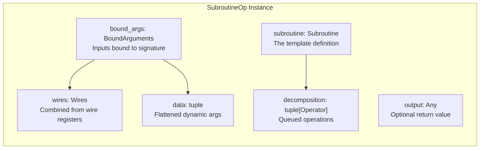
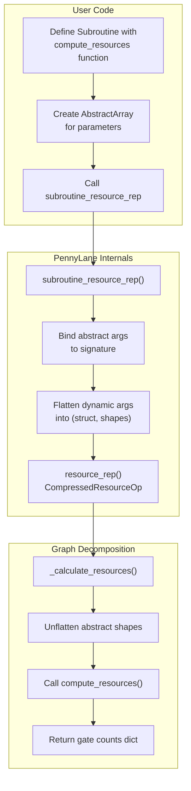
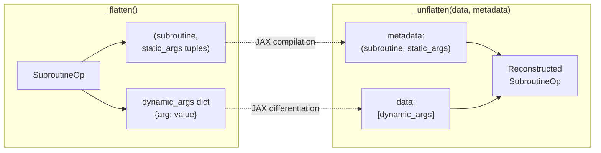

<!-- source: DeepWiki mcp.deepwiki.com · repo PennyLaneAI/pennylane · page 7.1 Circuit Templates and Subroutines · fetched 2026-10-21 -->

# Circuit Templates and Subroutines

<details>
<summary>Relevant source files</summary>

The following files were used as context for generating this wiki page:

- [doc/introduction/templates.rst](doc/introduction/templates.rst)
- [pennylane/data/attributes/pytree.py](pennylane/data/attributes/pytree.py)
- [pennylane/ops/functions/assert_valid.py](pennylane/ops/functions/assert_valid.py)
- [pennylane/ops/functions/equal.py](pennylane/ops/functions/equal.py)
- [pennylane/pytrees/pytrees.py](pennylane/pytrees/pytrees.py)
- [pennylane/templates/__init__.py](pennylane/templates/__init__.py)
- [pennylane/templates/core.py](pennylane/templates/core.py)
- [pennylane/templates/subroutines/__init__.py](pennylane/templates/subroutines/__init__.py)
- [pennylane/templates/subroutines/qchem/basis_rotation.py](pennylane/templates/subroutines/qchem/basis_rotation.py)
- [tests/capture/test_templates.py](tests/capture/test_templates.py)
- [tests/ops/functions/conftest.py](tests/ops/functions/conftest.py)
- [tests/ops/functions/test_equal.py](tests/ops/functions/test_equal.py)
- [tests/pytrees/test_pytrees.py](tests/pytrees/test_pytrees.py)
- [tests/templates/subroutines/qchem/test_basis_rotation.py](tests/templates/subroutines/qchem/test_basis_rotation.py)
- [tests/templates/test_subroutine.py](tests/templates/test_subroutine.py)

</details>


This page documents PennyLane's template and subroutine system for creating reusable quantum circuit components. Templates are pre-coded quantum circuit architectures (embeddings, layers, state preparations, subroutines) that can be used to build complex models. The `Subroutine` system provides a framework for defining custom circuit components with resource estimation and integration into PennyLane's transform pipeline.

For pre-built templates focused on quantum chemistry applications, see [Quantum Chemistry Support](#7.2). For operator validation and testing, see [Operator Equality and Validation](#7.3). For general operator concepts, see [Operators and Operation System](#2.1).

## Template Categories

PennyLane organizes templates into distinct categories based on their purpose in quantum circuits. Each category serves a specific role in circuit construction.

```mermaid
graph TB
    Templates["pennylane.templates"]
    
    Embeddings["Embedding Templates<br/>pennylane.templates.embeddings"]
    Layers["Layer Templates<br/>pennylane.templates.layers"]
    StatePrep["State Preparations<br/>pennylane.templates.state_preparations"]
    Subroutines["Subroutines<br/>pennylane.templates.subroutines"]
    SwapNets["Swap Networks<br/>pennylane.templates.swapnetworks"]
    TensorNets["Tensor Networks<br/>pennylane.templates.tensornetworks"]
    
    Templates --> Embeddings
    Templates --> Layers
    Templates --> StatePrep
    Templates --> Subroutines
    Templates --> SwapNets
    Templates --> TensorNets
    
    Embeddings --> AmplitudeEmbedding["AmplitudeEmbedding"]
    Embeddings --> AngleEmbedding["AngleEmbedding"]
    Embeddings --> BasisEmbedding["BasisEmbedding"]
    Embeddings --> IQPEmbedding["IQPEmbedding"]
    Embeddings --> QAOAEmbedding["QAOAEmbedding"]
    
    Layers --> BasicEntanglerLayers["BasicEntanglerLayers"]
    Layers --> StronglyEntanglingLayers["StronglyEntanglingLayers"]
    Layers --> RandomLayers["RandomLayers"]
    Layers --> SimplifiedTwoDesign["SimplifiedTwoDesign"]
    
    StatePrep --> MottonenStatePreparation["MottonenStatePreparation"]
    StatePrep --> ArbitraryStatePreparation["ArbitraryStatePreparation"]
    StatePrep --> CosineWindow["CosineWindow"]
    StatePrep --> QROMStatePreparation["QROMStatePreparation"]
    
    Subroutines --> QChem["Quantum Chemistry<br/>BasisRotation, UCCSD,<br/>AllSinglesDoubles"]
    Subroutines --> Arithmetic["Arithmetic<br/>PhaseAdder, Adder,<br/>Multiplier, ModExp"]
    Subroutines --> General["General<br/>QFT, AQFT, GroverOperator,<br/>QuantumPhaseEstimation"]
```



**Sources**: [pennylane/templates/__init__.py:1-26](), [pennylane/templates/subroutines/__init__.py:1-125](), [doc/introduction/templates.rst:1-485]()

## Subroutine System Architecture

The subroutine system is built around three core abstractions: `Subroutine`, `SubroutineOp`, and supporting utilities for resource estimation.

### Core Class Diagram

```mermaid
classDiagram
    class Subroutine {
        +name: str
        +signature: Signature
        +definition: Callable
        +wire_argnames: tuple[str]
        +static_argnames: tuple[str]
        +dynamic_argnames: tuple[str]
        +exact_resources: bool
        +setup_inputs(args, kwargs) tuple, dict
        +compute_resources(**kwargs) dict
        +operator(*args, **kwargs) SubroutineOp
        +__call__(*args, **kwargs) SubroutineOp
        +__instancecheck__(instance) bool
    }
    
    class SubroutineOp {
        +subroutine: Subroutine
        +bound_args: BoundArguments
        +output: Any
        +resource_params: dict
        +decomposition() list[Operator]
        +map_wires(wire_map) SubroutineOp
        +_flatten() tuple
        +_unflatten(data, metadata) SubroutineOp
    }
    
    class Operation {
        <<abstract>>
        +wires: Wires
        +data: tuple
        +hyperparameters: dict
    }
    
    class AbstractArray {
        +shape: tuple[int]
        +dtype: np.dtype
        +__len__() int
    }
    
    Subroutine --> SubroutineOp : creates
    SubroutineOp --|> Operation
    AbstractArray : used for resource estimation
```



**Sources**: [pennylane/templates/core.py:1-347](), [pennylane/templates/core.py:215-335]()

### Key Components

| Component | Purpose | Key Methods |
|-----------|---------|-------------|
| `Subroutine` | Decorator/class for defining reusable circuit components | `operator()`, `compute_resources()`, `setup_inputs()` |
| `SubroutineOp` | Operator created when calling a `Subroutine` | `decomposition()`, `map_wires()`, `_flatten()`, `_unflatten()` |
| `AbstractArray` | Abstract array representation for resource calculations | `__len__()`, shape, dtype attributes |
| `subroutine_resource_rep()` | Create resource representation for graph decomposition | Returns `CompressedResourceOp` |

**Sources**: [pennylane/templates/core.py:54-80](), [pennylane/templates/core.py:82-158](), [pennylane/templates/core.py:215-335]()

## Creating Custom Subroutines

The `@Subroutine` decorator transforms a quantum function into a reusable template with resource estimation and metadata tracking.

### Subroutine Creation Flow



**Sources**: [pennylane/templates/core.py:348-502](), [tests/templates/test_subroutine.py:27-133]()

### Basic Subroutine Definition

The simplest subroutine requires just a quantum function. PennyLane automatically infers the `wires` argument.

```python
# Basic example - automatic wire detection
@Subroutine
def Simple(x, wires):
    qml.RX(x, wires=wires)
```

This creates a `Subroutine` with:
- `name = "Simple"`
- `wire_argnames = ("wires",)`
- `dynamic_argnames = ("x",)`
- `static_argnames = tuple()`

**Sources**: [tests/templates/test_subroutine.py:29-53]()

### Advanced Configuration

Subroutines support custom configuration for wire management, static arguments, input processing, and resource estimation.

```python
# Advanced example with all features
def my_setup_inputs(x, y, reg1, reg2, metadata):
    # Make metadata hashable
    return (x, y), {"reg1": reg1, "reg2": reg2, "metadata": tuple(metadata)}

def my_resources(x, y, reg1, reg2, metadata):
    return {qml.RX: len(reg1), qml.RZ: len(reg2)}

@Subroutine(
    wire_argnames=("reg1", "reg2"),       # Multiple wire registers
    static_argnames=("metadata",),         # Non-differentiable args
    setup_inputs=my_setup_inputs,          # Input preprocessing
    compute_resources=my_resources,        # Resource estimation
    exact_resources=False                  # Estimates may be approximate
)
def Advanced(x, y, reg1, reg2, metadata):
    for w in reg1:
        qml.RX(x, w)
    for w in reg2:
        qml.RZ(y, w)
```

**Sources**: [tests/templates/test_subroutine.py:60-132](), [pennylane/templates/core.py:348-502]()

### Argument Classification

Arguments are classified into three categories:

| Category | Description | Example |
|----------|-------------|---------|
| **Wire Arguments** | Specify which qubits to act on | `wires`, `reg1`, `reg2` |
| **Static Arguments** | Non-differentiable metadata, must be hashable | `metadata`, `pauli_words`, `rotation` |
| **Dynamic Arguments** | Differentiable parameters | `x`, `y`, `weights` |

The classification affects:
- **Wire arguments**: Automatically converted to `Wires` objects
- **Static arguments**: Included in `resource_params` key, must be hashable
- **Dynamic arguments**: Extracted as operator `data`, included in pytree leaves

**Sources**: [pennylane/templates/core.py:159-177](), [pennylane/templates/core.py:230-238]()

## SubroutineOp: The Operator Type

When a `Subroutine` is called, it creates a `SubroutineOp` - a special `Operation` that encapsulates the subroutine definition, bound arguments, decomposition, and optional output.

### SubroutineOp Structure



**Sources**: [pennylane/templates/core.py:215-335](), [tests/templates/test_subroutine.py:183-265]()

### Key Properties and Methods

| Member | Type | Description |
|--------|------|-------------|
| `subroutine` | `Subroutine` | Reference to the template definition |
| `bound_args` | `BoundArguments` | Arguments bound to the subroutine's signature |
| `output` | `Any` | Optional return value from subroutine execution |
| `resource_params` | `dict` | Contains `subroutine` and `signature_key` for resource tracking |
| `decomposition()` | `list[Operator]` | Returns the queued operations |
| `map_wires(wire_map)` | `SubroutineOp` | Creates new instance with remapped wires |
| `_flatten()` | `tuple` | Pytree flattening for JAX integration |
| `_unflatten()` | `SubroutineOp` | Reconstructs from pytree leaves and metadata |

**Sources**: [pennylane/templates/core.py:215-335]()

### Wire Register Handling

SubroutineOp supports multiple wire registers and automatically combines them while avoiding duplicates.

```python
# Multiple wire registers
op = Example1Subroutine(
    0.5, 0.6, 
    reg1=Wires([0, "a"]), 
    reg2=Wires(["a", 1]), 
    pauli_words=("XY", "YZ")
)

# Combined wires: [0, "a", 1] - duplicates removed
assert op.wires == Wires([0, "a", 1])

# Map wires across all registers
new_op = op.map_wires({0: 3, "a": 4})
assert new_op.wires == Wires([3, 4, 1])
```

**Sources**: [tests/templates/test_subroutine.py:234-241](), [pennylane/templates/core.py:288-293](), [pennylane/templates/core.py:319-324]()

### Integration with Decompose Transform

`SubroutineOp` integrates with PennyLane's decomposition system for circuit optimization.

```python
tape = qml.tape.QuantumScript([subroutine_op])
[new_tape], _ = qml.transforms.decompose(tape, gate_set={qml.PauliRot})

# Decomposition replaces SubroutineOp with its constituent operations
```

**Sources**: [tests/templates/test_subroutine.py:255-264]()

## Resource Estimation

PennyLane's subroutine system provides tools for estimating quantum resources without executing circuits, critical for graph-based decomposition and resource analysis.

### Resource Estimation Architecture



**Sources**: [pennylane/templates/core.py:82-158](), [pennylane/templates/core.py:337-343]()

### AbstractArray for Abstract Resource Estimation

`AbstractArray` represents array metadata (shape, dtype) without actual values, enabling resource calculations before execution.

```python
from pennylane.templates import AbstractArray, subroutine_resource_rep

# Define a subroutine with resource function
def S_resources(params, wires, rotation):
    return {qml.resource_rep(rotation): params.shape[0]}

@Subroutine(static_argnames="rotation", compute_resources=S_resources)
def S(params, wires, rotation):
    for x in params:
        rotation(x, wires)

# Create abstract representations
abstract_params = AbstractArray((4,), float)  # Array of 4 floats
abstract_wires = AbstractArray(())            # Single wire

# Generate resource representation
S_rep = subroutine_resource_rep(S, abstract_params, abstract_wires, qml.RX)
# Returns: CompressedResourceOp(SubroutineOp, subroutine=S, signature_key=(...))
```

**Sources**: [pennylane/templates/core.py:54-80](), [pennylane/templates/core.py:82-158]()

### Using Subroutine Resources in Decompositions

Resource representations can be registered for use in graph decomposition.

```python
# Register subroutine in another operator's resources
class MyOp(qml.operation.Operation):
    pass

abstract_params = AbstractArray((4,), float)
abstract_wires = AbstractArray(())
S_rep = subroutine_resource_rep(S, abstract_params, abstract_wires, qml.RX)

@qml.decomposition.register_resources({S_rep: 1})
def my_op_decomposition(wires):
    params = np.array([1.0, 2.0, 3.0, 4.0])
    S(params, wires, qml.RX)

qml.add_decomps(MyOp, my_op_decomposition)

# Graph decomposition now knows MyOp decomposes into 1 instance of S
```

**Sources**: [pennylane/templates/core.py:82-158]()

### Resource Calculation Flow

The `compute_resources` function receives bound arguments with `wires` converted to `Wires` objects:

```python
def compute_resources(x, wires, metadata):
    # wires is always a Wires object
    assert isinstance(wires, qml.wires.Wires)
    # metadata filled with defaults
    return {qml.RX: len(wires)}

@Subroutine(compute_resources=compute_resources)
def HasResources(x, wires, metadata=2):
    for w in wires:
        qml.RX(x, w)

# Called with single wire
resources = HasResources.compute_resources(0.5, 0)
# Returns: {qml.RX: 1}

# Called with multiple wires  
resources = HasResources.compute_resources(0.5, [0, 1, 2])
# Returns: {qml.RX: 3}
```

**Sources**: [tests/templates/test_subroutine.py:105-122](), [pennylane/templates/core.py:337-343]()

## Pytree Integration

`SubroutineOp` is registered as a JAX pytree, enabling automatic differentiation and JIT compilation.

### Pytree Flattening



**Sources**: [pennylane/templates/core.py:253-268]()

### Flattening Implementation

Dynamic arguments (differentiable parameters) become pytree leaves, while subroutine definition and static arguments become metadata.

```python
# _flatten implementation
def _flatten(self):
    dynamic_args = {
        arg: self._bound_args.arguments[arg] 
        for arg in self.subroutine.dynamic_argnames
    }
    static_args = {
        arg: self._bound_args.arguments[arg] 
        for arg in self.subroutine.static_argnames
    }
    for wire_argname in self.subroutine.wire_argnames:
        static_args[wire_argname] = self._bound_args.arguments[wire_argname]
    
    static_args = tuple((key, value) for key, value in static_args.items())
    return (dynamic_args,), (self.subroutine, static_args)

# _unflatten implementation  
@classmethod
def _unflatten(cls, data, metadata):
    subroutine = metadata[0]
    return subroutine.operator(**data[0], **dict(metadata[1]))
```

**Sources**: [pennylane/templates/core.py:253-268]()

### JAX Capture Support

Subroutines work with JAX's program capture for JIT compilation.

```python
import jax

@Subroutine
def f(x, wires):
    qml.RX(x, wires)
    return 2

# Capture into JAX IR
jaxpr = jax.make_jaxpr(lambda x: f.operator(x, 0))(0.5)
# Execution preserves semantics
op = jax.core.eval_jaxpr(jaxpr.jaxpr, jaxpr.consts, 0.5)[0]
assert op.output == 2
```

**Sources**: [tests/templates/test_subroutine.py:169-181](), [tests/capture/test_templates.py:32-295]()

## Built-in Template Examples

PennyLane provides numerous pre-built templates across different categories.

### Embedding Templates

Encode classical data into quantum states.

| Template | Purpose | Key Parameters |
|----------|---------|----------------|
| `AmplitudeEmbedding` | Encode data in state amplitudes | `features`, `wires`, `normalize`, `pad_with` |
| `AngleEmbedding` | Encode data as rotation angles | `features`, `wires`, `rotation` |
| `BasisEmbedding` | Encode bitstrings in computational basis | `features`, `wires` |
| `IQPEmbedding` | Instantaneous Quantum Polynomial encoding | `features`, `wires`, `n_repeats`, `pattern` |

**Sources**: [doc/introduction/templates.rst:20-57]()

### Layer Templates

Repeated parametrized gate sequences.

| Template | Purpose | Key Parameters |
|----------|---------|----------------|
| `BasicEntanglerLayers` | Basic rotation + entangling layers | `weights`, `wires`, `rotation` |
| `StronglyEntanglingLayers` | Strongly entangling ansatz | `weights`, `wires`, `ranges`, `imprimitive` |
| `RandomLayers` | Random parametrized gates | `weights`, `wires`, `ratio_imprim`, `rotations` |
| `SimplifiedTwoDesign` | Simplified two-design circuit | `initial_layer_weights`, `weights`, `wires` |

**Sources**: [doc/introduction/templates.rst:61-90]()

### State Preparation Templates

Initialize specific quantum states.

| Template | Purpose | Key Parameters |
|----------|---------|----------------|
| `MottonenStatePreparation` | Prepare arbitrary states via Möttönen decomposition | `state_vector`, `wires` |
| `ArbitraryStatePreparation` | Prepare states with arbitrary rotations | `weights`, `wires` |
| `CosineWindow` | Prepare cosine window state | `wires` |
| `QROMStatePreparation` | QROM-based state preparation | Multiple parameters |

**Sources**: [doc/introduction/templates.rst:94-136]()

### Quantum Chemistry Templates

Specialized templates for quantum chemistry simulations.

| Template | Purpose | Implementation |
|----------|---------|---------------|
| `BasisRotation` | Single-body basis transformation | Givens decomposition via `SingleExcitation` and `PhaseShift` |
| `UCCSD` | Unitary coupled-cluster ansatz | Singles and doubles excitations |
| `AllSinglesDoubles` | All single and double excitations | Fermionic excitation operators |
| `kUpCCGSD` | k-UpCCGSD ansatz | Generalized coupled-cluster |

The `BasisRotation` template implements efficient basis transformations using Givens rotations.

**Sources**: [doc/introduction/templates.rst:187-223](), [pennylane/templates/subroutines/qchem/basis_rotation.py:1-228]()

### Arithmetic Templates

In-place quantum arithmetic operations.

| Template | Purpose |
|----------|---------|
| `PhaseAdder` | Phase-based addition |
| `Adder` | In-place modular addition |
| `Multiplier` | In-place modular multiplication |
| `OutMultiplier` | Out-of-place multiplication |
| `ModExp` | Modular exponentiation |
| `IntegerComparator` | Integer comparison |
| `OutPoly` | Polynomial evaluation |

**Sources**: [doc/introduction/templates.rst:140-185]()

### General Subroutines

Algorithmic building blocks.

| Template | Purpose |
|----------|---------|
| `QFT` | Quantum Fourier Transform |
| `AQFT` | Approximate QFT with reduced gates |
| `GroverOperator` | Grover's diffusion operator |
| `QuantumPhaseEstimation` | QPE algorithm |
| `QuantumMonteCarlo` | Quantum Monte Carlo |
| `QSVT` | Quantum Singular Value Transformation |
| `ControlledSequence` | Sequentially controlled operations |
| `Select` | Block-encoding selector |

**Sources**: [doc/introduction/templates.rst:265-404](), [pennylane/templates/subroutines/__init__.py:1-125]()

## Validation and Testing

Templates and subroutines must pass standard operator validation checks.

### Standard Validation

All template operators are tested using `qml.ops.functions.assert_valid()`:

```python
# Example from BasisRotation validation
op = qml.BasisRotation.operator(
    wires=range(len(rotation)), 
    unitary_matrix=rotation
)
qml.ops.functions.assert_valid(op, skip_pickle=True)
```

This validates:
- Decomposition consistency
- Matrix representation (if applicable)
- Pytree flattening/unflattening
- Wire mapping
- Resource estimation
- Copy and deepcopy behavior

**Sources**: [tests/templates/subroutines/qchem/test_basis_rotation.py:52-55](), [pennylane/ops/functions/assert_valid.py:1-510]()

### Equality Testing

Templates support equality comparison through `qml.equal()`:

```python
# SubroutineOp equality based on subroutine and bound arguments
op1 = MySubroutine(0.5, wires=0)
op2 = MySubroutine(0.5, wires=0)
assert qml.equal(op1, op2)

# Different parameters
op3 = MySubroutine(0.6, wires=0)
assert not qml.equal(op1, op3)
```

**Sources**: [pennylane/ops/functions/equal.py:1-866](), [tests/ops/functions/test_equal.py:1-2832]()

### Instance Checking

`Subroutine` implements custom instance checking, allowing type-like behavior:

```python
@Subroutine
def MyTemplate(x, wires):
    qml.RX(x, wires)

op = MyTemplate(0.5, 0)

# SubroutineOp instances are instances of their Subroutine
assert isinstance(op, MyTemplate)  # Returns True
```

**Sources**: [tests/templates/test_subroutine.py:195-199](), [pennylane/templates/core.py:431-434]()

---

