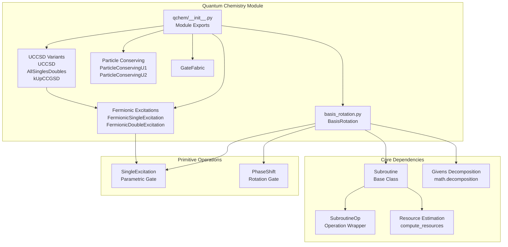
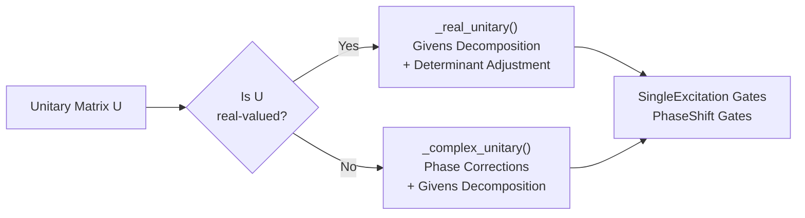
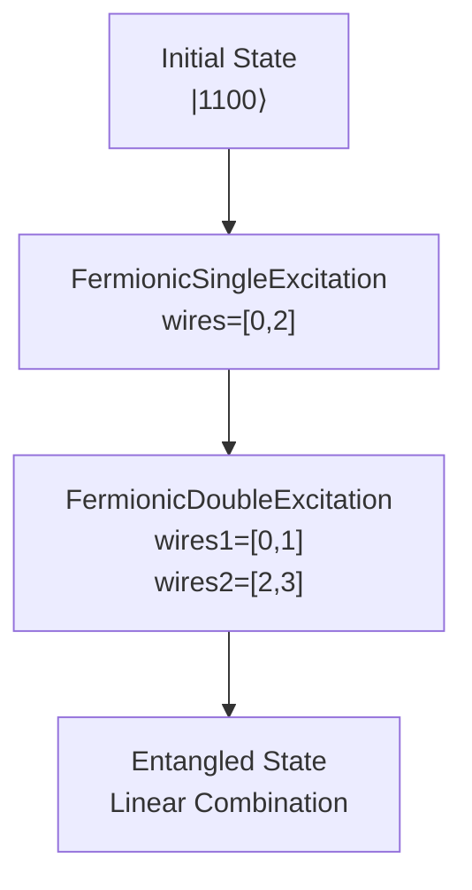
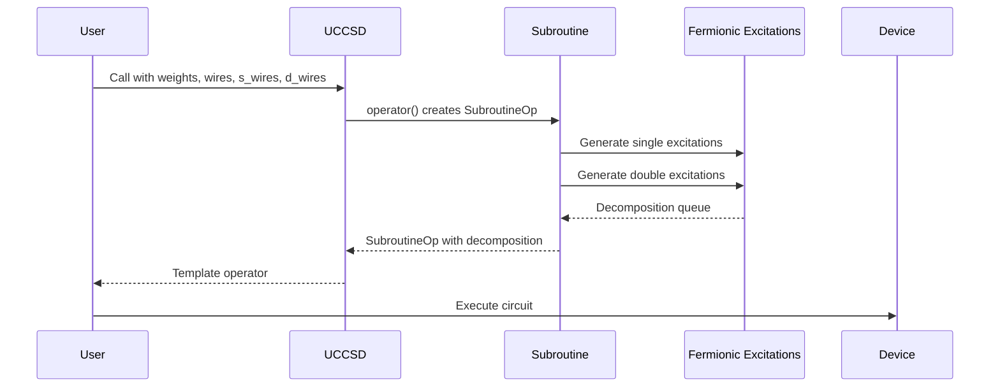
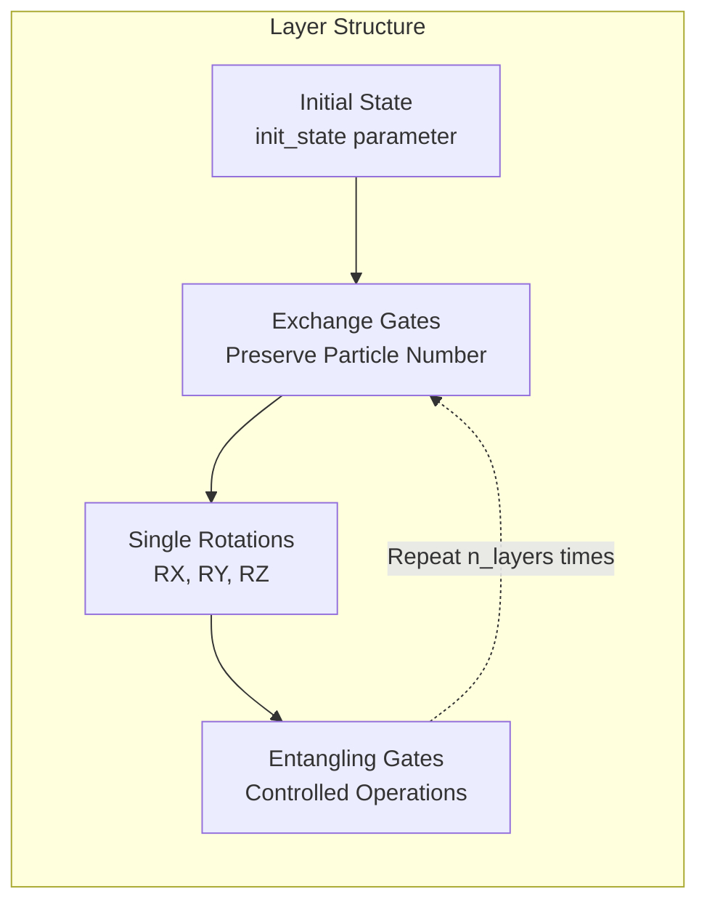
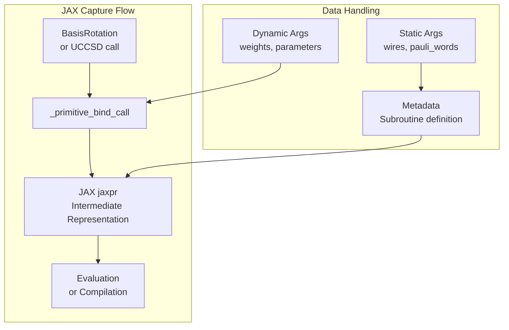
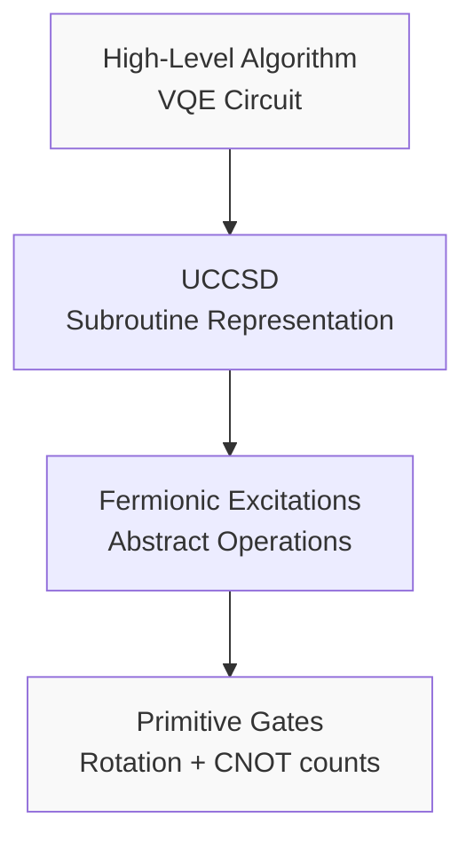

<!-- source: DeepWiki mcp.deepwiki.com · repo PennyLaneAI/pennylane · page 7.2 Quantum Chemistry Support · fetched 2026-10-21 -->

# Quantum Chemistry Support

<details>
<summary>Relevant source files</summary>

The following files were used as context for generating this wiki page:

- [.github/workflows/docker.yml](.github/workflows/docker.yml)
- [doc/development/release_notes.md](doc/development/release_notes.md)
- [doc/introduction/templates.rst](doc/introduction/templates.rst)
- [doc/news/program_capture_sharp_bits.rst](doc/news/program_capture_sharp_bits.rst)
- [doc/releases/changelog-0.42.1.md](doc/releases/changelog-0.42.1.md)
- [doc/releases/changelog-0.42.2.md](doc/releases/changelog-0.42.2.md)
- [doc/releases/changelog-0.42.3.md](doc/releases/changelog-0.42.3.md)
- [doc/releases/changelog-0.43.0.md](doc/releases/changelog-0.43.0.md)
- [docker/interfaces/gpu-cuda/cuda-base.dockerfile](docker/interfaces/gpu-cuda/cuda-base.dockerfile)
- [docker/pennylane.dockerfile](docker/pennylane.dockerfile)
- [pennylane/_version.py](pennylane/_version.py)
- [pennylane/data/attributes/pytree.py](pennylane/data/attributes/pytree.py)
- [pennylane/devices/default_gaussian.py](pennylane/devices/default_gaussian.py)
- [pennylane/ops/functions/assert_valid.py](pennylane/ops/functions/assert_valid.py)
- [pennylane/ops/functions/equal.py](pennylane/ops/functions/equal.py)
- [pennylane/pytrees/pytrees.py](pennylane/pytrees/pytrees.py)
- [pennylane/templates/__init__.py](pennylane/templates/__init__.py)
- [pennylane/templates/core.py](pennylane/templates/core.py)
- [pennylane/templates/subroutines/__init__.py](pennylane/templates/subroutines/__init__.py)
- [pennylane/templates/subroutines/qchem/basis_rotation.py](pennylane/templates/subroutines/qchem/basis_rotation.py)
- [tests/capture/test_templates.py](tests/capture/test_templates.py)
- [tests/devices/test_default_gaussian.py](tests/devices/test_default_gaussian.py)
- [tests/ops/functions/conftest.py](tests/ops/functions/conftest.py)
- [tests/ops/functions/test_equal.py](tests/ops/functions/test_equal.py)
- [tests/pytrees/test_pytrees.py](tests/pytrees/test_pytrees.py)
- [tests/templates/subroutines/qchem/test_basis_rotation.py](tests/templates/subroutines/qchem/test_basis_rotation.py)
- [tests/templates/test_subroutine.py](tests/templates/test_subroutine.py)

</details>


## Purpose and Scope

This page documents PennyLane's quantum chemistry support, which provides pre-built templates and operations for simulating molecular systems using variational quantum algorithms. These templates implement standard quantum chemistry ansätze and basis transformations used in algorithms like the Variational Quantum Eigensolver (VQE).

For information about the general template system and `Subroutine` infrastructure, see [Circuit Templates and Subroutines](#7.1). For operator composition and symbolic operations used in chemistry applications, see [Operator Arithmetic](#5.3).

---

## Overview

PennyLane's quantum chemistry support centers on templates that encode fermionic systems onto qubit registers and prepare trial wavefunctions for molecular simulations. The module provides:

- **Basis transformation operations** for rotating between different fermionic bases
- **Fermionic excitation operators** that preserve particle number
- **Variational ansätze** tailored for molecular electronic structure
- **Particle-conserving circuit layers** for chemistry-inspired variational algorithms

All quantum chemistry templates are located in [pennylane/templates/subroutines/qchem/]() and are accessible through the `qml.templates.subroutines` namespace.

**Sources:** [pennylane/templates/subroutines/__init__.py:51-58](), [doc/introduction/templates.rst:187-223]()

---

## Quantum Chemistry Template Architecture



**Sources:** [pennylane/templates/subroutines/__init__.py:51-58](), [pennylane/templates/subroutines/qchem/basis_rotation.py:1-26]()

---

## BasisRotation Template

### Purpose

The `BasisRotation` template implements basis transformations for fermionic operators represented as unitary rotations on qubit registers. This is essential for transforming between different orbital bases in quantum chemistry calculations, such as rotating from the atomic orbital basis to molecular orbitals.

### Implementation Details

The `BasisRotation` is defined as a `Subroutine` in [pennylane/templates/subroutines/qchem/basis_rotation.py:133-229](). The template decomposes arbitrary unitary matrices using Givens rotations, handling both real (orthogonal) and complex unitary matrices differently:



**Key Functions:**

| Function | Purpose | Location |
|----------|---------|----------|
| `_adjust_determinant` | Ensures orthogonal matrix has determinant +1 | [basis_rotation.py:33-55]() |
| `_real_unitary` | Decomposes real orthogonal matrices | [basis_rotation.py:71-94]() |
| `_complex_unitary` | Decomposes complex unitary matrices | [basis_rotation.py:97-131]() |
| `basis_rotation_decomp_resources` | Computes resource requirements | [basis_rotation.py:59-68]() |

### Resource Estimation

For a unitary matrix of dimension `n × n`:

- **Real orthogonal matrix**: Uses 1 `PhaseShift` + `n(n-1)/2` `SingleExcitation` gates
- **Complex unitary matrix**: Uses `n + n(n-1)/2` `PhaseShift` + `n(n-1)/2` `SingleExcitation` gates

**Sources:** [pennylane/templates/subroutines/qchem/basis_rotation.py:1-229](), [tests/templates/subroutines/qchem/test_basis_rotation.py:58-82]()

---

## Fermionic Excitation Operators

### Overview

Fermionic excitation operators implement single and double electron excitations while preserving particle number. These are fundamental building blocks for chemistry-inspired ansätze.

### FermionicSingleExcitation

Implements a single fermionic excitation between two orbitals. The operator acts on two wires and applies the unitary:

```
exp[θ(a†_i a_j - a†_j a_i)]
```

where `a†_i` and `a_i` are fermionic creation and annihilation operators.

### FermionicDoubleExcitation

Implements a double fermionic excitation involving four orbitals. The template is defined with custom parameter binding in [pennylane/templates/subroutines/qchem/__init__.py]() and uses the signature:

```python
FermionicDoubleExcitation(weight, wires1, wires2)
```

where `wires1` and `wires2` specify the orbital pairs involved in the excitation.

**Usage Pattern:**



**Sources:** [pennylane/templates/subroutines/__init__.py:51-58](), [tests/capture/test_templates.py:472-501]()

---

## UCCSD and Variants

### UCCSD (Unitary Coupled Cluster Singles and Doubles)

The `UCCSD` template implements the unitary coupled cluster with singles and doubles excitations ansatz, a standard variational form for molecular electronic structure calculations.

**Key Parameters:**

| Parameter | Type | Description |
|-----------|------|-------------|
| `weights` | array | Variational parameters for excitations |
| `wires` | Wires | Full qubit register |
| `s_wires` | list | Wire indices for single excitations |
| `d_wires` | list | Wire index pairs for double excitations |
| `init_state` | array | Initial Hartree-Fock state |

The template constructs the ansatz:

```
|ψ(θ)⟩ = exp(T̂ - T̂†)|HF⟩
```

where `T̂` includes all single and double excitation operators.

### AllSinglesDoubles

A variant that automatically generates all possible single and double excitations given the electron configuration. This is useful when you want to include the full UCCSD excitation space without manually specifying individual excitations.

### kUpCCGSD (k-UpCCGSD)

An extension of UCCSD that includes generalized pair excitations up to order `k`. This template is particularly useful for strongly correlated systems where traditional UCCSD may be insufficient.

**Template Integration with Capture:**



**Sources:** [pennylane/templates/subroutines/__init__.py:51-58](), [tests/capture/test_templates.py:238-241](), [doc/introduction/templates.rst:194-211]()

---

## Particle-Conserving Circuit Layers

### ParticleConservingU1 and ParticleConservingU2

These templates implement hardware-efficient ansätze that preserve the total particle number, making them suitable for simulating fermionic systems with fixed electron count.

**ParticleConservingU1:**
- Uses 2-qubit exchange gates that preserve particle number
- Requires `init_state` parameter to specify initial occupation
- Applies parametrized single-particle rotations

**ParticleConservingU2:**
- Extended version with additional entangling layers
- Provides more expressivity while maintaining particle conservation

**Key Distinction from UCCSD:**

| Feature | UCCSD | ParticleConservingU1/U2 |
|---------|-------|-------------------------|
| Basis | Physical excitations | Hardware-efficient |
| Parameters | Coupled cluster amplitudes | Arbitrary rotations |
| Structure | Chemistry-inspired | Circuit-layer inspired |
| Expressivity | Targeted for molecules | General particle-conserving |

**Template Structure:**



**Sources:** [doc/introduction/templates.rst:214-220](), [tests/capture/test_templates.py:105-123]()

---

## GateFabric Template

The `GateFabric` template provides a specialized circuit architecture for quantum chemistry that interleaves parameterized rotations with controlled operations based on an initial state configuration.

**Unique Features:**
- Requires `init_state` parameter defining the occupation pattern
- Uses multi-controlled gates based on occupation numbers
- Option to include π-phase shifts via `include_pi` parameter

**Sources:** [doc/introduction/templates.rst:202-203](), [tests/capture/test_templates.py:92-102]()

---

## Integration with Subroutine System

All quantum chemistry templates are built on top of the `Subroutine` infrastructure documented in [Circuit Templates and Subroutines](#7.1). This provides:

### Automatic Resource Calculation

Templates define `compute_resources` functions that return gate counts without circuit execution:

```python
# Example: BasisRotation resource estimation
abstract_wires = AbstractArray((4,))  # 4 qubits
abstract_unitary = AbstractArray((4, 4), dtype=float)  # Real 4x4 matrix

resources = qml.BasisRotation.compute_resources(
    wires=abstract_wires,
    unitary_matrix=abstract_unitary
)
# Returns: {PhaseShift: 1, SingleExcitation: 6}
```

### Subroutine Resource Representation

For advanced decomposition workflows, use `subroutine_resource_rep` to create compressed representations:

```python
from pennylane.templates import AbstractArray, subroutine_resource_rep

# Create abstract representation
wires_spec = AbstractArray((6,))  # 6-qubit system
weights_spec = AbstractArray((10,), dtype=float)  # 10 parameters

uccsd_rep = subroutine_resource_rep(
    qml.UCCSD,
    weights_spec,
    wires_spec,
    s_wires=[[0], [1]],
    d_wires=[[[0, 1], [2, 3]]],
    init_state=[1, 1, 0, 0, 0, 0]
)
```

### JAX Integration and Program Capture

Quantum chemistry templates are compatible with JAX program capture, allowing them to be traced and compiled:



**Capture Example from Tests:**

The `BasisRotation` template is captured as a single JAX primitive when used within a traced function. The unitary matrix flows through as dynamic data while the wire specification is embedded in metadata.

**Sources:** [pennylane/templates/core.py:82-157](), [tests/templates/subroutines/qchem/test_basis_rotation.py:52-56](), [tests/capture/test_templates.py:354-394]()

---

## Resource Estimation for Quantum Chemistry

### Computing Resources without Execution

The quantum chemistry templates implement resource estimation through the `compute_resources` interface:

```python
def basis_rotation_decomp_resources(wires, unitary_matrix, check=False):
    """Calculate the resources for BasisRotation."""
    dim = math.shape(unitary_matrix)[0]
    is_real = math.is_real_obj_or_close(unitary_matrix)
    se_count = dim * (dim - 1) // 2
    if is_real:
        return {PhaseShift: 1, SingleExcitation: se_count}
    
    ps_count = dim + se_count
    return {PhaseShift: ps_count, SingleExcitation: se_count}
```

This function is called internally by the estimator module (see [Resource Estimation](#8)) to provide fast resource estimates.

### Abstract Representations

Use `AbstractArray` for symbolic resource calculations:

| Construct | Description | Example |
|-----------|-------------|---------|
| `AbstractArray((n,), int)` | n-element integer array (wires) | `AbstractArray((4,), int)` |
| `AbstractArray((m, n), float)` | m×n real matrix | `AbstractArray((8, 8), float)` |
| `AbstractArray((k,), complex)` | k complex parameters | `AbstractArray((10,), complex)` |

### Integration with Decomposition System

The resource estimation integrates with PennyLane's graph-based decomposition system for hierarchical resource tracking:



**Sources:** [pennylane/templates/subroutines/qchem/basis_rotation.py:59-68](), [tests/templates/subroutines/qchem/test_basis_rotation.py:69-96](), [pennylane/templates/core.py:82-157]()

---

## Template Usage Patterns

### Basic VQE Circuit Construction

```python
# Example pattern (conceptual - not executable without molecule data)
import pennylane as qml

def build_chemistry_circuit(weights, n_qubits, n_electrons):
    """Build a quantum chemistry circuit for VQE."""
    # Prepare Hartree-Fock initial state
    init_state = [1] * n_electrons + [0] * (n_qubits - n_electrons)
    
    # Apply UCCSD ansatz
    qml.UCCSD(
        weights,
        wires=range(n_qubits),
        s_wires=[[i] for i in range(n_electrons)],
        d_wires=[[[i, j], [k, l]] for combinations...],
        init_state=init_state
    )
    
    return qml.expval(molecular_hamiltonian)
```

### Basis Transformation Pattern

```python
# Rotate to molecular orbital basis
orbital_rotation_matrix = get_molecular_orbital_coefficients()

qml.BasisRotation(
    wires=range(n_orbitals),
    unitary_matrix=orbital_rotation_matrix
)
```

### Validation

All quantum chemistry templates pass through the standard operator validation system documented in [Operator Equality and Validation](#7.3). Tests ensure:

- Correct decomposition into primitive gates
- Matrix representation matches theoretical expectation
- Resource estimates match actual gate counts
- Compatibility with program capture and JIT compilation

**Sources:** [pennylane/templates/subroutines/__init__.py:51-58](), [tests/templates/subroutines/qchem/test_basis_rotation.py:52-56](), [doc/introduction/templates.rst:187-223]()

---

