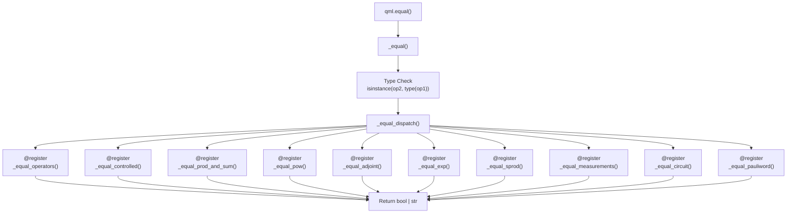
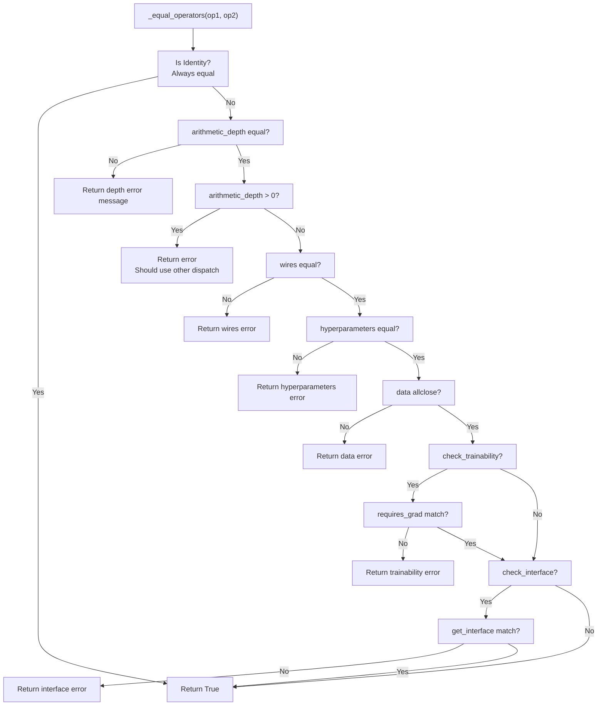
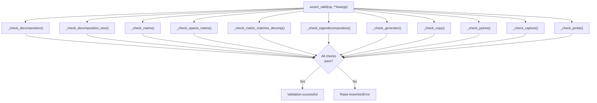
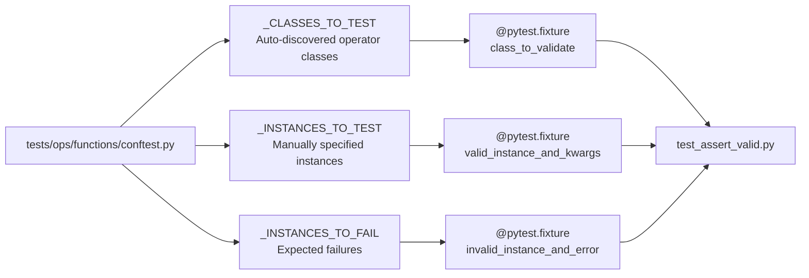

<!-- source: DeepWiki mcp.deepwiki.com · repo PennyLaneAI/pennylane · page 7.3 Operator Equality and Validation · fetched 2026-10-21 -->

# Operator Equality and Validation

<details>
<summary>Relevant source files</summary>

The following files were used as context for generating this wiki page:

- [doc/introduction/templates.rst](doc/introduction/templates.rst)
- [pennylane/data/attributes/pytree.py](pennylane/data/attributes/pytree.py)
- [pennylane/ops/functions/assert_valid.py](pennylane/ops/functions/assert_valid.py)
- [pennylane/ops/functions/equal.py](pennylane/ops/functions/equal.py)
- [pennylane/pytrees/pytrees.py](pennylane/pytrees/pytrees.py)
- [pennylane/templates/__init__.py](pennylane/templates/__init__.py)
- [pennylane/templates/core.py](pennylane/templates/core.py)
- [pennylane/templates/subroutines/__init__.py](pennylane/templates/subroutines/__init__.py)
- [pennylane/templates/subroutines/qchem/basis_rotation.py](pennylane/templates/subroutines/qchem/basis_rotation.py)
- [tests/capture/test_templates.py](tests/capture/test_templates.py)
- [tests/ops/functions/conftest.py](tests/ops/functions/conftest.py)
- [tests/ops/functions/test_equal.py](tests/ops/functions/test_equal.py)
- [tests/pytrees/test_pytrees.py](tests/pytrees/test_pytrees.py)
- [tests/templates/subroutines/qchem/test_basis_rotation.py](tests/templates/subroutines/qchem/test_basis_rotation.py)
- [tests/templates/test_subroutine.py](tests/templates/test_subroutine.py)

</details>


This page documents PennyLane's systems for comparing operators and validating their implementations. The equality system provides flexible comparison of quantum operators, measurements, and tapes, while the validation system ensures operators are correctly implemented according to PennyLane conventions.

For information about operator decomposition and resource estimation, see [Circuit Decomposition](#3.3) and [Resource Estimation](#5.5). For details on the Operator base class itself, see [Operators and Operation System](#2.1).

## Purpose and Scope

The equality and validation systems serve two distinct but related purposes:

1. **Equality Checking**: Comparing operators, measurements, quantum tapes, and Pauli representations to determine if they are equivalent
2. **Operator Validation**: Testing that custom operator classes correctly implement required methods and properties

These systems are used throughout PennyLane's test suite and are available for users implementing custom operators.

## Equality Functions

PennyLane provides two primary functions for comparing quantum objects:

```
qml.equal(op1, op2, check_interface=True, check_trainability=True, rtol=1e-5, atol=1e-9)
qml.assert_equal(op1, op2, check_interface=True, check_trainability=True, rtol=1e-5, atol=1e-9)
```

### Function Signatures

| Function | Return Type | Raises on Mismatch |
|----------|-------------|-------------------|
| `qml.equal()` | `bool` | No |
| `qml.assert_equal()` | `None` | Yes (AssertionError) |

Both functions accept the same arguments:

| Parameter | Type | Default | Purpose |
|-----------|------|---------|---------|
| `op1`, `op2` | Operator \| MeasurementProcess \| QuantumScript \| PauliWord \| PauliSentence | - | Objects to compare |
| `check_interface` | bool | True | Compare interface (NumPy/JAX/PyTorch/TensorFlow) |
| `check_trainability` | bool | True | Compare `requires_grad` status |
| `rtol` | float | 1e-5 | Relative tolerance for numerical parameters |
| `atol` | float | 1e-9 | Absolute tolerance for numerical parameters |

Sources: [pennylane/ops/functions/equal.py:54-163]()

### Usage Patterns

#### Basic Operator Comparison

```python
# Same operators are equal
op1 = qml.RX(0.5, wires=0)
op2 = qml.RX(0.5, wires=0)
assert qml.equal(op1, op2) == True

# Different operators are not equal
op3 = qml.RY(0.5, wires=0)
assert qml.equal(op1, op3) == False
```

#### Interface and Trainability

```python
# Different interfaces
op1 = qml.RX(torch.tensor(1.2), wires=0)
op2 = qml.RX(jax.numpy.array(1.2), wires=0)
assert qml.equal(op1, op2) == False  # Different interfaces
assert qml.equal(op1, op2, check_interface=False) == True

# Different trainability
op3 = qml.RX(pnp.array(1.2, requires_grad=True), wires=0)
op4 = qml.RX(pnp.array(1.2, requires_grad=False), wires=0)
assert qml.equal(op3, op4) == False
assert qml.equal(op3, op4, check_trainability=False) == True
```

#### Composite Operators

```python
# Prod order matters
prod1 = qml.X(0) @ qml.Y(1)
prod2 = qml.Y(1) @ qml.X(0)
assert qml.equal(prod1, prod2) == True  # Sorted comparison

# Hamiltonians with identity simplification
H1 = qml.Hamiltonian([0.5, 0.5], [qml.Z(0) @ qml.Y(1), qml.Y(1) @ qml.Z(0) @ qml.Identity("a")])
H2 = qml.Hamiltonian([1], [qml.Z(0) @ qml.Y(1)])
assert qml.equal(H1, H2) == True  # Identity terms simplified
```

Sources: [tests/ops/functions/test_equal.py:292-448](), [pennylane/ops/functions/equal.py:89-149]()

### Assertion Variant

`qml.assert_equal()` raises an `AssertionError` with detailed diagnostic messages when objects don't match:

```python
op1 = qml.RX(0.12, wires=0)
op2 = qml.RX(1.23, wires=0)

# Raises: AssertionError: op1 and op2 have different data. Got (array(0.12),) and (array(1.23),)
qml.assert_equal(op1, op2)
```

Error messages specify the exact reason for inequality, making debugging easier during test development.

Sources: [pennylane/ops/functions/equal.py:165-221](), [tests/ops/functions/test_equal.py:265-290]()

## Dispatch Architecture

### Single Dispatch Pattern



The equality system uses Python's `@singledispatch` decorator to route comparison logic based on the type of the first argument. Each registered function handles comparison for a specific operator category.

Sources: [pennylane/ops/functions/equal.py:247-257]()

### Dispatch Function Table

| Operator Type | Dispatch Function | Lines |
|---------------|-------------------|-------|
| Default Operators | `_equal_operators()` | [equal.py:303-364]() |
| Controlled | `_equal_controlled()` | [equal.py:456-479]() |
| ControlledSequence | `_equal_controlled_sequence()` | [equal.py:482-494]() |
| Prod/Sum (CompositeOp) | `_equal_prod_and_sum()` | [equal.py:435-453]() |
| Pow | `_equal_pow()` | [equal.py:497-526]() |
| Adjoint | `_equal_adjoint()` | [equal.py:529-537]() |
| Exp | `_equal_exp()` | [equal.py:555-596]() |
| SProd | `_equal_sprod()` | [equal.py:599-644]() |
| MeasurementProcess | `_equal_measurements()` | [equal.py:669-714]() |
| QuantumScript | `_equal_circuit()` | [equal.py:260-300]() |
| PauliWord | `_equal_pauliword()` | [equal.py:367-388]() |
| PauliSentence | `_equal_paulisentence()` | [equal.py:391-431]() |

Sources: [pennylane/ops/functions/equal.py:247-744]()

### Return Values

Each dispatch function returns either:
- `True` (bool): Objects are equal
- `False` (bool): Should not be used (deprecated pattern)
- Error message (str): Objects are not equal, with reason

The top-level `_equal()` function converts string results to `False` for `qml.equal()` or raises `AssertionError` for `qml.assert_equal()`.

Sources: [pennylane/ops/functions/equal.py:223-244]()

### Key Comparison Logic

#### Default Operators



The default operator comparison checks, in order:
1. Identity operators (always equal)
2. Arithmetic depth consistency
3. Wire equality
4. Hyperparameter equality
5. Numerical data (with tolerances)
6. Trainability (if enabled)
7. Interface (if enabled)

Sources: [pennylane/ops/functions/equal.py:303-364]()

#### Composite Operators (Prod/Sum)

For `Prod` and `Sum` operators:
1. Check `pauli_rep` if available (shortcut)
2. Verify same number of operands
3. Sort operands using `_sort()` method (respects commutation)
4. Recursively compare sorted operands

Sources: [pennylane/ops/functions/equal.py:435-453]()

#### Controlled Operators

For `Controlled` and `ControlledOp`:
1. Compare arithmetic depth
2. Compare work wires
3. Compare work wire type
4. Create control dictionaries from `(control_wires, control_values)`
5. Recursively compare base operators

Sources: [pennylane/ops/functions/equal.py:456-479]()

## Operator Validation System

The `assert_valid()` function performs comprehensive validation that an operator is correctly implemented. This is primarily used in PennyLane's test suite.



Sources: [pennylane/ops/functions/assert_valid.py:405-459]()

### Validation Checks

| Check Function | Purpose | Can Skip |
|----------------|---------|----------|
| `_check_decomposition()` | Validates `decomposition()` and `compute_decomposition()` match | `skip_wire_mapping=True` |
| `_check_decomposition_new()` | Validates resource estimation and decomposition rules | `skip_decomp_matrix_check=True` |
| `_check_matrix()` | Validates `matrix()` returns correct shape | No |
| `_check_sparse_matrix()` | Validates `sparse_matrix()` if available | No |
| `_check_matrix_matches_decomp()` | Ensures matrix matches decomposition matrix | No |
| `_check_eigendecomposition()` | Validates `diagonalizing_gates()` and `eigvals()` | No |
| `_check_generator()` | Validates `generator()` produces correct exponential | No |
| `_check_copy()` | Validates copy and deepcopy work correctly | `skip_deepcopy=True` |
| `_check_pytree()` | Validates pytree flatten/unflatten | No |
| `_check_capture()` | Validates JAX capture integration | `skip_capture=True` |
| `_check_pickle()` | Validates operator can be pickled | `skip_pickle=True` |

Sources: [pennylane/ops/functions/assert_valid.py:47-459]()

### Decomposition Validation

```python
def _check_decomposition(op, skip_wire_mapping):
    if op.has_decomposition:
        decomp = op.decomposition()
        compute_decomp = type(op).compute_decomposition(*op.data, wires=op.wires, **op.hyperparameters)
        
        # Assert decomposition is a list
        assert isinstance(decomp, list)
        
        # Assert operator not in its own decomposition
        assert op not in decomp
        
        # Compare decomposition with compute_decomposition
        for o1, o2 in zip(decomp, compute_decomp):
            assert o1 == o2
        
        # Test wire mapping transitions to decomposition
        if not skip_wire_mapping:
            wire_map = {w: ascii_lowercase[i] for i, w in enumerate(op.wires)}
            mapped_op = op.map_wires(wire_map)
            # Verify decomposition wires are also mapped
```

Sources: [pennylane/ops/functions/assert_valid.py:47-101]()

### Resource Validation

For operators with the new decomposition system (using `register_resources` and `DecompositionRule`):

1. Check `resource_params` keys match `resource_keys`
2. For each registered decomposition rule:
   - Check if rule is applicable
   - Execute decomposition
   - Count gate types
   - Compare actual counts with `compute_resources()` output
   - Verify decomposition matrix matches operator matrix (if `has_matrix`)

Sources: [pennylane/ops/functions/assert_valid.py:103-198]()

### Matrix Validation

```python
def _check_matrix(op):
    if op.has_matrix:
        mat = op.matrix()
        assert isinstance(mat, TensorLike)
        
        l = 2 ** len(op.wires)
        assert qml.math.shape(mat) == (l, l)
    else:
        # Must raise MatrixUndefinedError
        assert_raises(op.matrix, MatrixUndefinedError)
```

The validator ensures:
- If `has_matrix=True`, `matrix()` returns a square matrix of size `2^n × 2^n`
- If `has_matrix=False`, `matrix()` raises `MatrixUndefinedError`

Similar logic applies to `sparse_matrix()`, `diagonalizing_gates()`, `eigvals()`, and `generator()`.

Sources: [pennylane/ops/functions/assert_valid.py:200-245]()

### Pytree Validation

```python
def _check_pytree(op):
    # Flatten operator
    data, metadata = op._flatten()
    
    # Metadata must be hashable
    assert hash(metadata)
    
    # Unflatten must reconstruct operator
    new_op = type(op)._unflatten(data, metadata)
    assert_equal(op, new_op)
    
    # JAX integration (if available)
    import jax
    leaves, struct = jax.tree_util.tree_flatten(op)
    unflattened_op = jax.tree_util.tree_unflatten(struct, leaves)
    assert unflattened_op == op
    
    # Data must be terminal leaves
    for d1, d2 in zip(op.data, leaves):
        assert qml.math.allclose(d1, d2)
```

This ensures operators are valid pytrees for integration with JAX and other frameworks.

Sources: [pennylane/ops/functions/assert_valid.py:337-373]()

## Test Infrastructure

### Automatic Operator Testing

PennyLane's test suite automatically validates all operators using fixtures that generate instances:



The test infrastructure:
1. Auto-discovers all `Operator` subclasses via `get_all_classes()`
2. Excludes abstract/meta types and templates
3. Provides fixtures for parameterized testing
4. Maintains lists of special cases requiring manual instantiation

Sources: [tests/ops/functions/conftest.py:1-238]()

### Special Cases

Some operators require special handling in tests:

| Operator | Reason | Skip Flags |
|----------|--------|------------|
| `TrotterizedQfunc` | Cannot pickle callables | `skip_pickle=True` |
| `qml.ops.Conditional` | Flattening issues | Expected failure |
| `qml.GlobalPhase` | Matrix differs from decomposition | Expected failure |
| `qml.SparseHamiltonian` | Data not tensorlike | Expected failure |
| Qutrit operations | Not fully supported | Expected failure |

Sources: [tests/ops/functions/conftest.py:133-172]()

## Common Patterns

### Testing Custom Operators

When implementing a custom operator:

```python
class MyCustomOp(qml.operation.Operation):
    num_wires = 1
    
    def __init__(self, theta, wires):
        super().__init__(theta, wires=wires)
    
    def decomposition(self):
        return [qml.RX(self.data[0], wires=self.wires)]
    
    @staticmethod
    def compute_matrix(theta):
        return qml.RX.compute_matrix(theta)

# Validate implementation
op = MyCustomOp(0.5, wires=0)
qml.ops.functions.assert_valid(op)
```

### Comparing Operators in Tests

```python
# Use qml.equal for boolean checks
def test_my_function():
    result = my_transform(qml.RX(0.5, 0))
    expected = qml.RY(0.5, 0)
    assert qml.equal(result, expected)

# Use qml.assert_equal for clearer error messages
def test_my_function_verbose():
    result = my_transform(qml.RX(0.5, 0))
    expected = qml.RY(0.5, 0)
    qml.assert_equal(result, expected)  # Clear AssertionError if different
```

### Subroutine Equality

For `SubroutineOp` instances, equality compares both the subroutine definition and bound arguments:

```python
from pennylane.templates import Subroutine

@Subroutine
def my_subroutine(theta, wires):
    qml.RX(theta, wires)

op1 = my_subroutine.operator(0.5, wires=0)
op2 = my_subroutine.operator(0.5, wires=0)
assert qml.equal(op1, op2)
```

Sources: [tests/templates/test_subroutine.py:1-24](), [pennylane/templates/core.py:215-335]()

## Error Messages

The `qml.assert_equal()` function provides detailed diagnostic messages:

| Error Condition | Message Format |
|-----------------|----------------|
| Different types | `op1 and op2 are of different types. Got {type1} and {type2}.` |
| Different wires | `op1 and op2 have different wires. Got {wires1} and {wires2}.` |
| Different data | `op1 and op2 have different data.\nGot {data1} and {data2}` |
| Different hyperparameters | `The hyperparameters are not equal...` |
| Different trainability | `Parameters have different trainability.\n {param1} trainability is {train1}...` |
| Different interface | `Parameters have different interfaces.\n {param1} interface is {iface1}...` |
| Different arithmetic depth | `op1 and op2 have different arithmetic depths. Got {depth1} and {depth2}` |
| Different operands | `op1 and op2 have different operands because {reason}` |
| Different base operation | `op1 and op2 have different base operations because {reason}` |

These messages are constructed by the dispatch functions returning error strings rather than `False`.

Sources: [pennylane/ops/functions/equal.py:49-51](), [pennylane/ops/functions/equal.py:219-221]()

---

