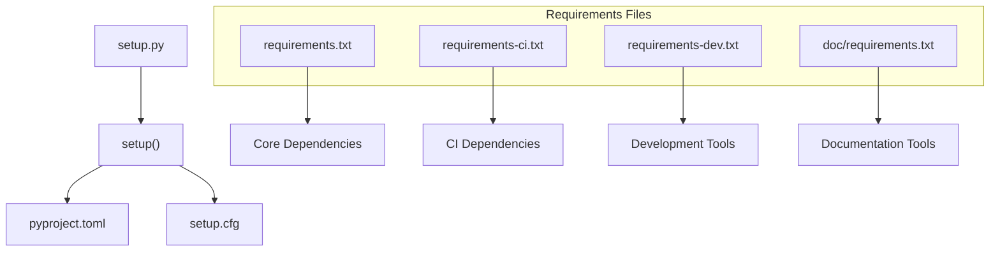
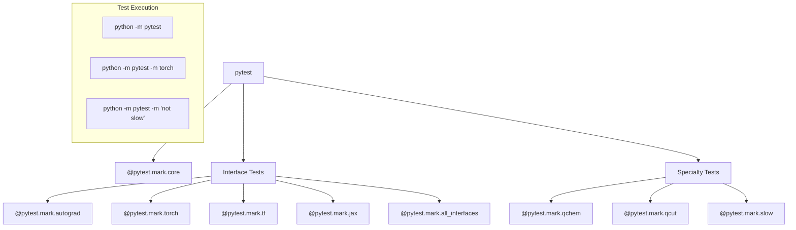
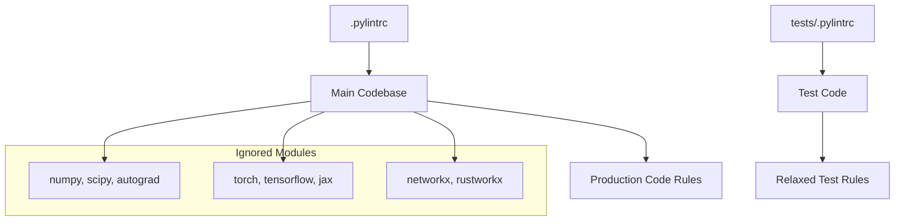
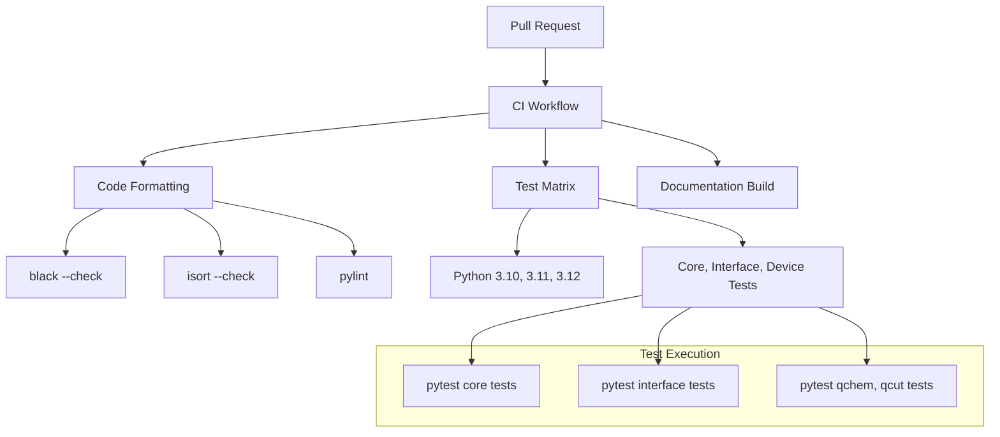
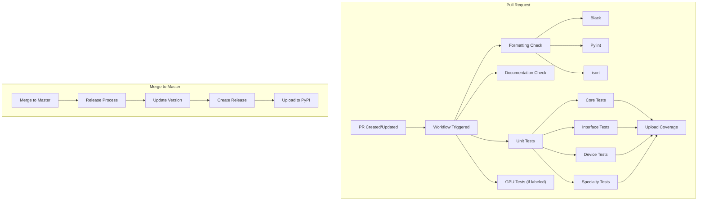
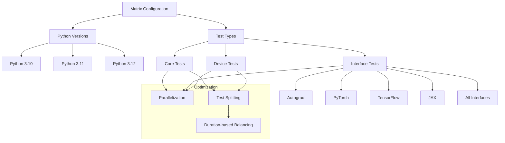
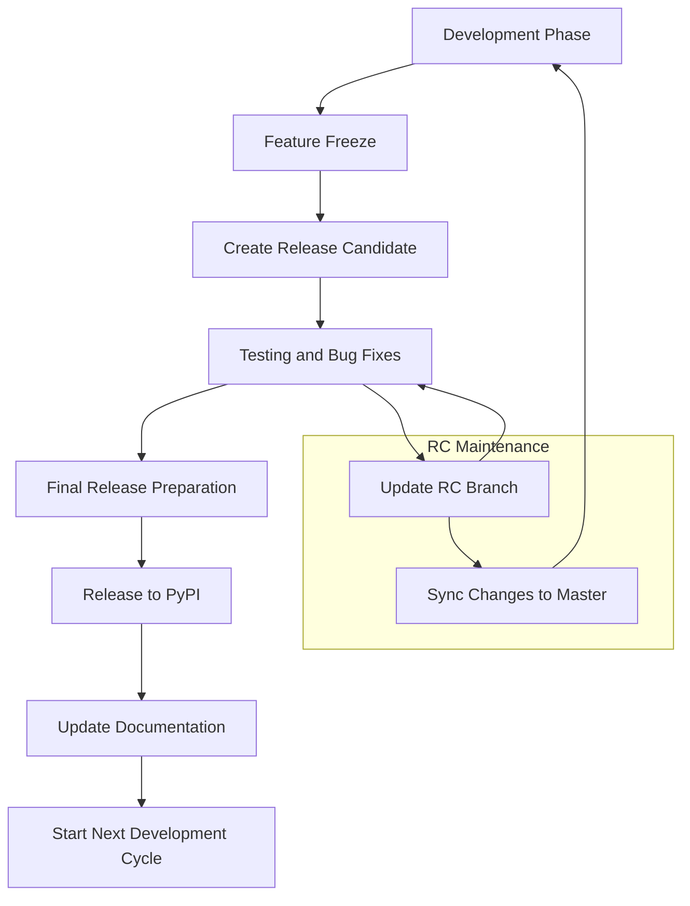
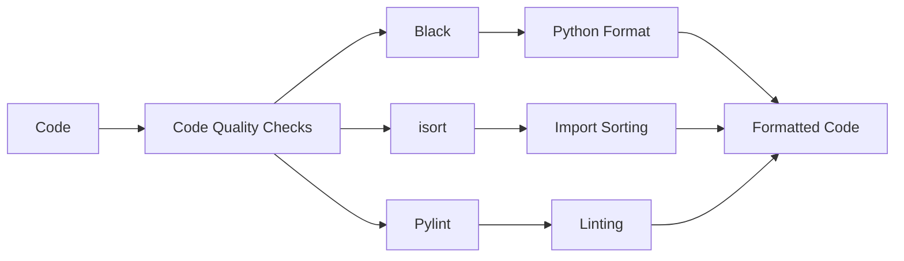
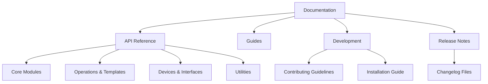

<!-- source: DeepWiki mcp.deepwiki.com · repo PennyLaneAI/pennylane · page 8 Development Infrastructure · fetched 2026-10-21 -->

# Development Infrastructure

<details>
<summary>Relevant source files</summary>

The following files were used as context for generating this wiki page:

- [.github/workflows/create-release.yml](.github/workflows/create-release.yml)
- [.github/workflows/docs.yml](.github/workflows/docs.yml)
- [.github/workflows/format.yml](.github/workflows/format.yml)
- [.github/workflows/interface-unit-tests.yml](.github/workflows/interface-unit-tests.yml)
- [.github/workflows/rc_sync.yml](.github/workflows/rc_sync.yml)
- [.github/workflows/rtd-check.yml](.github/workflows/rtd-check.yml)
- [.github/workflows/tests-gpu.yml](.github/workflows/tests-gpu.yml)
- [.github/workflows/tests.yml](.github/workflows/tests.yml)
- [.github/workflows/unit-test.yml](.github/workflows/unit-test.yml)
- [.github/workflows/upload-nightly-rc-release.yml](.github/workflows/upload-nightly-rc-release.yml)
- [.github/workflows/upload-nightly-release.yml](.github/workflows/upload-nightly-release.yml)
- [.github/workflows/upload.yml](.github/workflows/upload.yml)
- [.pylintrc](.pylintrc)
- [.readthedocs.yml](.readthedocs.yml)
- [doc/code/qml.rst](doc/code/qml.rst)
- [doc/development/guide/documentation.rst](doc/development/guide/documentation.rst)
- [doc/development/guide/installation.rst](doc/development/guide/installation.rst)
- [doc/introduction/compiling_workflows.rst](doc/introduction/compiling_workflows.rst)
- [doc/requirements.txt](doc/requirements.txt)
- [pennylane/compiler/__init__.py](pennylane/compiler/__init__.py)
- [pennylane/compiler/compiler.py](pennylane/compiler/compiler.py)
- [pennylane/numpy/random.py](pennylane/numpy/random.py)
- [pyproject.toml](pyproject.toml)
- [setup.py](setup.py)
- [tests/.pylintrc](tests/.pylintrc)

</details>


This page documents the development infrastructure that supports PennyLane's development workflow, including package organization, build configuration, testing frameworks, continuous integration, and release processes. This infrastructure enables developers to contribute effectively to PennyLane while maintaining code quality and ensuring compatibility across multiple interfaces and quantum computing backends.

## Package Structure and Build System

PennyLane uses a modern Python packaging approach with setuptools and multiple requirements files to manage dependencies for different use cases.

### Build Configuration

**Setup Configuration**
The build system is configured through `setup.py`, which provides a minimal setup call that delegates to configuration files.



**Requirements Management**
PennyLane maintains separate requirements files for different environments and use cases:

| File | Purpose | Key Dependencies |
|------|---------|------------------|
| `requirements.txt` | Core runtime dependencies | `numpy`, `scipy`, `autograd`, `autoray`, `rustworkx` |
| `requirements-ci.txt` | CI environment | Subset of core dependencies for testing |
| `requirements-dev.txt` | Development tools | `pytest`, `pylint`, `black`, `pre-commit` |
| `doc/requirements.txt` | Documentation building | `sphinx`, `jax`, `torch`, `tensorflow` |

### Core Dependencies

**Runtime Dependencies**
The core dependencies defined in `requirements.txt` include:

- **Mathematical Libraries**: `numpy~=1.23`, `scipy~=1.8`
- **Graph Libraries**: `networkx~=2.8`, `rustworkx~=0.15.1` 
- **Autodifferentiation**: `autograd~=1.4`, `autoray>=0.6.11`
- **Utilities**: `tomlkit~=0.13`, `appdirs~=1.4`, `cachetools~=5.3.0`
- **Visualization**: `matplotlib~=3.5`
- **Optimization**: `cvxpy~=1.2`, `cvxopt~=1.3.0`

**Interface Dependencies**
Optional interface dependencies are documented but not included in core requirements:

- **JAX Interface**: `jax==0.6.0`, `jaxlib==0.6.0`
- **PyTorch Interface**: `torch==2.5.1`
- **TensorFlow Interface**: `tensorflow==2.19`

### Development Installation

**Editable Installation**
For development work, install PennyLane in editable mode:

```bash
git clone https://github.com/PennyLaneAI/pennylane
cd pennylane
pip install -e .
```

**Development Dependencies**
Install development tools:

```bash
pip install -r requirements-dev.txt
```

This includes testing frameworks (`pytest`, `pytest-cov`), code quality tools (`black`, `pylint`, `isort`), and development utilities (`pre-commit`, `build`).

Sources:
[setup.py:1-4]()
[requirements.txt:1-19]()
[requirements-ci.txt:1-18]()
[requirements-dev.txt:1-18]()
[doc/requirements.txt:1-41]()
[doc/development/guide/installation.rst:56-86]()

## Testing and CI/CD

PennyLane maintains comprehensive testing infrastructure using `pytest` with specialized markers, fixtures, and continuous integration workflows to ensure code quality across multiple interfaces and quantum computing backends.

### Testing Framework

**Test Organization and Markers**
The testing system uses `pytest` markers to categorize and filter tests:



**Test Structure and Requirements**
Tests require specific dependencies based on their markers:

| Marker | Dependencies | Purpose |
|--------|-------------|---------|
| `core` | Core PennyLane only | Basic functionality |
| `autograd` | `autograd` | Autograd interface tests |
| `torch` | `torch` | PyTorch interface tests |
| `tf` | `tensorflow` | TensorFlow interface tests |
| `jax` | `jax`, `jaxlib` | JAX interface tests |
| `all_interfaces` | All interfaces | Cross-interface compatibility |

### Test Configuration

**pytest Configuration**
Tests are automatically marked based on imports through `conftest.py` configuration. Core tests (those not importing interfaces) are automatically marked as `@pytest.mark.core`.

**Specialized Testing Tools**
The testing framework includes several pytest extensions:

- `pytest-cov`: Test coverage measurement
- `pytest-mock`: Mock object support  
- `pytest-xdist`: Parallel test execution
- `pytest-benchmark`: Performance benchmarking
- `flaky`: Non-deterministic test handling
- `pytest-forked`: Process isolation
- `pytest-rng`: Random number generation control

### Linting and Code Quality

**pylint Configuration**
Code quality is enforced through `pylint` with separate configurations:



**Disabled Checks**
Both configurations disable certain checks:
- `line-too-long`: Handled by Black formatter
- `cyclic-import`: Temporarily disabled due to existing cycles
- `import-error`: Disabled for optional dependencies

### Continuous Integration

**Matrix Testing Strategy**
CI/CD employs matrix testing across Python versions and test categories:



**Performance Optimizations**
CI pipeline includes several optimizations:
- **Test Splitting**: Uses `pytest-split` for balanced test distribution
- **Parallel Execution**: Leverages `pytest-xdist` for concurrent test runs
- **Dependency Caching**: Caches pip dependencies between runs
- **Selective Testing**: Runs only relevant tests based on changed files

Sources:
[doc/development/guide/tests.rst:1-254]()
[requirements-dev.txt:1-18]()
[.pylintrc:1-48]()
[tests/.pylintrc:1-64]()

## CI/CD Pipeline

PennyLane uses GitHub Actions for continuous integration and deployment, with a comprehensive set of workflows for testing, linting, documentation building, and releases.

### CI/CD Workflow



### Matrix Testing Strategy

PennyLane's CI pipeline uses a matrix strategy to run tests across different Python versions and interfaces:



The CI system uses cached dependencies and optimized test splitting to reduce test execution time.

### Workflow Implementation

The workflows are defined in YAML files in the `.github/workflows` directory:

- `tests.yml`: Main test workflow that calls `interface-unit-tests.yml`
- `interface-unit-tests.yml`: Reusable workflow with matrix testing for different interfaces
- `unit-test.yml`: Reusable workflow for running a specific test configuration
- `format.yml`: Code formatting and linting checks
- `docs.yml`: Documentation building and checks
- `tests-gpu.yml`: GPU-specific tests

The CI system also collects test results and coverage data, which are uploaded as artifacts and to Codecov.

Sources:
[.github/workflows/tests.yml:1-803]()
[.github/workflows/interface-unit-tests.yml:1-803]()
[.github/workflows/unit-test.yml:1-246]()
[.github/workflows/tests-gpu.yml:1-125]()
[.github/workflows/format.yml:1-59]()
[.github/workflows/docs.yml:1-87]()

## Release Management

PennyLane follows a structured release process for both regular releases and release candidates.

### Version Numbering

PennyLane uses semantic versioning (major.minor.patch) with optional development markers:

```
0.42.0-dev12  # Development release
0.42.0        # Stable release
```

Version numbers are maintained in `pennylane/_version.py`.

### Release Process



### Release Synchronization

The `rc_sync.yml` workflow automatically synchronizes changes from release candidate branches to the master branch during feature freeze periods:

1. Checks for an RC branch matching the current development version
2. Creates a temporary branch based on the RC branch
3. Excludes version-specific files that need to remain different
4. Opens a pull request to merge changes back to master

### Release Notes

Release notes are maintained in Markdown files in the `doc/releases` directory:

- `changelog-dev.md`: Development version changelog
- `changelog-X.Y.Z.md`: Stable release changelogs

The release notes are assembled in `doc/development/release_notes.md`.

### Publishing Releases

When a release is published on GitHub, the `upload.yml` workflow is triggered, which:

1. Runs all tests to ensure the release is stable
2. Builds a distribution wheel
3. Uploads the package to PyPI

Sources:
[pennylane/_version.py:15-19]()
[.github/workflows/rc_sync.yml:1-75]()
[.github/workflows/upload.yml:1-49]()
[doc/development/release_notes.md:1-106]()
[doc/releases/changelog-0.40.0.md:1-82]()

## Code Quality Tools

PennyLane employs several tools to ensure code quality throughout the development process.

### Code Formatting



The code quality tools are run automatically on pull requests:

- **Black**: Formats Python code with line length of 100 characters
- **isort**: Sorts imports with Black-compatible profile
- **Pylint**: Checks for coding standard violations and potential errors

Configuration for Pylint is defined in `.pylintrc` and `tests/.pylintrc`.

### Automated Checks

The `format.yml` workflow runs these tools automatically on pull requests:

```yaml
- name: Run Black
  run: |
    black -t py310 -t py311 -t py312 -l 100 pennylane/ --check
    black -t py310 -t py311 -t py312 -l 100 tests/ --check

- name: Run isort
  run: |
    isort --py 312 --profile black -l 100 -o autoray -p ./pennylane --skip __init__.py --filter-files ./pennylane --check
    isort --py 312 --profile black -l 100 -o autoray -p ./pennylane --skip __init__.py --filter-files ./tests --check

- name: Run Pylint
  run: pylint --rcfile .pylintrc $(find pennylane -name "*.py")
```

Sources:
[.github/workflows/format.yml:1-59]()
[.pylintrc:1-39]()
[tests/.pylintrc:1-18]()

## Documentation Infrastructure

PennyLane maintains comprehensive documentation built using Sphinx.

### Documentation Structure



### Documentation Building

The documentation is built using Sphinx with several extensions:
- sphinx-automodapi for automatic API documentation
- sphinx-copybutton for copy buttons on code blocks
- sphinxcontrib-bibtex for bibliography support

The build process is defined in the `docs.yml` workflow:

```yaml
- uses: PennyLaneAI/sphinx-action@master
  with:
    docs-folder: "doc/"
    pre-build-command: >
        apt install -y graphviz
        && pip3 install -r doc/requirements.txt
        && pip3 install .
        && pip3 install openfermionpyscf
        && pip3 install aiohttp fsspec h5py
    build-command: "sphinx-build -b html . _build -W --keep-going"
```

### Release Notes Management

Release notes are organized by version in separate Markdown files and included in the documentation through `mdinclude` directives in `doc/development/release_notes.md`:

```
.. mdinclude:: ../releases/changelog-dev.md
.. mdinclude:: ../releases/changelog-0.41.0.md
...
```

Each changelog file follows a consistent format with sections for new features, improvements, breaking changes, and bug fixes.

Sources:
[.github/workflows/docs.yml:1-87]()
[doc/requirements.txt:1-41]()
[doc/development/release_notes.md:1-106]()
[doc/code/qml_wires.rst:1-14]()

---

