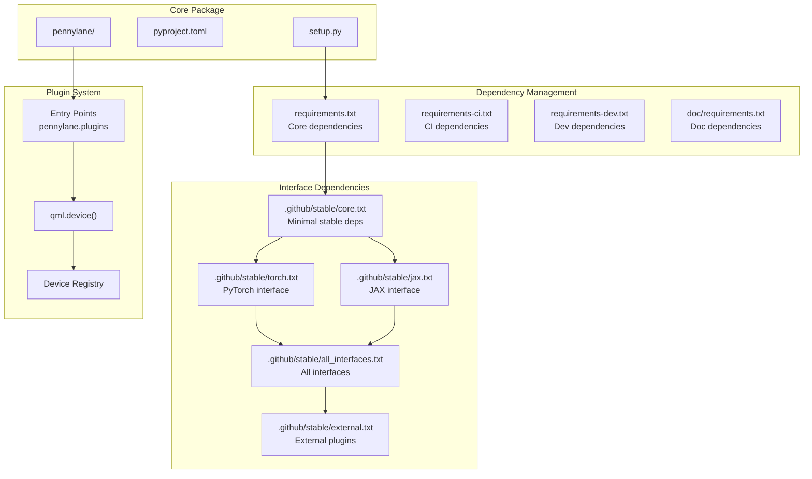
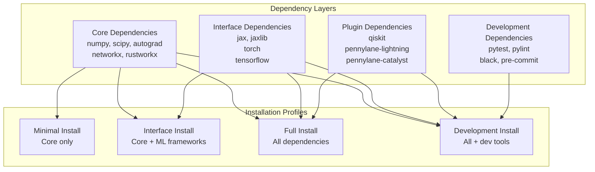
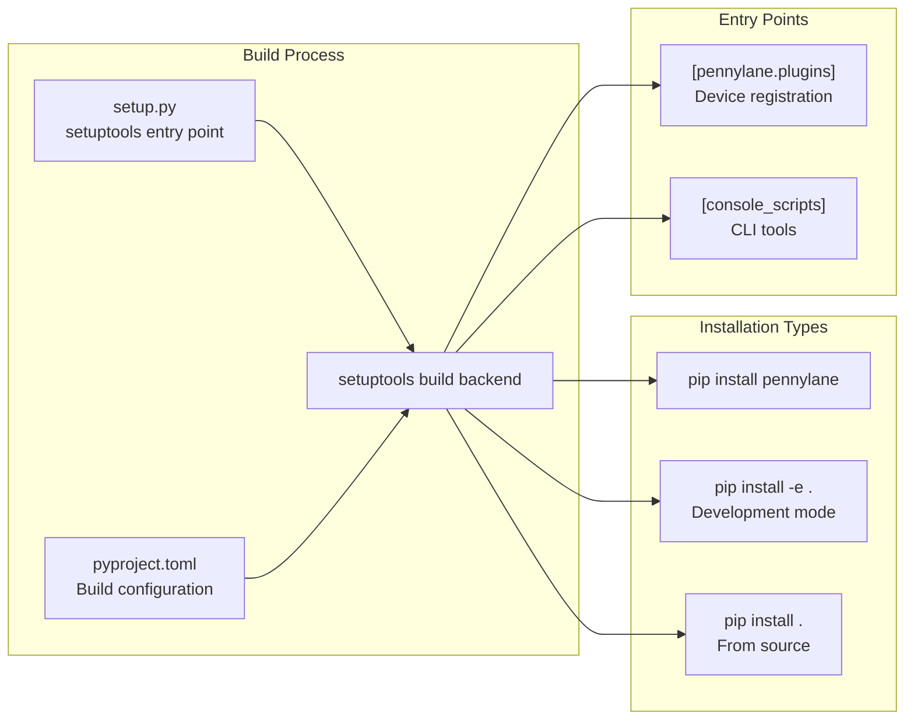
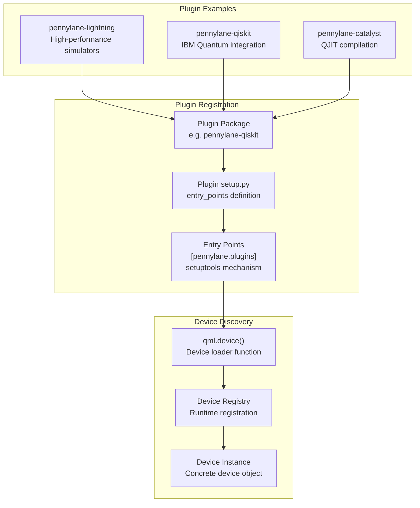
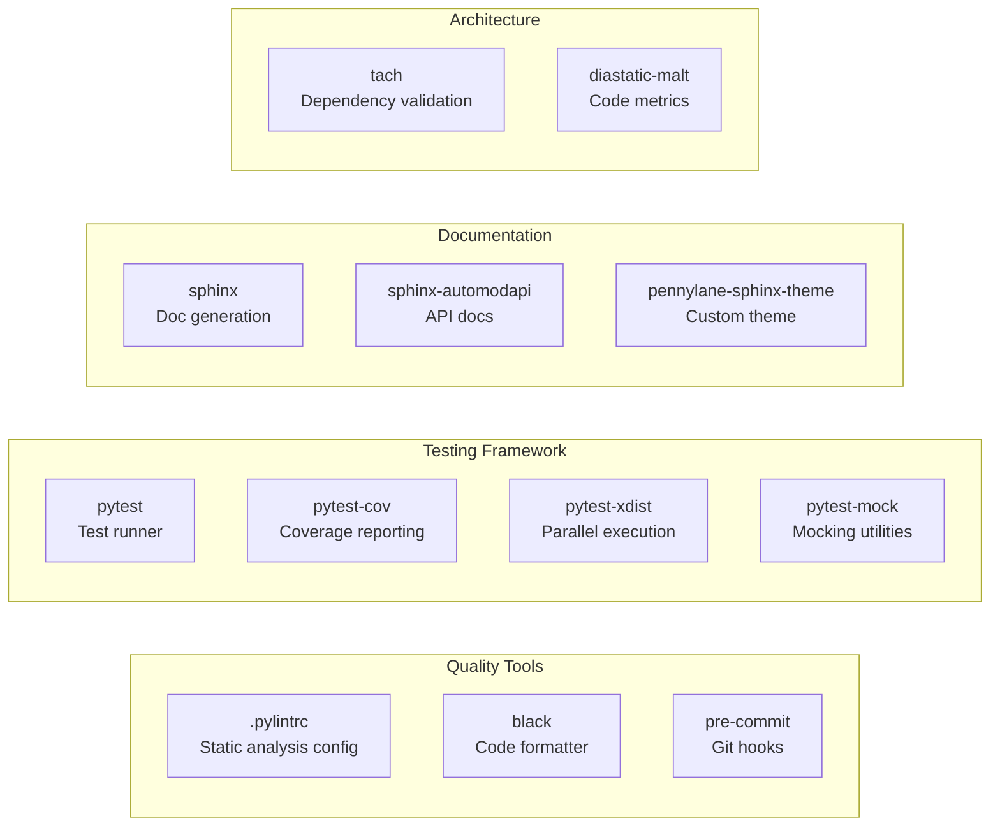
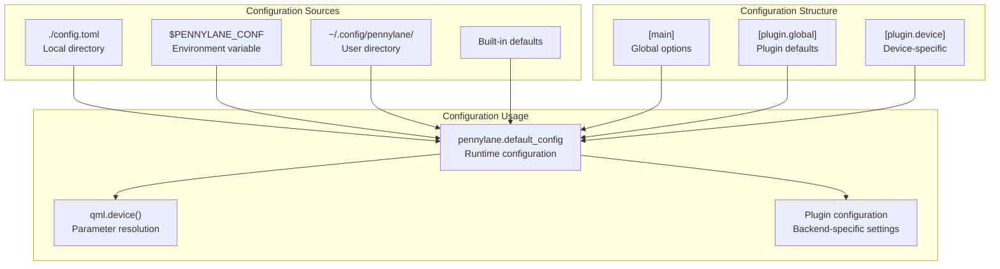
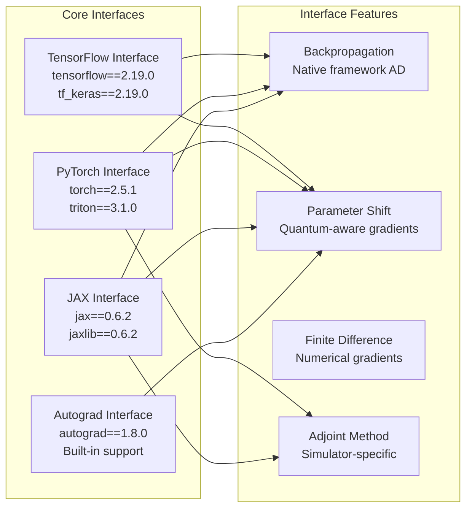

<!-- source: DeepWiki mcp.deepwiki.com · repo PennyLaneAI/pennylane · page 8.1 Package Structure and Build System · fetched 2026-10-21 -->

# Package Structure and Build System

Relevant source files

The following files were used as context for generating this wiki page:

- [.pylintrc](.pylintrc)
- [doc/code/qml.rst](doc/code/qml.rst)
- [doc/development/guide/documentation.rst](doc/development/guide/documentation.rst)
- [doc/development/guide/installation.rst](doc/development/guide/installation.rst)
- [doc/introduction/compiling_workflows.rst](doc/introduction/compiling_workflows.rst)
- [doc/requirements.txt](doc/requirements.txt)
- [pennylane/compiler/__init__.py](pennylane/compiler/__init__.py)
- [pennylane/compiler/compiler.py](pennylane/compiler/compiler.py)
- [pennylane/numpy/random.py](pennylane/numpy/random.py)
- [pyproject.toml](pyproject.toml)
- [setup.py](setup.py)
- [tests/.pylintrc](tests/.pylintrc)

This document describes PennyLane's package organization, dependency management, build configuration, and development infrastructure. It covers the technical foundations that enable PennyLane's modular architecture and extensible plugin system.

For information about testing infrastructure and CI/CD processes, see [Testing and CI/CD](#8.2). For release processes and versioning, see [Release Management and Versioning](#8.3).

## Package Organization

PennyLane follows a hierarchical package structure that separates core functionality from optional interfaces and plugins. The build system is designed to support minimal installations alongside full-featured deployments with multiple autodifferentiation backends.

Sources: [setup.py:1-4](), [requirements.txt:1-19](), [.github/stable/core.txt:1-93](), [.github/stable/all_interfaces.txt:1-132]()

## Core Dependencies Architecture

PennyLane's dependency system is organized in layers to support different installation profiles and use cases. The core package maintains minimal dependencies while interface-specific packages add framework requirements.

| Dependency Category | Key Packages | Purpose |
|-------------------|--------------|---------|
| **Numerical Computing** | `numpy ~=1.23`, `scipy ~=1.8` | Core mathematical operations |
| **Graph Processing** | `networkx ~=2.8`, `rustworkx ~=0.15.1` | Circuit graph manipulation |  
| **Autodifferentiation** | `autograd ~=1.4`, `autoray>=0.6.11` | Framework-agnostic differentiation |
| **Optimization** | `cvxpy ~=1.2`, `cvxopt ~=1.3.0` | Convex optimization routines |
| **Configuration** | `tomlkit ~=0.13`, `appdirs ~=1.4` | Settings and config management |
| **Utilities** | `packaging`, `requests ~=2.31.0` | Package utilities and HTTP |

Sources: [requirements.txt:1-19](), [.github/stable/core.txt:1-93](), [.github/stable/all_interfaces.txt:1-132](), [requirements-dev.txt:1-18]()

## Build Configuration System

PennyLane uses a minimal build configuration centered around `setup.py` that delegates to `pyproject.toml` for modern Python packaging standards. The build system supports editable installs for development and entry point registration for plugins.

The setup process is intentionally minimal at [setup.py:1-4](), delegating configuration to declarative files and following modern Python packaging practices.

Sources: [setup.py:1-4](), [doc/development/guide/installation.rst:57-78]()

## Plugin Architecture and Entry Points

PennyLane's extensibility relies on Python entry points under the `pennylane.plugins` namespace. This allows external packages to register devices and operations that integrate seamlessly with the core framework.

The entry point system enables runtime discovery of devices without hardcoded dependencies, as described in [doc/development/guide/installation.rst:74-78]().

Sources: [doc/development/guide/architecture.rst:177-184](), [doc/development/guide/installation.rst:74-78](), [.github/stable/external.txt:147-149]()

## Development Toolchain

PennyLane employs a comprehensive development toolchain for code quality, testing, and documentation. The tools are configured consistently across the codebase and integrated into CI/CD workflows.

| Tool | Configuration File | Purpose |
|------|-------------------|---------|
| **pylint** | `.pylintrc`, `tests/.pylintrc` | Static code analysis |
| **black** | `requirements-dev.txt` | Code formatting |
| **pytest** | `requirements-dev.txt` | Testing framework |
| **pre-commit** | `requirements-dev.txt` | Git hooks for quality |
| **sphinx** | `doc/requirements.txt` | Documentation generation |
| **tach** | `requirements.txt` | Architecture validation |

The linting configuration at [.pylintrc:1-48]() defines extension packages and disabled checks, while test-specific configuration at [tests/.pylintrc:1-64]() provides different rules for test code.

Sources: [.pylintrc:1-48](), [tests/.pylintrc:1-64](), [requirements-dev.txt:1-18](), [doc/requirements.txt:1-41]()

## Configuration Management

PennyLane uses a TOML-based configuration system for device defaults, user credentials, and environment settings. The configuration system supports hierarchical overrides and plugin-specific settings.

Configuration precedence follows the order: local directory → environment variable → user config directory → defaults, as documented in [doc/introduction/configuration.rst:16-28]().

Sources: [doc/introduction/configuration.rst:1-116](), [requirements.txt:9]()

## Interface-Specific Dependencies

PennyLane supports multiple autodifferentiation frameworks through interface-specific dependency management. Each interface maintains version compatibility requirements for stable integration.

Interface dependencies are managed through separate requirement files to enable minimal installations, as shown in [.github/stable/jax.txt:34-35](), [.github/stable/torch.txt:103](), and [.github/stable/all_interfaces.txt:40-41,115-116]().

Sources: [.github/stable/jax.txt:34-35](), [.github/stable/torch.txt:103](), [.github/stable/all_interfaces.txt:40-41,115-116](), [doc/development/guide/installation.rst:49-55]()

---

