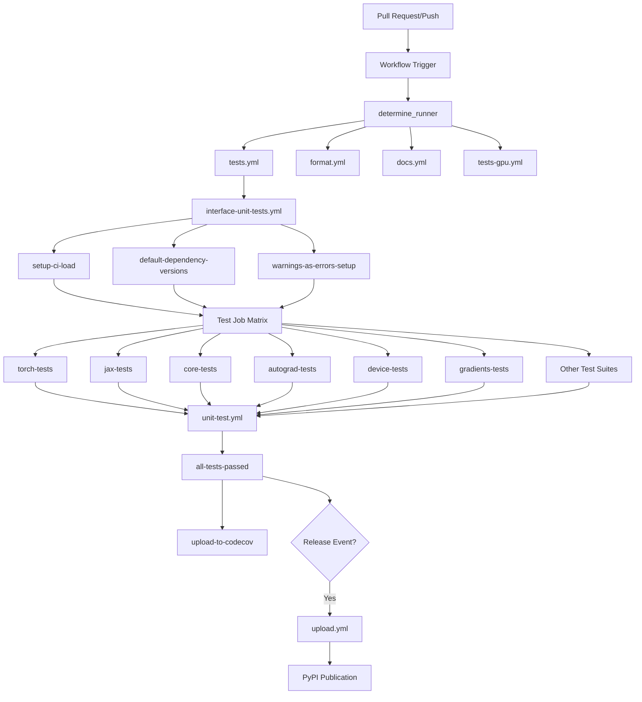

<!-- source: DeepWiki mcp.deepwiki.com · repo PennyLaneAI/pennylane · page 8.2 Testing Infrastructure and CI/CD · fetched 2026-10-21 -->

# Testing and CI/CD

<details>
<summary>Relevant source files</summary>

The following files were used as context for generating this wiki page:

- [.github/durations/core_tests_durations.json](.github/durations/core_tests_durations.json)
- [.github/durations/jax_tests_durations.json](.github/durations/jax_tests_durations.json)
- [.github/workflows/create-release.yml](.github/workflows/create-release.yml)
- [.github/workflows/docs.yml](.github/workflows/docs.yml)
- [.github/workflows/format.yml](.github/workflows/format.yml)
- [.github/workflows/interface-unit-tests.yml](.github/workflows/interface-unit-tests.yml)
- [.github/workflows/rc_sync.yml](.github/workflows/rc_sync.yml)
- [.github/workflows/rtd-check.yml](.github/workflows/rtd-check.yml)
- [.github/workflows/tests-gpu.yml](.github/workflows/tests-gpu.yml)
- [.github/workflows/tests.yml](.github/workflows/tests.yml)
- [.github/workflows/unit-test.yml](.github/workflows/unit-test.yml)
- [.github/workflows/upload-nightly-rc-release.yml](.github/workflows/upload-nightly-rc-release.yml)
- [.github/workflows/upload-nightly-release.yml](.github/workflows/upload-nightly-release.yml)
- [.github/workflows/upload.yml](.github/workflows/upload.yml)
- [.readthedocs.yml](.readthedocs.yml)

</details>


This document describes PennyLane's comprehensive testing framework and continuous integration/continuous deployment (CI/CD) infrastructure. It covers the test organization, GitHub Actions workflows, automation processes, and quality assurance systems that ensure code reliability and maintainability.

For information about the package structure and build system, see [Package Structure and Build System](#8.1). For details about release management, see [Release Management and Versioning](#8.3).

## Overview

PennyLane employs a sophisticated CI/CD system built on GitHub Actions that provides comprehensive testing coverage across multiple dimensions:

- **Interface Testing**: Tests for PyTorch, JAX, TensorFlow, Autograd, and other ML framework integrations
- **Component Testing**: Core functionality, gradients, devices, quantum chemistry, and specialized features
- **Multi-Platform Support**: Testing across multiple Python versions (3.11, 3.12, 3.13) and hardware configurations
- **Quality Assurance**: Code formatting, documentation validation, and coverage reporting
- **Automated Release**: Streamlined deployment to PyPI with pre-release validation

## Core Testing Architecture

The testing infrastructure is organized around a central orchestration system that coordinates multiple specialized test suites:

### CI/CD Pipeline Flow



Sources: [.github/workflows/tests.yml:1-66](), [.github/workflows/interface-unit-tests.yml:1-811](), [.github/workflows/upload.yml:1-48]()

### Test Job Organization

```mermaid
flowchart TB
    subgraph "Test Suite Categories"
        INTERFACE_SUITES["Interface Tests"]
        COMPONENT_SUITES["Component Tests"] 
        SPECIALIZED_SUITES["Specialized Tests"]
        QUALITY_SUITES["Quality Checks"]
    end
    
    INTERFACE_SUITES --> TORCH["torch-tests<br/>PyTorch Integration"]
    INTERFACE_SUITES --> JAX["jax-tests<br/>JAX Integration<br/>4 parallel groups"]
    INTERFACE_SUITES --> CAPTURE_JAX["capture-jax-tests<br/>JAX Capture Features"]
    INTERFACE_SUITES --> AUTOGRAD["autograd-tests<br/>Autograd Integration"]
    INTERFACE_SUITES --> ALL_INTERFACES["all-interfaces-tests<br/>Multi-framework Tests"]
    
    COMPONENT_SUITES --> CORE["core-tests<br/>Core Functionality<br/>6 parallel groups"]
    COMPONENT_SUITES --> GRADIENTS["gradients-tests<br/>finite-diff, param-shift"]
    COMPONENT_SUITES --> DEVICES["device-tests<br/>default.qubit, default.mixed"]
    COMPONENT_SUITES --> DATA["data-tests<br/>Data Loading/Storage"]
    
    SPECIALIZED_SUITES --> QCHEM["qchem-tests<br/>Quantum Chemistry"]
    SPECIALIZED_SUITES --> QCUT["qcut-tests<br/>Circuit Cutting"]
    SPECIALIZED_SUITES --> EXTERNAL["external-libraries-tests<br/>Third-party Integrations"]
    
    QUALITY_SUITES --> FORMAT["black-pylint<br/>Code Formatting"]
    QUALITY_SUITES --> SPHINX["sphinx<br/>Documentation"]
    QUALITY_SUITES --> GPU["gpu-tests<br/>GPU Device Testing"]
```



Sources: [.github/workflows/interface-unit-tests.yml:231-713](), [.github/workflows/format.yml:26-59](), [.github/workflows/docs.yml:43-71](), [.github/workflows/tests-gpu.yml:24-125]()

## Workflow Orchestration

### Main Test Workflow

The primary entry point for testing is `tests.yml`, which orchestrates the complete test suite:

| Feature | Configuration |
|---------|---------------|
| **Triggers** | Push to master, PR events, scheduled runs, merge group |
| **Concurrency** | `unit-tests-${{ github.ref }}` with cancellation |
| **Lightened CI** | Conditional based on PR labels (`ci:run-full-test-suite`) |
| **Runner Selection** | Dynamic based on event type and configuration |

The workflow determines whether to run a full test suite or lightened version based on the event type and PR labels: [.github/workflows/tests.yml:40-46]()

### Interface Unit Tests Workflow

The `interface-unit-tests.yml` workflow is the core testing orchestrator that supports extensive customization:

| Input Parameter | Purpose | Default |
|-----------------|---------|---------|
| `branch` | Target branch for testing | Required |
| `run_lightened_ci` | Enable reduced test matrix | `false` |
| `pytest_coverage_flags` | Coverage configuration | Comprehensive coverage settings |
| `python_warning_level` | Warning handling | `'default'` |
| `use_large_runner` | Force large runner usage | `false` |

Sources: [.github/workflows/interface-unit-tests.yml:21-84]()

### Test Matrix Configuration

The system uses dynamic matrix configuration to optimize resource usage:

**Python Version Matrix** (based on CI mode):
- **Full CI**: Python 3.11, 3.12, 3.13 for most jobs
- **Lightened CI**: Python 3.11 only
- **Warnings-as-Errors**: Python 3.11 only

**Parallelization Strategy**:
- `core-tests`: 6 parallel groups
- `jax-tests`: 4 parallel groups  
- `gradients-tests`: 2 test suites (finite-diff, param-shift)
- `device-tests`: 3 configurations (default.qubit with/without shots, default.mixed)

Sources: [.github/workflows/interface-unit-tests.yml:134-221]()

### Unit Test Execution

The reusable `unit-test.yml` workflow handles individual test job execution:

**Key Features**:
- **Dependency Management**: Uses `uv` for fast package installation
- **Test Splitting**: Supports `pytest-splits` for parallel execution  
- **Duration Tracking**: Records test durations for optimization
- **Coverage Reporting**: Generates coverage reports for Codecov
- **Artifact Management**: Handles test reports and frozen requirements

**Environment Setup**:
```yaml
UV_SYSTEM_PYTHON: 1
TEST_REPORTS_DIR: .github/test-reports
```

**PyTest Configuration**:
- Parallel execution with `-n auto`
- Coverage with configurable flags
- XML reporting for CI analytics
- Duration-based test splitting

Sources: [.github/workflows/unit-test.yml:96-246]()

## Test Categories and Markers

PennyLane uses pytest markers to categorize and select tests:

### Interface Markers
- `torch`: PyTorch integration tests
- `jax`: JAX integration tests  
- `autograd`: Autograd integration tests
- `capture`: JAX capture functionality tests
- `all_interfaces`: Multi-framework compatibility tests

### Component Markers  
- `core`: Core PennyLane functionality
- `finite-diff`: Finite difference gradient tests
- `param-shift`: Parameter-shift gradient tests
- `qcut`: Circuit cutting tests
- `qchem`: Quantum chemistry tests
- `external`: External library integration tests
- `data`: Data handling tests
- `gpu`: GPU-specific tests

### Exclusion Patterns
Common exclusion patterns used across test suites:
```
and not qcut and not finite-diff and not param-shift
```

Sources: [.github/workflows/interface-unit-tests.yml:265-696]()

## Dependency Management

### Interface Dependencies

The system maintains centralized dependency versions through `interface-dependency-versions.yml`:

| Framework | Default Version | Usage |
|-----------|----------------|-------|
| JAX | 0.6.2 | Regular JAX tests |
| JAX (Catalyst) | 0.6.2 | Catalyst compatibility tests |
| PyTorch | 2.5.0 | PyTorch integration tests |

**Specialized Dependencies**:
- **Catalyst**: Nightly builds from TestPyPI
- **Lightning**: Latest pre-release versions
- **QChem**: `openfermionpyscf`, `basis-set-exchange`, `geometric`
- **External**: `pyzx`, `matplotlib`, `stim`, `quimb`, `mitiq`

Sources: [.github/workflows/interface-dependency-versions.yml:15-77]()

### Frozen Requirements

The system captures and manages stable dependency snapshots:
- Generated during scheduled runs
- Stored as artifacts and committed to `.github/stable/`
- Used for reproducible testing environments
- Automatically updated via bot PRs

Sources: [.github/workflows/tests.yml:48-65](), [.github/workflows/unit-test.yml:207-217]()

## Quality Assurance

### Code Formatting

The `format.yml` workflow enforces code style standards:

**Tools and Configuration**:
- **Black**: Line length 100, Python 3.11-3.13 compatibility
- **isort**: Black profile, custom PennyLane ordering
- **Pylint**: Separate configurations for source and test files

**Execution**:
```bash
black -t py311 -t py312 -t py313 -l 100 pennylane/ --check
pylint --rcfile .pylintrc $(find pennylane -name "*.py")
```

Sources: [.github/workflows/format.yml:32-58]()

### Documentation Validation

The `docs.yml` workflow validates documentation integrity:

**Features**:
- Sphinx warnings treated as errors (`-W --keep-going`)
- Dependency freezing for reproducible builds
- GitHub annotations for warning locations
- Stricter than Read the Docs validation

**Build Command**:
```bash
sphinx-build -b html . _build -W --keep-going
```

Sources: [.github/workflows/docs.yml:43-70]()

### GPU Testing  

The `tests-gpu.yml` workflow provides specialized GPU validation:

**Infrastructure**:
- Self-hosted runners with GPU access
- CUDA environment configuration
- Virtual environment isolation
- Matrix testing across Python versions

**Environment Setup**:
```bash
echo "/usr/local/cuda/bin" >> $GITHUB_PATH
echo "LD_LIBRARY_PATH=/usr/local/cuda/lib64" >> $GITHUB_ENV
```

Sources: [.github/workflows/tests-gpu.yml:50-125]()

## Coverage and Reporting

### Coverage Collection

Coverage is collected across all test jobs and aggregated:

**Coverage Configuration**:
- Uses `.coveragerc` configuration file
- Appends coverage across jobs (`--cov-append`)
- Generates XML reports for Codecov
- Adjusts paths for proper attribution

**Codecov Integration**:
- Uploads only after all tests pass
- Fails CI on upload errors
- Provides coverage change analysis

Sources: [.github/workflows/interface-unit-tests.yml:36-40](), [.github/workflows/interface-unit-tests.yml:728-755]()

### Test Analytics

The system includes comprehensive test analytics:

**Duration Tracking**:
- Records test execution times
- Uses durations for optimal test splitting
- Stored in `.github/durations/` directory

**Failure Reporting**:
- Generates JUnit XML reports
- Uploads failure reports to analytics service
- Provides detailed failure analysis

Sources: [.github/workflows/unit-test.yml:194-233](), [.github/workflows/interface-unit-tests.yml:799-810]()

## Release Automation

### Release Workflow

The `upload.yml` workflow handles automated package publication:

**Process**:
1. Full test suite execution on large runners
2. Wheel building with Python build tools
3. PyPI publication using trusted publishing
4. Dependency on successful test completion

**Security**:
- Uses PyPI trusted publishing
- Requires successful test validation
- Triggered only on release events

Sources: [.github/workflows/upload.yml:14-47]()

## Performance Optimization

### Runner Management

The system uses dynamic runner selection for optimal resource utilization:

**Runner Types**:
- Standard GitHub-hosted runners for regular jobs
- Large runners for compute-intensive tasks
- Self-hosted GPU runners for specialized testing

**Selection Logic**:
```yaml
force_large_runner: ${{ github.event_name == 'merge_group' }}
```

### Test Parallelization

**Strategies**:
- Matrix parallelization across Python versions
- Test splitting using `pytest-splits`
- Load balancing based on historical durations
- Configurable max-parallel settings per job type

**Example Configuration**:
```yaml
max-parallel: 8  # for jax-tests
matrix:
  group: [1, 2, 3, 4]  # 4-way splitting
```

Sources: [.github/workflows/interface-unit-tests.yml:174-201](), [.github/workflows/interface-unit-tests.yml:311-340]()

---

