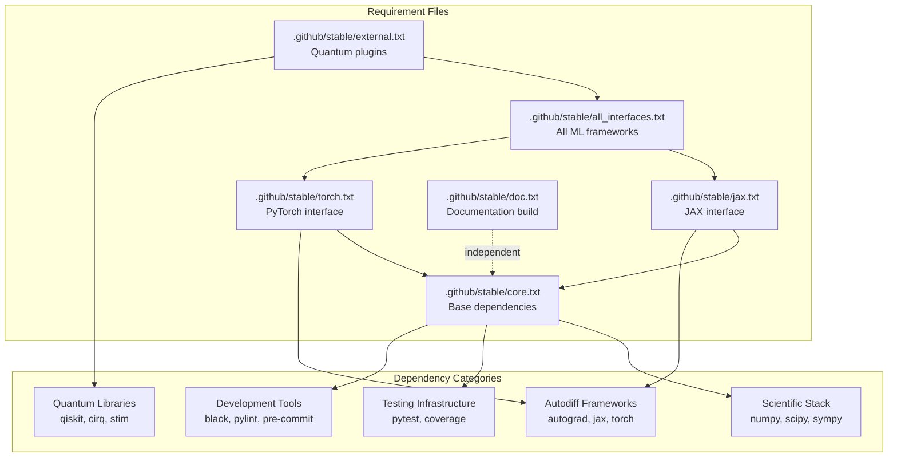
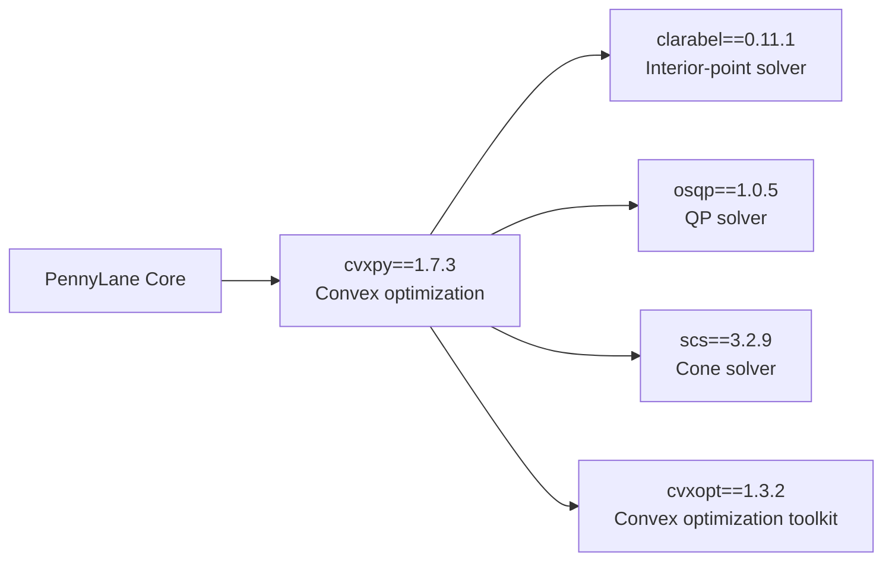
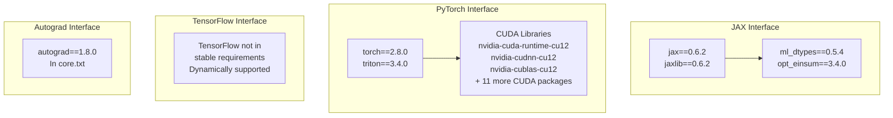
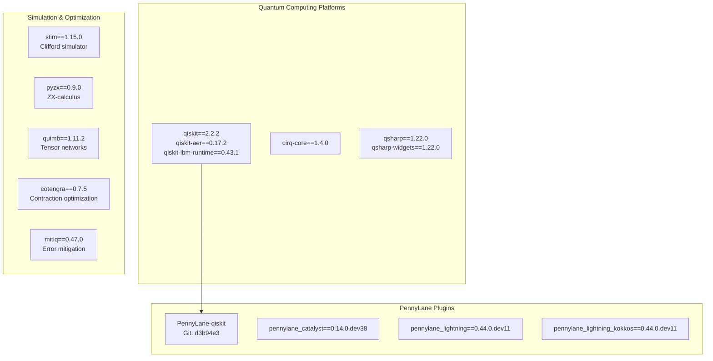
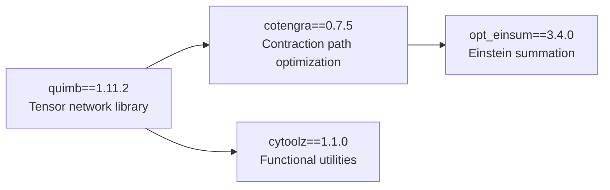
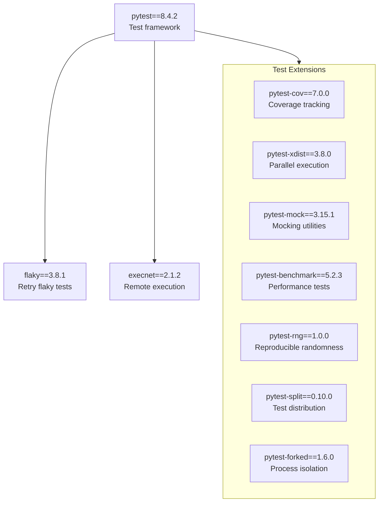
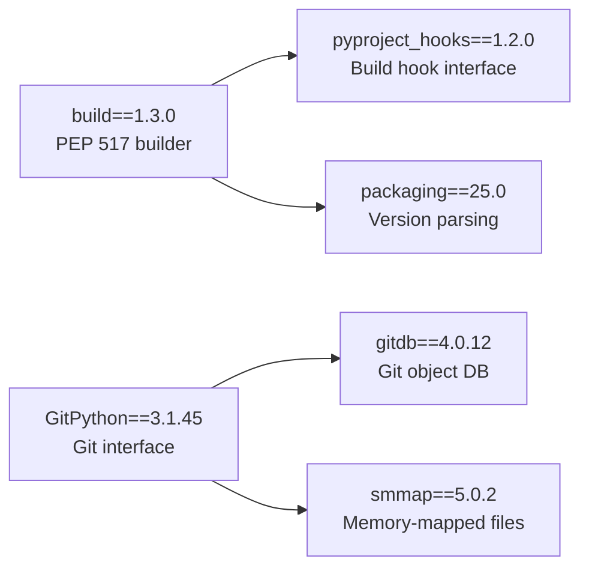
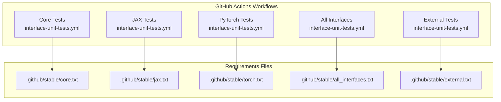
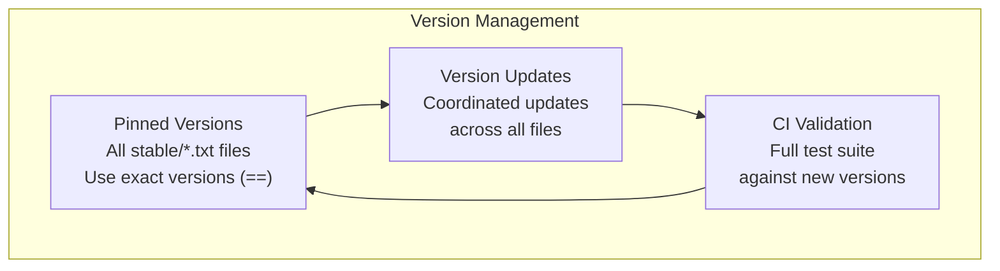

<!-- source: DeepWiki mcp.deepwiki.com · repo PennyLaneAI/pennylane · page 8.3 Dependencies and Environment Setup · fetched 2026-10-21 -->

# Dependencies and Environment Setup

<details>
<summary>Relevant source files</summary>

The following files were used as context for generating this wiki page:

- [.github/stable/all_interfaces.txt](.github/stable/all_interfaces.txt)
- [.github/stable/core.txt](.github/stable/core.txt)
- [.github/stable/doc.txt](.github/stable/doc.txt)
- [.github/stable/external.txt](.github/stable/external.txt)
- [.github/stable/jax.txt](.github/stable/jax.txt)
- [.github/stable/torch.txt](.github/stable/torch.txt)

</details>


This document describes PennyLane's dependency management system, including core requirements, ML framework integration, quantum library plugins, and development environment configuration. The dependency structure supports multiple installation profiles tailored to different use cases, from minimal core functionality to full external plugin support.

For information about the package structure and build configuration, see [Package Structure and Build System](#8.1). For CI/CD workflows that use these dependencies, see [Testing Infrastructure and CI/CD](#8.2).

---

## Dependency Configuration Structure

PennyLane organizes dependencies into multiple requirement files located in `.github/stable/`, each targeting specific installation profiles. These files are used by CI/CD workflows to create reproducible test environments.

### Dependency Groups



**Sources:** [.github/stable/core.txt](), [.github/stable/jax.txt](), [.github/stable/torch.txt](), [.github/stable/all_interfaces.txt](), [.github/stable/external.txt](), [.github/stable/doc.txt]()

---

## Core Dependencies

The core dependency set provides the minimal requirements for running PennyLane without ML framework integrations or external plugins.

### Scientific Computing Stack

| Package | Version | Purpose |
|---------|---------|---------|
| `numpy` | 2.3.5 | Array operations and linear algebra |
| `scipy` | 1.16.3 | Scientific computing utilities |
| `scipy-openblas32` | 0.3.30.0.8 | Optimized BLAS backend |
| `autograd` | 1.8.0 | Automatic differentiation for NumPy |
| `autoray` | 0.8.2 | Backend-agnostic array operations |
| `networkx` | 3.6 | Graph algorithms |
| `rustworkx` | 0.17.1 | High-performance graph library (Rust-based) |
| `sympy` | 1.14.0 | Symbolic mathematics |

**Sources:** [.github/stable/core.txt:1-93]()

### Built-in Plugins

The core installation includes `pennylane_lightning==0.44.0.dev15`, which provides high-performance C++ simulators for state vector operations. This is the default backend used by `default.qubit` when available.

**Sources:** [.github/stable/core.txt:50]()

### Optimization Libraries



These optimization libraries support various PennyLane features including variational quantum algorithms and optimization-based transforms.

**Sources:** [.github/stable/core.txt:13-18](), [.github/stable/core.txt:46](), [.github/stable/core.txt:81]()

---

## ML Framework Integration

PennyLane supports multiple automatic differentiation frameworks through a unified interface abstraction layer. Each framework has specific version requirements and optional dependencies.

### Interface Dependency Specifications



**Sources:** [.github/stable/jax.txt:34-35](), [.github/stable/jax.txt:44-49](), [.github/stable/torch.txt:48-61](), [.github/stable/torch.txt:106-107](), [.github/stable/core.txt:4]()

### PyTorch CUDA Dependencies

When using PyTorch, PennyLane's environment includes comprehensive CUDA support for GPU acceleration:

| Category | Packages |
|----------|----------|
| Runtime | `nvidia-cuda-runtime-cu12==12.8.90` |
| Compilation | `nvidia-cuda-nvrtc-cu12==12.8.93`, `nvidia-nvjitlink-cu12==12.8.93` |
| Linear Algebra | `nvidia-cublas-cu12==12.8.4.1`, `nvidia-cusolver-cu12==11.7.3.90`, `nvidia-cusparse-cu12==12.5.8.93` |
| FFT & Random | `nvidia-cufft-cu12==11.3.3.83`, `nvidia-curand-cu12==10.3.9.90` |
| Neural Networks | `nvidia-cudnn-cu12==9.10.2.21`, `nvidia-cusparselt-cu12==0.7.1` |
| Profiling | `nvidia-cuda-cupti-cu12==12.8.90`, `nvidia-nvtx-cu12==12.8.90` |
| Multi-GPU | `nvidia-nccl-cu12==2.27.3` |
| Storage | `nvidia-cufile-cu12==1.13.1.3` |

**Sources:** [.github/stable/torch.txt:48-61]()

### Interface Version Compatibility

The `all_interfaces.txt` configuration combines JAX and PyTorch, ensuring cross-framework compatibility. Key shared dependencies:

- `numpy==2.3.5` (upgraded from NumPy 1.x for broader framework support)
- `scipy==1.16.3` (consistent across all interfaces)
- `autoray==0.8.2` (enables multi-framework dispatch)

**Sources:** [.github/stable/all_interfaces.txt:50](), [.github/stable/all_interfaces.txt:99](), [.github/stable/all_interfaces.txt:5]()

---

## External Quantum Plugins

The `external.txt` configuration includes extensive quantum computing libraries and plugins that extend PennyLane's capabilities.

### Major Quantum Frameworks



**Sources:** [.github/stable/external.txt:137-140](), [.github/stable/external.txt:183-185](), [.github/stable/external.txt:187-188](), [.github/stable/external.txt:30](), [.github/stable/external.txt:182](), [.github/stable/external.txt:189-190](), [.github/stable/external.txt:212](), [.github/stable/external.txt:111](), [.github/stable/external.txt:35]()

### Quantum Algorithm Libraries

| Package | Version | Purpose |
|---------|---------|---------|
| `bartiq` | 0.9.0 | Resource estimation and circuit analysis |
| `qualtran` | 0.6.1 | Quantum algorithms from Google |
| `qref` | 0.9.0 | Quantum reference implementations |
| `mitiq` | 0.47.0 | Quantum error mitigation techniques |
| `pyzx` | 0.9.0 | ZX-calculus for circuit optimization |

**Sources:** [.github/stable/external.txt:18](), [.github/stable/external.txt:189](), [.github/stable/external.txt:186](), [.github/stable/external.txt:111](), [.github/stable/external.txt:182]()

### Tensor Network Simulation



These libraries enable efficient simulation of quantum circuits using tensor network methods, particularly useful for circuits with limited entanglement.

**Sources:** [.github/stable/external.txt:190](), [.github/stable/external.txt:35](), [.github/stable/external.txt:41](), [.github/stable/external.txt:127]()

### Catalyst JIT Compilation

The Catalyst plugin (`pennylane_catalyst==0.14.0.dev38`) provides JIT compilation through MLIR:

- `filecheck==1.0.3` - LLVM file checking utility
- `xdsl==0.55.0` - Python MLIR dialect framework
- `xdsl-jax` - JAX integration (Git: 4412dcd)

**Sources:** [.github/stable/external.txt:138](), [.github/stable/external.txt:53](), [.github/stable/external.txt:238-239]()

---

## Development Dependencies

All dependency files include a comprehensive set of development tools for testing, code quality, and collaboration.

### Testing Infrastructure



**Sources:** [.github/stable/core.txt:64-71](), [.github/stable/core.txt:25](), [.github/stable/core.txt:23]()

### Code Quality Tools

| Tool | Version | Purpose |
|------|---------|---------|
| `black` | 25.9.0 | Code formatting |
| `pylint` | 4.0.3 | Static code analysis |
| `isort` | 7.0.0 | Import statement sorting |
| `pre-commit` | 4.5.0 | Pre-commit hook management |
| `astroid` | 4.0.2 | Abstract syntax tree for Python |

All tools are configured to maintain consistent code style across the codebase.

**Sources:** [.github/stable/core.txt:6](), [.github/stable/core.txt:61](), [.github/stable/core.txt:33](), [.github/stable/core.txt:54](), [.github/stable/core.txt:2]()

### Build and Packaging



**Sources:** [.github/stable/core.txt:7](), [.github/stable/core.txt:63](), [.github/stable/core.txt:47](), [.github/stable/core.txt:30](), [.github/stable/core.txt:29](), [.github/stable/core.txt:83]()

---

## Environment Setup Workflows

PennyLane's CI/CD system uses different dependency configurations for various test workflows. This section maps workflow files to their dependency requirements.

### CI Dependency Matrix



Each workflow installs its specific requirement file to create an isolated test environment matching the target configuration.

**Sources:** [.github/stable/core.txt](), [.github/stable/jax.txt](), [.github/stable/torch.txt](), [.github/stable/all_interfaces.txt](), [.github/stable/external.txt]()

### Local Development Setup

For local development, the recommended approach is to install dependencies incrementally based on needs:

**Minimal Installation:**
```bash
pip install -r .github/stable/core.txt
```

**With ML Framework (JAX):**
```bash
pip install -r .github/stable/jax.txt
```

**With ML Framework (PyTorch):**
```bash
pip install -r .github/stable/torch.txt
```

**Full Development Environment:**
```bash
pip install -r .github/stable/all_interfaces.txt
pip install -r .github/stable/external.txt
```

### Jupyter and Interactive Development

The `external.txt` configuration includes comprehensive Jupyter support:

| Package | Version | Purpose |
|---------|---------|---------|
| `jupyterlab` | 4.5.0 | JupyterLab environment |
| `notebook` | 7.5.0 | Classic notebook interface |
| `ipykernel` | 7.1.0 | IPython kernel |
| `ipywidgets` | 8.1.8 | Interactive widgets |
| `matplotlib` | 3.10.7 | Plotting library |
| `plotly` | 6.5.0 | Interactive plots |

**Sources:** [.github/stable/external.txt:97](), [.github/stable/external.txt:122](), [.github/stable/external.txt:75](), [.github/stable/external.txt:78](), [.github/stable/external.txt:106](), [.github/stable/external.txt:144]()

---

## Dependency Version Management

PennyLane uses pinned versions in stable requirement files to ensure reproducible builds and test environments. This approach prevents unexpected breakages from upstream dependency updates.

### Version Pinning Strategy



Key considerations:
- All versions use exact equality (`==`) to prevent surprises
- NumPy 2.x series adopted for improved performance
- CUDA libraries synchronized with PyTorch 2.8.0
- JAX 0.6.2 and jaxlib 0.6.2 matched versions

**Sources:** [.github/stable/core.txt:45](), [.github/stable/torch.txt:106](), [.github/stable/jax.txt:34-35]()

### Development vs. Stable Dependencies

The PennyLane Lightning and Catalyst plugins use development versions (`dev`) in the stable requirements:

- `pennylane_lightning==0.44.0.dev15`
- `pennylane_lightning_kokkos==0.44.0.dev11`
- `pennylane_catalyst==0.14.0.dev38`

These packages are actively developed in sync with PennyLane core and use development versions to ensure compatibility with the latest features.

**Sources:** [.github/stable/core.txt:50](), [.github/stable/external.txt:139-140](), [.github/stable/external.txt:138]()

---

## Special Dependencies and Utilities

### Platform-Specific Requirements

The `doc.txt` file contains Ubuntu system-level dependencies used for documentation builds in CI environments:

- `cloud-init==25.1.4` - Cloud instance initialization
- `dbus-python==1.3.2` - D-Bus messaging
- `python-apt==2.7.7+ubuntu5` - APT package management interface
- `ubuntu-pro-client==8001` - Ubuntu Pro integration

These are system-level packages not typically needed for local development.

**Sources:** [.github/stable/doc.txt:13](), [.github/stable/doc.txt:19](), [.github/stable/doc.txt:57](), [.github/stable/doc.txt:74]()

### Performance and Profiling

Development environments include performance monitoring tools:

- `py-cpuinfo==9.0.0` - CPU information extraction
- `psutil==7.1.3` - System and process monitoring
- `tqdm==4.67.1` - Progress bars for long operations

**Sources:** [.github/stable/external.txt:156](), [.github/stable/external.txt:151](), [.github/stable/external.txt:224]()

### Graph Visualization

Both `networkx` (pure Python) and `rustworkx` (Rust-based) are included for graph operations:

- `networkx==3.6` - Pure Python graph library
- `rustworkx==0.17.1` - High-performance alternative
- `graphviz==0.20.3` - Graph rendering
- `pydot==3.0.4` - DOT language interface

**Sources:** [.github/stable/core.txt:43](), [.github/stable/core.txt:78](), [.github/stable/external.txt:64](), [.github/stable/core.txt:59]()

---

