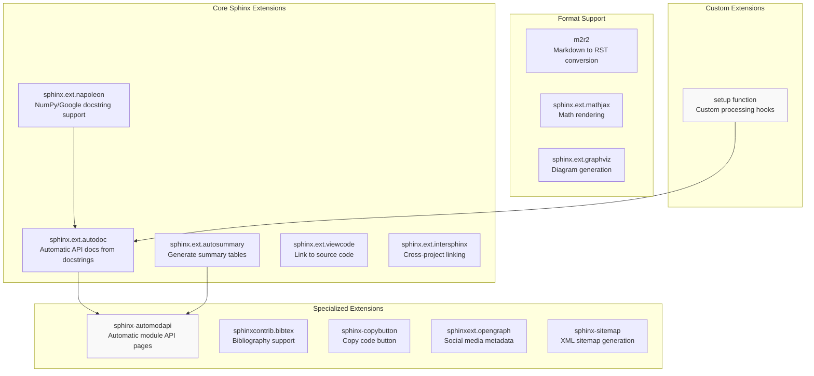
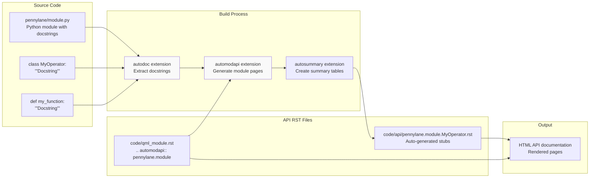
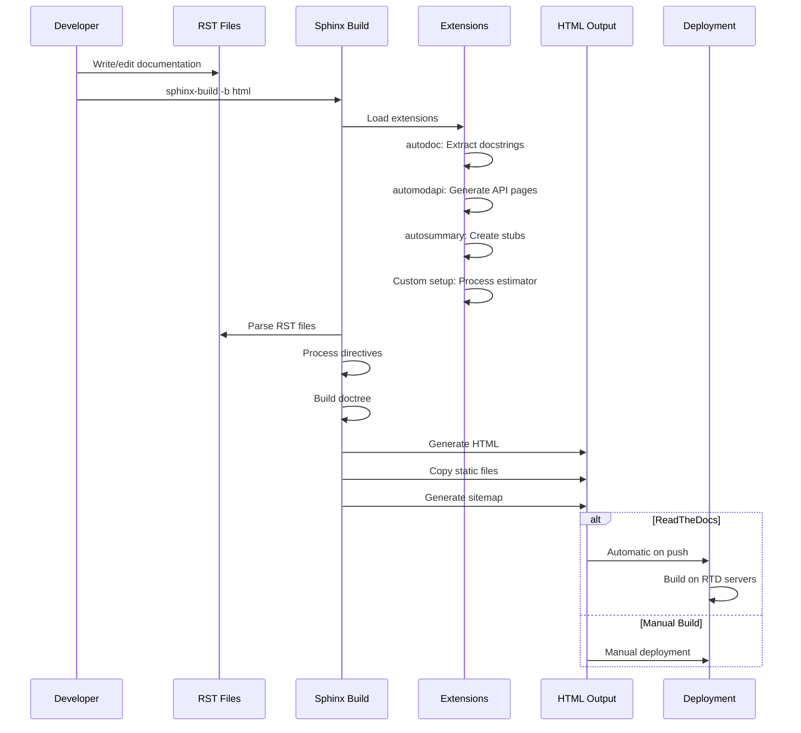

<!-- source: DeepWiki mcp.deepwiki.com · repo PennyLaneAI/pennylane · page 8.4 Documentation System · fetched 2026-10-21 -->

# Documentation System

<details>
<summary>Relevant source files</summary>

The following files were used as context for generating this wiki page:

- [.github/CONTRIBUTING.md](.github/CONTRIBUTING.md)
- [AI_Policy.md](AI_Policy.md)
- [README.md](README.md)
- [doc/conf.py](doc/conf.py)
- [doc/index.rst](doc/index.rst)

</details>


## Purpose and Scope

The Documentation System encompasses PennyLane's comprehensive documentation infrastructure built on Sphinx. This includes the build system configuration, API documentation generation, theme customization, content organization, and deployment workflows. The system generates user-facing documentation hosted at https://docs.pennylane.ai from reStructuredText (RST) source files and Python docstrings.

For information about testing and CI workflows related to documentation builds, see [Testing Infrastructure and CI/CD](#8.2). For general contribution guidelines, see the developer guide referenced in [Package Structure and Build System](#8.1).

---

## Sphinx Build System

PennyLane uses **Sphinx 8.1** as its documentation engine. The build configuration is centralized in [doc/conf.py:1-397]().

### Core Configuration

| Configuration | Value | Purpose |
|---------------|-------|---------|
| `needs_sphinx` | `"8.1"` | Minimum Sphinx version requirement |
| `master_doc` | `"index"` | Root document (`index.rst`) |
| `source_suffix` | `".rst"` | Source file format |
| `project` | `"PennyLane"` | Project name |
| `html_theme` | `"pennylane"` | Custom theme |

The system adds multiple paths to `sys.path` for extension discovery:
- [doc/conf.py:26-28]() adds parent directory, `_ext/`, and `doc/` to path
- This enables autodoc to discover PennyLane modules and custom extensions

### Version Management

Version information is extracted from `pennylane.__version__`:
- [doc/conf.py:127]() imports `pennylane` and reads `__version__`
- [doc/conf.py:130]() extracts major.minor version using regex
- Dynamic versioning ensures documentation always reflects the installed version

**Sources:** [doc/conf.py:1-130]()

---

## Extensions and Plugin System

The documentation system uses 16 Sphinx extensions to provide rich functionality:



### Key Extension Configurations

**sphinx-automodapi** ([doc/conf.py:50]())
- `autosummary_generate = True` ([doc/conf.py:77]()): Auto-generate stub files
- `automodapi_toctreedirnm = "code/api"` ([doc/conf.py:79]()): API docs directory
- `automodapi_inheritance_diagram = False` ([doc/conf.py:80]()): Disable inheritance diagrams
- `automodsumm_inherited_members = True` ([doc/conf.py:81]()): Include inherited members

**sphinx-copybutton** ([doc/conf.py:51]())
- [doc/conf.py:86-87](): Regex patterns to hide prompts (`>>>`, `...`, `$`, `In [*]:`)

**intersphinx** ([doc/conf.py:49]())
- [doc/conf.py:89-92](): Maps to external documentation (PennyLane demos, Catalyst)

**sphinxcontrib.bibtex** ([doc/conf.py:47]())
- [doc/conf.py:84](): Uses `bibfile.bib` for citations

**Sources:** [doc/conf.py:38-98]()

---

## Documentation Structure

The documentation is organized into logical sections using nested `toctree` directives:

```mermaid
graph TD
    index["index.rst<br/>Main entry point"]
    
    subgraph "User Documentation"
        using["Using PennyLane<br/>Guides and tutorials"]
        circuits["introduction/circuits"]
        interfaces["introduction/interfaces"]
        operations["introduction/operations"]
        measurements["introduction/measurements"]
        chemistry["introduction/chemistry"]
    end
    
    subgraph "Development"
        dev_guide["development/guide"]
        plugins["development/plugins"]
        adding_ops["development/adding_operators"]
        release_notes["development/release_notes.md"]
        deprecations["development/deprecations"]
    end
    
    subgraph "API Reference"
        qml["code/qml"]
        qml_ops["code/qml_ops_op_math"]
        qml_transforms["code/qml_transforms"]
        qml_gradients["code/qml_gradients"]
        qml_devices["code/qml_devices"]
        qml_math["code/qml_math"]
    end
    
    subgraph "Internals"
        qml_capture["code/qml_capture"]
        qml_operation["code/qml_operation"]
        qml_tape["code/qml_tape"]
        qml_workflow["code/qml_workflow"]
    end
    
    index --> using
    index --> dev_guide
    index --> qml
    index --> qml_capture
    
    using --> circuits
    using --> interfaces
    using --> operations
    using --> measurements
    using --> chemistry
    
    dev_guide --> plugins
    dev_guide --> adding_ops
    dev_guide --> release_notes
    dev_guide --> deprecations
    
    qml --> qml_ops
    qml --> qml_transforms
    qml --> qml_gradients
    qml --> qml_devices
    qml --> qml_math
    
    qml_capture -.internal.-> qml_operation
    qml_operation -.internal.-> qml_tape
    qml_tape -.internal.-> qml_workflow
    
    style index fill:#f9f9f9
    style qml fill:#f9f9f9
```



### Directory Structure

| Path | Purpose |
|------|---------|
| `doc/index.rst` | Root documentation file with landing page |
| `doc/introduction/` | User guides and tutorials |
| `doc/development/` | Developer documentation and contribution guides |
| `doc/code/` | Auto-generated API reference pages |
| `doc/code/api/` | Individual API stub files (generated) |
| `doc/_static/` | Static assets (images, CSS, JS) |
| `doc/_templates/` | Custom Jinja2 templates |
| `doc/_ext/` | Custom Sphinx extensions |

### Table of Contents Organization

The [doc/index.rst:154-246]() file defines four main sections using `toctree` directives:

1. **Using PennyLane** (`:caption: Using PennyLane`, [doc/index.rst:154-172]())
2. **Release news** (`:caption: Release news`, [doc/index.rst:174-182]())
3. **Development** (`:caption: Development`, [doc/index.rst:184-191]())
4. **API** (`:caption: API`, [doc/index.rst:193-227]())
5. **Internals** (`:caption: Internals`, [doc/index.rst:229-246]())

Each `toctree` uses `:maxdepth: 1` and `:hidden:` to create navigation without cluttering the landing page.

**Sources:** [doc/index.rst:154-246](), [doc/conf.py:100-108]()

---

## API Documentation Generation

PennyLane uses **sphinx-automodapi** to automatically generate API documentation from Python docstrings.

### API Page Structure



### Custom Processing: Estimator Stubs

The documentation system includes custom processing for `pennylane.estimator` modules to avoid index conflicts:

**add_noindex_to_estimator_stubs** ([doc/conf.py:344-371]())
- Triggered during `source-read` event ([doc/conf.py:395]())
- Detects estimator API stubs matching `pennylane.estimator.(ops|templates)`
- Dynamically inserts `:noindex:` directive to prevent duplicate index entries
- Uses regex to modify content: [doc/conf.py:362-367]()

**add_links_to_estimator_table** ([doc/conf.py:374-391]())
- Triggered during `doctree-resolved` event ([doc/conf.py:396]())
- Converts literal text in automodsumm tables to clickable links
- Processes table indices 3 (ops) and 4 (templates): [doc/conf.py:379]()
- Generates relative URIs: [doc/conf.py:385]()

### Autodoc Configuration

| Setting | Value | Purpose |
|---------|-------|---------|
| `autodoc_member_order` | `"bysource"` | Order members by source code position |
| `autodoc_typehints` | `"none"` | Remove type hints from signatures |
| `autodoc_mock_imports` | `["torch"]` | Mock torch to avoid import errors |
| `add_module_names` | `False` | Omit module names in signatures |

**Sources:** [doc/conf.py:77-81](), [doc/conf.py:334-397]()

---

## Theme and Styling

PennyLane uses a custom theme (`pennylane`) based on `pennylane-sphinx-theme`:

### Theme Configuration

```python
# doc/conf.py:261-270
html_theme = "pennylane"

html_theme_options = {
    "extra_copyrights": [
        "TensorFlow, the TensorFlow logo, and any related marks are trademarks of Google Inc."
    ],
    "google_analytics_tracking_id": "G-C480Z9JL0D",
    "search_on_pennylane_ai": True,
}
```

### Static Assets

- `html_static_path = ["_static"]` ([doc/conf.py:191]()): Custom CSS, images, logos
- `html_extra_path = ["robots.txt"]` ([doc/conf.py:196]()): SEO configuration
- Custom CSS styling in [doc/index.rst:12-26]() for landing page

### Open Graph Metadata

Social media integration via `sphinxext.opengraph`:

```python
# doc/conf.py:59-64
ogp_social_cards = {
    "image": "_static/logo.png",
    "enable": True,
    "site_url": "https://docs.pennylane.ai/",
    "line_color": "#03b2ff",
}
ogp_image = "_static/opengraph.png"
```

### GitHub Integration

- `edit_on_github_project = "PennyLaneAI/pennylane"` ([doc/conf.py:272]())
- `edit_on_github_branch = "master/doc"` ([doc/conf.py:273]())
- Enables "Edit on GitHub" links in documentation

**Sources:** [doc/conf.py:158-277](), [doc/index.rst:10-26]()

---

## Build Pipeline and Deployment

### Build Process Flow



### Environment Configuration

The build system detects Read the Docs environment:

```python
# doc/conf.py:69-73
html_baseurl = os.environ.get("READTHEDOCS_CANONICAL_URL", "https://docs.pennylane.ai/")

if os.environ.get("READTHEDOCS", "") == "True":
    html_context = {"READTHEDOCS": True}
```

The `SPHINX_BUILD` environment variable is set to enable special behaviors during builds:
- [doc/conf.py:75](): `os.environ["SPHINX_BUILD"] = "1"`

### Output Configuration

| Setting | Value | Purpose |
|---------|-------|---------|
| `htmlhelp_basename` | `"PennyLanedoc"` | Base name for HTML help |
| `html_use_smartypants` | Default | Typographically correct quotes |
| `html_show_sourcelink` | Default | Links to RST source |
| `html_show_copyright` | Default | Copyright notice in footer |

### LaTeX Output

LaTeX configuration for PDF generation:
- [doc/conf.py:281-303](): LaTeX document settings
- [doc/conf.py:296](): `latex_additional_files = ["macros.tex"]` for custom LaTeX macros

**Sources:** [doc/conf.py:69-75](), [doc/conf.py:158-196](), [doc/conf.py:258-303]()

---

## Content Types and Organization

### Landing Page Structure

The [doc/index.rst:1-153]() file serves as the documentation landing page:

| Section | Lines | Purpose |
|---------|-------|---------|
| Title & Lead | [doc/index.rst:3-33]() | Project introduction and description |
| Index Cards | [doc/index.rst:36-54]() | Navigation cards (Using, Developing, API) |
| Features | [doc/index.rst:56-92]() | Key PennyLane features with image |
| Getting Started | [doc/index.rst:94-119]() | Links to tutorials and resources |
| How to Cite | [doc/index.rst:121-130]() | Citation information |
| Support & Contribution | [doc/index.rst:132-147]() | Community links |
| License | [doc/index.rst:149-152]() | Apache 2.0 license notice |

### Custom RST Directives

The landing page uses custom directives:
- `.. index-card::` ([doc/index.rst:36-49]()): Creates clickable navigation cards
- `.. raw:: html` ([doc/index.rst:10-26]()): Injects custom CSS
- `.. rst-class::` ([doc/index.rst:6]()): Applies custom styling classes

### Markdown Integration

The system supports Markdown via `m2r2` extension:
- [doc/conf.py:54](): `m2r2` enables `.md` to `.rst` conversion
- [doc/index.rst:179](): `development/release_notes.md` is a Markdown file

**Sources:** [doc/index.rst:1-153](), [doc/conf.py:54]()

---

## Contributing to Documentation

### Documentation Guidelines

The contribution guidelines emphasize documentation quality:

**From [.github/CONTRIBUTING.md:71-75]()**:
> Documentation - If you would like to add to our documentation or suggest improvements/changes, let us know or submit a pull request directly. Changes that fix rendering issues, grammar, or a broken code example help us a lot too.

The development guide provides detailed documentation instructions:
- Referenced at [.github/CONTRIBUTING.md:74](): Documentation guide at `pennylane.readthedocs.io/en/stable/development/guide/documentation.html`

### AI Tool Usage Policy

Documentation contributions must follow the AI policy:

**From [AI_Policy.md:7-9]()**:
> Contributors must read and review all LLM-generated code or text before they ask other project members to review it.

**Transparency requirements** ([AI_Policy.md:11-17]()):
- Label tool-generated content in PR descriptions
- Use `Assisted-by: <name>` commit trailer

**Human-in-the-loop requirement** ([AI_Policy.md:26-27]()):
> It is strongly recommended that contributors write PR descriptions themselves (if needed, using tools for translation or copy-editing).

### Documentation Build Requirements

To build documentation locally, developers need:
1. Install dev dependencies: `pip install --group dev` ([.github/CONTRIBUTING.md:68]())
2. Navigate to `doc/` directory
3. Run: `sphinx-build -b html . _build/html`

### Quality Standards

The documentation system enforces several quality measures:
- `show_authors = True` ([doc/conf.py:149]()): Show section authors
- `todo_include_todos = False` ([doc/conf.py:155]()): Hide TODO items in production
- `pygments_style = "sphinx"` ([doc/conf.py:152]()): Syntax highlighting style

**Sources:** [.github/CONTRIBUTING.md:71-75](), [AI_Policy.md:1-74](), [doc/conf.py:149-155]()

---

## Cross-Project Documentation Linking

### Intersphinx Configuration

PennyLane documentation links to related project documentation using intersphinx:

```python
# doc/conf.py:89-92
intersphinx_mapping = {
    "demo": ("https://pennylane.ai/qml", None),
    "catalyst": ("https://docs.pennylane.ai/projects/catalyst/en/stable", None),
}
```

This enables references like `:doc:\`catalyst:guide\`` to link to Catalyst documentation.

### Sitemap Generation

The `sphinx-sitemap` extension generates XML sitemaps for SEO:
- [doc/conf.py:53](): Extension enabled
- [doc/conf.py:276](): `sitemap_url_scheme = "{link}"`
- [doc/conf.py:277](): `sitemap_excludes = []` (no pages excluded)

### Version-Aware URLs

Documentation URLs include version information:
- [doc/conf.py:69](): Base URL from `READTHEDOCS_CANONICAL_URL` environment variable
- Defaults to `https://docs.pennylane.ai/`
- Supports versioned documentation (e.g., `/en/stable/`, `/en/latest/`)

**Sources:** [doc/conf.py:53](), [doc/conf.py:69](), [doc/conf.py:89-92](), [doc/conf.py:275-277]()

---

## MathJax Configuration

Mathematical notation is rendered using MathJax:

```python
# doc/conf.py:94-96
mathjax_path = (
    "https://cdnjs.cloudflare.com/ajax/libs/mathjax/2.7.5/MathJax.js?config=TeX-MML-AM_CHTML"
)
```

Additional LaTeX macros are defined in `macros.tex` for consistent mathematical notation across the documentation.

**Sources:** [doc/conf.py:94-96](), [doc/conf.py:296]()

---

## Summary

The PennyLane documentation system is a comprehensive Sphinx-based infrastructure that:

1. **Auto-generates API documentation** from Python docstrings using `sphinx-automodapi`
2. **Organizes content** into logical sections (User Guides, Development, API, Internals)
3. **Customizes appearance** with a branded theme and Open Graph metadata
4. **Supports multiple formats** (HTML, LaTeX/PDF, XML sitemap)
5. **Integrates with deployment** via Read the Docs environment detection
6. **Enables cross-linking** to related projects (Catalyst, demos)
7. **Enforces quality** through contribution guidelines and AI policy

The modular extension system allows for custom processing (e.g., estimator stubs), while the structured `toctree` organization ensures documentation remains navigable as the codebase grows.

**Sources:** [doc/conf.py:1-397](), [doc/index.rst:1-246](), [.github/CONTRIBUTING.md:1-106](), [README.md:1-170]()