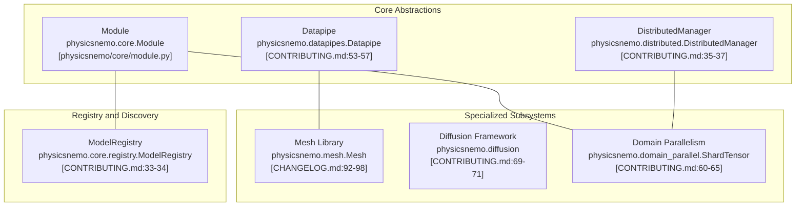
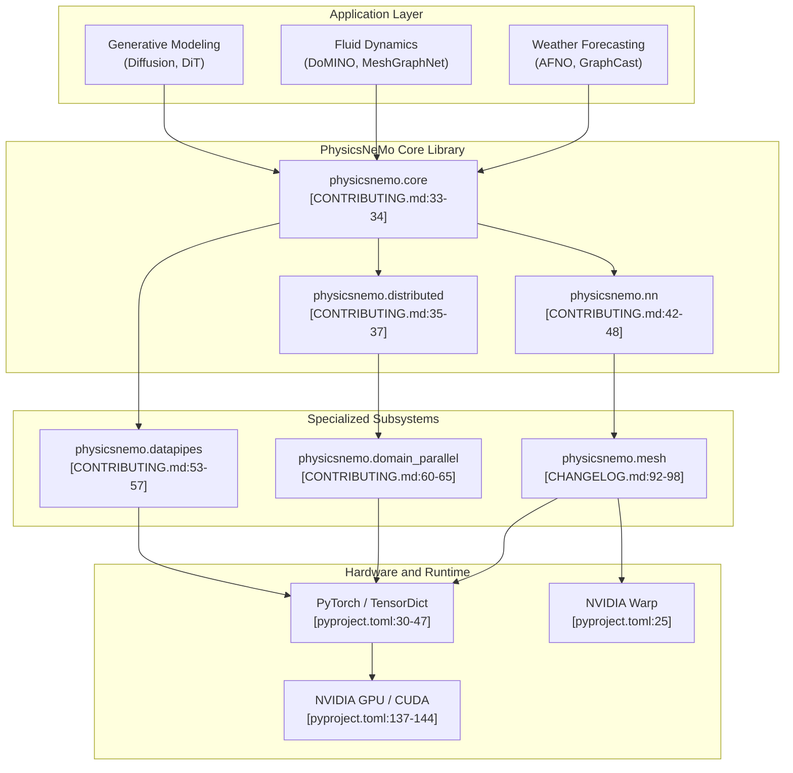

<!-- source: DeepWiki mcp.deepwiki.com · repo NVIDIA/physicsnemo · page 1 PhysicsNeMo Overview · fetched 2026-10-21 -->

# PhysicsNeMo Overview

Relevant source files

The following files were used as context for generating this wiki page:

- [.github/PULL_REQUEST_TEMPLATE.md](.github/PULL_REQUEST_TEMPLATE.md)
- [.gitlab/issue_templates/bug.md](.gitlab/issue_templates/bug.md)
- [.gitlab/issue_templates/documentation.md](.gitlab/issue_templates/documentation.md)
- [.gitlab/issue_templates/feature_request.md](.gitlab/issue_templates/feature_request.md)
- [.gitlab/issue_templates/security.md](.gitlab/issue_templates/security.md)
- [.gitlab/merge_request_templates/Default.md](.gitlab/merge_request_templates/Default.md)
- [.importlinter](.importlinter)
- [CHANGELOG.md](CHANGELOG.md)
- [CONTRIBUTING.md](CONTRIBUTING.md)
- [Dockerfile](Dockerfile)
- [Makefile](Makefile)
- [README.md](README.md)
- [codecov.yml](codecov.yml)
- [docs/Makefile](docs/Makefile)
- [docs/api/diffusion/noise_schedulers.rst](docs/api/diffusion/noise_schedulers.rst)
- [docs/conf.py](docs/conf.py)
- [docs/img/Modulus-850x720.svg](docs/img/Modulus-850x720.svg)
- [docs/index.rst](docs/index.rst)
- [docs/research.md](docs/research.md)
- [examples/cfd/gray_scott_rnn/README.md](examples/cfd/gray_scott_rnn/README.md)
- [examples/cfd/gray_scott_rnn/requirements.txt](examples/cfd/gray_scott_rnn/requirements.txt)
- [examples/cfd/navier_stokes_rnn/README.md](examples/cfd/navier_stokes_rnn/README.md)
- [examples/cfd/navier_stokes_rnn/requirements.txt](examples/cfd/navier_stokes_rnn/requirements.txt)
- [examples/cfd/stokes_mgn/requirements.txt](examples/cfd/stokes_mgn/requirements.txt)
- [examples/cfd/swe_nonlinear_pino/requirements.txt](examples/cfd/swe_nonlinear_pino/requirements.txt)
- [examples/molecular_dynamics/lennard_jones/README.md](examples/molecular_dynamics/lennard_jones/README.md)
- [examples/molecular_dynamics/lennard_jones/conf/config.yaml](examples/molecular_dynamics/lennard_jones/conf/config.yaml)
- [examples/molecular_dynamics/lennard_jones/lennard_jones_system.py](examples/molecular_dynamics/lennard_jones/lennard_jones_system.py)
- [examples/molecular_dynamics/lennard_jones/requirements.txt](examples/molecular_dynamics/lennard_jones/requirements.txt)
- [examples/molecular_dynamics/lennard_jones/utils.py](examples/molecular_dynamics/lennard_jones/utils.py)
- [greptile.json](greptile.json)
- [physicsnemo/__init__.py](physicsnemo/__init__.py)
- [physicsnemo/core/version_check.py](physicsnemo/core/version_check.py)
- [physicsnemo/diffusion/__init__.py](physicsnemo/diffusion/__init__.py)
- [physicsnemo/diffusion/base.py](physicsnemo/diffusion/base.py)
- [physicsnemo/diffusion/metrics/__init__.py](physicsnemo/diffusion/metrics/__init__.py)
- [physicsnemo/diffusion/metrics/losses.py](physicsnemo/diffusion/metrics/losses.py)
- [physicsnemo/diffusion/noise_schedulers/__init__.py](physicsnemo/diffusion/noise_schedulers/__init__.py)
- [physicsnemo/diffusion/noise_schedulers/domain_parallel.py](physicsnemo/diffusion/noise_schedulers/domain_parallel.py)
- [physicsnemo/diffusion/noise_schedulers/noise_schedulers.py](physicsnemo/diffusion/noise_schedulers/noise_schedulers.py)
- [physicsnemo/diffusion/preconditioners/preconditioners.py](physicsnemo/diffusion/preconditioners/preconditioners.py)
- [physicsnemo/diffusion/samplers/__init__.py](physicsnemo/diffusion/samplers/__init__.py)
- [physicsnemo/diffusion/samplers/samplers.py](physicsnemo/diffusion/samplers/samplers.py)
- [physicsnemo/diffusion/samplers/solvers.py](physicsnemo/diffusion/samplers/solvers.py)
- [physicsnemo/diffusion/utils/__init__.py](physicsnemo/diffusion/utils/__init__.py)
- [physicsnemo/diffusion/utils/model_wrappers.py](physicsnemo/diffusion/utils/model_wrappers.py)
- [physicsnemo/nn/module/mlp_layers.py](physicsnemo/nn/module/mlp_layers.py)
- [pyproject.toml](pyproject.toml)
- [test/ci_tests/prevent_untracked_imports.py](test/ci_tests/prevent_untracked_imports.py)
- [test/core/test_version_check.py](test/core/test_version_check.py)
- [test/diffusion/test_wrappers.py](test/diffusion/test_wrappers.py)
- [test/nn/functional/test_natten.py](test/nn/functional/test_natten.py)
- [test/nn/module/test_mlp_layers.py](test/nn/module/test_mlp_layers.py)
- [uv.lock](uv.lock)

**Purpose**: This page provides a high-level introduction to the PhysicsNeMo framework, covering its purpose as an AI platform for physics-informed modeling, its high-level architecture, the layered import contract (`.importlinter`), and the major v2.0 refactor. It serves as the entry point for understanding how PhysicsNeMo components compose to enable scalable scientific machine learning [README.md:27-30](), [CONTRIBUTING.md:30-89]().

**Scope**: This overview focuses on the framework's overall design, import contracts, and major subsystems. For detailed information on specific child topics, see:
- Installation methods, dependencies, optional groups, and migration guide: [Installation and Setup](#1.1)
- Foundational core abstractions (`Module`, `Datapipe`, `DistributedManager`, import contract): [Core Architecture](#1.2)
- Neural network primitives and functional/layer APIs: [Neural Network Primitives (physicsnemo.nn)](#1.3)

---

## What is PhysicsNeMo?

NVIDIA PhysicsNeMo is an open-source deep-learning framework built on PyTorch for building, training, fine-tuning, and inferring physics-informed machine learning (SciML) models [README.md:27-29](). It supplies researchers and engineers with GPU-accelerated library components and end-to-end training recipes spanning multi-physics systems, CFD, weather forecasting, structural mechanics, and generative modeling [README.md:27-29]().

The framework extends standard PyTorch with:
- Standardized module initialization, argument serialization, and checkpointing via `physicsnemo.core.Module` [physicsnemo/__init__.py:22-23]().
- GPU-accelerated scientific datapipes and mesh processing via `physicsnemo.datapipes` and `physicsnemo.mesh` [CHANGELOG.md:92-98]().
- Distributed training infrastructure and sharded tensors via `physicsnemo.distributed` and `physicsnemo.domain_parallel` [CONTRIBUTING.md:35-37,60-65]().
- Optional lazy imports and dependency management via `physicsnemo.core.version_check.OptionalImport` [physicsnemo/core/version_check.py:25-36]().

Sources: [README.md:27-29](), [physicsnemo/__init__.py:22-23](), [physicsnemo/core/version_check.py:25-36]()

---

## High-Level Architecture and Import Contract

PhysicsNeMo enforces strict modularity and dependency direction through its `.importlinter` configuration [.importlinter:1-28](). Upward imports from foundational layers to higher-level application packages are prohibited, ensuring that core numerical and tensor utilities remain lightweight and decoupled.

### System Mapping: Natural Language to Code Entities

Sources: [.importlinter:8-28](), [CONTRIBUTING.md:30-89]()

### Layered Import Contract (`.importlinter`)

The package architecture is structured into strict hierarchical layers defined in `.importlinter` under the `physicsnemo-modules` contract [.importlinter:8-28](). The layers flow downward from compatibility and experimental wrappers to core primitives:

1. `compat` [.importlinter:19]()
2. `experimental` [.importlinter:20]()
3. `deploy` | `active_learning` | `diffusion` | `sym` [.importlinter:21]()
4. `models` : `datapipes` : `metrics` : `domain_parallel` : `optim` [.importlinter:22]()
5. `mesh` [.importlinter:23]()
6. `nn` [.importlinter:24]()
7. `utils` [.importlinter:25]()
8. `distributed` [.importlinter:26]()
9. `core` [.importlinter:27]()

Sources: [.importlinter:8-28]()

---

## The v2.0 Refactor

PhysicsNeMo v2.0 establishes a modernized framework layout designed to prevent circular dependencies, trim core requirements, and isolate optional packages like `pyvista`, `vtk`, or `torch_geometric` [CONTRIBUTING.md:30-89]().

### Reorganization Summary

| Component / Subsystem | v1.x Location | v2.0 Location |
| :--- | :--- | :--- |
| Base Module | `physicsnemo.models.Module` | `physicsnemo.core.Module` [physicsnemo/__init__.py:22-23]() |
| Checkpointing & Logging | `physicsnemo.launch` | `physicsnemo.utils.checkpoint` / `physicsnemo.utils.logging` [CONTRIBUTING.md:38-41]() |
| Standalone Layers | `physicsnemo.models` / `utils` | `physicsnemo.nn` [CONTRIBUTING.md:42-48]() |
| Domain Parallel Sharding | `physicsnemo.distributed` | `physicsnemo.domain_parallel` [CONTRIBUTING.md:60-65]() |

Sources: [CONTRIBUTING.md:30-89](), [physicsnemo/__init__.py:22-23]()

---

## System Architecture Overview

Sources: [pyproject.toml:25-47](), [CONTRIBUTING.md:30-89](), [CHANGELOG.md:92-98]()

---

## Child Sections

- **[Installation and Setup](#1.1)**: Covers installation workflows via pip, uv, or Docker, package index requirements, dependency/extras groups in `pyproject.toml`, lazy loading via `OptionalImport`, and the v2.0 migration guide.
- **[Core Architecture](#1.2)**: Explains the foundational abstractions (`Module`, `Datapipe`, `DistributedManager`), the compat layer, function spec systems, and import-layer contract enforcement.
- **[Neural Network Primitives (physicsnemo.nn)](#1.3)**: Documents the `physicsnemo.nn` package, including stateless GPU-accelerated functionals (`physicsnemo.nn.functional`) and reusable layer modules (`physicsnemo.nn.module`).

Sources: [pyproject.toml:4-52](), [physicsnemo/core/version_check.py:21-39](), [.importlinter:1-28]()

---

