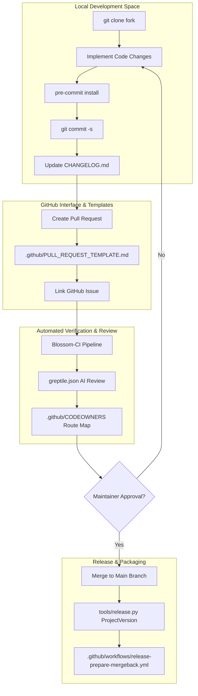
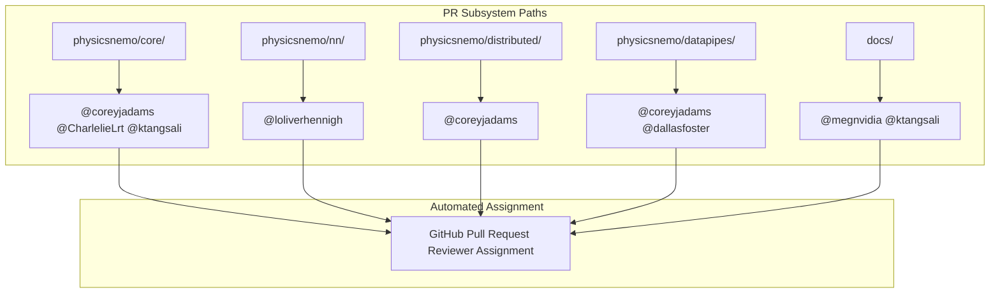

<!-- source: DeepWiki mcp.deepwiki.com · repo NVIDIA/physicsnemo · page 10.1 Contributing Guidelines · fetched 2026-10-21 -->

# Contributing Guidelines

Relevant source files

The following files were used as context for generating this wiki page:

- [.github/CODEOWNERS](.github/CODEOWNERS)
- [.github/PULL_REQUEST_TEMPLATE.md](.github/PULL_REQUEST_TEMPLATE.md)
- [.github/release-process.md](.github/release-process.md)
- [.github/workflows/release-prepare-mergeback.yml](.github/workflows/release-prepare-mergeback.yml)
- [.github/workflows/release-start-rc.yml](.github/workflows/release-start-rc.yml)
- [.gitlab/issue_templates/bug.md](.gitlab/issue_templates/bug.md)
- [.gitlab/issue_templates/documentation.md](.gitlab/issue_templates/documentation.md)
- [.gitlab/issue_templates/feature_request.md](.gitlab/issue_templates/feature_request.md)
- [.gitlab/issue_templates/security.md](.gitlab/issue_templates/security.md)
- [.gitlab/merge_request_templates/Default.md](.gitlab/merge_request_templates/Default.md)
- [CONTRIBUTING.md](CONTRIBUTING.md)
- [README.md](README.md)
- [codecov.yml](codecov.yml)
- [docs/conf.py](docs/conf.py)
- [docs/img/Modulus-850x720.svg](docs/img/Modulus-850x720.svg)
- [docs/research.md](docs/research.md)
- [greptile.json](greptile.json)
- [test/ci_tests/check_docstring_coverage.py](test/ci_tests/check_docstring_coverage.py)
- [test/ci_tests/interrogate_baseline.txt](test/ci_tests/interrogate_baseline.txt)
- [tools/release.py](tools/release.py)

## Purpose and Scope

This page documents the complete contribution workflow for NVIDIA PhysicsNeMo, covering pull request procedures, Developer Certificate of Origin (DCO) sign-off, `CHANGELOG.md` maintenance, code ownership mapping via `.github/CODEOWNERS`, issue/PR templates, the software release process managed by `tools/release.py`, and AI-assisted code review integration. PhysicsNeMo is an open-source project relying on community and enterprise contributions to scale its physics-informed AI modeling capabilities [CONTRIBUTING.md:1-25]().

Sources: [CONTRIBUTING.md:1-25]()

---

## Pull Request Workflow and Code Entity Mapping

The PhysicsNeMo project follows a standard fork-and-pull-request model. Code contributions pass through automated continuous integration (Blossom-CI), AI review gates, and manual code review by assigned maintainers before merging [CONTRIBUTING.md:97-118](), [.github/PULL_REQUEST_TEMPLATE.md:22-34]().

### Developer Workflow Architecture

The following diagram maps the natural language contribution flow to the underlying code entities, release scripts, and CI mechanisms.

Sources: [CONTRIBUTING.md:97-118](), [.github/PULL_REQUEST_TEMPLATE.md:1-34](), [.github/CODEOWNERS:1-45](), [tools/release.py:1-115]()

### Mandatory PR Requirements

Every pull request must satisfy the following criteria prior to merging:

1. **Developer Certificate of Origin (DCO)**: All commits must include a DCO sign-off certifying legal rights to submit the contribution under the Apache 2.0 license [CONTRIBUTING.md:120-131](). Append sign-offs using `git commit -s -m "message"`.
2. **CHANGELOG Updates**: User-facing features, deprecations, and bug fixes must be recorded in `CHANGELOG.md` [CONTRIBUTING.md:112](), [.github/PULL_REQUEST_TEMPLATE.md:14]().
3. **Issue Linking**: PRs must reference an open GitHub or GitLab issue using the `closes #1234` syntax [CONTRIBUTING.md:116-118](), [.github/PULL_REQUEST_TEMPLATE.md:6]().
4. **License Headers**: All source files must include the standardized Apache-2.0 SPDX header [CONTRIBUTING.md:122-134]().

Sources: [CONTRIBUTING.md:97-134](), [.github/PULL_REQUEST_TEMPLATE.md:1-17]()

---

## Code Ownership and CODEOWNERS Review Map

Review responsibilities are governed by `.github/CODEOWNERS`, which maps repository paths to subsystem owners and core engineers [.github/CODEOWNERS:1-45]().

### Review Routing Architecture

Sources: [.github/CODEOWNERS:1-115]()

Top-level files, documentation, and specific API modules inherit ownership mappings defined in `.github/CODEOWNERS:1-115]`.

Sources: [.github/CODEOWNERS:1-115]()

---

## Release Process and Versioning Mechanics

Releases and development cycles are orchestrated via python scripts in `tools/release.py` and GitHub Actions workflows [.github/workflows/release-prepare-mergeback.yml:1-61](), [tools/release.py:1-70]().

### Versioning Classes and Functions

The package version is maintained in `physicsnemo/__init__.py` and parsed through `tools/release.py` using `ProjectVersion` [tools/release.py:29-115]().

- **`ProjectVersion.parse(value)`**: Validates package strings matching `X.Y.Z` or `X.Y.Za0` [tools/release.py:80-93]().
- **`start_rc(repo_root, release_version, release_date)`**: Transitions a development alpha checkout (`a0`) to a stable release candidate version and updates `CHANGELOG.md` headings [tools/release.py:173-206]().
- **Release Automation Workflows**: `.github/workflows/release-prepare-mergeback.yml` manages merge-backs from completed release candidate branches (`-rc`) back to the default branch [.github/workflows/release-prepare-mergeback.yml:1-103]().

Sources: [tools/release.py:1-206](), [.github/workflows/release-prepare-mergeback.yml:1-103]()

---

## Issue and Pull Request Templates

PhysicsNeMo maintains uniform reporting structures through structured GitHub and GitLab templates.

### Template Inventory

| Template Path | Target Subsystem | Key Fields |
|---------------|------------------|------------|
| `.github/PULL_REQUEST_TEMPLATE.md` | General PRs | Description, Checklist, Dependencies, Review Process [.github/PULL_REQUEST_TEMPLATE.md:1-34]() |
| `.gitlab/issue_templates/bug.md` | Bug Tracking | System info, environment capture script [.gitlab/issue_templates/bug.md:9-46]() |
| `.gitlab/issue_templates/security.md` | Vulnerabilities | Severity, reproduction steps [.gitlab/issue_templates/security.md:1-13]() |
| `.gitlab/merge_request_templates/Default.md` | Internal Merge Requests | Checklist mirrors GitHub PR requirements [.gitlab/merge_request_templates/Default.md:1-20]() |

Sources: [.github/PULL_REQUEST_TEMPLATE.md:1-34](), [.gitlab/issue_templates/bug.md:1-46](), [.gitlab/issue_templates/security.md:1-13](), [.gitlab/merge_request_templates/Default.md:1-20]()

---

## AI-Assisted Code Review (Greptile)

PhysicsNeMo integrates **Greptile** for automated code review scans [.github/PULL_REQUEST_TEMPLATE.md:28-34]().

### Greptile Review Workflow

1. **Trigger**: A pull request opening or synchronization event executes the `greptile.json` configuration scan.
2. **Evaluation**: Comments are generated targeting `logic`, `syntax`, and `style` violations [greptile.json:4-8](). Model implementations are checked against `CODING_STANDARDS/MODELS_IMPLEMENTATION.md` [greptile.json:51-57]().
3. **Feedback Interaction**: Authors and maintainers interact with AI comments using reaction emojis (`👍` / `👎`) to measure relevance and assist refinement [.github/PULL_REQUEST_TEMPLATE.md:28-34]().

Sources: [.github/PULL_REQUEST_TEMPLATE.md:28-34](), [greptile.json:1-59]()

---

