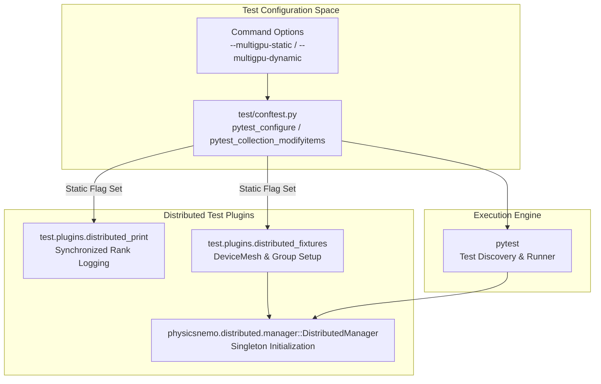
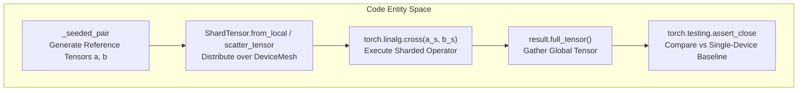

<!-- source: DeepWiki mcp.deepwiki.com · repo NVIDIA/physicsnemo · page 10.2 Testing Framework · fetched 2026-10-21 -->

# Testing Framework

<details>
<summary>Relevant source files</summary>

The following files were used as context for generating this wiki page:

- [.github/PULL_REQUEST_TEMPLATE.md](.github/PULL_REQUEST_TEMPLATE.md)
- [.gitlab/issue_templates/bug.md](.gitlab/issue_templates/bug.md)
- [.gitlab/issue_templates/documentation.md](.gitlab/issue_templates/documentation.md)
- [.gitlab/issue_templates/feature_request.md](.gitlab/issue_templates/feature_request.md)
- [.gitlab/issue_templates/security.md](.gitlab/issue_templates/security.md)
- [.gitlab/merge_request_templates/Default.md](.gitlab/merge_request_templates/Default.md)
- [CONTRIBUTING.md](CONTRIBUTING.md)
- [README.md](README.md)
- [codecov.yml](codecov.yml)
- [docs/conf.py](docs/conf.py)
- [docs/img/Modulus-850x720.svg](docs/img/Modulus-850x720.svg)
- [docs/research.md](docs/research.md)
- [greptile.json](greptile.json)
- [physicsnemo/distributed/manager.py](physicsnemo/distributed/manager.py)
- [physicsnemo/domain_parallel/custom_ops/_reductions.py](physicsnemo/domain_parallel/custom_ops/_reductions.py)
- [physicsnemo/domain_parallel/shard_utils/normalization_patches.py](physicsnemo/domain_parallel/shard_utils/normalization_patches.py)
- [physicsnemo/domain_parallel/shard_utils/ring.py](physicsnemo/domain_parallel/shard_utils/ring.py)
- [test/conftest.py](test/conftest.py)
- [test/datapipes/test_climate.py](test/datapipes/test_climate.py)
- [test/datapipes/test_mesh_datapipe.py](test/datapipes/test_mesh_datapipe.py)
- [test/distributed/test_config.py](test/distributed/test_config.py)
- [test/distributed/test_distributed_fft.py](test/distributed/test_distributed_fft.py)
- [test/distributed/test_manager.py](test/distributed/test_manager.py)
- [test/distributed/test_manager_timeout.py](test/distributed/test_manager_timeout.py)
- [test/domain_parallel/ops/test_convolution.py](test/domain_parallel/ops/test_convolution.py)
- [test/domain_parallel/ops/test_cross.py](test/domain_parallel/ops/test_cross.py)
- [test/domain_parallel/ops/test_knn.py](test/domain_parallel/ops/test_knn.py)
- [test/domain_parallel/ops/test_normalization.py](test/domain_parallel/ops/test_normalization.py)
- [test/domain_parallel/ops/utils.py](test/domain_parallel/ops/utils.py)
- [test/domain_parallel/test_grad_sharding.py](test/domain_parallel/test_grad_sharding.py)
- [test/domain_parallel/test_reductions.py](test/domain_parallel/test_reductions.py)
- [test/models/sfno/test_sfno.py](test/models/sfno/test_sfno.py)
- [test/models/test_distributed_graph.py](test/models/test_distributed_graph.py)

</details>


## Purpose and Scope

This document describes PhysicsNeMo's testing infrastructure, including `pytest` usage, import checking (`requires_module`), test organization, golden-file and numerical testing, `conftest.py` multi-GPU setup, coverage components (`codecov.yml`), and `ShardTensor` numerical checks. For information about the CI/CD pipeline executing these tests, see [CI/CD Pipeline](10.3). For code quality standards, see [Code Quality Standards](10.4).

Sources: `[CONTRIBUTING.md:77-79](), [test/conftest.py:1-20]()`

---

## Test Organization and Execution

PhysicsNeMo uses `pytest` as its primary testing framework. Tests are structured within the `test/` directory to mirror the source layout (`physicsnemo/`).

### Pytest Configuration and Command-Line Options

The test session is configured via `test/conftest.py`, which registers custom command-line options and fixtures [test/conftest.py:65-87]()`:
- `--multigpu-dynamic`: Runs multi-GPU tests requiring dynamic process group initialization [test/conftest.py:67-71]().
- `--multigpu-static`: Runs multi-GPU tests using static session-level initialization [test/conftest.py:73-77]().
- `--fail-on-missing-modules`: Fails tests if required optional modules are missing [test/conftest.py:79-83]().
- `--nfs-data-dir`: Specifies the path to large test datasets [test/conftest.py:85-86]().

Test execution time per file is tracked via `pytest_runtest_logreport` and summarized in `pytest_sessionfinish` [test/conftest.py:50-63]().

Sources: `[test/conftest.py:46-87]()`

---

## Core Testing Architecture



**Diagram: Testing Architecture and Distributed Plugin Integration**

Sources: `[test/conftest.py:65-139]()`

---

## Conditional Testing with `requires_module`

Optional dependencies (such as `vtk`, `warp`, etc.) are handled conditionally using the `requires_module` decorator [test/conftest.py:181-205]().

### Implementation Details

The decorator inspects package versions via `importlib.metadata` and `packaging.requirements.Requirement` [test/conftest.py:181-195](). If dependencies are missing, tests are automatically skipped [test/conftest.py:197-205]().

```python
# Example usage in datapipes testing
@requires_module(["vtk", "warp"])
@pytest.mark.parametrize("device", ["cuda", "cpu"])
def test_mesh_datapipe(device, tmp_path, pytestconfig):
    ...
```

Sources: `[test/conftest.py:181-205](), [test/datapipes/test_mesh_datapipe.py:30-32]()`

---

## Distributed and Multi-GPU Testing

Multi-GPU tests are managed via `DistributedManager` and custom session fixtures [physicsnemo/distributed/manager.py:68-88](), [test/distributed/test_manager.py:36-47]()].

### State Cleaning and Fixtures

To ensure clean isolation across tests, a session fixture resets `DistributedManager._shared_state` and destroys active process groups [test/distributed/test_manager.py:36-47]()]:

```python
@pytest.fixture(autouse=True)
def clean_distributed_state():
    """Ensure torch.distributed and DistributedManager are clean for each test."""
    DistributedManager._shared_state = {}
    if torch.distributed.is_initialized():
        torch.distributed.destroy_process_group()
    yield
    DistributedManager._shared_state = {}
    if torch.distributed.is_initialized():
        torch.distributed.destroy_process_group()
```

Sources: `[physicsnemo/distributed/manager.py:68-88](), [test/distributed/test_manager.py:36-47]()`

---

## ShardTensor Numerical Checks

`ShardTensor` operations (such as cross-products, views, and normalizations) undergo strict numerical validation against single-device eager PyTorch baselines [test/domain_parallel/ops/test_cross.py:17-165](), [test/domain_parallel/ops/utils.py:17-26]()].



**Diagram: ShardTensor Numerical Validation Flow**

### Collective Assertion Utilities

Because distributed tests can hang if ranks desynchronize during failures, helper utilities in `test/domain_parallel/ops/utils.py` ensure collective error propagation [test/domain_parallel/ops/utils.py:45-122]()]:
- `collective_assert`: Uses `dist.all_reduce` with `ReduceOp.MIN` to abort all ranks if any single rank fails an assertion [test/domain_parallel/ops/utils.py:45-81]().
- `collective_assert_close`: Combines `torch.allclose` with `collective_assert` [test/domain_parallel/ops/utils.py:83-122]().
- `unparallelize_module`: Converts a distributed `torch.nn.Module` back to a regular module for verification by gathering `DTensor` parameters [test/domain_parallel/ops/utils.py:153-190]().

Sources: `[test/domain_parallel/ops/test_cross.py:17-165](), [test/domain_parallel/ops/utils.py:45-190]()`

---

## Coverage and Codecov Components

Code coverage is monitored and broken down by subsystem components in `codecov.yml` [codecov.yml:56-77]()].

```yaml
component_management:
  individual_components:
    - component_id: models
      paths:
        - physicsnemo/models/**
    - component_id: distributed
      paths:
        - physicsnemo/distributed/**
        - physicsnemo/domain_parallel/**
    - component_id: datapipes
      paths:
        - physicsnemo/datapipes/**
    - component_id: mesh
      paths:
        - physicsnemo/mesh/**
    - component_id: nn
      paths:
        - physicsnemo/nn/**
    - component_id: diffusion
      paths:
        - physicsnemo/diffusion/**
```

Sources: `[codecov.yml:26-77]()`

---

## Summary of Testing Utilities

| Utility | Location | Purpose |
|---------|----------|---------|
| `requires_module` | `test/conftest.py` | Skips tests when optional modules are missing [test/conftest.py:181-205](). |
| `nfs_data_dir` | `test/conftest.py` | Fixture providing path to large integration test datasets [test/conftest.py:89-105](). |
| `collective_assert` | `test/domain_parallel/ops/utils.py` | Synchronizes assertions across ranks to prevent distributed deadlocks [test/domain_parallel/ops/utils.py:45-81](). |
| `unparallelize_module` | `test/domain_parallel/ops/utils.py` | Converts distributed modules back to standard torch modules for validation [test/domain_parallel/ops/utils.py:153-190](). |

Sources: `[test/conftest.py:89-205](), [test/domain_parallel/ops/utils.py:45-190]()`

---

