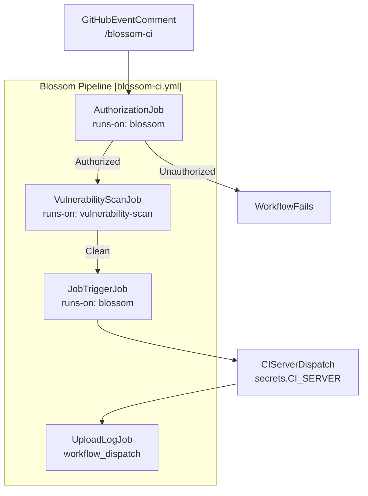
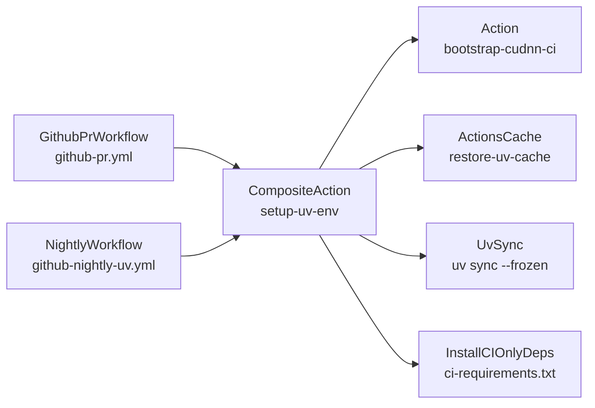
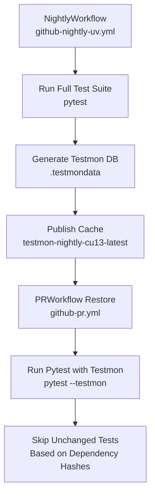

<!-- source: DeepWiki mcp.deepwiki.com · repo NVIDIA/physicsnemo · page 10.3 CI/CD Pipeline · fetched 2026-10-21 -->

# CI/CD Pipeline

<details>
<summary>Relevant source files</summary>

The following files were used as context for generating this wiki page:

- [.github/CACHE_CONTRACT.md](.github/CACHE_CONTRACT.md)
- [.github/ISSUE_TEMPLATE/bug_report.yml](.github/ISSUE_TEMPLATE/bug_report.yml)
- [.github/ISSUE_TEMPLATE/config.yml](.github/ISSUE_TEMPLATE/config.yml)
- [.github/ISSUE_TEMPLATE/documentation_request.yml](.github/ISSUE_TEMPLATE/documentation_request.yml)
- [.github/ISSUE_TEMPLATE/feature_request.yml](.github/ISSUE_TEMPLATE/feature_request.yml)
- [.github/ISSUE_TEMPLATE/research_paper.yml](.github/ISSUE_TEMPLATE/research_paper.yml)
- [.github/actions/bootstrap-cudnn-ci/action.yml](.github/actions/bootstrap-cudnn-ci/action.yml)
- [.github/actions/replace-cache/action.yml](.github/actions/replace-cache/action.yml)
- [.github/actions/setup-uv-env/action.yml](.github/actions/setup-uv-env/action.yml)
- [.github/ci-requirements.lock](.github/ci-requirements.lock)
- [.github/ci-requirements.txt](.github/ci-requirements.txt)
- [.github/regen-ci-deps-lock.sh](.github/regen-ci-deps-lock.sh)
- [.github/workflows/blossom-ci.yml](.github/workflows/blossom-ci.yml)
- [.github/workflows/codeowners-info.yml](.github/workflows/codeowners-info.yml)
- [.github/workflows/github-multigpu.yml](.github/workflows/github-multigpu.yml)
- [.github/workflows/github-nightly-uv.yml](.github/workflows/github-nightly-uv.yml)
- [.github/workflows/github-pr.yml](.github/workflows/github-pr.yml)
- [.github/workflows/install-ci.yml](.github/workflows/install-ci.yml)
- [.github/workflows/merge-queue-blossom-passthrough.yml](.github/workflows/merge-queue-blossom-passthrough.yml)
- [.github/workflows/regen-ci-deps-lock.yml](.github/workflows/regen-ci-deps-lock.yml)
- [.pre-commit-config.yaml](.pre-commit-config.yaml)
- [CHANGELOG.md](CHANGELOG.md)
- [Dockerfile](Dockerfile)
- [Makefile](Makefile)
- [physicsnemo/__init__.py](physicsnemo/__init__.py)
- [physicsnemo/core/version_check.py](physicsnemo/core/version_check.py)
- [pyproject.toml](pyproject.toml)
- [test/ci_tests/prevent_untracked_imports.py](test/ci_tests/prevent_untracked_imports.py)
- [test/core/test_version_check.py](test/core/test_version_check.py)
- [test/nn/functional/test_natten.py](test/nn/functional/test_natten.py)
- [uv.lock](uv.lock)

</details>


## Purpose and Scope

This document details PhysicsNeMo's Continuous Integration and Continuous Deployment (CI/CD) infrastructure. The system combines NVIDIA's internal **Blossom-CI** hybrid framework (for secure, hardware-accelerated testing via comment triggers) with an extensive suite of **GitHub Actions** (`github-pr`, `nightly-uv`, `install-ci`, and `github-multigpu`). It covers composite actions, the `uv` caching contract, `testmon`-based test selection, and multi-stage container builds.

**Sources**: [.github/workflows/blossom-ci.yml:1-135](), [.github/workflows/github-pr.yml:1-100](), [.github/workflows/github-nightly-uv.yml:1-122](), [Dockerfile:1-157]()

---

## 1. Blossom-CI Hybrid Workflows

The Blossom-CI infrastructure integrates GitHub pull request events with self-hosted runners and security scanners. It operates through sequential jobs triggered by authorized maintainers [^1].


**Diagram: Blossom-CI Pipeline Stage Mapping to Workflow Jobs**

### Pipeline Stages

1. **Authorization (`Authorization`)**: Validates that issue comments containing `/blossom-ci` or `/multi-gpu-ci` originate from an explicit allowlist of contributors (`nickgeneva`, `ktangsali`, `dallasfoster`, etc.) [.github/workflows/blossom-ci.yml:41-69](). It executes the `blossom-ci` tool with `OPERATION: 'AUTH'` [.github/workflows/blossom-ci.yml:71-76]().
2. **Vulnerability Scan (`Vulnerability-scan`)**: Checks out the PR branch with LFS enabled [.github/workflows/blossom-ci.yml:83-88]() and runs `NVIDIA/blossom-action` to analyze dependencies [.github/workflows/blossom-ci.yml:103-112]().
3. **Job Trigger (`Job-trigger`)**: Dispatches the pipeline to the external Jenkins or internal server via `secrets.CI_SERVER` [.github/workflows/blossom-ci.yml:113-124]().
4. **Upload Log (`Upload-Log`)**: Handles log uploads on `workflow_dispatch` events [.github/workflows/blossom-ci.yml:125-135]().

**Sources**: [.github/workflows/blossom-ci.yml:33-135]()

---

## 2. GitHub Actions CI Suite

PhysicsNeMo maintains separate workflows for PR feedback, nightly cache generation, multi-environment installation checks, and multi-GPU evaluations.

### Workflow Matrix

| Workflow File | Trigger | Purpose | Key Tools |
| :--- | :--- | :--- | :--- |
| `github-pr.yml` | Push to `pull-request/*`, manual | Fast PR validation using testmon | `pytest-testmon`, `uv` |
| `github-nightly-uv.yml` | Cron (`0 2 * * *`), manual | Nightly test suite & testmon DB publication | Full test coverage, `uv` sync |
| `install-ci.yml` | Push, PR, Daily cron | Matrix testing across OS & Python versions | `pip`, `uv`, `pytest` |
| `github-multigpu.yml` | Issue comment / manual | Distributed training and multi-GPU validation | PyTorch DDP, Slurm/Torchrun |

**Sources**: [.github/workflows/github-pr.yml:34-40](), [.github/workflows/github-nightly-uv.yml:48-54](), [.github/workflows/install-ci.yml:1-30]()

---

## 3. Composite Actions & Environment Bootstrap

To reduce boilerplate across GitHub workflows, custom composite actions encapsulate environment initialization, cuDNN booting, and CI dataset retrieval.


**Diagram: Composite Action Hierarchy for Environment Setup**

### Composite Action Definitions

* **`setup-uv-env`**: Restores the `uv` download cache fail-open using the computed cache prefix, executes `uv sync` with frozen requirements, and installs CI-only test dependencies [.github/actions/setup-uv-env/action.yml]().
* **`bootstrap-cudnn-ci`**: Sets up the specified Python and `uv` runtimes inside CUDA-enabled containers [.github/actions/bootstrap-cudnn-ci/action.yml]().
* **`replace-cache`**: Manages atomic cache eviction and replacement for nightly artifacts like testmon databases and coverage baselines [.github/actions/replace-cache/action.yml]().

**Sources**: [.github/workflows/github-pr.yml:109-114](), [.github/actions/setup-uv-env/action.yml:1-50](), [.github/actions/bootstrap-cudnn-ci/action.yml:1-30]()

---

## 4. UV Caching Contract & Deterministic Environment

PhysicsNeMo relies on `uv` for deterministic dependency resolution and rapid environment setup. The caching contract is detailed in `.github/CACHE_CONTRACT.md`.

### Cache Design Rules

1. **`uv` Download Cache (`~/.cache/uv`)**:
   - **Key Format**: `<UV_CACHE_KEY_PREFIX>-latest` [.github/workflows/github-nightly-uv.yml:25-27]()
   - **Scope**: Additive wheel store surviving lockfile modifications. Restored fail-open [.github/workflows/github-nightly-uv.yml:28-30]().
2. **Realized Virtual Environment (`.venv`)**:
   - There is **no cross-run `.venv` cache**. The virtual environment is built fresh on every run using `uv sync --frozen` [.github/workflows/github-nightly-uv.yml:31-33]().
3. **Environment Flags**:
   - `UV_FROZEN="1"` prevents lockfile modification [.github/workflows/github-nightly-uv.yml:113]().
   - `UV_NO_SYNC="1"` prevents implicit syncs during `uv run` invocations [.github/workflows/github-nightly-uv.yml:114]().

**Sources**: [.github/workflows/github-pr.yml:22-32](), [.github/workflows/github-nightly-uv.yml:23-41](), [.github/CACHE_CONTRACT.md:1-50]()

---

## 5. Testmon Test Selection

To optimize PR pipeline runtime, `github-pr.yml` integrates `pytest-testmon` to selectively execute only tests affected by code changes.


**Diagram: Testmon Data Flow Between Nightly and PR Workflows**

### Implementation Mechanics
* **Nightly Generation**: The nightly workflow executes the entire test suite, generating `.testmondata`, `.testmondata-shm`, and `.testmondata-wal`, which are published under `TESTMON_CACHE_KEY_PREFIX` [.github/workflows/github-nightly-uv.yml:103-104]().
* **PR Consumption**: The PR workflow restores the latest nightly testmon DB [.github/workflows/github-pr.yml:121-129]() and runs pytest with `--testmon` [.github/workflows/github-pr.yml:147](). If dependency hashes differ, testmon automatically re-runs stale tests, guaranteeing safety.

**Sources**: [.github/workflows/github-pr.yml:116-148](), [.github/workflows/github-nightly-uv.yml:17-20]()

---

## 6. Container Builds & Deployment

Container images are compiled using a multi-stage `Dockerfile` controlled via the root `Makefile`.

### Multi-Stage Docker Architecture

* **`dependencies`**: Installs OS dependencies, configures `uv` (`UV_SYSTEM_PYTHON=1`), and caches third-party wheel installations [Dockerfile:29-138]().
* **`builder`**: Installs PhysicsNeMo non-editable using cached dependencies [Dockerfile:141-148]().
* **`deploy`**: Produces the lightweight deployment image by pruning development dependencies (e.g., removing `mlflow`/`wandb` where required) [Dockerfile:23]().
* **`ci`**: Branches from dependencies to include the `dev` dependency group, FigNet/Makani, and CI-only packages [Dockerfile:153-157]().

### Makefile Integration
Container targets invoke BuildKit with target-specific options:
```makefile
container-deploy:
	docker build -t physicsnemo:deploy --build-arg TARGETPLATFORM=${TARGETPLATFORM} --target deploy -f Dockerfile .
```
*(See `Makefile` lines 69-77 for full build targets including `container-ci` and `container-docs`)*.

**Sources**: [Dockerfile:1-157](), [Makefile:55-77]()

---

