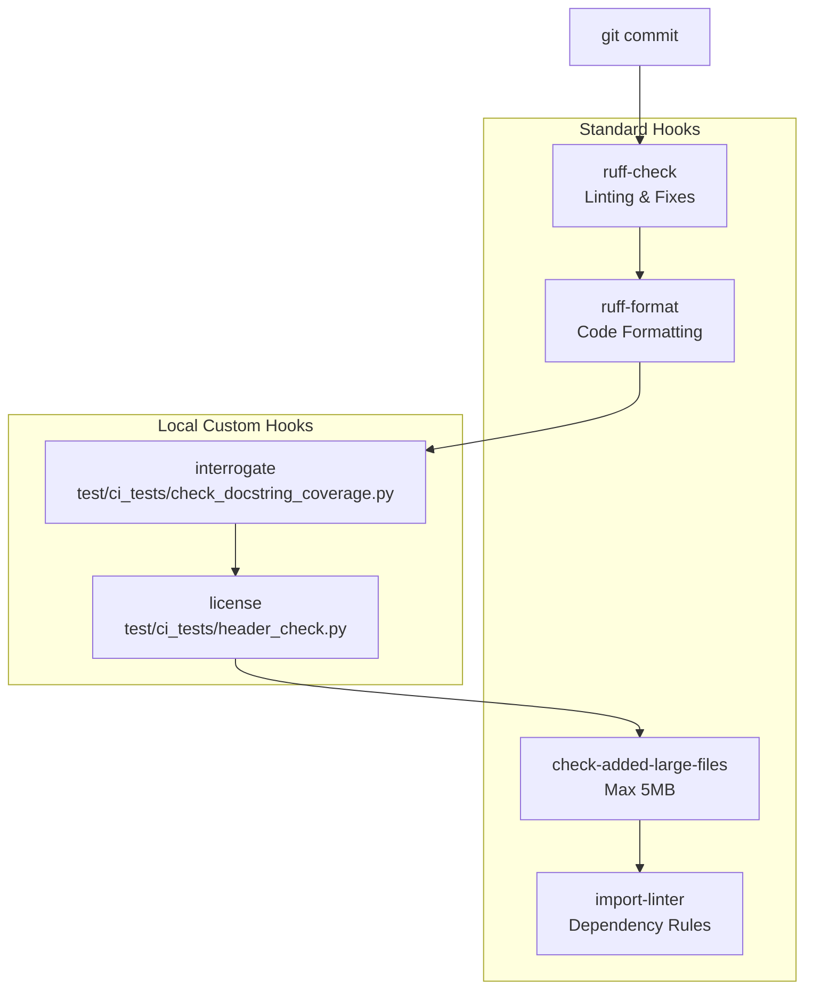
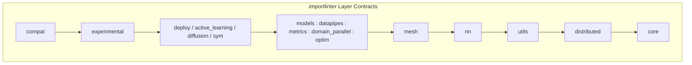
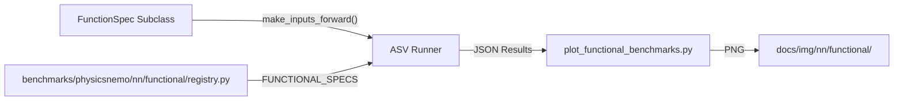

<!-- source: DeepWiki mcp.deepwiki.com · repo NVIDIA/physicsnemo · page 10.4 Code Quality Standards · fetched 2026-10-21 -->

# Code Quality Standards

<details>
<summary>Relevant source files</summary>

The following files were used as context for generating this wiki page:

- [.github/CODEOWNERS](.github/CODEOWNERS)
- [.importlinter](.importlinter)
- [benchmarks/physicsnemo/nn/functional/registry.py](benchmarks/physicsnemo/nn/functional/registry.py)
- [docs/api/diffusion/noise_schedulers.rst](docs/api/diffusion/noise_schedulers.rst)
- [docs/api/mesh/transformations.rst](docs/api/mesh/transformations.rst)
- [docs/api/nn/functionals/geometry.rst](docs/api/nn/functionals/geometry.rst)
- [docs/api/nn/functionals/normalization.rst](docs/api/nn/functionals/normalization.rst)
- [docs/api/physicsnemo.nn.functionals.rst](docs/api/physicsnemo.nn.functionals.rst)
- [physicsnemo/core/module.py](physicsnemo/core/module.py)
- [physicsnemo/core/registry.py](physicsnemo/core/registry.py)
- [physicsnemo/diffusion/__init__.py](physicsnemo/diffusion/__init__.py)
- [physicsnemo/diffusion/base.py](physicsnemo/diffusion/base.py)
- [physicsnemo/diffusion/metrics/__init__.py](physicsnemo/diffusion/metrics/__init__.py)
- [physicsnemo/diffusion/metrics/losses.py](physicsnemo/diffusion/metrics/losses.py)
- [physicsnemo/diffusion/noise_schedulers/__init__.py](physicsnemo/diffusion/noise_schedulers/__init__.py)
- [physicsnemo/diffusion/noise_schedulers/domain_parallel.py](physicsnemo/diffusion/noise_schedulers/domain_parallel.py)
- [physicsnemo/diffusion/noise_schedulers/noise_schedulers.py](physicsnemo/diffusion/noise_schedulers/noise_schedulers.py)
- [physicsnemo/diffusion/preconditioners/preconditioners.py](physicsnemo/diffusion/preconditioners/preconditioners.py)
- [physicsnemo/diffusion/samplers/__init__.py](physicsnemo/diffusion/samplers/__init__.py)
- [physicsnemo/diffusion/samplers/samplers.py](physicsnemo/diffusion/samplers/samplers.py)
- [physicsnemo/diffusion/samplers/solvers.py](physicsnemo/diffusion/samplers/solvers.py)
- [physicsnemo/diffusion/utils/__init__.py](physicsnemo/diffusion/utils/__init__.py)
- [physicsnemo/diffusion/utils/model_wrappers.py](physicsnemo/diffusion/utils/model_wrappers.py)
- [physicsnemo/mesh/README.md](physicsnemo/mesh/README.md)
- [physicsnemo/mesh/geometry/_cell_normals.py](physicsnemo/mesh/geometry/_cell_normals.py)
- [physicsnemo/mesh/remeshing/_partition.py](physicsnemo/mesh/remeshing/_partition.py)
- [physicsnemo/mesh/transformations/deform/__init__.py](physicsnemo/mesh/transformations/deform/__init__.py)
- [physicsnemo/models/mlp/fully_connected.py](physicsnemo/models/mlp/fully_connected.py)
- [physicsnemo/models/unet/unet.py](physicsnemo/models/unet/unet.py)
- [physicsnemo/nn/functional/__init__.py](physicsnemo/nn/functional/__init__.py)
- [physicsnemo/nn/functional/geometry/__init__.py](physicsnemo/nn/functional/geometry/__init__.py)
- [physicsnemo/nn/functional/geometry/deform/__init__.py](physicsnemo/nn/functional/geometry/deform/__init__.py)
- [physicsnemo/nn/functional/geometry/deform/_warp_impl/__init__.py](physicsnemo/nn/functional/geometry/deform/_warp_impl/__init__.py)
- [physicsnemo/nn/functional/normalization.py](physicsnemo/nn/functional/normalization.py)
- [physicsnemo/nn/module/mlp_layers.py](physicsnemo/nn/module/mlp_layers.py)
- [test/ci_tests/check_docstring_coverage.py](test/ci_tests/check_docstring_coverage.py)
- [test/ci_tests/header_check.py](test/ci_tests/header_check.py)
- [test/ci_tests/interrogate_baseline.txt](test/ci_tests/interrogate_baseline.txt)
- [test/core/test_module_nested.py](test/core/test_module_nested.py)
- [test/diffusion/test_wrappers.py](test/diffusion/test_wrappers.py)
- [test/mesh/geometry/test_cell_normals.py](test/mesh/geometry/test_cell_normals.py)
- [test/mesh/remeshing/test_partition.py](test/mesh/remeshing/test_partition.py)
- [test/models/mlp/test_fully_connected.py](test/models/mlp/test_fully_connected.py)
- [test/models/unet/test_unet.py](test/models/unet/test_unet.py)
- [test/nn/module/test_mlp_layers.py](test/nn/module/test_mlp_layers.py)

</details>


## Purpose and Scope

This document describes PhysicsNeMo's code quality enforcement mechanisms, including pre-commit hooks, CI/CD pipeline stages, documentation requirements, license headers, import-linter contracts, coding standards, and functional API benchmarks. These standards ensure consistent code style, clean architectural boundaries, comprehensive documentation, and reliable performance benchmarks across the codebase.

For information about the complete development workflow including PRs and code review, see [Contributing Guidelines](#10.1). For details about the testing framework and test organization, see [Testing Framework](#10.2). For CI/CD infrastructure and Blossom-CI authorization, see [CI/CD Pipeline](#10.3).

---

## Pre-commit Hooks System

PhysicsNeMo **requires** pre-commit hooks for all development work. The pre-commit system automatically checks code quality before commits are created, catching issues early in the development process.

### Installation and Configuration

Pre-commit is installed via the `Makefile` or through the `dev` optional dependencies. To enable pre-commit hooks:

```bash
make setup-ci
# Equivalent to:
# pip install pre-commit && pre-commit install
```
[Makefile:17-19]()

### Pre-commit Hook Architecture

The `.pre-commit-config.yaml` defines a sequence of specialized hooks that validate formatting, docstring coverage, and license compliance.


**Sources:** [.pre-commit-config.yaml:17-61]()

---

## Code Formatting and Linting with Ruff

PhysicsNeMo uses [Ruff](https://docs.astral.sh/ruff/) for both formatting and linting. It replaces multiple legacy tools (Black, Flake8, isort) with a single high-performance Rust-based engine.

### Formatting Enforcement

Ruff formatting is enforced via `ruff-format`. It ensures consistent indentation, line length, and import organization.
- **Manual Format:** `make black` (runs `pre-commit run ruff-format -a`) [Makefile:21-22]()
- **CI Check:** Verified during the pre-commit stage of the CI pipeline.

### Linting Rules

The `ruff-check` hook is configured with `--fix` to automatically resolve common issues like unused imports or unsorted variables.
- **Manual Lint:** `make lint` [Makefile:27-30]()

Sources: [.pre-commit-config.yaml:21-22](), [Makefile:21-30]()

---

## Docstring Coverage (Interrogate)

PhysicsNeMo enforces strict docstring coverage using `interrogate`. Unlike standard configurations, PhysicsNeMo uses a custom wrapper `test/ci_tests/check_docstring_coverage.py` to manage a baseline of grandfathered undocumented items.

### The Baseline System

New code must have docstrings. Existing undocumented code is tracked in `test/ci_tests/interrogate_baseline.txt`. If a developer adds a new function without a docstring, the hook will fail because the new item is not in the baseline.

| File | Role |
|------|------|
| `test/ci_tests/check_docstring_coverage.py` | Logic to run interrogate and compare against baseline. [test/ci_tests/check_docstring_coverage.py:194-200]() |
| `test/ci_tests/interrogate_baseline.txt` | List of `filepath:item_name` exempt from coverage requirements. [test/ci_tests/interrogate_baseline.txt:1-5]() |

### Exemptions

The following patterns are ignored by the coverage checker:
- `forward`, `backward` (Standard PyTorch methods)
- `reset_parameters`, `extra_repr`
- `MetaData` classes
- Private/Magic methods (e.g., `_internal`, `__str__`)

**Sources:** [test/ci_tests/check_docstring_coverage.py:53-71](), [.pre-commit-config.yaml:28-35]()

---

## License Header Validation

Every source file must contain the standard NVIDIA Apache-2.0 license header. This is validated by `test/ci_tests/header_check.py`.

### Validation Logic

The script `header_check.py` performs the following:
1. Reads the first few lines of a file. [test/ci_tests/header_check.py:46-64]()
2. Matches against a regex: `re.compile(r"Copyright.*NVIDIA.*", re.IGNORECASE)`. [test/ci_tests/header_check.py:33]()
3. Validates that the copyright year is current (starts from 2024). [test/ci_tests/header_check.py:135-136]()
4. Rejects files containing "GPL" to prevent licensing contamination. [test/ci_tests/header_check.py:116]()

**Sources:** [test/ci_tests/header_check.py:67-118](), [.pre-commit-config.yaml:43-50]()

---

## Import-Linter Contracts (.importlinter)

PhysicsNeMo uses `import-linter` to enforce strict modular layering and prevent circular dependencies or improper upward imports across packages [-.importlinter:1-141]().

### Architectural Layer Contracts

The `.importlinter` configuration defines several contracts:
- **`physicsnemo-modules`**: Controls the high-level layer hierarchy within `physicsnemo`, ensuring that components like `nn`, `mesh`, and `models` adhere to unidirectional dependency rules [.importlinter:8-28]().
- **`physicsnemo-core`**: Governs core utilities and serialization primitives inside `physicsnemo.core` [-.importlinter:29-39]().
- **`physicsnemo-distributed`**: Enforces layering within distributed training and communication modules [-.importlinter:41-53]().
- **`physicsnemo-utils`**: Restricts dependencies across utility submodules [-.importlinter:54-66]().
- **`physicsnemo-nn`**: Manages isolation between functional operators, layer modules, and model components [-.importlinter:67-77]().
- **`physicsnemo-models`**: Prevents unauthorized cross-model imports in `physicsnemo.models` [-.importlinter:99-111]().


**Sources:** [-.importlinter:8-28]()

---

## Coding Standards (CODING_STANDARDS)

PhysicsNeMo maintains explicit guidelines for functional APIs, model implementation, and external package imports under the `CODING_STANDARDS/` directory [.github/CODEOWNERS:39-41]().

### Functional APIs (`FUNCTIONAL_APIS.md`)

Functional operators (`physicsnemo.nn.functional`) must follow stateless design patterns akin to `torch.nn.functional`:
- Operations must be side-effect free and support `torch.compile` and CUDA graph capture where applicable.
- Multi-backend operations must implement `FunctionSpec` subclasses allowing dynamic dispatch across backends (e.g., Torch vs. Warp) [benchmarks/physicsnemo/nn/functional/registry.py:17-117]().

### Model Implementation (`MOD-*` Standards)

All neural network models must inherit from `physicsnemo.core.Module`, ensuring:
- JSON-serializable arguments in `__init__` for checkpoint recovery [physicsnemo/core/module.py:130-137]().
- Support for nested module wrapping via `Module.from_torch()` [physicsnemo/core/module.py:138-144]().
- Integration with `ModelMetaData` for provenance tracking [physicsnemo/core/module.py:148-150]().

### External Imports

External library usage is strictly policed via `import-linter` forbidden import contracts [-.importlinter:138-141]() to keep dependencies lightweight and ensure cross-platform compatibility (CPU, GPU, and specialized backends).

**Sources:** [.github/CODEOWNERS:39-41](), [physicsnemo/core/module.py:123-150]()

---

## ASV Benchmarks

PhysicsNeMo uses [Airspeed Velocity (ASV)](https://github.com/airspeed-velocity/asv) to track performance regressions in functional APIs.

### Benchmark Workflow

Functional benchmarks are defined by associating a `FunctionSpec` with the ASV runner.

1. **Registry:** Functionals are added to `benchmarks/physicsnemo/nn/functional/registry.py`. [benchmarks/physicsnemo/nn/functional/registry.py:38-57]()
2. **Input Generation:** The `FunctionSpec` provides labeled test cases (e.g., "small", "medium", "large"). [benchmarks/physicsnemo/nn/functional/registry.py:68-70]()
3. **Execution:** Benchmarks are run via `./benchmarks/run_benchmarks.sh`.
4. **Visualization:** `plot_functional_benchmarks.py` generates bar charts comparing backend speeds (e.g., Warp vs. PyTorch).

### ASV Data Flow



**Sources:** [benchmarks/physicsnemo/nn/functional/registry.py:17-123]()

---

## Quality Assurance Summary

| Standard | Tool | Enforcement |
|----------|------|-------------|
| **Formatting** | Ruff | `ruff-format` hook [Makefile:22]() |
| **Linting** | Ruff | `ruff-check` hook [Makefile:28]() |
| **Docstrings** | Interrogate | Custom script with baseline [test/ci_tests/interrogate_baseline.txt]() |
| **License** | Custom | `header_check.py` [test/ci_tests/header_check.py]() |
| **Imports** | Import-Linter | `.importlinter` contracts [-.importlinter:1-141]() |
| **Functional** | FunctionSpec | Registry & Dispatch logic [physicsnemo/core/function_spec.py]() |
| **Performance**| ASV | Automated regression tracking [benchmarks/physicsnemo/nn/functional/registry.py]() |

**Sources:** [Makefile:57](), [.pre-commit-config.yaml:1-61](), [-.importlinter:1-141]()

---

