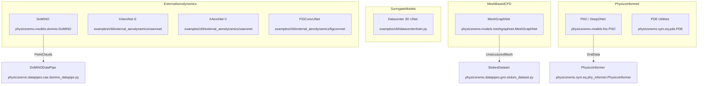

<!-- source: DeepWiki mcp.deepwiki.com · repo NVIDIA/physicsnemo · page 11.2 Computational Fluid Dynamics · fetched 2026-10-21 -->

# Computational Fluid Dynamics

Relevant source files

The following files were used as context for generating this wiki page:

- [docs/img/datacenter_design_cfd.gif](docs/img/datacenter_design_cfd.gif)
- [docs/img/datacenter_hybrid_training.png](docs/img/datacenter_hybrid_training.png)
- [docs/img/inverse_pinn_sample_points.png](docs/img/inverse_pinn_sample_points.png)
- [examples/additive_manufacturing/sintering_physics/inference.py](examples/additive_manufacturing/sintering_physics/inference.py)
- [examples/additive_manufacturing/sintering_physics/requirements.txt](examples/additive_manufacturing/sintering_physics/requirements.txt)
- [examples/additive_manufacturing/sintering_physics/train.py](examples/additive_manufacturing/sintering_physics/train.py)
- [examples/cfd/darcy_physics_informed/README.md](examples/cfd/darcy_physics_informed/README.md)
- [examples/cfd/darcy_physics_informed/requirements.txt](examples/cfd/darcy_physics_informed/requirements.txt)
- [examples/cfd/datacenter/README.md](examples/cfd/datacenter/README.md)
- [examples/cfd/datacenter/conf/config.yaml](examples/cfd/datacenter/conf/config.yaml)
- [examples/cfd/datacenter/conf/config_inference.yaml](examples/cfd/datacenter/conf/config_inference.yaml)
- [examples/cfd/datacenter/conf/config_physics_informed.yaml](examples/cfd/datacenter/conf/config_physics_informed.yaml)
- [examples/cfd/datacenter/inference.py](examples/cfd/datacenter/inference.py)
- [examples/cfd/datacenter/requirements.txt](examples/cfd/datacenter/requirements.txt)
- [examples/cfd/datacenter/train.py](examples/cfd/datacenter/train.py)
- [examples/cfd/datacenter/train_physics_informed.py](examples/cfd/datacenter/train_physics_informed.py)
- [examples/cfd/external_aerodynamics/domino_nim_finetuning/README.md](examples/cfd/external_aerodynamics/domino_nim_finetuning/README.md)
- [examples/cfd/external_aerodynamics/figconvnet/README.md](examples/cfd/external_aerodynamics/figconvnet/README.md)
- [examples/cfd/external_aerodynamics/figconvnet/configs/data/drivaerml.yaml](examples/cfd/external_aerodynamics/figconvnet/configs/data/drivaerml.yaml)
- [examples/cfd/external_aerodynamics/figconvnet/configs/experiment/drivaerml/figconv_unet.yaml](examples/cfd/external_aerodynamics/figconvnet/configs/experiment/drivaerml/figconv_unet.yaml)
- [examples/cfd/external_aerodynamics/figconvnet/configs/lr_scheduler/onecyclelr.yaml](examples/cfd/external_aerodynamics/figconvnet/configs/lr_scheduler/onecyclelr.yaml)
- [examples/cfd/external_aerodynamics/figconvnet/configs/model/figconv_unet_drivaerml.yaml](examples/cfd/external_aerodynamics/figconvnet/configs/model/figconv_unet_drivaerml.yaml)
- [examples/cfd/external_aerodynamics/figconvnet/src/data/__init__.py](examples/cfd/external_aerodynamics/figconvnet/src/data/__init__.py)
- [examples/cfd/external_aerodynamics/figconvnet/src/data/drivaerml_datamodule.py](examples/cfd/external_aerodynamics/figconvnet/src/data/drivaerml_datamodule.py)
- [examples/cfd/external_aerodynamics/figconvnet/src/networks/__init__.py](examples/cfd/external_aerodynamics/figconvnet/src/networks/__init__.py)
- [examples/cfd/external_aerodynamics/figconvnet/src/networks/figconvunet_drivaer.py](examples/cfd/external_aerodynamics/figconvnet/src/networks/figconvunet_drivaer.py)
- [examples/cfd/external_aerodynamics/figconvnet/src/utils/eval_funcs.py](examples/cfd/external_aerodynamics/figconvnet/src/utils/eval_funcs.py)
- [examples/cfd/external_aerodynamics/figconvnet/src/utils/loggers.py](examples/cfd/external_aerodynamics/figconvnet/src/utils/loggers.py)
- [examples/cfd/external_aerodynamics/xaeronet/README.md](examples/cfd/external_aerodynamics/xaeronet/README.md)
- [examples/cfd/external_aerodynamics/xaeronet/requirements.txt](examples/cfd/external_aerodynamics/xaeronet/requirements.txt)
- [examples/cfd/external_aerodynamics/xaeronet/surface/compute_stats.py](examples/cfd/external_aerodynamics/xaeronet/surface/compute_stats.py)
- [examples/cfd/external_aerodynamics/xaeronet/surface/dataloader.py](examples/cfd/external_aerodynamics/xaeronet/surface/dataloader.py)
- [examples/cfd/external_aerodynamics/xaeronet/surface/preprocessor.py](examples/cfd/external_aerodynamics/xaeronet/surface/preprocessor.py)
- [examples/cfd/external_aerodynamics/xaeronet/surface/train.py](examples/cfd/external_aerodynamics/xaeronet/surface/train.py)
- [examples/cfd/inverse_pinns/README.md](examples/cfd/inverse_pinns/README.md)
- [examples/cfd/inverse_pinns/config.yaml](examples/cfd/inverse_pinns/config.yaml)
- [examples/cfd/inverse_pinns/train_inverse_pinn.py](examples/cfd/inverse_pinns/train_inverse_pinn.py)
- [examples/cfd/ldc_pinns/README.md](examples/cfd/ldc_pinns/README.md)
- [examples/cfd/mhd_pino/README.md](examples/cfd/mhd_pino/README.md)
- [examples/cfd/mhd_pino/losses/loss_mhd_physicsnemo.py](examples/cfd/mhd_pino/losses/loss_mhd_physicsnemo.py)
- [examples/cfd/mhd_pino/losses/loss_mhd_vec_pot_physicsnemo.py](examples/cfd/mhd_pino/losses/loss_mhd_vec_pot_physicsnemo.py)
- [examples/cfd/mhd_pino/utils/plot_utils.py](examples/cfd/mhd_pino/utils/plot_utils.py)
- [examples/cfd/stokes_mgn/conf/config.yaml](examples/cfd/stokes_mgn/conf/config.yaml)
- [examples/cfd/stokes_mgn/inference.py](examples/cfd/stokes_mgn/inference.py)
- [examples/cfd/stokes_mgn/pi_fine_tuning.py](examples/cfd/stokes_mgn/pi_fine_tuning.py)
- [examples/cfd/stokes_mgn/pi_fine_tuning_gnn.py](examples/cfd/stokes_mgn/pi_fine_tuning_gnn.py)
- [examples/cfd/stokes_mgn/train.py](examples/cfd/stokes_mgn/train.py)
- [examples/cfd/stokes_mgn/utils.py](examples/cfd/stokes_mgn/utils.py)
- [examples/cfd/swe_nonlinear_pino/README.md](examples/cfd/swe_nonlinear_pino/README.md)
- [examples/cfd/swe_nonlinear_pino/train_swe_nl_pino.py](examples/cfd/swe_nonlinear_pino/train_swe_nl_pino.py)
- [examples/cfd/swe_nonlinear_pino/train_utils/plot.py](examples/cfd/swe_nonlinear_pino/train_utils/plot.py)
- [examples/cfd/swe_nonlinear_pino/train_utils/utils.py](examples/cfd/swe_nonlinear_pino/train_utils/utils.py)
- [v2.0-MIGRATION-GUIDE.md](v2.0-MIGRATION-GUIDE.md)

This page provides a high-level overview of Computational Fluid Dynamics (CFD) workflows in PhysicsNeMo. The framework offers scalable AI surrogate models, graph neural networks, neural operators, and physics-informed neural networks (PINNs/PINOs) designed to accelerate traditional CAE and CFD simulations across external aerodynamics, internal thermal systems, and porous media flows.

## Overview of CFD Models and Recipes

PhysicsNeMo supports diverse geometric representations (point clouds, unstructured meshes, voxel grids, and regular domains) across multiple architectural families.

**CFD Architecture to Code Entity Mapping**

| Model / Family | Primary Representation | Target Application | Key Code Entities |
|----------------|------------------------|--------------------|-------------------|
| **DoMINO** | Point Clouds & STL | Automotive External Aerodynamics | `physicsnemo.models.domino.DoMINO`, `DoMINODataPipe` [physicsnemo/models/domino/model.py:45-56]() |
| **XAeroNet-S / -V** | Subgraph Partitions / Voxels | Large-Scale DrivAerML Aerodynamics | `examples/cfd/external_aerodynamics/xaeronet/surface/train.py` [examples/cfd/external_aerodynamics/xaeronet/README.md:29-60]() |
| **FIGConvUNet** | Large 3D Point Clouds | Ahmed Body & DrivAerNet Pressure | `examples/cfd/external_aerodynamics/figconvnet/src/networks/figconvunet_drivaer.py` [examples/cfd/external_aerodynamics/figconvnet/README.md:9-13]() |
| **MeshGraphNet** | Irregular Meshes | Vortex Shedding & Stokes Flow | `physicsnemo.models.meshgraphnet.MeshGraphNet`, `StokesDataset` [examples/cfd/stokes_mgn/train.py:31-101]() |
| **Datacenter 3D UNet** | Voxel Grid + SDF | Hot Aisle Thermal & Airflow | `examples/cfd/datacenter/train.py` [examples/cfd/datacenter/README.md:3-9]() |
| **PINO / DeepONet** | Regular Grids & Points | Darcy Flow & Shallow Water Equations | `physicsnemo.models.fno.FNO`, `physicsnemo.sym.eq.pde.PDE` [examples/cfd/darcy_physics_informed/README.md:3-5]() |

Sources:
- [physicsnemo/models/domino/model.py:45-56]()
- [examples/cfd/external_aerodynamics/xaeronet/README.md:29-60]()
- [examples/cfd/external_aerodynamics/figconvnet/README.md:9-13]()
- [examples/cfd/stokes_mgn/train.py:31-101]()
- [examples/cfd/datacenter/README.md:3-9]()
- [examples/cfd/darcy_physics_informed/README.md:3-5]()

---

## External Aerodynamics and Surface Surrogates

External aerodynamics models predict pressure distributions, skin friction, and velocity fields around complex geometries like automobiles and aircraft. PhysicsNeMo provides specialized architectures such as DoMINO, XAeroNet, and FIGConvUNet to handle massive point clouds and high-resolution CAD models.

- **DoMINO**: Decomposable Multi-scale Iterative Neural Operator for surface and volume predictions with domain parallelism support. For details, see [DoMINO for External Aerodynamics](#11.2.1).
- **XAeroNet**: Consists of XAeroNet-S (scalable MeshGraphNet with graph partitioning and halo regions for surface metrics) and XAeroNet-V (3D UNet with attention gates and continuity constraints for volume grids) [examples/cfd/external_aerodynamics/xaeronet/README.md:29-60]().
- **FIGConvUNet**: Combines U-shaped architectures with factorized implicit global convolutions to process 1M+ point cloud geometries from DrivAerNet and Ahmed body benchmarks [examples/cfd/external_aerodynamics/figconvnet/README.md:9-17]().
- **Unified Recipe**: Configures Hydra-based pipelines, dataset factories, DomainMesh contracts, and non-dimensionalization. For details, see [Unified External Aerodynamics Recipe](#11.2.3).

Sources:
- [examples/cfd/external_aerodynamics/xaeronet/README.md:29-60]()
- [examples/cfd/external_aerodynamics/figconvnet/README.md:9-17]()

---

## Mesh-Based CFD and Transient Flow

Mesh-based simulations leverage Graph Neural Networks (GNNs) to operate directly on unstructured computational meshes, capturing complex transient phenomena like vortex shedding, laminar cavity flows, and Stokes regimes.

- **MeshGraphNet (MGN)**: Implements an encoder-processor-decoder message passing paradigm to predict physical states and autoregressive rollouts on triangular or tetrahedral meshes [examples/cfd/vortex_shedding_mgn/inference.py:37-145]().
- **Stokes Flow & BiStride Variants**: Integrates multiscale graph processing and physics-informed fine-tuning using `physicsnemo.sym` PDE definitions [examples/cfd/stokes_mgn/pi_fine_tuning.py:51-98]().
- **Rollout Inference**: Autoregressively updates mesh node attributes over extended time horizons [examples/cfd/vortex_shedding_mgn/inference.py:88-155]().

For implementation details, dataset preparation, and rollout pipelines, see [MeshGraphNet for Vortex Shedding](#11.2.2).

Sources:
- [examples/cfd/vortex_shedding_mgn/inference.py:37-145]()
- [examples/cfd/stokes_mgn/pi_fine_tuning.py:51-98]()

---

## Surrogate Models for Systems Engineering

Industrial thermal and airflow management requires rapid design space exploration. PhysicsNeMo provides 3D U-Net surrogate models tailored for structured voxel grids and parametric CAD variations.

- **Datacenter Airflow Model**: Uses a 3D U-Net conditioned on Signed Distance Fields (SDF) and sinusoidal positional embeddings to predict temperature, velocity, and pressure distributions inside datacenter hot aisles [examples/cfd/datacenter/README.md:3-59]().
- **OpenFOAM Integration**: Processes steady-state OpenFOAM VTK exports, applying normalization and spatial padding to handle variable hot aisle lengths, heights, widths, and IT rack counts [examples/cfd/datacenter/README.md:16-58]().
- **Hybrid Training**: Supports auxiliary physics-informed loss terms alongside data-driven MSE objectives to improve generalization in low-data regimes [examples/cfd/datacenter/README.md:78-87]().

Sources:
- [examples/cfd/datacenter/README.md:3-87]()

---

## Physics-Informed CFD (PINN / PINO)

When observational data is scarce or physical consistency is strictly required, PhysicsNeMo incorporates governing equations directly into the training loop via `physicsnemo.sym`.

- **Darcy Flow PINO & DeepONet**: Demonstrates auto-differentiation via DeepONet branch/trunk networks and numerical Fourier derivatives via FNO to evaluate governing equation residuals [examples/cfd/darcy_physics_informed/README.md:3-51]().
- **Nonlinear Shallow Water Equations (SWE)**: Implements coupled multi-equation PDE residuals using spectral differentiation and custom loss aggregations [examples/cfd/swe_nonlinear_pino/README.md:1-70]().
- **Lid-Driven Cavity (LDC) PINNs**: Solves purely physics-driven problems on point clouds sampled from symbolic geometries without requiring simulation datasets [examples/cfd/ldc_pinns/README.md:1-41]().

For a complete breakdown of symbolic PDE definitions, PhysicsInformer utilities, and inverse modeling, see [Physics-Informed CFD (PINN/PINO)](#11.2.4).

Sources:
- [examples/cfd/darcy_physics_informed/README.md:3-51]()
- [examples/cfd/swe_nonlinear_pino/README.md:1-70]()
- [examples/cfd/ldc_pinns/README.md:1-41]()

---

