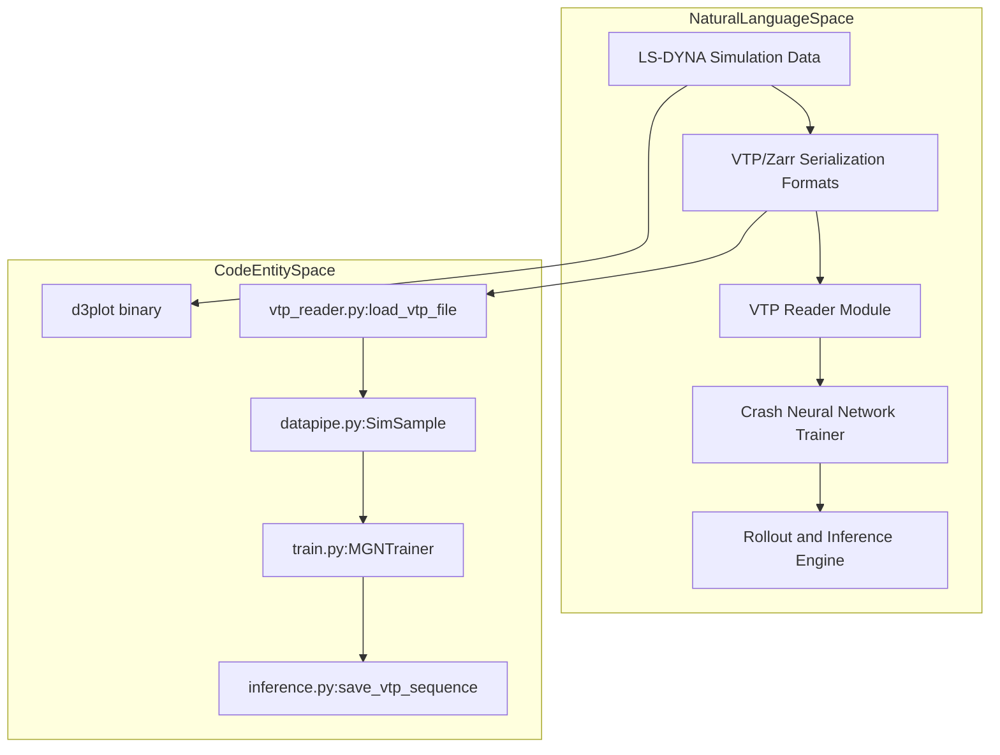
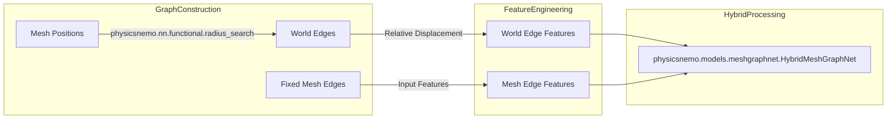
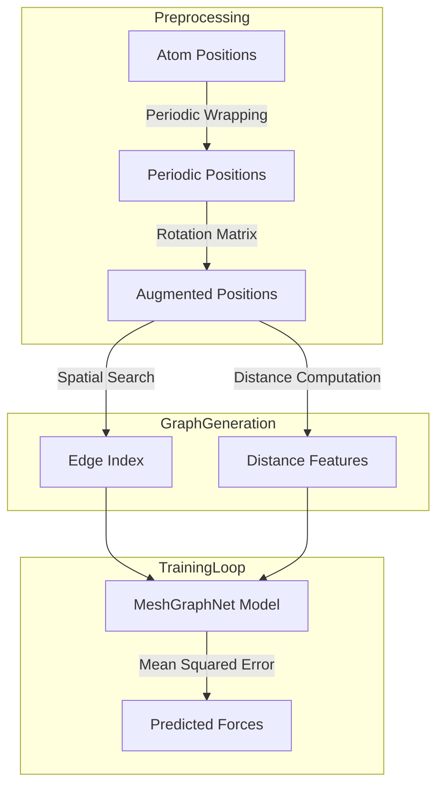

<!-- source: DeepWiki mcp.deepwiki.com · repo NVIDIA/physicsnemo · page 11.4 Scientific Domain Examples · fetched 2026-10-21 -->

# Scientific Domain Examples

Relevant source files

The following files were used as context for generating this wiki page:

- [docs/Makefile](docs/Makefile)
- [docs/examples_weather.rst](docs/examples_weather.rst)
- [docs/img/corrdiff_illustration.png](docs/img/corrdiff_illustration.png)
- [docs/img/crash/Test_MSE_models.png](docs/img/crash/Test_MSE_models.png)
- [docs/img/crash/Time_integraton_val_loss.png](docs/img/crash/Time_integraton_val_loss.png)
- [docs/img/crash/bumper_beam.gif](docs/img/crash/bumper_beam.gif)
- [docs/img/deforming_plate.gif](docs/img/deforming_plate.gif)
- [docs/img/hydrographnet.gif](docs/img/hydrographnet.gif)
- [docs/img/kmc_energy_rollout.gif](docs/img/kmc_energy_rollout.gif)
- [docs/img/lj_system_physicsnemo_results.png](docs/img/lj_system_physicsnemo_results.png)
- [docs/img/regen_method.gif](docs/img/regen_method.gif)
- [docs/index.rst](docs/index.rst)
- [examples/README.md](examples/README.md)
- [examples/additive_manufacturing/sintering_physics/README.md](examples/additive_manufacturing/sintering_physics/README.md)
- [examples/cfd/flow_reconstruction_diffusion/README.md](examples/cfd/flow_reconstruction_diffusion/README.md)
- [examples/cfd/flow_reconstruction_diffusion/generate_dfsr.py](examples/cfd/flow_reconstruction_diffusion/generate_dfsr.py)
- [examples/cfd/flow_reconstruction_diffusion/requirements.txt](examples/cfd/flow_reconstruction_diffusion/requirements.txt)
- [examples/cfd/gray_scott_rnn/README.md](examples/cfd/gray_scott_rnn/README.md)
- [examples/cfd/gray_scott_rnn/requirements.txt](examples/cfd/gray_scott_rnn/requirements.txt)
- [examples/cfd/navier_stokes_rnn/README.md](examples/cfd/navier_stokes_rnn/README.md)
- [examples/cfd/navier_stokes_rnn/requirements.txt](examples/cfd/navier_stokes_rnn/requirements.txt)
- [examples/cfd/stokes_mgn/README.md](examples/cfd/stokes_mgn/README.md)
- [examples/cfd/stokes_mgn/requirements.txt](examples/cfd/stokes_mgn/requirements.txt)
- [examples/cfd/swe_nonlinear_pino/requirements.txt](examples/cfd/swe_nonlinear_pino/requirements.txt)
- [examples/generative/stormcast/README.md](examples/generative/stormcast/README.md)
- [examples/geophysics/diffusion_fwi/README.md](examples/geophysics/diffusion_fwi/README.md)
- [examples/healthcare/bloodflow_1d_mgn/README.md](examples/healthcare/bloodflow_1d_mgn/README.md)
- [examples/healthcare/bloodflow_1d_mgn/generate_dataset.py](examples/healthcare/bloodflow_1d_mgn/generate_dataset.py)
- [examples/healthcare/bloodflow_1d_mgn/generate_graphs.py](examples/healthcare/bloodflow_1d_mgn/generate_graphs.py)
- [examples/healthcare/bloodflow_1d_mgn/graph_tools.py](examples/healthcare/bloodflow_1d_mgn/graph_tools.py)
- [examples/healthcare/bloodflow_1d_mgn/requirements.txt](examples/healthcare/bloodflow_1d_mgn/requirements.txt)
- [examples/kinetic_monte_carlo/README.md](examples/kinetic_monte_carlo/README.md)
- [examples/kinetic_monte_carlo/compute_stats.py](examples/kinetic_monte_carlo/compute_stats.py)
- [examples/kinetic_monte_carlo/conf/config_compute_stats.yaml](examples/kinetic_monte_carlo/conf/config_compute_stats.yaml)
- [examples/kinetic_monte_carlo/conf/config_generate.yaml](examples/kinetic_monte_carlo/conf/config_generate.yaml)
- [examples/kinetic_monte_carlo/conf/config_train.yaml](examples/kinetic_monte_carlo/conf/config_train.yaml)
- [examples/kinetic_monte_carlo/dataset/__init__.py](examples/kinetic_monte_carlo/dataset/__init__.py)
- [examples/kinetic_monte_carlo/dataset/dataset.py](examples/kinetic_monte_carlo/dataset/dataset.py)
- [examples/kinetic_monte_carlo/generate.py](examples/kinetic_monte_carlo/generate.py)
- [examples/molecular_dynamics/lennard_jones/README.md](examples/molecular_dynamics/lennard_jones/README.md)
- [examples/molecular_dynamics/lennard_jones/conf/config.yaml](examples/molecular_dynamics/lennard_jones/conf/config.yaml)
- [examples/molecular_dynamics/lennard_jones/lennard_jones_system.py](examples/molecular_dynamics/lennard_jones/lennard_jones_system.py)
- [examples/molecular_dynamics/lennard_jones/requirements.txt](examples/molecular_dynamics/lennard_jones/requirements.txt)
- [examples/molecular_dynamics/lennard_jones/utils.py](examples/molecular_dynamics/lennard_jones/utils.py)
- [examples/structural_mechanics/crash/README.md](examples/structural_mechanics/crash/README.md)
- [examples/structural_mechanics/crash/conf/datapipe/graph.yaml](examples/structural_mechanics/crash/conf/datapipe/graph.yaml)
- [examples/structural_mechanics/crash/conf/datapipe/point_cloud.yaml](examples/structural_mechanics/crash/conf/datapipe/point_cloud.yaml)
- [examples/structural_mechanics/crash/conf/inference/default.yaml](examples/structural_mechanics/crash/conf/inference/default.yaml)
- [examples/structural_mechanics/crash/conf/training/default.yaml](examples/structural_mechanics/crash/conf/training/default.yaml)
- [examples/structural_mechanics/crash/datapipe.py](examples/structural_mechanics/crash/datapipe.py)
- [examples/structural_mechanics/crash/inference.py](examples/structural_mechanics/crash/inference.py)
- [examples/structural_mechanics/crash/rollout.py](examples/structural_mechanics/crash/rollout.py)
- [examples/structural_mechanics/crash/tests/test_rollout.py](examples/structural_mechanics/crash/tests/test_rollout.py)
- [examples/structural_mechanics/crash/tests/test_vtp_reader.py](examples/structural_mechanics/crash/tests/test_vtp_reader.py)
- [examples/structural_mechanics/crash/train.py](examples/structural_mechanics/crash/train.py)
- [examples/structural_mechanics/crash/utils.py](examples/structural_mechanics/crash/utils.py)
- [examples/structural_mechanics/crash/vtp_reader.py](examples/structural_mechanics/crash/vtp_reader.py)
- [examples/structural_mechanics/deforming_plate/README.md](examples/structural_mechanics/deforming_plate/README.md)
- [examples/structural_mechanics/deforming_plate/conf/config.yaml](examples/structural_mechanics/deforming_plate/conf/config.yaml)
- [examples/structural_mechanics/deforming_plate/deforming_plate_dataset.py](examples/structural_mechanics/deforming_plate/deforming_plate_dataset.py)
- [examples/structural_mechanics/deforming_plate/helpers.py](examples/structural_mechanics/deforming_plate/helpers.py)
- [examples/structural_mechanics/deforming_plate/inference.py](examples/structural_mechanics/deforming_plate/inference.py)
- [examples/structural_mechanics/deforming_plate/preprocessor.py](examples/structural_mechanics/deforming_plate/preprocessor.py)
- [examples/structural_mechanics/deforming_plate/requirements.txt](examples/structural_mechanics/deforming_plate/requirements.txt)
- [examples/structural_mechanics/deforming_plate/train.py](examples/structural_mechanics/deforming_plate/train.py)
- [examples/weather/flood_modeling/hydrographnet/conf/config.yaml](examples/weather/flood_modeling/hydrographnet/conf/config.yaml)
- [examples/weather/regional_weather_diffusion/.gitignore](examples/weather/regional_weather_diffusion/.gitignore)

This page provides technical details for PhysicsNeMo applications in specialized scientific domains, including structural mechanics (automotive crash and deforming plates), healthcare (cardiovascular blood flow), molecular dynamics (Lennard-Jones systems), TCAD, reservoir simulation, kinetic Monte Carlo, and additive manufacturing. These examples demonstrate how the framework's core GNN and operator learning architectures are adapted to specific physical constraints and data formats.

## Structural Mechanics: Automotive Crash Dynamics

The automotive crash modeling pipeline predicts structural deformation histories for design candidates. It supports high-fidelity finite element (FE) data from LS-DYNA, preprocessed via PhysicsNeMo-Curator into VTP or Zarr formats [examples/structural_mechanics/crash/README.md:6-12]().

### Implementation and Data Flow
The crash pipeline uses a modular architecture supporting `GeoTransolver`, `MeshGraphNet`, and `FIGConvUNet` [examples/structural_mechanics/crash/README.md:10-11](). Data is managed through a unified `SimSample` representation that encapsulates node features, target trajectories, and optional graph connectivity [examples/structural_mechanics/crash/datapipe.py:37-68]().

**Automotive Crash Architecture and Code Entities**

Sources: [examples/structural_mechanics/crash/README.md:54-100](), [examples/structural_mechanics/crash/datapipe.py:37-68](), [examples/structural_mechanics/crash/vtp_reader.py:59-141](), [examples/structural_mechanics/crash/inference.py:64-117]()

### Key Components
*   **`load_vtp_file`**: Parses displacement fields (e.g., `displacement_t0.005`) and mesh connectivity from PolyData [examples/structural_mechanics/crash/vtp_reader.py:59-141]().
*   **`CrashBaseDataset`**: Normalizes position trajectories and manages feature statistics (mean/std) cached in a local `stats` directory [examples/structural_mechanics/crash/datapipe.py:111-139]().
*   **`MGNTrainer`**: Orchestrates training, ensuring consistency between model types (e.g., `MeshGraphNet` requires a graph datapipe) [examples/structural_mechanics/crash/train.py:53-193]().
*   **`save_vtp_sequence`**: In `inference.py`, this function reconstructs the temporal sequence by applying predicted displacements to reference coordinates for visualization [examples/structural_mechanics/crash/inference.py:64-117]().

Sources: [examples/structural_mechanics/crash/vtp_reader.py:59-141](), [examples/structural_mechanics/crash/datapipe.py:111-139](), [examples/structural_mechanics/crash/train.py:53-193](), [examples/structural_mechanics/crash/inference.py:64-117]()

---

## Structural Mechanics: Deforming Plate

The deforming plate example uses a `HybridMeshGraphNet` to simulate the dynamics of a plate under stress. It distinguishes between mesh edges (fixed connectivity) and "world edges" (dynamic spatial proximity) [examples/structural_mechanics/deforming_plate/train.py:36-145]().

### Implementation Details
The model leverages a "concat trick" for efficient message passing and supports activation recomputation to reduce memory footprint [examples/structural_mechanics/deforming_plate/train.py:108-145]().

**Deforming Plate World Edge Integration**

Sources: [examples/structural_mechanics/deforming_plate/helpers.py:23-65](), [examples/structural_mechanics/deforming_plate/train.py:137-145]()

### Key Functions
*   **`add_world_edges`**: Uses spatial radius search to find nodes within a `world_edge_radius` and appends them to the graph connectivity if they are not already mesh edges [examples/structural_mechanics/deforming_plate/helpers.py:23-65]().
*   **`LazyTimeStepDataset`**: Implements on-demand loading of `.pt` sample files to handle datasets larger than system memory [examples/structural_mechanics/deforming_plate/train.py:72-97]().

Sources: [examples/structural_mechanics/deforming_plate/helpers.py:23-65](), [examples/structural_mechanics/deforming_plate/train.py:72-97]()

---

## Healthcare: 1D Cardiovascular Blood Flow

This application implements a reduced-order model (ROM) using `MeshGraphNet` to approximate 3D Navier-Stokes simulations of blood flow in arteries [examples/healthcare/bloodflow_1d_mgn/README.md:1-6]().

### Model Architecture
The network is trained on 1D centerline data from the Vascular Model Repository. Node features include physiological parameters such as diastolic/systolic pressure and RCR boundary conditions [examples/healthcare/bloodflow_1d_mgn/README.md:50-63]().

| Feature Category | Entities |
| :--- | :--- |
| **Node Features** | Pressure, Flow Rate, Cross-sectional Area, Tangent, RCR Parameters |
| **Edge Features** | Relative 3D Position, Distance, Edge Type |
| **Output** | $\Delta$ Pressure, $\Delta$ Flow Rate for next timestep |

Sources: [examples/healthcare/bloodflow_1d_mgn/README.md:50-72]()

### Specialized Graph Connectivity
To accelerate the transfer of boundary condition information, the implementation adds special edges connecting boundary nodes directly to interior nodes [examples/healthcare/bloodflow_1d_mgn/README.md:73-77]().

Sources: [examples/healthcare/bloodflow_1d_mgn/README.md:73-77]()

---

## Molecular Dynamics: Lennard-Jones System

This example predicts forces on atoms in a liquid Argon system (258 atoms) using a `MeshGraphNet` variant [examples/molecular_dynamics/lennard_jones/README.md:1-12]().

### Implementation Logic
Because all atoms are identical (Argon), the standard node encoder is bypassed [examples/molecular_dynamics/lennard_jones/README.md:20-23](). Edges are generated dynamically using nearest-neighbor search within a periodic domain [examples/molecular_dynamics/lennard_jones/README.md:24-24]().

**Molecular Dynamics Training Pipeline**

Sources: [examples/molecular_dynamics/lennard_jones/README.md:1-24]()

### Key Components
*   **`prepare_input`**: Handles data augmentation including periodic boundary wrapping, random noise injection, and system rotation [examples/molecular_dynamics/lennard_jones/README.md:1-24]().
*   **Force Normalization**: Forces are normalized using precomputed statistics before loss calculation [examples/molecular_dynamics/lennard_jones/README.md:1-24]().

Sources: [examples/molecular_dynamics/lennard_jones/README.md:1-24]()

---

## Additional Specialized Domain Examples

PhysicsNeMo provides specialized domain implementations across several other engineering and scientific disciplines:

*   **TCAD (Technology Computer-Aided Design)**: Implements Thermal and Elasticity Domain Decomposition using Fourier Neural Operators combined with Schwarz iterative methods (`examples/tcad/fp_ddm/`) [examples/README.md:53-58]().
*   **Reservoir Simulation**: Utilizes `MeshGraphNet` architectures (`X-MeshGraphNet`) to model subsurface fluid flow and pressure propagation in complex porous media reservoirs (`examples/reservoir_simulation/`) [examples/README.md:108-114]().
*   **Kinetic Monte Carlo (KMC)**: Provides probabilistic neural network surrogates based on `GeoTransolver` to accelerate long-time scale kinetic Monte Carlo solvers (`examples/kinetic_monte_carlo/`) [examples/README.md:102-107]().
*   **Additive Manufacturing**: Implements sintering physics models using `MeshGraphNet` to predict microstructural evolution and material compaction during metal additive manufacturing (`examples/additive_manufacturing/sintering_physics/`) [examples/README.md:90-95]().

Sources: [examples/README.md:53-114]()

---

