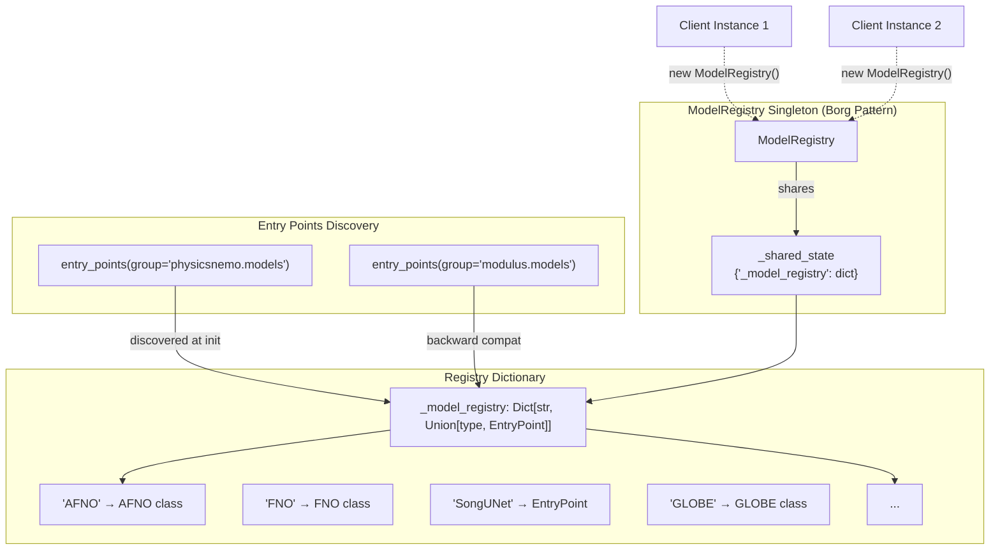
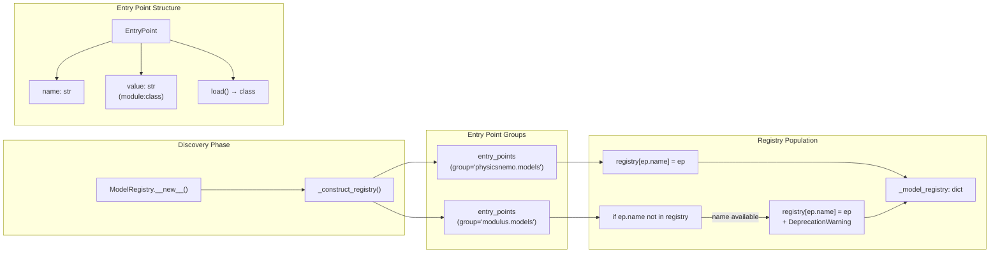
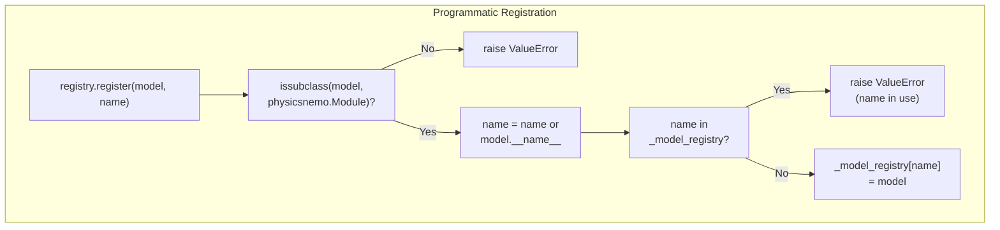
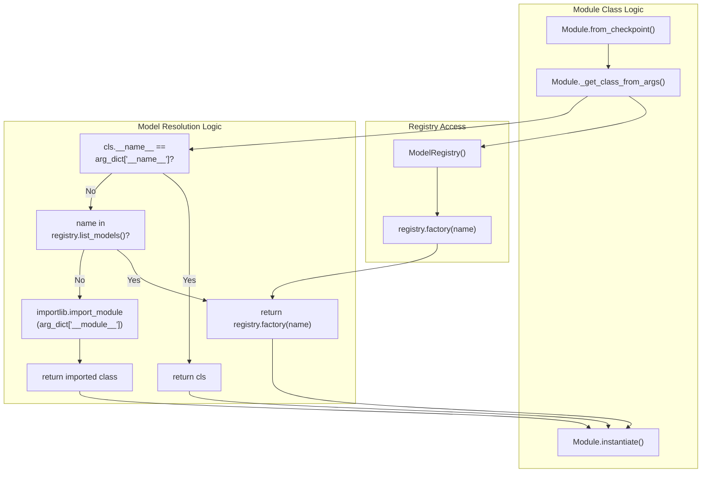

<!-- source: DeepWiki mcp.deepwiki.com · repo NVIDIA/physicsnemo · page 2.2 Model Registry · fetched 2026-10-21 -->

# Model Registry

<details>
<summary>Relevant source files</summary>

The following files were used as context for generating this wiki page:

- [CHANGELOG.md](CHANGELOG.md)
- [Dockerfile](Dockerfile)
- [Makefile](Makefile)
- [physicsnemo/__init__.py](physicsnemo/__init__.py)
- [physicsnemo/core/module.py](physicsnemo/core/module.py)
- [physicsnemo/core/registry.py](physicsnemo/core/registry.py)
- [physicsnemo/core/version_check.py](physicsnemo/core/version_check.py)
- [physicsnemo/models/mlp/fully_connected.py](physicsnemo/models/mlp/fully_connected.py)
- [physicsnemo/models/unet/unet.py](physicsnemo/models/unet/unet.py)
- [pyproject.toml](pyproject.toml)
- [test/ci_tests/header_check.py](test/ci_tests/header_check.py)
- [test/ci_tests/prevent_untracked_imports.py](test/ci_tests/prevent_untracked_imports.py)
- [test/core/test_module_nested.py](test/core/test_module_nested.py)
- [test/core/test_version_check.py](test/core/test_version_check.py)
- [test/models/mlp/test_fully_connected.py](test/models/mlp/test_fully_connected.py)
- [test/models/unet/test_unet.py](test/models/unet/test_unet.py)
- [test/nn/functional/test_natten.py](test/nn/functional/test_natten.py)
- [uv.lock](uv.lock)

</details>


## Purpose and Scope

The Model Registry provides a centralized discovery and instantiation system for PhysicsNeMo models. It maintains a catalog of available model classes and enables dynamic model instantiation by name, supporting both entry point-based discovery and programmatic registration. This system is fundamental to checkpoint loading and model serialization workflows, particularly in the v2.0 refactor which emphasizes modularity and easy integration. 

For information about the base `Module` class that models inherit from, see **2.1 Module Base Class**. For details on checkpoint serialization, see **2.3 Checkpointing and Serialization**.

Sources: [physicsnemo/core/module.py:42](), [physicsnemo/core/version_check.py:41-52]()

---

## Architecture Overview

The `ModelRegistry` implements a singleton pattern using the **Borg idiom**, ensuring a single shared registry state across the application (`_shared_state`). It maintains a mapping from model names to model classes or entry points (`_model_registry`), providing a factory interface for model instantiation.

### Registry Singleton Pattern



Sources: [physicsnemo/core/module.py:42]()

---

## Entry Points Discovery and Auto-Registration

The registry discovers models automatically through Python's entry points system, scanning groups such as `physicsnemo.models` and legacy fallback groups (`modulus.models`). Entry points are defined in package metadata and package configuration specifications.

### Entry Point Resolution Flow



Sources: [pyproject.toml:4-21]()

---

## Registry Operations

The registry provides core operations for programmatic registration, model factory instantiation, and model catalog listing via `ModelRegistry` methods.

### Core API Methods

| Method | Signature | Purpose |
|--------|-----------|---------|
| `register()` | `register(model: type[physicsnemo.Module], name: Union[str, None])` | Programmatically add a model to the registry. Validates subclassing of `physicsnemo.Module`. |
| `factory()` | `factory(name: str) → physicsnemo.Module` | Retrieve a registered model class by name, resolving entry points if necessary. |
| `list_models()` | `list_models() → List[str]` | Return all registered model names (primary and legacy). |

Sources: [physicsnemo/core/module.py:42]()

### Registration Process



Sources: [physicsnemo/core/module.py:123-144]()

---

## Integration with Module System

The registry integrates directly with `Module` instantiation and serialization routines, particularly when deserializing checkpoints or restoring nested module structures via `Module.from_checkpoint()` [physicsnemo/core/module.py:169-172]().

### Module Resolution Logic



Sources: [physicsnemo/core/module.py:42](), [physicsnemo/core/version_check.py:41-52]()

---

## Usage Examples

### Retrieving and Instantiating a Model via Factory

```python
from physicsnemo.core.registry import ModelRegistry

# Get registry instance (singleton)
registry = ModelRegistry()

# List all available models
model_names = registry.list_models()

# Get model class by name (resolves EntryPoint if needed)
AFNOClass = registry.factory('AFNO')

# Instantiate model
model = AFNOClass(...)
```

Sources: [physicsnemo/core/module.py:42]()

### Programmatic Registration

```python
from physicsnemo.core.module import Module
from physicsnemo.core.registry import ModelRegistry

class CustomModel(Module):
    def __init__(self, **kwargs):
        super().__init__()

# Register the model
registry = ModelRegistry()
registry.register(CustomModel, name="MyCustomModel")

# Now available via factory
model_class = registry.factory("MyCustomModel")
```

Sources: [physicsnemo/core/module.py:123-144]()

---

