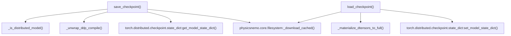
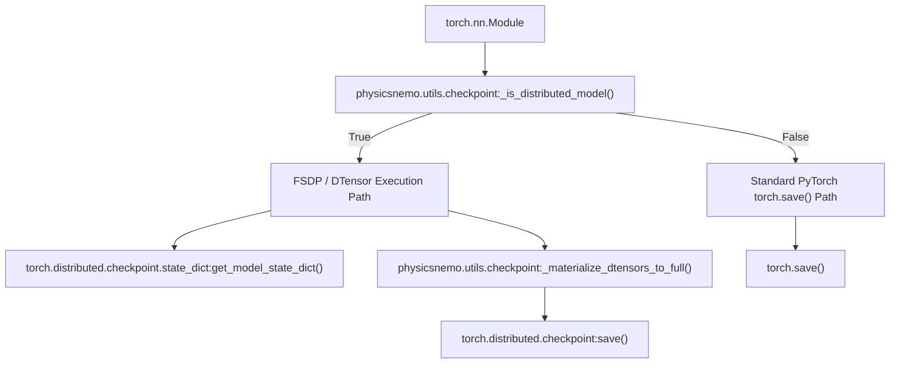

<!-- source: DeepWiki mcp.deepwiki.com · repo NVIDIA/physicsnemo · page 2.3 Checkpointing and Serialization · fetched 2026-10-21 -->

# Checkpointing and Serialization

Relevant source files

The following files were used as context for generating this wiki page:

- [docs/api/models/convolutional.rst](docs/api/models/convolutional.rst)
- [docs/api/models/fnos.rst](docs/api/models/fnos.rst)
- [docs/api/models/fully_connected.rst](docs/api/models/fully_connected.rst)
- [docs/api/models/gnns.rst](docs/api/models/gnns.rst)
- [docs/api/models/modules.rst](docs/api/models/modules.rst)
- [docs/api/models/operators.rst](docs/api/models/operators.rst)
- [docs/api/models/recurrent.rst](docs/api/models/recurrent.rst)
- [docs/api/models/transolver.rst](docs/api/models/transolver.rst)
- [docs/api/models/weather.rst](docs/api/models/weather.rst)
- [docs/api/physicsnemo.sym.rst](docs/api/physicsnemo.sym.rst)
- [docs/api/physicsnemo.utils.rst](docs/api/physicsnemo.utils.rst)
- [docs/api_index.rst](docs/api_index.rst)
- [docs/api_models.rst](docs/api_models.rst)
- [physicsnemo/experimental/datapipes/healda/transforms/obs_features.py](physicsnemo/experimental/datapipes/healda/transforms/obs_features.py)
- [physicsnemo/experimental/datapipes/healda/transforms/obs_features_ext.py](physicsnemo/experimental/datapipes/healda/transforms/obs_features_ext.py)
- [physicsnemo/metrics/general/calibration.py](physicsnemo/metrics/general/calibration.py)
- [physicsnemo/metrics/general/crps.py](physicsnemo/metrics/general/crps.py)
- [physicsnemo/sym/__init__.py](physicsnemo/sym/__init__.py)
- [physicsnemo/sym/computation.py](physicsnemo/sym/computation.py)
- [physicsnemo/sym/constants.py](physicsnemo/sym/constants.py)
- [physicsnemo/sym/eq/__init__.py](physicsnemo/sym/eq/__init__.py)
- [physicsnemo/sym/eq/gradients.py](physicsnemo/sym/eq/gradients.py)
- [physicsnemo/utils/checkpoint.py](physicsnemo/utils/checkpoint.py)
- [physicsnemo/utils/logging/launch.py](physicsnemo/utils/logging/launch.py)
- [test/core/test_registry.py](test/core/test_registry.py)
- [test/datapipes/healda/test_features.py](test/datapipes/healda/test_features.py)
- [test/diffusion/test_domain_parallel_sampling.py](test/diffusion/test_domain_parallel_sampling.py)
- [test/nn/module/test_interpolation.py](test/nn/module/test_interpolation.py)
- [test/optim/test_combined_optimizer.py](test/optim/test_combined_optimizer.py)
- [test/utils/msc_config_checkpoint.yaml](test/utils/msc_config_checkpoint.yaml)
- [test/utils/msc_config_public_read.yaml](test/utils/msc_config_public_read.yaml)
- [test/utils/test_checkpoint.py](test/utils/test_checkpoint.py)
- [test/utils/test_checkpoint_distributed.py](test/utils/test_checkpoint_distributed.py)
- [test/utils/test_msc_public_read.py](test/utils/test_msc_public_read.py)

## Purpose and Scope

This page provides full technical documentation for the serialization and checkpointing architecture in PhysicsNeMo. The subsystem is responsible for persisting and restoring training states, optimizer configurations, learning rate schedulers, gradient scalers, and arbitrary metadata across both local filesystems and remote object stores. It supports standard PyTorch serialization (`.pt`) as well as PhysicsNeMo's specialized module format (`.mdlus`), and natively integrates PyTorch's Distributed Checkpoint (DCP) APIs for Fully Sharded Data Parallel (FSDP) and DTensor / ShardTensor parameters.

Sources: [physicsnemo/utils/checkpoint.py:17-29](), [docs/api/models/modules.rst:12-23]()

---

## 1. Serialization Formats (`.mdlus` vs `.pt`)

PhysicsNeMo relies on two primary file containers depending on whether you are persisting a standalone simulation module or a full multi-component training loop:

*   **`.mdlus` Format**: Specialized container format for `physicsnemo.Module` instances. Beyond the model weights (`state_dict`), a `.mdlus` archive embeds the `ModelMetaData` dictionary containing the exact constructor arguments (hyperparameters) used to initialize the module. This enables zero-configuration model hydration (`from_checkpoint`).
*   **`.pt` Format**: Standard PyTorch serialization files used for saving generic training states, vanilla `torch.nn.Module` weights, optimizer states (`torch.optim.Optimizer`), learning rate schedulers, and `GradScaler` states.

Sources: [physicsnemo/utils/checkpoint.py:304-315](), [docs/api/models/modules.rst:12-28]()

---

## 2. Core API and Data Flow

The core checkpointing logic is implemented in `physicsnemo.utils.checkpoint`, exposing functions like `save_checkpoint` and `load_checkpoint` that manage multi-model synchronization and device placement.

### Diagram: Checkpointing System Architecture (Code Entity Mapping)

Sources: [physicsnemo/utils/checkpoint.py:70-82](), [physicsnemo/utils/checkpoint.py:148-172](), [physicsnemo/utils/checkpoint.py:56-58]()

---

## 3. Distributed Serialization and DCP Integration

For large-scale distributed training using PyTorch FSDP (`FullyShardedDataParallel`, `FSDPModule`) or `DTensor` sharded parameters, `physicsnemo.utils.checkpoint` transparently leverages PyTorch's Distributed Checkpoint (DCP) infrastructure.

### Detection and Unwrapping Helpers

*   `_is_distributed_model(model)`: Returns `True` if the model instance is an instance of `FSDP`, `FSDPModule`, or contains parameters of type `DTensor` [physicsnemo/utils/checkpoint.py:70-82]().
*   `_unwrap_ddp_compile(model)`: Strips `DistributedDataParallel`, `DataParallel`, and `torch.compile` (`OptimizedModule`) wrappers while preserving FSDP layers [physicsnemo/utils/checkpoint.py:84-102]().
*   `_unwrapped_class_name(model)`: Peels synthetic FSDP2 dynamic subclasses (e.g., `FSDPFullyConnected`) back to the original user-defined class name (`FullyConnected`) so that `.mdlus` filenames reflect the underlying architecture [physicsnemo/utils/checkpoint.py:115-133]().

### Diagram: Distributed State Dispatch Flow (Code Entity Mapping)

Sources: [physicsnemo/utils/checkpoint.py:70-102](), [physicsnemo/utils/checkpoint.py:148-172]()

---

## 4. Multi-Storage Client (MSC) and Filesystem Abstraction

PhysicsNeMo integrates with `fsspec` and the Multi-Storage Client (MSC) to support cloud object stores (such as S3, GCS, or Azure Blob) transparently via the `msc://` protocol prefix.

*   **Caching**: Remote assets are downloaded and cached locally under `~/.cache/physicsnemo` using `_download_cached` to avoid redundant network fetching during multi-node checkpoint loading [physicsnemo/core/filesystem.py:56-57]().
*   **Environment Configuration**: Object storage profiles and credentials are configured via YAML files pointed to by the `MSC_CONFIG` environment variable [test/utils/test_checkpoint.py:92-94]().

Sources: [physicsnemo/utils/checkpoint.py:39-40](), [physicsnemo/core/filesystem.py:56-57](), [test/utils/test_checkpoint.py:92-94]()

---

## 5. Module-Level Serialization and Nested Modules

`physicsnemo.Module` extends `torch.nn.Module` to support recursive serialization of nested modules and metadata persistence.

*   **`Module.save(path)`**: Serializes the module's state dictionary alongside its `ModelMetaData` (constructor arguments) into a single `.mdlus` tar/zip or compressed archive [docs/api/models/modules.rst:12-28]().
*   **`Module.load(path)`**: Restores weights into an existing module instance.
*   **`Module.from_checkpoint(path)`**: Class method that reads the embedded `ModelMetaData` from the `.mdlus` file, dynamically reinstantiates the module with the correct architecture hyperparameters, and loads the saved weights in one step [docs/api/models/modules.rst:12-28]().
*   **Nested Modules**: When a `physicsnemo.Module` contains child `physicsnemo.Module` instances, serialization traverses the module hierarchy recursively, preserving sub-component metadata and parameters [docs/api/models/modules.rst:12-28]().

Sources: [docs/api/models/modules.rst:12-28](), [physicsnemo/utils/checkpoint.py:144-185]()

---

