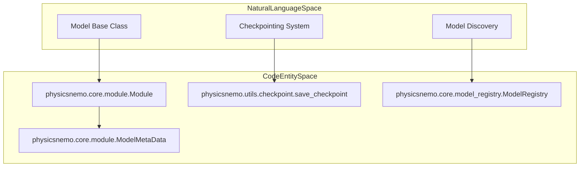
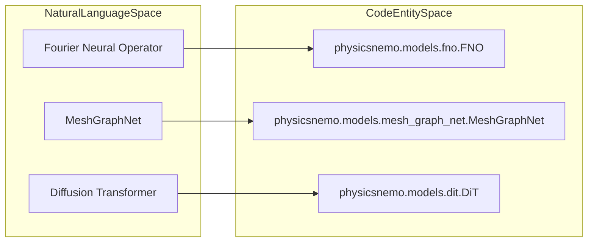

<!-- source: DeepWiki mcp.deepwiki.com · repo NVIDIA/physicsnemo · page 3 Model Architectures · fetched 2026-10-21 -->

# Model Architectures

Relevant source files

The following files were used as context for generating this wiki page:

- [.github/PULL_REQUEST_TEMPLATE.md](.github/PULL_REQUEST_TEMPLATE.md)
- [.gitlab/issue_templates/bug.md](.gitlab/issue_templates/bug.md)
- [.gitlab/issue_templates/documentation.md](.gitlab/issue_templates/documentation.md)
- [.gitlab/issue_templates/feature_request.md](.gitlab/issue_templates/feature_request.md)
- [.gitlab/issue_templates/security.md](.gitlab/issue_templates/security.md)
- [.gitlab/merge_request_templates/Default.md](.gitlab/merge_request_templates/Default.md)
- [CONTRIBUTING.md](CONTRIBUTING.md)
- [README.md](README.md)
- [codecov.yml](codecov.yml)
- [docs/api/models/convolutional.rst](docs/api/models/convolutional.rst)
- [docs/api/models/fnos.rst](docs/api/models/fnos.rst)
- [docs/api/models/fully_connected.rst](docs/api/models/fully_connected.rst)
- [docs/api/models/gnns.rst](docs/api/models/gnns.rst)
- [docs/api/models/modules.rst](docs/api/models/modules.rst)
- [docs/api/models/operators.rst](docs/api/models/operators.rst)
- [docs/api/models/recurrent.rst](docs/api/models/recurrent.rst)
- [docs/api/models/transolver.rst](docs/api/models/transolver.rst)
- [docs/api/models/weather.rst](docs/api/models/weather.rst)
- [docs/api/physicsnemo.sym.rst](docs/api/physicsnemo.sym.rst)
- [docs/api/physicsnemo.utils.rst](docs/api/physicsnemo.utils.rst)
- [docs/api_index.rst](docs/api_index.rst)
- [docs/api_models.rst](docs/api_models.rst)
- [docs/conf.py](docs/conf.py)
- [docs/img/Modulus-850x720.svg](docs/img/Modulus-850x720.svg)
- [docs/research.md](docs/research.md)
- [greptile.json](greptile.json)
- [physicsnemo/sym/__init__.py](physicsnemo/sym/__init__.py)
- [physicsnemo/sym/computation.py](physicsnemo/sym/computation.py)
- [physicsnemo/sym/constants.py](physicsnemo/sym/constants.py)
- [physicsnemo/sym/eq/__init__.py](physicsnemo/sym/eq/__init__.py)
- [physicsnemo/sym/eq/gradients.py](physicsnemo/sym/eq/gradients.py)
- [physicsnemo/utils/checkpoint.py](physicsnemo/utils/checkpoint.py)
- [test/diffusion/test_domain_parallel_sampling.py](test/diffusion/test_domain_parallel_sampling.py)
- [test/utils/test_checkpoint_distributed.py](test/utils/test_checkpoint_distributed.py)

## Purpose and Scope

This page provides a high-level overview of PhysicsNeMo's model zoo, encompassing neural operators, graph neural networks (GNNs), diffusion models, recurrent/hybrid architectures, and specialized or experimental models. These models are designed for high-performance physics-informed modeling, scientific machine learning, and AI-driven simulation across domains such as computational fluid dynamics (CFD), meteorology, and structural mechanics. 

As a PARENT page, this document outlines the major model families and their architectural roles. Detailed technical specifications, parameterizations, and layer implementations are covered in the respective child pages:
- [Neural Operators](#3.1)
- [Graph Neural Networks](#3.2)
- [Diffusion Models](#3.3)
- [Recurrent and Hybrid Models](#3.4)
- [Specialized and Experimental Models](#3.5)

Sources: [CONTRIBUTING.md:49-52](), [README.md:27-29]()

---

## Model Zoo Overview

PhysicsNeMo organizes its neural architectures into specialized families reflecting their mathematical foundations and application domains. All models inherit from the foundational `Module` class, ensuring consistent argument serialization, metadata tracking, and checkpoint integration.

### Neural Operators

Neural operators learn continuous mappings between infinite-dimensional function spaces, providing resolution-invariant solutions to partial differential equations (PDEs). The framework includes Fourier Neural Operators (`FNO`), Adaptive Fourier Neural Operators (`AFNO`), Decomposable Multi-scale Iterative Operators (`DoMINO`), and physics-attention based transformers like `Transolver`, `GeoTransolver`, and `FLARE`.

For complete details, see [Neural Operators](#3.1).

Sources: [CHANGELOG.md:94-96](), [docs/api_models.rst:13-22]()

### Graph Neural Networks

Graph Neural Networks operate on unstructured meshes, point clouds, and specialized spherical grids. This family includes `MeshGraphNet` for mesh-based physical simulations, `GraphCastNet` for global icosahedral weather forecasting, as well as multiscale and hybrid variants like `BiStride MGN` and `MeshGraphKAN`.

For complete details, see [Graph Neural Networks](#3.2).

Sources: [CHANGELOG.md:109-115](), [docs/api_models.rst:14]()

### Diffusion Models

Generative diffusion frameworks provide high-fidelity physics synthesis, super-resolution, and ensemble generation. The `physicsnemo.diffusion` package supports score-based score networks (`SongUNet`, `SongUNetPosEmbd`, `DhariwalUNet`), Diffusion Transformers (`DiT`), flexible EDM/VP/VE preconditioning schemes, and guidance operators for domain-parallel sampling.

For complete details, see [Diffusion Models](#3.3).

Sources: [CHANGELOG.md:80-84](), [docs/api_models.rst:18-19]()

### Recurrent and Hybrid Models

Architectures designed for time-dependent sequential forecasting and ensemble weather prediction. This category features cubed-sphere models (`DLWP`), HEALPix-based recurrent UNets (`HEALPixRecUNet`), `SwinRNN`, and Mixture of Weather Experts (`MoWE`) models trained with continuous ranked probability score (CRPS) objectives.

For complete details, see [Recurrent and Hybrid Models](#3.4).

Sources: [CHANGELOG.md:113-118](), [docs/api_models.rst:16]()

### Specialized and Experimental Models

Cutting-edge models and symmetry-preserving neural primitives. This includes topology optimization (`TopoDiff`), convolutional neural networks for scientific grids (`FigConvNet`), global external aerodynamics models (`GLOBE`), and experimental symmetry-equivariant layers (`physicsnemo.experimental.nn.symmetry`).

For complete details, see [Specialized and Experimental Models](#3.5).

Sources: [CHANGELOG.md:13-14](), [docs/api_models.rst:15]()

---

## Architecture Integration and Code Mapping

The following diagrams illustrate how natural language concepts bridge to concrete code entities within the `physicsnemo` codebase.

### Diagram: Model Architecture Foundations

Sources: [physicsnemo/core/module.py:25-25](), [physicsnemo/utils/checkpoint.py:19-21]()

### Diagram: Model Family Implementations

Sources: [docs/api_models.rst:13-19](), [CHANGELOG.md:80-96]()

---

