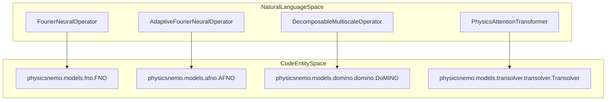

<!-- source: DeepWiki mcp.deepwiki.com · repo NVIDIA/physicsnemo · page 3.1 Neural Operators · fetched 2026-10-21 -->

# Neural Operators

Relevant source files

The following files were used as context for generating this wiki page:

- [examples/cfd/darcy_fno/README.md](examples/cfd/darcy_fno/README.md)
- [examples/cfd/darcy_fno/config.yaml](examples/cfd/darcy_fno/config.yaml)
- [examples/cfd/darcy_fno/requirements.txt](examples/cfd/darcy_fno/requirements.txt)
- [examples/cfd/darcy_fno/train_fno_darcy.py](examples/cfd/darcy_fno/train_fno_darcy.py)
- [examples/cfd/darcy_fno/validator.py](examples/cfd/darcy_fno/validator.py)
- [examples/cfd/darcy_nested_fnos/README.md](examples/cfd/darcy_nested_fnos/README.md)
- [examples/cfd/darcy_nested_fnos/config.yaml](examples/cfd/darcy_nested_fnos/config.yaml)
- [examples/cfd/darcy_nested_fnos/evaluate_nested_darcy.py](examples/cfd/darcy_nested_fnos/evaluate_nested_darcy.py)
- [examples/cfd/darcy_nested_fnos/generate_nested_darcy.py](examples/cfd/darcy_nested_fnos/generate_nested_darcy.py)
- [examples/cfd/darcy_nested_fnos/train_nested_darcy.py](examples/cfd/darcy_nested_fnos/train_nested_darcy.py)
- [examples/cfd/darcy_nested_fnos/utils.py](examples/cfd/darcy_nested_fnos/utils.py)
- [examples/cfd/darcy_transolver/config.yaml](examples/cfd/darcy_transolver/config.yaml)
- [examples/cfd/darcy_transolver/convert_mat_to_npz.py](examples/cfd/darcy_transolver/convert_mat_to_npz.py)
- [examples/cfd/darcy_transolver/darcy_datapipe_fix.py](examples/cfd/darcy_transolver/darcy_datapipe_fix.py)
- [examples/cfd/darcy_transolver/train_transolver_darcy.py](examples/cfd/darcy_transolver/train_transolver_darcy.py)
- [examples/cfd/darcy_transolver/validator_fix.py](examples/cfd/darcy_transolver/validator_fix.py)
- [examples/cfd/external_aerodynamics/transformer_models/deprecated/conf/train_surface.yaml](examples/cfd/external_aerodynamics/transformer_models/deprecated/conf/train_surface.yaml)
- [examples/cfd/external_aerodynamics/transformer_models/src/conf/model/transolver.yaml](examples/cfd/external_aerodynamics/transformer_models/src/conf/model/transolver.yaml)
- [examples/cfd/gray_scott_rnn/conf/config_3d.yaml](examples/cfd/gray_scott_rnn/conf/config_3d.yaml)
- [examples/cfd/gray_scott_rnn/gray_scott_rnn.py](examples/cfd/gray_scott_rnn/gray_scott_rnn.py)
- [examples/cfd/navier_stokes_rnn/navier_stokes_rnn.py](examples/cfd/navier_stokes_rnn/navier_stokes_rnn.py)
- [physicsnemo/models/transolver/__init__.py](physicsnemo/models/transolver/__init__.py)
- [physicsnemo/models/transolver/transolver.py](physicsnemo/models/transolver/transolver.py)
- [test/models/transolver/test_transolver.py](test/models/transolver/test_transolver.py)

## Purpose and Scope

This page introduces the Neural Operator model family in PhysicsNeMo, which provides implementations for learning mappings between infinite-dimensional function spaces using spectral, kernel, and physics-attention approaches. Neural operators are particularly effective for solving parametric partial differential equations (PDEs) and approximating continuous operators in physics simulations with resolution invariance.

PhysicsNeMo supports a diverse set of operator architectures. For comprehensive technical details and implementation specifics, refer to the child pages:
- **AFNO**: Documented in [AFNO](#3.1.1) (`physicsnemo.models.afno.AFNO`).
- **FNO**: Documented in [FNO](#3.1.2) (`physicsnemo.models.fno.FNO`).
- **DoMINO**: Documented in [DoMINO](#3.1.3) (`physicsnemo.models.domino.domino.DoMINO`).
- **Transformer Operators (Transolver, GeoTransolver, FLARE)**: Documented in [Transformer Operators: Transolver, GeoTransolver, FLARE](#3.1.4) (`physicsnemo.models.transolver.transolver.Transolver`).

Sources: [physicsnemo/models/transolver/transolver.py:4-9]()

## Neural Operator Family Overview

PhysicsNeMo organizes its neural operator implementations around the core `Module` infrastructure, mapping high-level mathematical operator concepts directly to concrete Python classes in the codebase.

**Diagram: Neural Operator Architecture Hierarchy and Code Mapping**

Sources: [physicsnemo/models/transolver/transolver.py:284-300](), [examples/cfd/darcy_fno/train_fno_darcy.py:55-65]()

## Core Operator Architectures

### FNO (Fourier Neural Operator)
FNO uses spectral convolutions in Fourier space to learn integral kernel operators. It serves as the foundational operator for resolution-invariant PDE solving on structured regular grids. 
- For full details on spectral convolution blocks, 1D/2D/3D/4D architecture variants, and Darcy flow use cases, see [FNO](#3.1.2).

Sources: [examples/cfd/darcy_fno/train_fno_darcy.py:55-65]()

### AFNO (Adaptive Fourier Neural Operator)
AFNO adapts the vision transformer architecture by replacing standard self-attention with Fourier-based token mixing. It is highly optimized for large-scale weather prediction (such as FourCastNet) and global climate modeling.
- For details on vision transformer adaptation, ModAFNO, and distributed AFNO variants, see [AFNO](#3.1.1).

### DoMINO (Decomposable Multi-scale Iterative Neural Operator)
DoMINO is designed for unstructured point clouds and large-scale computational fluid dynamics (CFD). It supports geometry representation encodings and domain parallelism via `ShardTensor` for handling massive geometries.
- For details on point cloud processing and CFD applications, see [DoMINO](#3.1.3).

### Transformer Operators: Transolver, GeoTransolver, FLARE
Transformer-based operators introduce physics-aware attention mechanisms to handle complex geometries and unstructured domains. 
- For details on `Transolver`, `GeoTransolver` (GALE, context projector), `FLARE` attention, and unified aerodynamics configuration, see [Transformer Operators: Transolver, GeoTransolver, FLARE](#3.1.4).

Sources: [physicsnemo/models/transolver/transolver.py:142-180]()

## Architecture Comparison and Code Mapping

All neural operators inherit from `physicsnemo.core.module.Module` and follow a "Lift-Process-Project" design pattern. The internal mixing mechanisms and target data domains differ across families:

| Model Family | Primary Mixing Mechanism | Input Support | Code Module Path | Child Page Reference |
| :--- | :--- | :--- | :--- | :--- |
| **FNO** | Spectral Convolution (FFT) | Structured Grids | `physicsnemo.models.fno.FNO` | [FNO](#3.1.2) |
| **AFNO** | Fourier Token Mixing | Structured Patches / Weather | `physicsnemo.models.afno.AFNO` | [AFNO](#3.1.1) |
| **Transolver** | Physics-Aware Attention | Structured & Irregular Meshes | `physicsnemo.models.transolver.transolver.Transolver` | [Transformer Operators: Transolver, GeoTransolver, FLARE](#3.1.4) |
| **DoMINO** | Multi-scale Point Mixing | Unstructured Point Clouds | `physicsnemo.models.domino.domino.DoMINO` | [DoMINO](#3.1.3) |

### Transolver Internal Component Structure
The `Transolver` model instantiates internal building blocks that map directly to specific PyTorch modules and helper classes within the physicsnemo package:

```mermaid
graph LR
    Input["InputTensor(B,N,C)"] --> Pre["physicsnemo.models.transolver.transolver._TransolverMlp"]
    Pre --> Blocks["physicsnemo.models.transolver.transolver.TransolverBlock"]
    
    subgraph "TransolverBlock"
        Attn["physicsnemo.nn.module.physics_attention.PhysicsAttentionIrregularMesh"]
        Mlp["physicsnemo.models.transolver.transolver._TransolverMlp"]
    end
    
    Blocks --> Attn
    Attn --> Mlp
    Mlp --> Post["physicsnemo.models.transolver.transolver._TransolverMlp"]
    Post --> Output["OutputTensor"]
```

**Diagram: Transolver Component Hierarchy and Code Mapping**

Sources: [physicsnemo/models/transolver/transolver.py:81-140](), [physicsnemo/models/transolver/transolver.py:142-180]()

---

