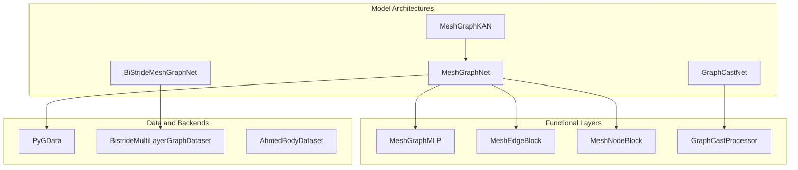
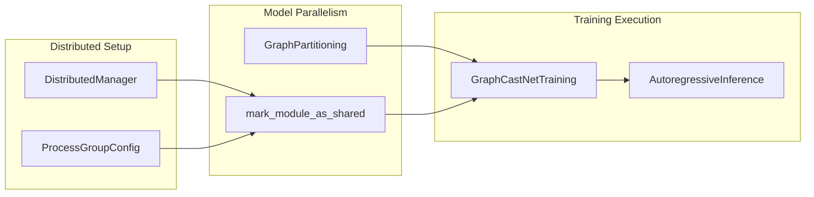

<!-- source: DeepWiki mcp.deepwiki.com · repo NVIDIA/physicsnemo · page 3.2 Graph Neural Networks · fetched 2026-10-21 -->

# Graph Neural Networks

Relevant source files

The following files were used as context for generating this wiki page:

- [examples/cfd/external_aerodynamics/aero_graph_net/README.md](examples/cfd/external_aerodynamics/aero_graph_net/README.md)
- [examples/cfd/swe_distributed_gnn/README.md](examples/cfd/swe_distributed_gnn/README.md)
- [examples/cfd/swe_distributed_gnn/config_graphcast_swe.yaml](examples/cfd/swe_distributed_gnn/config_graphcast_swe.yaml)
- [examples/cfd/swe_distributed_gnn/requirements.txt](examples/cfd/swe_distributed_gnn/requirements.txt)
- [examples/cfd/swe_distributed_gnn/shallow_water_pde_dataset.py](examples/cfd/swe_distributed_gnn/shallow_water_pde_dataset.py)
- [examples/cfd/swe_distributed_gnn/shallow_water_solver.py](examples/cfd/swe_distributed_gnn/shallow_water_solver.py)
- [examples/cfd/swe_distributed_gnn/train.py](examples/cfd/swe_distributed_gnn/train.py)
- [physicsnemo/datapipes/gnn/bsms.py](physicsnemo/datapipes/gnn/bsms.py)
- [physicsnemo/deploy/__init__.py](physicsnemo/deploy/__init__.py)
- [physicsnemo/deploy/onnx/utils.py](physicsnemo/deploy/onnx/utils.py)
- [physicsnemo/models/graphcast/graph_cast_net.py](physicsnemo/models/graphcast/graph_cast_net.py)
- [physicsnemo/models/meshgraphnet/bsms_mgn.py](physicsnemo/models/meshgraphnet/bsms_mgn.py)
- [physicsnemo/models/meshgraphnet/hybrid_meshgraphnet.py](physicsnemo/models/meshgraphnet/hybrid_meshgraphnet.py)
- [physicsnemo/models/meshgraphnet/meshgraphkan.py](physicsnemo/models/meshgraphnet/meshgraphkan.py)
- [physicsnemo/models/meshgraphnet/meshgraphnet.py](physicsnemo/models/meshgraphnet/meshgraphnet.py)
- [physicsnemo/nn/module/gumbel_softmax.py](physicsnemo/nn/module/gumbel_softmax.py)
- [physicsnemo/utils/mesh/combine_vtp_files.py](physicsnemo/utils/mesh/combine_vtp_files.py)
- [physicsnemo/utils/mesh/convert_file_formats.py](physicsnemo/utils/mesh/convert_file_formats.py)
- [physicsnemo/utils/mesh/generate_stl.py](physicsnemo/utils/mesh/generate_stl.py)
- [test/datapipes/test_bsms.py](test/datapipes/test_bsms.py)
- [test/datapipes/test_drivaernet.py](test/datapipes/test_drivaernet.py)
- [test/models/meshgraphnet/data/meshgraphkan_output.pth](test/models/meshgraphnet/data/meshgraphkan_output.pth)
- [test/models/meshgraphnet/test_bsms_mgn.py](test/models/meshgraphnet/test_bsms_mgn.py)
- [test/models/meshgraphnet/test_hybrid_meshgraphnet.py](test/models/meshgraphnet/test_hybrid_meshgraphnet.py)
- [test/models/meshgraphnet/test_meshgraphkan.py](test/models/meshgraphnet/test_meshgraphkan.py)
- [test/models/meshgraphnet/test_meshgraphnet.py](test/models/meshgraphnet/test_meshgraphnet.py)

## Purpose and Scope

This document covers Graph Neural Network (GNN) models in PhysicsNeMo for physics simulation on irregular meshes and specialized grids. GNN models are particularly suited for problems with complex geometries, unstructured meshes, and varying spatial connectivity patterns common in CFD, structural mechanics, and weather forecasting.

PhysicsNeMo provides several GNN architectures:
- **MeshGraphNet**: General-purpose encoder-processor-decoder for mesh-based physics [physicsnemo/models/meshgraphnet/meshgraphnet.py:54-152]().
- **GraphCastNet**: Multi-scale architecture for weather forecasting on icosahedral grids [physicsnemo/models/graphcast/graph_cast_net.py:133-181]().
- **BiStride MGN**: A multi-scale variant of MeshGraphNet using BiStride graph downsampling [physicsnemo/models/meshgraphnet/bsms_mgn.py:37-73]().
- **MeshGraphKAN**: A variant using Kolmogorov–Arnold Networks (KAN) for node encoding [physicsnemo/models/meshgraphnet/meshgraphkan.py:46-145]().
- **Hybrid MeshGraphNet**: Supports separate encoders for mesh and world edges [physicsnemo/models/meshgraphnet/hybrid_meshgraphnet.py:56-106]().

For neural operators on regular grids, see [Neural Operators](#3.1). For point cloud models, see [DoMINO](#3.1.3).

Sources: [physicsnemo/models/meshgraphnet/meshgraphnet.py:54-152](), [physicsnemo/models/graphcast/graph_cast_net.py:133-181](), [physicsnemo/models/meshgraphnet/bsms_mgn.py:37-73](), [physicsnemo/models/meshgraphnet/meshgraphkan.py:46-145](), [physicsnemo/models/meshgraphnet/hybrid_meshgraphnet.py:56-106]()

---

## GNN System Architecture

The GNN system bridges mesh-based data structures with message-passing neural architectures.

### Model Entity Map

Sources: [physicsnemo/models/meshgraphnet/meshgraphnet.py:32-35](), [physicsnemo/models/graphcast/graph_cast_net.py:28-40](), [physicsnemo/models/meshgraphnet/meshgraphkan.py:25-28](), [physicsnemo/models/meshgraphnet/bsms_mgn.py:36-37]()

---

## MeshGraphNet

MeshGraphNet implements an encoder-processor-decoder architecture for learning physics on meshes [physicsnemo/models/meshgraphnet/meshgraphnet.py:54-152](). It is the most general-purpose GNN model in PhysicsNeMo, suitable for a wide range of mesh-based simulations like vortex shedding and aerodynamics.

For detailed documentation on encoder-processor-decoder layers, message passing mechanics, backends, and hybrid variants, see [MeshGraphNet](#3.2.1).

Sources: [physicsnemo/models/meshgraphnet/meshgraphnet.py:154-201]()

---

## GraphCast

GraphCastNet is a specialized GNN for global weather forecasting on icosahedral meshes [physicsnemo/models/graphcast/graph_cast_net.py:133-181](). It uses a multi-mesh architecture to handle multi-scale atmospheric features.

For detailed documentation on the icosahedral multi-mesh architecture, weather forecasting configurations, gradient checkpointing, the concat trick, and distributed training utilities, see [GraphCast](#3.2.2).

Sources: [physicsnemo/models/graphcast/graph_cast_net.py:133-173]()

---

## Specialized Variants

### BiStride MeshGraphNet
The `BiStrideMeshGraphNet` extends MGN with a multi-scale "BiStride" processor [physicsnemo/models/meshgraphnet/bsms_mgn.py:37-73](). It leverages the `BistrideMultiLayerGraphDataset` to handle hierarchical graph representations, which is particularly effective for large meshes like the Ahmed Body [test/models/meshgraphnet/test_bsms_mgn.py:36-73]().

### MeshGraphKAN
`MeshGraphKAN` replaces the standard MLP node encoder with a Kolmogorov–Arnold Network (KAN) [physicsnemo/models/meshgraphnet/meshgraphkan.py:46-145](). This architecture uses learnable spline-based activation functions on edges instead of fixed activations on nodes, aiming for better interpretability and potential accuracy gains in physics tasks [physicsnemo/models/meshgraphnet/meshgraphkan.py:140-144]().

### Hybrid MeshGraphNet
The `HybridMeshGraphNet` supports separate encoders and processors for different edge types, such as "mesh" edges (physical connectivity) and "world" edges (spatial proximity) [physicsnemo/models/meshgraphnet/hybrid_meshgraphnet.py:56-106](). This is useful for simulations where long-range interactions or contact mechanics are present.

Sources: [physicsnemo/models/meshgraphnet/bsms_mgn.py:37-73](), [physicsnemo/models/meshgraphnet/meshgraphkan.py:46-145](), [physicsnemo/models/meshgraphnet/hybrid_meshgraphnet.py:56-106]()

---

## Distributed GNN Training

PhysicsNeMo supports distributed GNN training, particularly for large-scale weather and CFD models.

### Distributed Execution Flow

The `swe_distributed_gnn` example demonstrates training a distributed `GraphCastNet` for Shallow Water Equations [examples/cfd/swe_distributed_gnn/train.py:61-67](). It uses `mark_module_as_shared` to handle weight synchronization across ranks when the model is distributed in a tensor-parallel fashion [examples/cfd/swe_distributed_gnn/README.md:132-145]().

Sources: [examples/cfd/swe_distributed_gnn/train.py:61-67](), [examples/cfd/swe_distributed_gnn/README.md:132-145](), [physicsnemo/models/graphcast/graph_cast_net.py:45-113]()

---

