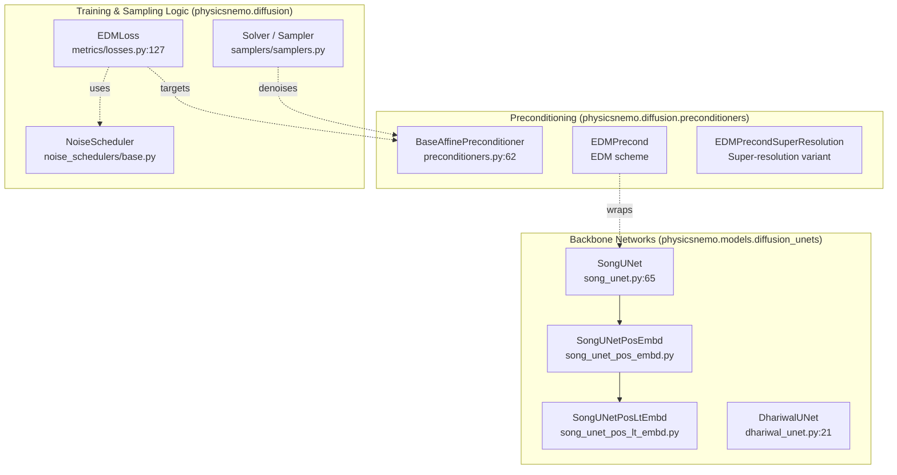

<!-- source: DeepWiki mcp.deepwiki.com · repo NVIDIA/physicsnemo · page 3.3 Diffusion Models · fetched 2026-10-21 -->

# Diffusion Models

Relevant source files

The following files were used as context for generating this wiki page:

- [.importlinter](.importlinter)
- [docs/api/diffusion/noise_schedulers.rst](docs/api/diffusion/noise_schedulers.rst)
- [physicsnemo/diffusion/__init__.py](physicsnemo/diffusion/__init__.py)
- [physicsnemo/diffusion/base.py](physicsnemo/diffusion/base.py)
- [physicsnemo/diffusion/metrics/__init__.py](physicsnemo/diffusion/metrics/__init__.py)
- [physicsnemo/diffusion/metrics/losses.py](physicsnemo/diffusion/metrics/losses.py)
- [physicsnemo/diffusion/noise_schedulers/__init__.py](physicsnemo/diffusion/noise_schedulers/__init__.py)
- [physicsnemo/diffusion/noise_schedulers/domain_parallel.py](physicsnemo/diffusion/noise_schedulers/domain_parallel.py)
- [physicsnemo/diffusion/noise_schedulers/noise_schedulers.py](physicsnemo/diffusion/noise_schedulers/noise_schedulers.py)
- [physicsnemo/diffusion/preconditioners/preconditioners.py](physicsnemo/diffusion/preconditioners/preconditioners.py)
- [physicsnemo/diffusion/samplers/__init__.py](physicsnemo/diffusion/samplers/__init__.py)
- [physicsnemo/diffusion/samplers/samplers.py](physicsnemo/diffusion/samplers/samplers.py)
- [physicsnemo/diffusion/samplers/solvers.py](physicsnemo/diffusion/samplers/solvers.py)
- [physicsnemo/diffusion/utils/__init__.py](physicsnemo/diffusion/utils/__init__.py)
- [physicsnemo/diffusion/utils/model_wrappers.py](physicsnemo/diffusion/utils/model_wrappers.py)
- [physicsnemo/models/diffusion_unets/dhariwal_unet.py](physicsnemo/models/diffusion_unets/dhariwal_unet.py)
- [physicsnemo/models/diffusion_unets/song_unet.py](physicsnemo/models/diffusion_unets/song_unet.py)
- [physicsnemo/models/diffusion_unets/unet.py](physicsnemo/models/diffusion_unets/unet.py)
- [physicsnemo/nn/module/mlp_layers.py](physicsnemo/nn/module/mlp_layers.py)
- [test/diffusion/test_wrappers.py](test/diffusion/test_wrappers.py)
- [test/metrics/diffusion/test_losses.py](test/metrics/diffusion/test_losses.py)
- [test/models/diffusion/test_dhariwal_unet.py](test/models/diffusion/test_dhariwal_unet.py)
- [test/models/diffusion/test_preconditioning.py](test/models/diffusion/test_preconditioning.py)
- [test/models/diffusion/test_song_unet.py](test/models/diffusion/test_song_unet.py)
- [test/models/diffusion/test_song_unet_pos_embd.py](test/models/diffusion/test_song_unet_pos_embd.py)
- [test/models/diffusion/test_song_unet_pos_lt_embd.py](test/models/diffusion/test_song_unet_pos_lt_embd.py)
- [test/models/diffusion/test_unet_wrappers.py](test/models/diffusion/test_unet_wrappers.py)
- [test/nn/module/test_mlp_layers.py](test/nn/module/test_mlp_layers.py)

## Purpose and Scope

This page provides an overview of the diffusion model infrastructure in PhysicsNeMo, including backbone architectures, preconditioning schemes, and sampling algorithms. Diffusion models in PhysicsNeMo are designed for generative tasks in scientific computing, particularly for super-resolution, ensemble generation, and uncertainty quantification in weather forecasting and fluid dynamics applications.

This is a parent page. For detailed technical documentation, see the following child sections:
- **SongUNet and Variants**: Document `SongUNet`, `SongUNetPosEmbd`, `SongUNetPosLtEmbd`, `DhariwalUNet`, and regression wrappers. See [SongUNet and Variants](#3.3.1).
- **DiT (Diffusion Transformer)**: Document Transformer-based diffusion backbones, adaptive layer norm, and tokenization. See [DiT (Diffusion Transformer)](#3.3.2).
- **Preconditioning and Samplers**: Document the `physicsnemo.diffusion` framework, EDM preconditioning schemes, noise schedulers, and solver protocols. See [Preconditioning and Samplers](#3.3.3).
- **Guidance and Multi-Diffusion**: Document DPS guidance, the guidance API, patch-based generation, and domain-parallel sampling. See [Guidance and Multi-Diffusion](#3.3.4).

For general model infrastructure (checkpointing, serialization): see [Model System](#2).

Sources: [physicsnemo/models/diffusion_unets/song_unet.py:65-75](), [physicsnemo/diffusion/preconditioners/preconditioners.py:62-85](), [physicsnemo/diffusion/utils/model_wrappers.py:33-58]()

## System Overview

PhysicsNeMo's diffusion models implement denoising diffusion probabilistic models (DDPM) following the EDM (Elucidating the Design Space of Diffusion-Based Generative Models) framework. The system supports both unconditional and conditional generation, with specialized support for spatial super-resolution and temporal forecasting. The framework is organized as a modular `physicsnemo.diffusion` package providing clear protocols for noise scheduling, preconditioning, and sampling [physicsnemo/diffusion/noise_schedulers/noise_schedulers.py:25-33]().

Sources: [physicsnemo/models/diffusion_unets/song_unet.py:65-75](), [physicsnemo/diffusion/preconditioners/preconditioners.py:62-110](), [physicsnemo/diffusion/metrics/losses.py:127-148]()

## Core Sub-Topics

### 1. SongUNet and Variants
The backbone network library provides several U-Net adaptations tailored for spatial grids and scientific fields. `SongUNet` implements DDPM++/NCSN++ architectures with configurable self-attention and channel multipliers [physicsnemo/models/diffusion_unets/song_unet.py:65-100](). Specialized variants include `SongUNetPosEmbd` for patch-based grid indexing and `SongUNetPosLtEmbd` for temporal lead-time embedding, alongside `DhariwalUNet` and regression wrappers like `CorrDiffRegressionUNet` [test/models/diffusion/test_unet_wrappers.py:24-47]().
- For details, see [SongUNet and Variants](#3.3.1).

Sources: [physicsnemo/models/diffusion_unets/song_unet.py:65-156](), [test/models/diffusion/test_unet_wrappers.py:24-87]()

### 2. DiT (Diffusion Transformer)
PhysicsNeMo incorporates Transformer-based backbones via `physicsnemo.models.dit.DiT`. These architectures replace traditional U-Net multi-scale feature maps with patch tokenization, self-attention transformer blocks, and adaptive layer normalization (`adaLN-Zero`) conditioned on noise levels and side information [physicsnemo/diffusion/utils/model_wrappers.py:130-137]().
- For details, see [DiT (Diffusion Transformer)](#3.3.2).

Sources: [physicsnemo/diffusion/utils/model_wrappers.py:33-58]()

### 3. Preconditioning and Samplers
The `physicsnemo.diffusion` framework standardizes training and inference through affine preconditioners (`BaseAffinePreconditioner`) and pluggable noise schedulers (`NoiseScheduler`, `EDMNoiseScheduler`) [physicsnemo/diffusion/preconditioners/preconditioners.py:62-110](), [physicsnemo/diffusion/noise_schedulers/noise_schedulers.py:25-33](). Samplers implement deterministic and stochastic solvers (such as EDM stochastic samplers) to integrate reverse-time SDEs and ODEs.
- For details, see [Preconditioning and Samplers](#3.3.3).

Sources: [physicsnemo/diffusion/preconditioners/preconditioners.py:62-110](), [physicsnemo/diffusion/noise_schedulers/noise_schedulers.py:25-33]()

### 4. Guidance and Multi-Diffusion
Conditional generation workflows utilize the guidance API and Diffusion Posterior Sampling (DPS) for constraint enforcement during sampling. Multi-diffusion patch-based generation and domain-parallel sampling utilities enable scalable generation across large spatial domains and distributed multi-GPU environments.
- For details, see [Guidance and Multi-Diffusion](#3.3.4).

Sources: [physicsnemo/diffusion/utils/model_wrappers.py:33-137]()

---

