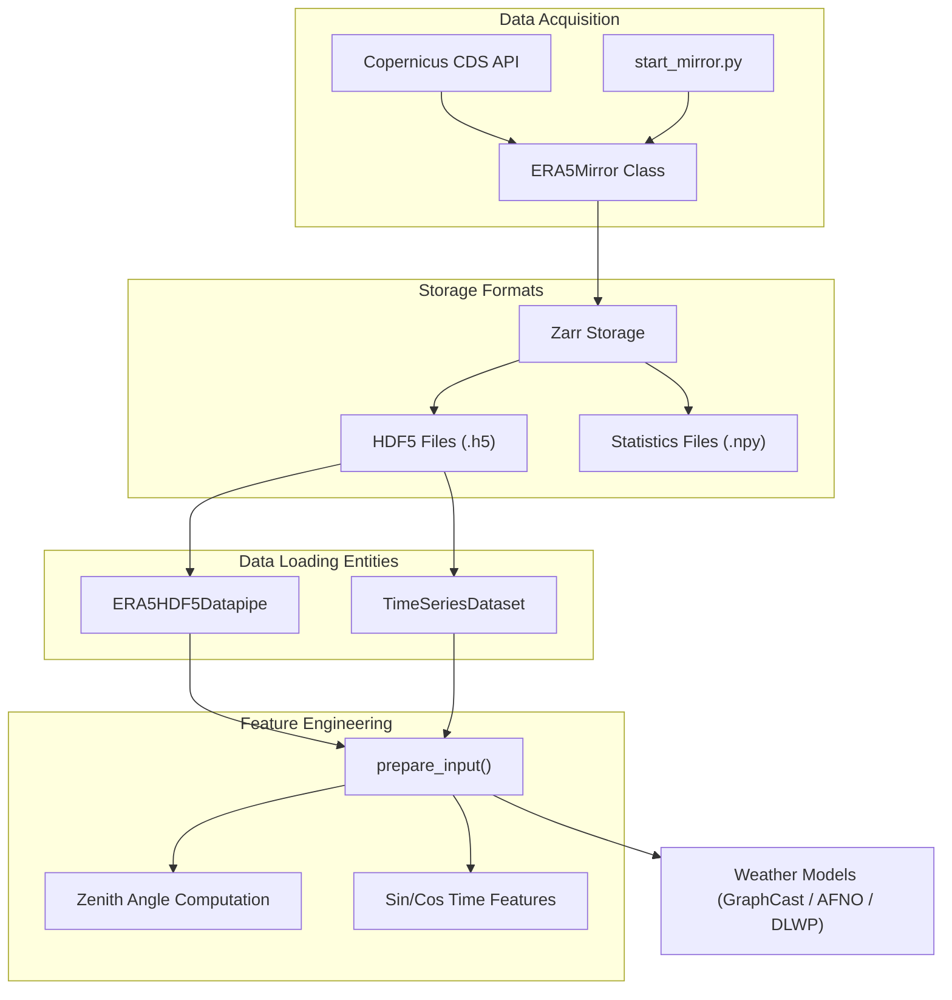

<!-- source: DeepWiki mcp.deepwiki.com · repo NVIDIA/physicsnemo · page 4.2 Climate and Weather Data · fetched 2026-10-21 -->

# Climate and Weather Data

Relevant source files

The following files were used as context for generating this wiki page:

- [examples/cfd/navier_stokes_dpot/README.md](examples/cfd/navier_stokes_dpot/README.md)
- [examples/cfd/navier_stokes_dpot/conf/config_2d.yaml](examples/cfd/navier_stokes_dpot/conf/config_2d.yaml)
- [examples/cfd/navier_stokes_dpot/requirements.txt](examples/cfd/navier_stokes_dpot/requirements.txt)
- [examples/cfd/navier_stokes_dpot/train_dpot.py](examples/cfd/navier_stokes_dpot/train_dpot.py)
- [examples/weather/flood_modeling/hydrographnet/README.md](examples/weather/flood_modeling/hydrographnet/README.md)
- [examples/weather/flood_modeling/hydrographnet/inference.py](examples/weather/flood_modeling/hydrographnet/inference.py)
- [examples/weather/flood_modeling/hydrographnet/train.py](examples/weather/flood_modeling/hydrographnet/train.py)
- [examples/weather/flood_modeling/hydrographnet/utils.py](examples/weather/flood_modeling/hydrographnet/utils.py)
- [physicsnemo/datapipes/cae/mesh_datapipe.py](physicsnemo/datapipes/cae/mesh_datapipe.py)
- [physicsnemo/datapipes/climate/climate.py](physicsnemo/datapipes/climate/climate.py)
- [physicsnemo/datapipes/climate/era5_hdf5.py](physicsnemo/datapipes/climate/era5_hdf5.py)
- [physicsnemo/datapipes/climate/utils/zenith_angle.py](physicsnemo/datapipes/climate/utils/zenith_angle.py)
- [physicsnemo/datapipes/gnn/hydrographnet_dataset.py](physicsnemo/datapipes/gnn/hydrographnet_dataset.py)
- [physicsnemo/datapipes/gnn/lagrangian_dataset.py](physicsnemo/datapipes/gnn/lagrangian_dataset.py)
- [physicsnemo/utils/zenith_angle.py](physicsnemo/utils/zenith_angle.py)
- [test/datapipes/test_hydrographnet.py](test/datapipes/test_hydrographnet.py)
- [test/models/dpot/test_dpot.py](test/models/dpot/test_dpot.py)
- [test/models/dpot/test_dpot3d.py](test/models/dpot/test_dpot3d.py)
- [test/utils/test_zenith_angle.py](test/utils/test_zenith_angle.py)

## Purpose and Scope

This document describes the complete climate and weather data management system in PhysicsNeMo, covering the full pipeline from data acquisition to model training. The system handles ERA5 reanalysis datasets, climate variables, and HEALPix spherical grids, providing tools for:

1.  **Data Acquisition**: Downloading ERA5 data from the Copernicus Climate Data Store (CDS) API using the `ERA5Mirror` class [examples/weather/graphcast/README.md:16-57]().
2.  **Data Storage**: Converting and storing data in efficient Zarr and HDF5 formats [test/datapipes/test_healpix.py:124-172]().
3.  **Data Loading**: Loading and preprocessing data for model training with `ERA5HDF5Datapipe` and HEALPix-specific datapipes (`TimeSeriesDataset`) [physicsnemo/datapipes/climate/era5_hdf5.py]().
4.  **Coordinate Systems**: Managing latitude-longitude grids, HEALPix projections, and solar geometry.
5.  **Normalization**: Computing and applying normalization statistics, including specialized time-difference normalization for autoregressive models [examples/weather/graphcast/compute_time_diff_std.py:30-86]().

Sources: [examples/weather/graphcast/README.md:16-57](), [test/datapipes/test_healpix.py:124-172]()

## Complete Data Pipeline Architecture

The climate and weather data system in PhysicsNeMo consists of a multi-stage pipeline from data acquisition to batch loading.

**Diagram: End-to-End Climate Data Pipeline**

Sources: [examples/weather/graphcast/README.md:19-57](), [examples/weather/graphcast/train_graphcast.py:50-52]()

## Code Entity Architecture Mapping

To bridge natural language concepts to the underlying codebase implementation, the following diagram maps major functional domains to their concrete Python classes and functions.

**Diagram: Code Entity Space Mapping for Climate Data**

```mermaid
graph TD
    subgraph "Solar Forcing & Geometry"
        ZenithFunc["physicsnemo.utils.zenith_angle.cos_zenith_angle"]
        AzimuthFunc["physicsnemo.utils.zenith_angle.zenith_azimuth_angles"]
        DaliZenith["physicsnemo.datapipes.climate.utils.zenith_angle.cos_zenith_angle"]
    end

    subgraph "Data Pipes & Datasets"
        ERA5Pipe["physicsnemo.datapipes.climate.era5_hdf5.ERA5HDF5Datapipe"]
        ClimatePipe["physicsnemo.datapipes.climate.climate.ClimateDatapipe"]
        HydroDataset["physicsnemo.datapipes.gnn.hydrographnet_dataset.HydroGraphDataset"]
    end

    subgraph "Readers & Storage"
        HDF5Reader["HDF5 Reader Engine"]
        ZarrReader["Zarr / Xarray Reader Engine"]
    end

    ZenithFunc -->|"Calculates"| SolarOutput["Cosine Zenith Tensor"]
    DaliZenith -->|"Accelerates via DALI"| SolarOutput
    ERA5Pipe -->|"Reads"| HDF5Reader
    ClimatePipe -->|"Reads"| ZarrReader
    HydroDataset -->|"Constructs Graphs"| PyGData["PyTorch Geometric Data Object"]
```

Sources: [physicsnemo/utils/zenith_angle.py:46-78](), [physicsnemo/datapipes/climate/utils/zenith_angle.py:48-70](), [physicsnemo/datapipes/gnn/hydrographnet_dataset.py:106-153]()

## Data Acquisition and Formats (Zarr and HDF5)

PhysicsNeMo supports multi-format climate data backends optimized for throughput and distributed training.

*   **HDF5 Format**: Used extensively for ERA5 reanalysis archives (`.h5` files per year). The typical tensor shape convention is `(time_steps, channels, latitude, longitude)` [physicsnemo/datapipes/climate/era5_hdf5.py]().
*   **Zarr & Xarray**: Utilized for HEALPix and DLWP-style pipelines to handle chunked, compressed n-dimensional arrays on cloud or local filesystems. Functions such as `create_time_series_dataset_classic` and `open_time_series_dataset_classic_prebuilt` facilitate ingestion and time-series metadata management [test/datapipes/test_healpix.py:124-172]().

Sources: [test/datapipes/test_healpix.py:124-172](), [physicsnemo/datapipes/climate/era5_hdf5.py]()

## Climate Datapipes: `ERA5HDF5Datapipe` and `ClimateDatapipe`

The climate datapipe family inherits from the base `Datapipe` class and integrates with NVIDIA DALI (Data Loading and Inference Library) where applicable to accelerate GPU-based preprocessing.

*   **`ERA5HDF5Datapipe`**: Responsible for streaming multi-channel ERA5 fields from HDF5 archives, handling temporal windowing, slicing, and normalizations.
*   **`ClimateDatapipe`**: Provides generalized grid-based streaming for arbitrary atmospheric and ocean variables.
*   **Statistics Integration**: Normalization parameters (`global_means.npy`, `global_std.npy`, and `time_diff_std.npy`) are loaded during datapipe initialization to apply scaling transformations on the fly [examples/weather/graphcast/compute_time_diff_std.py:30-86]().

Sources: [physicsnemo/datapipes/climate/era5_hdf5.py](), [physicsnemo/datapipes/climate/climate.py]()

## HEALPix Datapipes and Couplers

For models operating on spherical equal-area grids (such as DLWP), specialized datapipes handle hierarchical pixelization.

*   **`TimeSeriesDataset`**: Manages temporal windows for HEALPix arrays, ensuring input and output sequence lengths align correctly with autoregressive rollouts [test/datapipes/test_healpix.py:204-214]().
*   **Couplers**: Auxiliary data structures like `ConstantCoupler` inject static or time-invariant boundary conditions (e.g., land-sea masks, orography, or sea surface temperature forcing) into the model stream [test/datapipes/test_healpix_couple.py:108-148]().

Sources: [test/datapipes/test_healpix.py:96-214](), [test/datapipes/test_healpix_couple.py:108-148]()

## Zenith Angle Computation and Feature Engineering

Accurate representation of solar forcing is critical for weather forecasting models. PhysicsNeMo provides rigorous astronomical calculations implemented across PyTorch, NumPy, and DALI backends.

*   **Cosine Zenith Angle**: Computed via `cos_zenith_angle(time, lon, lat)` [physicsnemo/utils/zenith_angle.py:46-78]() and `cos_zenith_angle_from_timestamp(timestamp, lon, lat)` [physicsnemo/utils/zenith_angle.py:139-172]() using Julian centuries and solar declination formulas.
*   **Azimuth Angles**: `zenith_azimuth_angles` and `zenith_azimuth_angles_from_timestamp` return the complete tuple `(sin_zenith, cos_zenith, sin_azimuth, cos_azimuth)` following the north-clockwise convention [physicsnemo/utils/zenith_angle.py:81-137]().
*   **DALI Accelerated Variant**: `physicsnemo.datapipes.climate.utils.zenith_angle.cos_zenith_angle` provides native DALI graph nodes for on-device solar geometry calculations [physicsnemo/datapipes/climate/utils/zenith_angle.py:48-70]().

Sources: [physicsnemo/utils/zenith_angle.py:30-180](), [physicsnemo/datapipes/climate/utils/zenith_angle.py:34-70](), [test/utils/test_zenith_angle.py:45-63]()

## Normalization and Coordinate Systems

### Grid Weighting
Due to the convergence of meridians at the poles in standard latitude-longitude grids, spatial weighting is applied to loss functions and evaluation metrics:
*   `normalized_grid_cell_area`: Evaluates cell areas proportional to the cosine of latitude [examples/weather/graphcast/train_utils.py:22-27]().

### Time-Difference Normalization
For predictive models forecasting increments ($\Delta X = X_{t+1} - X_t$), variance scaling requires specialized statistics:
*   `compute_time_diff_std.py` scans training partitions to calculate per-variable temporal difference standard deviations [examples/weather/graphcast/compute_time_diff_std.py:30-86]().

Sources: [examples/weather/graphcast/train_utils.py:22-27](), [examples/weather/graphcast/compute_time_diff_std.py:30-86]()

---

