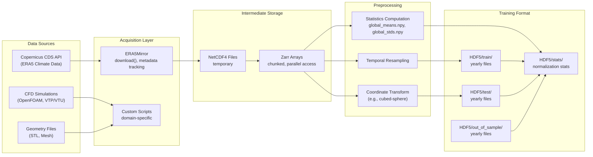
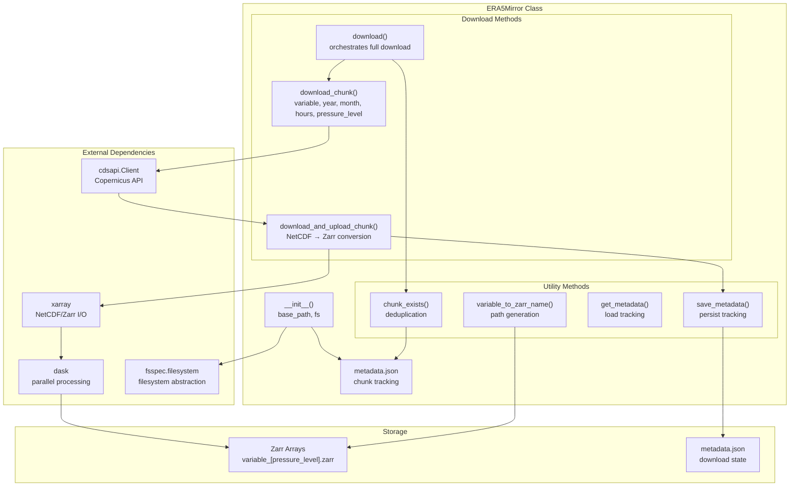
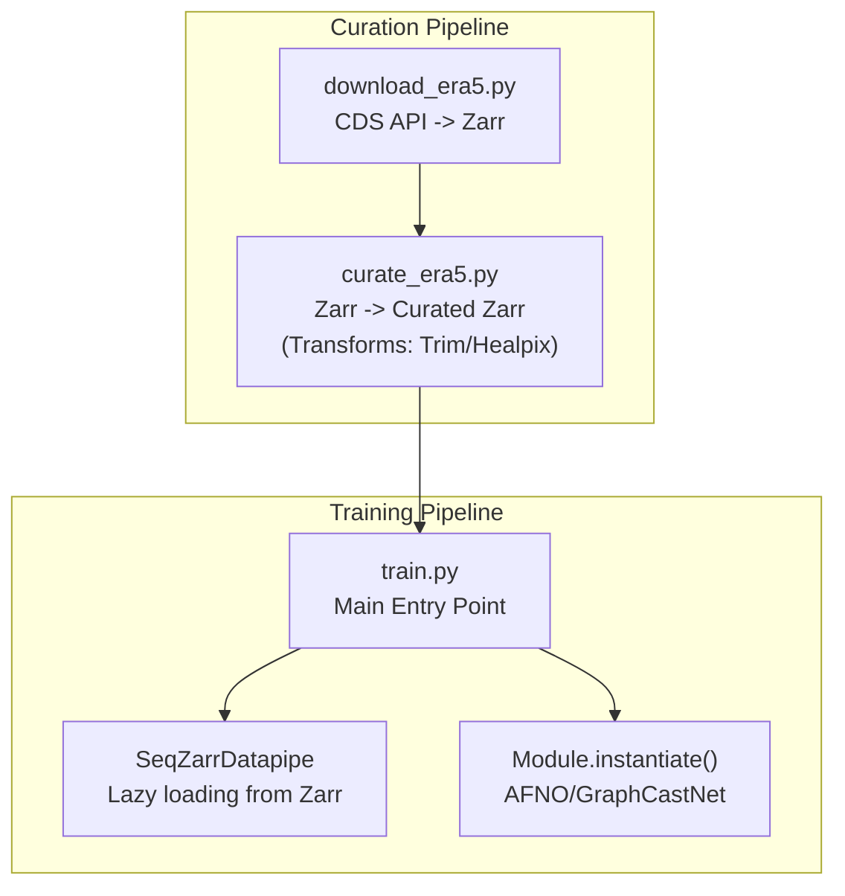

<!-- source: DeepWiki mcp.deepwiki.com · repo NVIDIA/physicsnemo · page 4.4 Data Curation · fetched 2026-10-21 -->

# Data Curation

<details>
<summary>Relevant source files</summary>

The following files were used as context for generating this wiki page:

- [examples/weather/dataset_download/README.md](examples/weather/dataset_download/README.md)
- [examples/weather/dataset_download/conf/config_34var.yaml](examples/weather/dataset_download/conf/config_34var.yaml)
- [examples/weather/dataset_download/conf/config_tas.yaml](examples/weather/dataset_download/conf/config_tas.yaml)
- [examples/weather/dataset_download/era5_mirror.py](examples/weather/dataset_download/era5_mirror.py)
- [examples/weather/dataset_download/requirements.txt](examples/weather/dataset_download/requirements.txt)
- [examples/weather/dataset_download/start_mirror.py](examples/weather/dataset_download/start_mirror.py)
- [examples/weather/diagnostic/README.md](examples/weather/diagnostic/README.md)
- [examples/weather/diagnostic/requirements.txt](examples/weather/diagnostic/requirements.txt)
- [examples/weather/dlwp/README.md](examples/weather/dlwp/README.md)
- [examples/weather/dlwp/data_curation/README.md](examples/weather/dlwp/data_curation/README.md)
- [examples/weather/dlwp/data_curation/requirements.txt](examples/weather/dlwp/data_curation/requirements.txt)
- [examples/weather/fcn_afno/README.md](examples/weather/fcn_afno/README.md)
- [examples/weather/unified_recipe/conf/config.yaml](examples/weather/unified_recipe/conf/config.yaml)
- [examples/weather/unified_recipe/conf/curated_dataset/34_var.yaml](examples/weather/unified_recipe/conf/curated_dataset/34_var.yaml)
- [examples/weather/unified_recipe/conf/curated_dataset/7_var.yaml](examples/weather/unified_recipe/conf/curated_dataset/7_var.yaml)
- [examples/weather/unified_recipe/conf/curated_dataset/healpix_19_var.yaml](examples/weather/unified_recipe/conf/curated_dataset/healpix_19_var.yaml)
- [examples/weather/unified_recipe/conf/curated_dataset/tiny_2_var.yaml](examples/weather/unified_recipe/conf/curated_dataset/tiny_2_var.yaml)
- [examples/weather/unified_recipe/conf/datapipe/default.yaml](examples/weather/unified_recipe/conf/datapipe/default.yaml)
- [examples/weather/unified_recipe/conf/dataset/6hr_subsample.yaml](examples/weather/unified_recipe/conf/dataset/6hr_subsample.yaml)
- [examples/weather/unified_recipe/conf/dataset/tiny_6hr_subsample.yaml](examples/weather/unified_recipe/conf/dataset/tiny_6hr_subsample.yaml)
- [examples/weather/unified_recipe/conf/filesystem/local.yaml](examples/weather/unified_recipe/conf/filesystem/local.yaml)
- [examples/weather/unified_recipe/conf/filesystem/object_storage.yaml](examples/weather/unified_recipe/conf/filesystem/object_storage.yaml)
- [examples/weather/unified_recipe/curate_era5.py](examples/weather/unified_recipe/curate_era5.py)
- [examples/weather/unified_recipe/download_era5.py](examples/weather/unified_recipe/download_era5.py)
- [examples/weather/unified_recipe/seq_zarr_datapipe.py](examples/weather/unified_recipe/seq_zarr_datapipe.py)
- [examples/weather/unified_recipe/train.py](examples/weather/unified_recipe/train.py)
- [examples/weather/unified_recipe/utils.py](examples/weather/unified_recipe/utils.py)
- [test/models/test_entrypoints.py](test/models/test_entrypoints.py)

</details>


## Purpose and Scope

Data curation in PhysicsNeMo encompasses the processes of acquiring, preprocessing, and converting raw scientific datasets into formats optimized for machine learning training. This page documents the **PhysicsNeMo Curator** infrastructure, specifically the `ERA5Mirror` system for climate data acquisition, the unified recipe for ERA5 preparation, and domain-specific preprocessing pipelines for models like DLWP.

For information about runtime data loading and transformation, see [Datapipe Base Class](). For specific datapipe implementations, see [Climate and Weather Data]() and [CFD and Mesh Data]().

## Overview

PhysicsNeMo provides tools to streamline the data curation workflow from raw data sources to training-ready formats. The primary challenge is handling large-scale scientific datasets (often terabytes in size) from heterogeneous sources while maintaining reproducibility and enabling efficient access patterns during training.

### Data Curation Workflow



Sources: [examples/weather/dataset_download/README.md:1-173](), [examples/weather/dataset_download/era5_mirror.py:35-333]()

## ERA5Mirror System

The `ERA5Mirror` class provides the core infrastructure for downloading and managing ERA5 climate reanalysis data from the Copernicus Climate Data Store (CDS).

### Architecture



Sources: [examples/weather/dataset_download/era5_mirror.py:35-333]()

### Key Components

#### Initialization and Metadata Tracking

The `ERA5Mirror` class maintains download state through a metadata file, enabling resumable downloads [examples/weather/dataset_download/era5_mirror.py:59-60](). It uses `fsspec` for filesystem abstraction [examples/weather/dataset_download/era5_mirror.py:50-52]().

The metadata structure tracks completed chunks to avoid redundant downloads [examples/weather/dataset_download/era5_mirror.py:79-90]().

#### Download Pipeline

The download process operates in three stages:

1. **Chunk Download**: Retrieve monthly data from CDS API as NetCDF4 [examples/weather/dataset_download/era5_mirror.py:92-160](). It uses `cdsapi.Client` [examples/weather/dataset_download/era5_mirror.py:133-133]() and handles both single-level and pressure-level datasets [examples/weather/dataset_download/era5_mirror.py:145-149]().
2. **Zarr Conversion**: Convert NetCDF to chunked Zarr format [examples/weather/dataset_download/era5_mirror.py:171-237](). Applies specific spatial chunking: `{"time": 1, "latitude": 721, "longitude": 1440}` [examples/weather/dataset_download/era5_mirror.py:206-206]().
3. **Orchestration**: The `download()` method coordinates multi-variable, multi-year downloads using Dask for parallel processing [examples/weather/dataset_download/era5_mirror.py:239-333]().

Sources: [examples/weather/dataset_download/era5_mirror.py:35-333]()

## Unified Training Recipe

PhysicsNeMo introduces a unified training recipe (found in `examples/weather/unified_recipe/`) that standardizes the curation and training flow for global weather models like AFNO and GraphCast.

### Unified Workflow Diagram



Sources: [examples/weather/unified_recipe/train.py:1-106](), [examples/weather/unified_recipe/conf/config.yaml:22-58]()

### Configuration-Driven Curation

The unified recipe leverages Hydra's defaults to compose complex curation tasks:
- **Filesystem**: Local or Object Storage (S3/GCS) [examples/weather/unified_recipe/conf/config.yaml:25-26]().
- **Transforms**: Trimming latitude (Trim720), HEALPix conversion, or downsampling [examples/weather/unified_recipe/conf/config.yaml:38-40]().
- **Curated Dataset**: Predefined variable sets (e.g., 34-var for FCN, 19-var for HEALPix) [examples/weather/unified_recipe/conf/config.yaml:33-35]().

Sources: [examples/weather/unified_recipe/conf/config.yaml:22-58]()

## Domain-Specific Curation

### DLWP Cubed-Sphere Data

The Deep Learning Weather Prediction (DLWP) model requires a specific cubed-sphere grid format.

1. **Acquisition**: Uses `ERA5Mirror` via `start_mirror.py` with `config_dlwp.yaml` [examples/weather/dlwp/README.md:71-72]().
2. **Transformation**: Uses **TempestRemap** to transform lat-lon data to cubed-sphere meshes [examples/weather/dlwp/data_curation/README.md:104-140]().
3. **Post-Processing**: `post_processing.py` converts NetCDF to HDF5 and organizes data into train/test/out-of-sample splits [examples/weather/dlwp/data_curation/README.md:145-153]().

The final DLWP dataset shape is `(time_steps, channels, faces, height, width)` where `faces=6` [examples/weather/dlwp/README.md:130-133]().

Sources: [examples/weather/dlwp/README.md:58-134](), [examples/weather/dlwp/data_curation/README.md:1-161]()

### FCN-AFNO Data Curation

FourCastNet (FCN-AFNO) typically uses a 20-channel subset of the 34 variables provided by the standard ERA5 downloader [examples/weather/fcn_afno/README.md:38-39]().

- **HDF5 Format**: Data is stored in yearly HDF5 files with shape `(time_steps, channels, latitude, longitude)` [examples/weather/fcn_afno/README.md:76-79]().
- **Statistics**: Global means and standard deviations are stored in `stats/global_means.npy` and `stats/global_stds.npy` [examples/weather/fcn_afno/README.md:69-71]().

Sources: [examples/weather/fcn_afno/README.md:36-79](), [examples/weather/fcn_afno/train_era5.py:126-154]()

## Data Formats and Storage

### Comparison of Formats

| Format | Purpose | Key Tools |
| :--- | :--- | :--- |
| **NetCDF (.nc)** | Raw download format from CDS | `cdsapi`, `xarray` |
| **Zarr (.zarr)** | Intermediate chunked storage for parallel access | `zarr`, `dask`, `fsspec` |
| **HDF5 (.h5)** | Legacy training format for FCN/DLWP | `h5netcdf`, `h5py` |
| **Numpy (.npy)** | Global normalization statistics | `numpy` |

Sources: [examples/weather/dataset_download/era5_mirror.py:143-169](), [examples/weather/dataset_download/start_mirror.py:53-112](), [examples/weather/unified_recipe/train.py:25-30]()

### Directory Structure (Standard ERA5)

```bash
hdf5_store_path/
├── train/
│   ├── 1980.h5
│   └── ...
├── test/
│   ├── 2016.h5
│   └── 2017.h5
├── out_of_sample/
│   └── 2018.h5
└── stats/
    ├── global_means.npy  # Shape: (1, channels, 1, 1)
    └── global_stds.npy   # Shape: (1, channels, 1, 1)
```

Sources: [examples/weather/dataset_download/README.md:145-157](), [examples/weather/dataset_download/start_mirror.py:71-82]()

## Performance Considerations

### Memory Management
- **Chunking**: Data is processed in monthly chunks to manage memory usage [examples/weather/dataset_download/README.md:118-118]().
- **Dask Slicing**: Large chunks are split using `array.slicing.split_large_chunks: False` to avoid memory spikes during HDF5 conversion [examples/weather/dataset_download/start_mirror.py:105-105]().

### Storage Requirements
- Each variable requires approximately **15GB per year** at 6-hourly resolution [examples/weather/dataset_download/README.md:114-114]().
- Total storage scales with variables, years, and temporal resolution ($24/dt$) [examples/weather/dataset_download/README.md:115-115]().

Sources: [examples/weather/dataset_download/README.md:100-120](), [examples/weather/dataset_download/start_mirror.py:100-113]()

---

