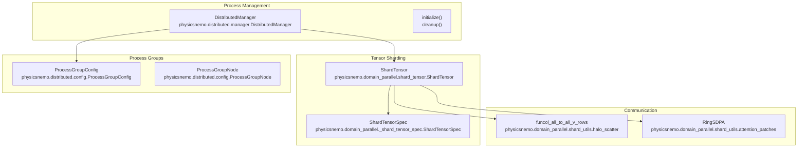
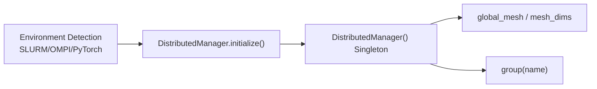

<!-- source: DeepWiki mcp.deepwiki.com · repo NVIDIA/physicsnemo · page 5 Distributed Computing · fetched 2026-10-21 -->

# Distributed Computing

Relevant source files

The following files were used as context for generating this wiki page:

- [physicsnemo/distributed/manager.py](physicsnemo/distributed/manager.py)
- [physicsnemo/domain_parallel/__init__.py](physicsnemo/domain_parallel/__init__.py)
- [physicsnemo/domain_parallel/_shard_redistribute.py](physicsnemo/domain_parallel/_shard_redistribute.py)
- [physicsnemo/domain_parallel/_shard_tensor_spec.py](physicsnemo/domain_parallel/_shard_tensor_spec.py)
- [physicsnemo/domain_parallel/custom_ops/__init__.py](physicsnemo/domain_parallel/custom_ops/__init__.py)
- [physicsnemo/domain_parallel/custom_ops/_tensor_ops.py](physicsnemo/domain_parallel/custom_ops/_tensor_ops.py)
- [physicsnemo/domain_parallel/shard_tensor.py](physicsnemo/domain_parallel/shard_tensor.py)
- [physicsnemo/domain_parallel/shard_utils/attention_patches.py](physicsnemo/domain_parallel/shard_utils/attention_patches.py)
- [physicsnemo/domain_parallel/shard_utils/halo_scatter.py](physicsnemo/domain_parallel/shard_utils/halo_scatter.py)
- [physicsnemo/domain_parallel/shard_utils/natten_patches.py](physicsnemo/domain_parallel/shard_utils/natten_patches.py)
- [test/conftest.py](test/conftest.py)
- [test/datapipes/test_climate.py](test/datapipes/test_climate.py)
- [test/datapipes/test_mesh_datapipe.py](test/datapipes/test_mesh_datapipe.py)
- [test/distributed/test_config.py](test/distributed/test_config.py)
- [test/distributed/test_distributed_fft.py](test/distributed/test_distributed_fft.py)
- [test/distributed/test_manager.py](test/distributed/test_manager.py)
- [test/distributed/test_manager_timeout.py](test/distributed/test_manager_timeout.py)
- [test/domain_parallel/models/test_geotransolver.py](test/domain_parallel/models/test_geotransolver.py)
- [test/domain_parallel/ops/test_cross.py](test/domain_parallel/ops/test_cross.py)
- [test/domain_parallel/test_redistribute.py](test/domain_parallel/test_redistribute.py)
- [test/domain_parallel/test_shard_alignment.py](test/domain_parallel/test_shard_alignment.py)
- [test/models/sfno/test_sfno.py](test/models/sfno/test_sfno.py)

This page provides a comprehensive overview of PhysicsNeMo's distributed computing infrastructure for scaling physics-informed machine learning across multiple GPUs and nodes. As a parent page, it outlines the high-level architecture and links to detailed child pages covering process management, tensor sharding, communication primitives, parallelism strategies, and distributed algorithms.

Sources: [physicsnemo/distributed/manager.py:68-134](), [physicsnemo/domain_parallel/__init__.py:17-33]()

## Architecture Overview

PhysicsNeMo's distributed computing stack bridges high-level physics models to low-level hardware communication through distinct layers, managing everything from environment initialization to domain-specific distributed algorithms.

**Distributed Computing Framework Architecture**

Sources: [physicsnemo/distributed/manager.py:68-134](), [physicsnemo/domain_parallel/shard_tensor.py:59-130](), [physicsnemo/domain_parallel/shard_utils/halo_scatter.py:82-103](), [physicsnemo/domain_parallel/shard_utils/attention_patches.py:137-152]()

## DistributedManager

`DistributedManager` is a singleton class responsible for setting up the distributed training environment [physicsnemo/distributed/manager.py:68-134](). It detects environment variables across PyTorch, Slurm, and OpenMPI launchers, tracks rank and world size, and provisions named process groups and `DeviceMesh` topologies [test/distributed/test_manager.py:78-115]().

For details, see [DistributedManager](#5.1).

**DistributedManager Singleton Workflow**

Sources: [physicsnemo/distributed/manager.py:92-128](), [test/distributed/test_manager.py:78-170]()

## ShardTensor System

`ShardTensor` extends PyTorch's `DTensor` architecture to support **uneven sharding**, where different ranks maintain shards of differing sizes [physicsnemo/domain_parallel/__init__.py:17-33](). This is essential for irregular physics domains and unstructured meshes. It includes custom autograd integration, shape inference via `ShardTensorSpec`, and redirection handlers for standard ATen operations [physicsnemo/domain_parallel/shard_tensor.py:59-130](), [physicsnemo/domain_parallel/_shard_tensor_spec.py:38-70]().

For details, see [ShardTensor System](#5.2).

Sources: [physicsnemo/domain_parallel/__init__.py:17-33](), [physicsnemo/domain_parallel/shard_tensor.py:59-130](), [physicsnemo/domain_parallel/_shard_tensor_spec.py:38-70]()

## Process Groups and Parallelism

PhysicsNeMo supports hierarchical process group topologies defined via `ProcessGroupConfig` and `ProcessGroupNode`. This enables flexible combination strategies including data parallelism, model parallelism, FSDP integration, and spatial domain partitioning [physicsnemo/distributed/manager.py:121-125]().

For details, see [Process Groups and Parallelism](#5.3).

| Strategy | Description | Code Entity / Reference |
|----------|-------------|-------------------------|
| **Data Parallel** | Replicates model weights, shards batch dimension. | `DistributedManager` |
| **Model / FSDP** | Shards parameters, gradients, and optimizer states. | `ProcessGroupConfig` |
| **Spatial Parallel** | Splits physical simulation domains across devices. | `DeviceMesh` |

Sources: [physicsnemo/distributed/manager.py:121-125](), [physicsnemo/distributed/config.py:25-30]()

## Communication Primitives

To support irregular and uneven workloads, the framework provides variable-sized communication primitives (`scatter_v`, `gather_v`, `all_gather_v`, and `indexed_all_to_all_v`) alongside autograd-aware custom reduction operations and distributed FFT support [physicsnemo/domain_parallel/shard_utils/halo_scatter.py:82-103]().

For details, see [Communication Primitives](#5.4).

Sources: [physicsnemo/domain_parallel/shard_utils/halo_scatter.py:82-103]()

## Distributed Algorithms

PhysicsNemo implements domain-specific distributed patterns optimized for simulation workloads, such as halo exchange for stencil operations and convolutions, ring attention and point-cloud passing, and custom layer patches for NATTEN and normalization [physicsnemo/domain_parallel/shard_utils/natten_patches.py:48-86](), [physicsnemo/domain_parallel/shard_utils/attention_patches.py:137-152]().

For details, see [Distributed Algorithms](#5.5).

Sources: [physicsnemo/domain_parallel/shard_utils/natten_patches.py:48-86](), [physicsnemo/domain_parallel/shard_utils/attention_patches.py:137-152]()

---

