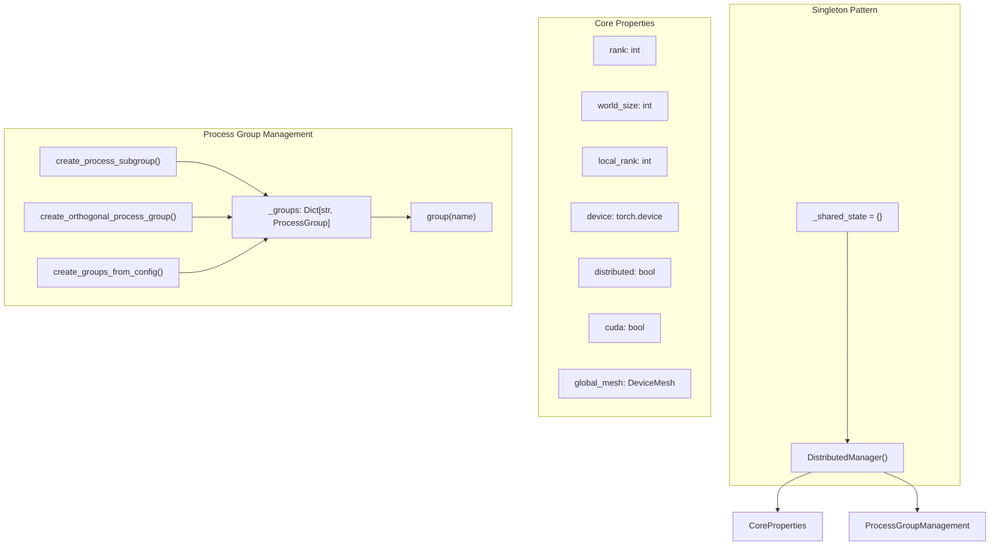
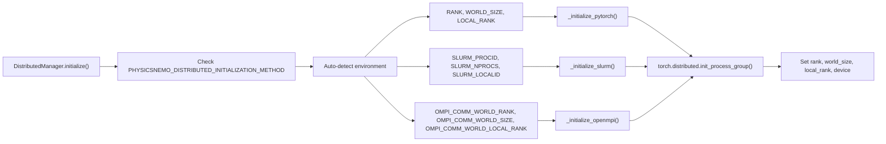

<!-- source: DeepWiki mcp.deepwiki.com · repo NVIDIA/physicsnemo · page 5.1 DistributedManager · fetched 2026-10-21 -->

# DistributedManager

<details>
<summary>Relevant source files</summary>

The following files were used as context for generating this wiki page:

- [physicsnemo/distributed/manager.py](physicsnemo/distributed/manager.py)
- [test/conftest.py](test/conftest.py)
- [test/datapipes/test_climate.py](test/datapipes/test_climate.py)
- [test/datapipes/test_mesh_datapipe.py](test/datapipes/test_mesh_datapipe.py)
- [test/distributed/test_config.py](test/distributed/test_config.py)
- [test/distributed/test_distributed_fft.py](test/distributed/test_distributed_fft.py)
- [test/distributed/test_manager.py](test/distributed/test_manager.py)
- [test/distributed/test_manager_timeout.py](test/distributed/test_manager_timeout.py)
- [test/domain_parallel/ops/test_cross.py](test/domain_parallel/ops/test_cross.py)
- [test/models/sfno/test_sfno.py](test/models/sfno/test_sfno.py)

</details>


## Purpose and Scope

`DistributedManager` is a singleton class that serves as the central interface for all distributed computing operations in PhysicsNeMo. It manages process initialization, process group configuration, timeouts, device assignment, and DeviceMesh integration across PyTorch, SLURM, and OpenMPI environments. The singleton pattern ensures all components in the codebase share a consistent distributed configuration throughout the lifetime of the program.

Sources: [physicsnemo/distributed/manager.py:68-88](), [test/distributed/test_manager.py:171-195]()

---

## Class Architecture

`DistributedManager` uses a shared state dictionary (`_shared_state`) to implement the Borg/Singleton pattern. All instances share the same internal `__dict__`, ensuring consistent parallel environment information across modules.



Sources: [physicsnemo/distributed/manager.py:90-128](), [physicsnemo/distributed/manager.py:135-191]()

---

## Initialization Mechanics and Launcher Support

The manager must be explicitly initialized via `DistributedManager.initialize()` prior to instantiating any manager object or distributed components. Attempting to instantiate without initialization raises `PhysicsNeMoUninitializedDistributedManagerWarning`.



### Supported Launchers and Environment Variables

| Launcher / Environment | Environment Variables | Initialization Method |
|------------------------|----------------------|-----------------------|
| **Standard PyTorch** | `RANK`, `WORLD_SIZE`, `LOCAL_RANK`, `MASTER_ADDR`, `MASTER_PORT` | `_initialize_pytorch()` |
| **SLURM Cluster** | `SLURM_PROCID`, `SLURM_NPROCS`, `SLURM_LOCALID`, `SLURM_LAUNCH_NODE_IPADDR` | `_initialize_slurm()` |
| **OpenMPI** | `OMPI_COMM_WORLD_RANK`, `OMPI_COMM_WORLD_SIZE`, `OMPI_COMM_WORLD_LOCAL_RANK` | `_initialize_openmpi()` |

You can override automatic detection by setting `PHYSICSNEMO_DISTRIBUTED_INITIALIZATION_METHOD` to `ENV`, `SLURM`, or `OPENMPI`.

Sources: [physicsnemo/distributed/manager.py:128-134](), [test/distributed/test_manager.py:78-169](), [test/distributed/test_manager_timeout.py:30-94]()

### Timeout Configuration

Timeouts for collective operations during process group initialization can be configured via:
1. Passing an explicit `timeout` argument (e.g., `timedelta` or seconds) to `DistributedManager.initialize(timeout=...)` or `DistributedManager.setup(...)`.
2. Setting the environment variable `PHYSICSNEMO_DIST_TIMEOUT_S`.

If neither is provided, PyTorch's default process group timeout is used.

Sources: [test/distributed/test_manager_timeout.py:30-165]()

---

## Process Groups and Parallelism

`DistributedManager` manages named process groups, enabling multi-dimensional parallelism (such as model parallelism, data parallelism, and spatial parallelism).

### Process Group Creation Functions
- **`create_process_subgroup(name, size, group_name=None, verbose=False)`**: Splits an existing group into subgroups of a given size [test/distributed/test_distributed_fft.py:40-42]().
- **`create_orthogonal_process_group(name, orthogonal_to, verbose=False)`**: Creates orthogonal process groups (e.g., data parallel groups spanning across model parallel slices) [test/distributed/test_distributed_fft.py:44-46]().
- **`create_groups_from_config(config, verbose=False)`**: Constructs a complete hierarchy from a `ProcessGroupConfig` tree [test/distributed/test_config.py:115-116]().

```python
# Example: Creating a model-parallel subgroup and orthogonal data-parallel group
DistributedManager.create_process_subgroup("model_parallel", 2)
DistributedManager.create_orthogonal_process_group("data_parallel", "model_parallel")
```

Sources: [test/distributed/test_config.py:36-69](), [test/distributed/test_distributed_fft.py:33-56]()

---

## DeviceMesh Support

`DistributedManager` provides native support for PyTorch `DeviceMesh` (v2.4+), allowing multi-dimensional tensor sharding and communication.

| Property / Method | Description |
|-------------------|-------------|
| `global_mesh` | Returns a 1D "world" `DeviceMesh` by default (lazy-initialized) [physicsnemo/distributed/manager.py:178-191](). |
| `mesh_dims` | Returns a dictionary mapping mesh axis names to their respective sizes [physicsnemo/distributed/manager.py:166-169](). |
| `initialize_mesh(...)` | Explicitly creates a multi-dimensional `DeviceMesh` with custom shapes and axis names [physicsnemo/distributed/manager.py:188](). |

```python
manager = DistributedManager()
manager.initialize_mesh(mesh_shape=(2, 4), mesh_dim_names=("dp", "mp"))
mesh = manager.global_mesh
```

Sources: [physicsnemo/distributed/manager.py:123-127](), [physicsnemo/distributed/manager.py:178-204](), [test/domain_parallel/ops/test_cross.py:45-56]()

---

## Core Properties and Error Handling

### Core Properties Table

| Property | Type | Description |
|----------|------|-------------|
| `rank` | `int` | Global process rank (`0` to `world_size - 1`) [physicsnemo/distributed/manager.py:136-138]() |
| `world_size` | `int` | Total number of processes [physicsnemo/distributed/manager.py:146-148]() |
| `local_rank` | `int` | Local process rank on the current node [physicsnemo/distributed/manager.py:141-143]() |
| `device` | `torch.device` | CUDA device assigned via `local_rank` [physicsnemo/distributed/manager.py:151-153]() |
| `distributed` | `bool` | Whether running in a distributed environment [physicsnemo/distributed/manager.py:156-158]() |
| `cuda` | `bool` | Whether CUDA is available [physicsnemo/distributed/manager.py:161-163]() |

Sources: [physicsnemo/distributed/manager.py:135-164]()

### Exceptions and Warnings

- `PhysicsNeMoUninitializedDistributedManagerWarning`: Raised when attempting to access a manager instance before calling `DistributedManager.initialize()` [physicsnemo/distributed/manager.py:54-66]().
- `PhysicsNeMoUndefinedGroupError`: Raised when querying an unregistered process group name [physicsnemo/distributed/manager.py:36-52]().

Sources: [physicsnemo/distributed/manager.py:36-66]()

---

## Cleanup

`DistributedManager.cleanup()` destroys all active process groups, resets backend states, and clears the shared singleton dictionary (`_shared_state`).

```python
# Terminate distributed process groups and reset singleton
DistributedManager.cleanup()
```

Sources: [test/distributed/test_manager.py:75-75](), [test/distributed/test_config.py:144-144]()

---

