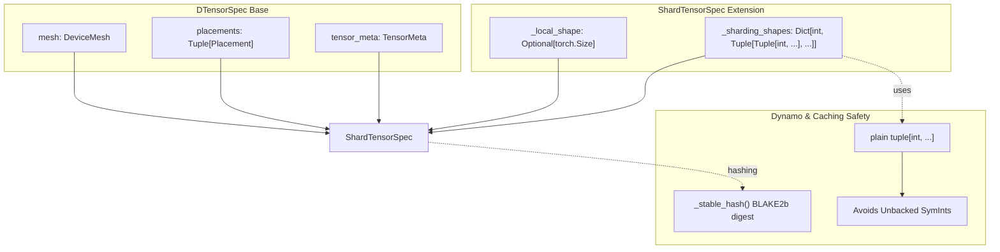
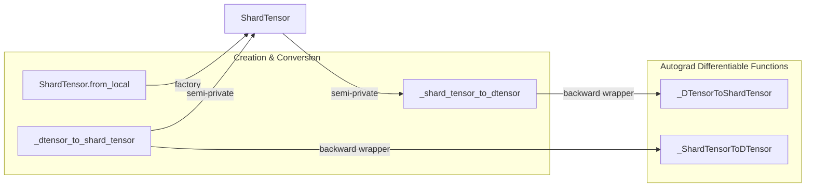
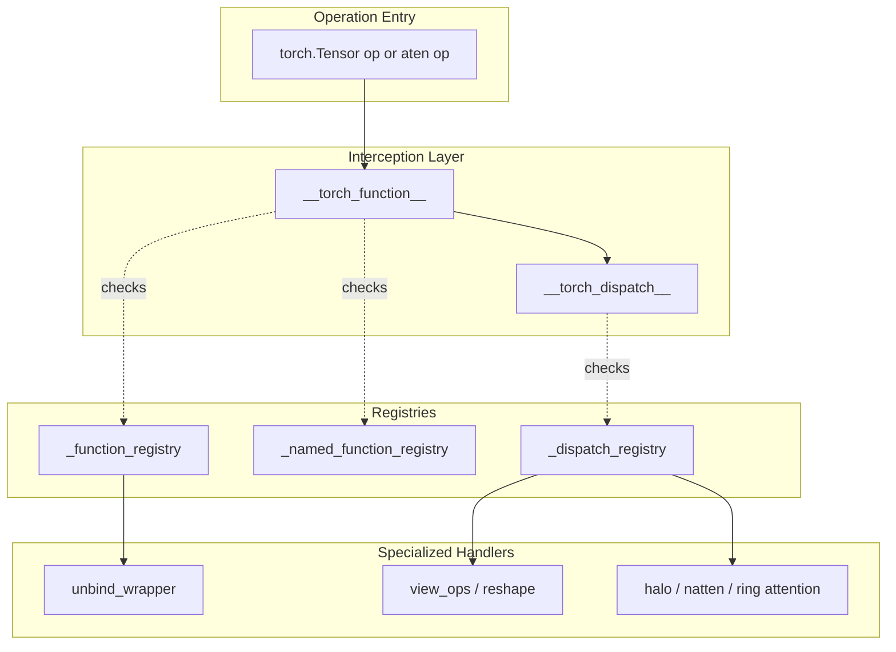
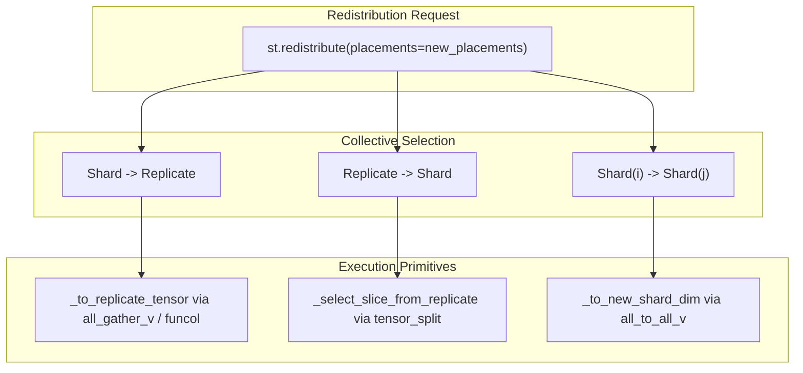

<!-- source: DeepWiki mcp.deepwiki.com · repo NVIDIA/physicsnemo · page 5.2 ShardTensor System · fetched 2026-10-21 -->

# ShardTensor System

<details>
<summary>Relevant source files</summary>

The following files were used as context for generating this wiki page:

- [physicsnemo/domain_parallel/__init__.py](physicsnemo/domain_parallel/__init__.py)
- [physicsnemo/domain_parallel/_shard_redistribute.py](physicsnemo/domain_parallel/_shard_redistribute.py)
- [physicsnemo/domain_parallel/_shard_tensor_spec.py](physicsnemo/domain_parallel/_shard_tensor_spec.py)
- [physicsnemo/domain_parallel/custom_ops/__init__.py](physicsnemo/domain_parallel/custom_ops/__init__.py)
- [physicsnemo/domain_parallel/custom_ops/_tensor_ops.py](physicsnemo/domain_parallel/custom_ops/_tensor_ops.py)
- [physicsnemo/domain_parallel/shard_tensor.py](physicsnemo/domain_parallel/shard_tensor.py)
- [physicsnemo/domain_parallel/shard_utils/attention_patches.py](physicsnemo/domain_parallel/shard_utils/attention_patches.py)
- [physicsnemo/domain_parallel/shard_utils/halo_scatter.py](physicsnemo/domain_parallel/shard_utils/halo_scatter.py)
- [physicsnemo/domain_parallel/shard_utils/natten_patches.py](physicsnemo/domain_parallel/shard_utils/natten_patches.py)
- [physicsnemo/domain_parallel/shard_utils/unary_ops.py](physicsnemo/domain_parallel/shard_utils/unary_ops.py)
- [physicsnemo/domain_parallel/shard_utils/view_ops.py](physicsnemo/domain_parallel/shard_utils/view_ops.py)
- [skills/physicsnemo-shard-tensor/BENCHMARK.md](skills/physicsnemo-shard-tensor/BENCHMARK.md)
- [skills/physicsnemo-shard-tensor/SKILL.md](skills/physicsnemo-shard-tensor/SKILL.md)
- [skills/physicsnemo-shard-tensor/evals/evals.json](skills/physicsnemo-shard-tensor/evals/evals.json)
- [skills/physicsnemo-shard-tensor/references/integration-checklist.md](skills/physicsnemo-shard-tensor/references/integration-checklist.md)
- [skills/physicsnemo-shard-tensor/references/new-op-patterns.md](skills/physicsnemo-shard-tensor/references/new-op-patterns.md)
- [skills/physicsnemo-shard-tensor/references/testing.md](skills/physicsnemo-shard-tensor/references/testing.md)
- [skills/physicsnemo-shard-tensor/skill-card.md](skills/physicsnemo-shard-tensor/skill-card.md)
- [skills/physicsnemo-shard-tensor/skill.oms.sig](skills/physicsnemo-shard-tensor/skill.oms.sig)
- [test/domain_parallel/models/test_geotransolver.py](test/domain_parallel/models/test_geotransolver.py)
- [test/domain_parallel/models/test_sharded_domino.py](test/domain_parallel/models/test_sharded_domino.py)
- [test/domain_parallel/ops/test_unary_ops.py](test/domain_parallel/ops/test_unary_ops.py)
- [test/domain_parallel/ops/test_view_ops.py](test/domain_parallel/ops/test_view_ops.py)
- [test/domain_parallel/test_function_registration.py](test/domain_parallel/test_function_registration.py)
- [test/domain_parallel/test_redistribute.py](test/domain_parallel/test_redistribute.py)
- [test/domain_parallel/test_shard_alignment.py](test/domain_parallel/test_shard_alignment.py)

</details>


The `ShardTensor` system extends PyTorch's native `DTensor` infrastructure to support uneven data sharding across distributed processes [physicsnemo/domain_parallel/__init__.py:17-23](). While standard `DTensor` assumes uniform chunk sizes derived from `torch.chunk` semantics, `ShardTensor` tracks individual shard shapes per rank (`_sharding_shapes`), enabling efficient domain-parallel operations on irregular scientific datasets such as adaptive unstructured meshes, point clouds, and spatially partitioned simulation domains [physicsnemo/domain_parallel/shard_tensor.py:231-1159]().

For details on overall process management and device mesh creation, see [DistributedManager](#5.1). For high-level distributed algorithms like halo exchanges and ring attention, see [Distributed Algorithms](#5.5).

---

## Core Architecture and ShardTensorSpec

The `ShardTensor` system rests on two primary types: `ShardTensor` (a `torch.Tensor` wrapper subclass) and `ShardTensorSpec` (which extends `DTensorSpec` to manage global sharding metadata) [physicsnemo/domain_parallel/shard_tensor.py:231-262](), [physicsnemo/domain_parallel/_shard_tensor_spec.py:37-70]().

### ShardTensorSpec Data Structure

`ShardTensorSpec` overrides parent methods to include per-rank shard tracking [physicsnemo/domain_parallel/_shard_tensor_spec.py:37-76]().



As detailed in `ShardTensorSpec`, `_sharding_shapes` stores plain Python `tuple[int, ...]` rather than `torch.Size` objects [physicsnemo/domain_parallel/_shard_tensor_spec.py:55-70](). This deliberate design choice prevents PyTorch's symbolic tracing (TorchDynamo) from turning contained integers into unbacked `SymInt` objects, which would otherwise trigger `PendingUnbackedSymbolNotFound` errors when operations drop or filter sharding metadata [physicsnemo/domain_parallel/_shard_tensor_spec.py:55-70](). Furthermore, `_stable_hash()` computes a cross-process stable hash using `blake2b` to support AOT autograd caching across uneven layouts [physicsnemo/domain_parallel/_shard_tensor_spec.py:119-158]().

Sources: [physicsnemo/domain_parallel/shard_tensor.py:231-262](), [physicsnemo/domain_parallel/_shard_tensor_spec.py:37-158]()

---

## Tensor Construction, Conversion, and Autograd

`ShardTensor` exposes factory methods and multi-layered conversion helpers that bridge plain tensors, `DTensor`, and `ShardTensor` while preserving autograd [physicsnemo/domain_parallel/shard_tensor.py:89-192]().



### Conversion Layers

1. **Semi-Private Conversions (`Layer 1`)**: Functions like `_shard_tensor_to_dtensor` and `_dtensor_to_shard_tensor` convert between `ShardTensor` and `DTensor` without touching the autograd graph (used inside dispatch routines or backward passes) [physicsnemo/domain_parallel/shard_tensor.py:89-130]().
2. **Autograd Functions (`Layer 2`)**: `_DTensorToShardTensor` and `_ShardTensorToDTensor` inherit from `torch.autograd.Function` to ensure gradient graphs remain connected when crossing tensor wrapper boundaries [physicsnemo/domain_parallel/shard_tensor.py:137-187](). Specifically, `_ShardTensorToDTensor.backward` updates cached uneven sharding shapes while adopting incoming gradient tensor metadata and placements (e.g. handling `Replicate` to `Partial` flips) [physicsnemo/domain_parallel/shard_tensor.py:176-187]().

Sources: [physicsnemo/domain_parallel/shard_tensor.py:89-187](), [physicsnemo/domain_parallel/shard_tensor.py:492-550]()

---

## Operation Dispatch System and Custom Ops

To handle operations on unevenly sharded tensors, `physicsnemo.domain_parallel` intercepts execution via Python and dispatcher hooks [physicsnemo/domain_parallel/custom_ops/_tensor_ops.py:17-23]().



### Registries and Wrappers

- **Registries**: `_function_registry`, `_named_function_registry`, and `_dispatch_registry` map operators to custom handler functions [physicsnemo/domain_parallel/shard_tensor.py:289-313]().
- **Custom Operation Handlers**: Specialized wrappers handle operations that require metadata updates without communication. For instance, `unbind_wrapper` validates that unbind axes do not intersect sharded dimensions (or raises a `RuntimeError`) and recomputes output `ShardTensorSpec` sharding shapes locally [physicsnemo/domain_parallel/custom_ops/_tensor_ops.py:52-190](). Similar view/reshape and neighborhood attention (`natten`) patches manage local tensor shapes and halo exchanges [physicsnemo/domain_parallel/shard_utils/view_ops.py:17-44](), [physicsnemo/domain_parallel/shard_utils/natten_patches.py:142-186]().

Sources: [physicsnemo/domain_parallel/shard_tensor.py:289-313](), [physicsnemo/domain_parallel/custom_ops/_tensor_ops.py:52-190](), [physicsnemo/domain_parallel/shard_utils/view_ops.py:17-44](), [physicsnemo/domain_parallel/shard_utils/natten_patches.py:142-186]()

---

## Redistribution

The `redistribute` method allows a `ShardTensor` to transition between different placements (e.g., `Shard` to `Replicate`, or `Shard(1)` to `Shard(2)`) [physicsnemo/domain_parallel/_shard_redistribute.py:1-50]().



- **Shard to Replicate**: `_to_replicate_tensor` queries individual shard shapes (`current_spec.sharding_shapes()`), pads flattened local shards to account for uneven sizes, and executes `funcol.all_gather_tensor` before concatenating along the sharded tensor dimension [physicsnemo/domain_parallel/_shard_redistribute.py:54-124]().
- **Replicate to Shard**: `_select_slice_from_replicate` splits a replicated tensor across ranks using `torch.tensor_split` based on target specification chunk sizes [physicsnemo/domain_parallel/_shard_redistribute.py:127-184]().

Sources: [physicsnemo/domain_parallel/_shard_redistribute.py:1-187](), [test/domain_parallel/test_redistribute.py:101-196]()

---

## ShardTensor Integration Guide and Skill

When incorporating domain parallelism into models using `ShardTensor`, several architectural rules must be followed [skills/physicsnemo-shard-tensor/SKILL.md:15-132]().

### Core Integration Principles

- **Zero Model Code Changes**: Because `ShardTensor` inherits directly from `torch.Tensor`, standard `nn.Module` definitions require no modifications [skills/physicsnemo-shard-tensor/SKILL.md:39-52]().
- **Tensor Auto-Promotion**: When an unsharded model weight meets a sharded activation in an operator, `ShardTensor` automatically promotes the weight to a `Replicate` DTensor for the duration of the computation (`TensorPromotionMode.SILENT` by default) [physicsnemo/domain_parallel/shard_tensor.py:59-82](), [skills/physicsnemo-shard-tensor/SKILL.md:39-52]().
- **Hard Constraint on Batch Size**: The per-domain-group batch size **must** be 1. Sharded activations with a batch dimension greater than 1 are outside the design scope [skills/physicsnemo-shard-tensor/SKILL.md:75-91](). Scale batch size exclusively through the Data-Parallel (DDP) mesh axis [skills/physicsnemo-shard-tensor/SKILL.md:75-91]().

### Setup Pattern in Scripts

```python
from physicsnemo.distributed import DistributedManager
from physicsnemo.domain_parallel import scatter_tensor
from torch.distributed.tensor.placement_types import Shard, Replicate

DistributedManager.initialize()
dm = DistributedManager()
torch.cuda.set_device(dm.device)

# Build DDP x Domain device mesh
mesh = dm.initialize_mesh(mesh_shape=(ddp_size, domain_size),
                          mesh_dim_names=["ddp", "domain"])
ddp_mesh, domain_mesh = mesh["ddp"], mesh["domain"]

assert x.shape[0] == 1, "per-domain-group batch size must be 1"

# Scatter input over domain mesh
src = dist.get_global_rank(domain_mesh.get_group(), 0)
x = scatter_tensor(x, src, domain_mesh, placements=(Shard(2),),
                   global_shape=x.shape, dtype=x.dtype)
```

Sources: [skills/physicsnemo-shard-tensor/SKILL.md:15-132]()

---

