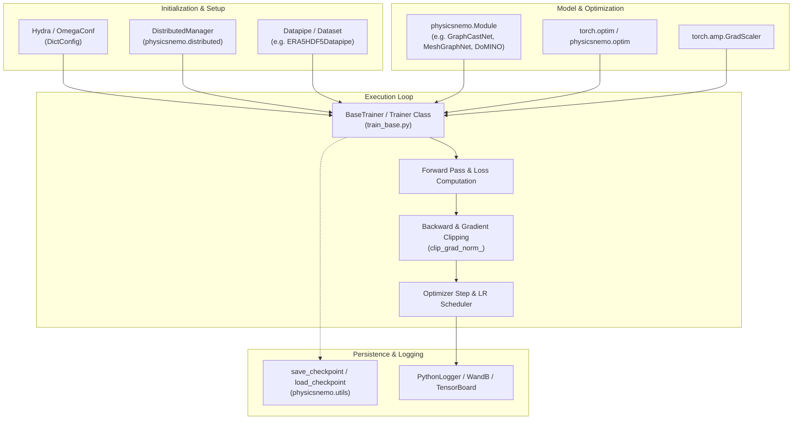
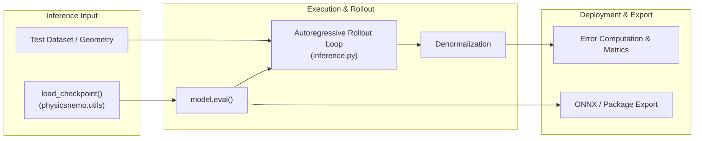

<!-- source: DeepWiki mcp.deepwiki.com · repo NVIDIA/physicsnemo · page 6 Training and Inference · fetched 2026-10-21 -->

# Training and Inference

Relevant source files

The following files were used as context for generating this wiki page:

- [docs/test_scripts/test_basic.py](docs/test_scripts/test_basic.py)
- [docs/test_scripts/test_basic_checkpointing.py](docs/test_scripts/test_basic_checkpointing.py)
- [docs/test_scripts/test_console_logger.py](docs/test_scripts/test_console_logger.py)
- [docs/test_scripts/test_custom_model_demo_1.py](docs/test_scripts/test_custom_model_demo_1.py)
- [docs/test_scripts/test_mlflow_logger.py](docs/test_scripts/test_mlflow_logger.py)
- [docs/test_scripts/test_simple_distributed.py](docs/test_scripts/test_simple_distributed.py)
- [docs/test_scripts/test_wandb_logger.py](docs/test_scripts/test_wandb_logger.py)
- [examples/cfd/external_aerodynamics/domino/src/benchmark_dataloader.py](examples/cfd/external_aerodynamics/domino/src/benchmark_dataloader.py)
- [examples/cfd/external_aerodynamics/domino_nim_finetuning/src/train.py](examples/cfd/external_aerodynamics/domino_nim_finetuning/src/train.py)
- [examples/cfd/external_aerodynamics/figconvnet/configs/base.yaml](examples/cfd/external_aerodynamics/figconvnet/configs/base.yaml)
- [examples/cfd/external_aerodynamics/figconvnet/train.py](examples/cfd/external_aerodynamics/figconvnet/train.py)
- [examples/cfd/external_aerodynamics/moe/train.py](examples/cfd/external_aerodynamics/moe/train.py)
- [examples/cfd/external_aerodynamics/xaeronet/volume/train.py](examples/cfd/external_aerodynamics/xaeronet/volume/train.py)
- [examples/cfd/transient_conjugate_heat_transfer_tank_fill/train.py](examples/cfd/transient_conjugate_heat_transfer_tank_fill/train.py)
- [examples/healthcare/bloodflow_1d_mgn/inference.py](examples/healthcare/bloodflow_1d_mgn/inference.py)
- [examples/healthcare/bloodflow_1d_mgn/train.py](examples/healthcare/bloodflow_1d_mgn/train.py)
- [examples/weather/graphcast/train_base.py](examples/weather/graphcast/train_base.py)
- [examples/weather/graphcast/train_graphcast.py](examples/weather/graphcast/train_graphcast.py)
- [test/common/optimization.py](test/common/optimization.py)

This page provides a high-level guide to model training, optimization, monitoring, checkpointing, and deployment within PhysicsNeMo. It outlines the foundational infrastructure used to orchestrate end-to-end physics machine learning workloads across single-GPU and distributed systems.

**Scope**: This is a parent page covering core concepts. For detailed implementation guides and deep dives into specific sub-topics, refer to the child sections:
- **Training Pipeline**: End-to-end flows, data loaders, and reference trainers [Training Pipeline](#6.1).
- **Optimization Techniques**: CUDA graphs, mixed precision, torch.compile, and custom optimizers [Optimization Techniques](#6.2).
- **Logging and Monitoring**: Experiment tracking, loggers, and rank-zero wrappers [Logging and Monitoring](#6.3).
- **Inference and Deployment**: Rollout patterns, ONNX export, memory pooling, and profiling [Inference and Deployment](#6.4).

Sources: 
- [examples/weather/graphcast/train_graphcast.py:60-148]()
- [examples/cfd/external_aerodynamics/domino_nim_finetuning/src/train.py:18-28]()

---

## Training Architecture Overview

PhysicsNeMo provides unified abstractions for building and executing training loops across various scientific domains (weather forecasting, computational fluid dynamics, structural mechanics). Training pipelines typically coordinate distributed environment setup via `DistributedManager`, dataset batching, mixed-precision scaling (`GradScaler`), optimizer steps, and periodic checkpoint persistence [examples/weather/graphcast/train_graphcast.py:167-172] [examples/healthcare/bloodflow_1d_mgn/train.py:135-151] [examples/cfd/external_aerodynamics/domino_nim_finetuning/src/train.py:42-55]().

### Training Orchestration Diagram

The following diagram bridges the high-level training lifecycle with the underlying code entities used across reference implementations.

**Sources**:
- [examples/weather/graphcast/train_graphcast.py:60-172]()
- [examples/healthcare/bloodflow_1d_mgn/train.py:60-151]()
- [examples/weather/graphcast/train_base.py:24-84]()

### Core Training Infrastructure Components

| Component | Code Entity / Module | Purpose | Key Responsibilities |
|-----------|----------------------|---------|----------------------|
| **Distributed Manager** | `DistributedManager` [examples/weather/graphcast/train_graphcast.py:51]() | Multi-node/multi-GPU coordination | Initializes process groups, handles device assignment [examples/cfd/external_aerodynamics/xaeronet/volume/train.py:73-76]() |
| **Trainer Base** | `BaseTrainer` [examples/weather/graphcast/train_base.py:24]() | Execution loop boilerplate | Manages forward passes, autocast contexts, gradient clipping, and scheduler steps [examples/weather/graphcast/train_base.py:30-84]() |
| **Checkpoint Management** | `save_checkpoint`, `load_checkpoint` [examples/weather/graphcast/train_graphcast.py:45]() | State persistence | Saves/restores model weights, optimizer states, schedulers, and scaler states [examples/healthcare/bloodflow_1d_mgn/train.py:144-151]() |
| **Precision Scaling** | `GradScaler` [examples/weather/graphcast/train_graphcast.py:20]() | Mixed precision stability | Scales loss values to prevent underflow during `fp16`/`bf16` training [examples/weather/graphcast/train_base.py:66-72]() |

**Sources**:
- [examples/weather/graphcast/train_graphcast.py:45-51]()
- [examples/weather/graphcast/train_base.py:24-84]()
- [examples/healthcare/bloodflow_1d_mgn/train.py:144-151]()

---

## Training Pipeline

The training pipeline integrates data loading, device allocation, forward execution, loss evaluation, backpropagation, and metric recording into a cohesive workflow. Reference trainers (such as `GraphCastTrainer` or `MGNTrainer`) subclass base training classes to implement domain-specific rollout and loss aggregation logic [examples/weather/graphcast/train_graphcast.py:60]() [examples/healthcare/bloodflow_1d_mgn/train.py:60]().

For detailed documentation on epoch management, data loading patterns, distributed data parallel (DDP/FSDP) wrappers, and validation loops, see [Training Pipeline](#6.1).

Sources:
- [examples/weather/graphcast/train_graphcast.py:60-172]()
- [examples/healthcare/bloodflow_1d_mgn/train.py:60-151]()

---

## Optimization Techniques

To maximize hardware utilization on NVIDIA GPUs, PhysicsNeMo supports advanced performance primitives. These include `torch.compile` for operator fusion, Automatic Mixed Precision (AMP) via `torch.amp.autocast`, gradient clipping, and CUDA graph capture decorators [examples/weather/graphcast/train_graphcast.py:128-146] [examples/weather/graphcast/train_base.py:31-77] [test/common/optimization.py:33-134](). Additionally, specialized optimization algorithms are provided under `physicsnemo.optim`.

For detailed information on `StaticCapture` decorators, CUDA graphs, AMP configuration, gradient checkpointing, and optimizer implementations, see [Optimization Techniques](#6.2).

Sources:
- [examples/weather/graphcast/train_graphcast.py:128-146]()
- [examples/weather/graphcast/train_base.py:31-77]()
- [test/common/optimization.py:33-134]()

---

## Logging and Monitoring

Effective monitoring in physics-informed machine learning requires tracking standard optimization metrics alongside domain-specific indicators (such as physical conservation errors, rollout stability, and spatial metrics). PhysicsNeMo provides unified logging infrastructure via `PythonLogger`, `LaunchLogger`, and rank-zero wrapper utilities to prevent redundant console spam in distributed training runs [examples/weather/graphcast/train_graphcast.py:40-43] [examples/cfd/external_aerodynamics/domino/src/benchmark_dataloader.py:130-131]().

For details on integrating Weights & Biases (WandB), TensorBoard, MLflow, and rank-zero logging wrappers, see [Logging and Monitoring](#6.3).

Sources:
- [examples/weather/graphcast/train_graphcast.py:40-43]()
- [examples/cfd/external_aerodynamics/domino/src/benchmark_dataloader.py:130-131]()

---

## Inference and Deployment

Inference pipelines execute autoregressive rollouts, batch predictions, and geometry evaluations. Production workflows frequently leverage ONNX export, package-based model access via `filesystem.Package`, unified GPU memory pools (RMM) for zero-copy inter-operability, and profiling tools [examples/healthcare/bloodflow_1d_mgn/inference.py:47-187] [examples/cfd/external_aerodynamics/domino/src/benchmark_dataloader.py:44]().

### Inference Flow Diagram

**Sources**:
- [examples/healthcare/bloodflow_1d_mgn/inference.py:47-125]()
- [examples/healthcare/bloodflow_1d_mgn/inference.py:171-200]()

For comprehensive coverage of inference patterns, ONNX export workflows, memory management utilities, and profiling, see [Inference and Deployment](#6.4).

Sources:
- [examples/healthcare/bloodflow_1d_mgn/inference.py:47-200]()
- [examples/cfd/external_aerodynamics/domino/src/benchmark_dataloader.py:44]()

---

