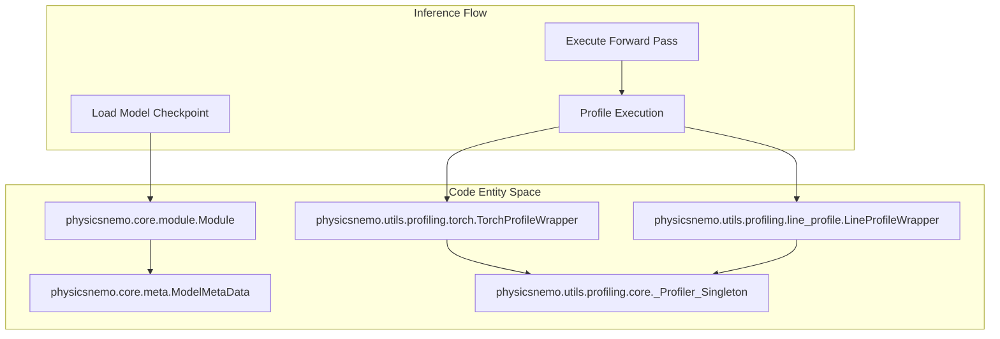
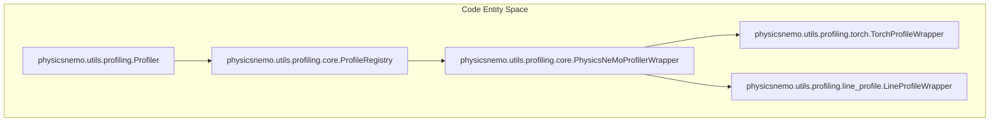

<!-- source: DeepWiki mcp.deepwiki.com · repo NVIDIA/physicsnemo · page 6.4 Inference and Deployment · fetched 2026-10-21 -->

# Inference and Deployment

Relevant source files

The following files were used as context for generating this wiki page:

- [.github/actions/download-ci-data/action.yml](.github/actions/download-ci-data/action.yml)
- [examples/cfd/external_aerodynamics/aero_graph_net/README.md](examples/cfd/external_aerodynamics/aero_graph_net/README.md)
- [physicsnemo/datapipes/gnn/bsms.py](physicsnemo/datapipes/gnn/bsms.py)
- [physicsnemo/deploy/__init__.py](physicsnemo/deploy/__init__.py)
- [physicsnemo/deploy/onnx/utils.py](physicsnemo/deploy/onnx/utils.py)
- [physicsnemo/models/meshgraphnet/bsms_mgn.py](physicsnemo/models/meshgraphnet/bsms_mgn.py)
- [physicsnemo/models/meshgraphnet/hybrid_meshgraphnet.py](physicsnemo/models/meshgraphnet/hybrid_meshgraphnet.py)
- [physicsnemo/models/meshgraphnet/meshgraphkan.py](physicsnemo/models/meshgraphnet/meshgraphkan.py)
- [physicsnemo/models/meshgraphnet/meshgraphnet.py](physicsnemo/models/meshgraphnet/meshgraphnet.py)
- [physicsnemo/utils/profiling/core.py](physicsnemo/utils/profiling/core.py)
- [physicsnemo/utils/profiling/interface.py](physicsnemo/utils/profiling/interface.py)
- [physicsnemo/utils/profiling/line_profile.py](physicsnemo/utils/profiling/line_profile.py)
- [physicsnemo/utils/profiling/torch.py](physicsnemo/utils/profiling/torch.py)
- [test/datapipes/test_bsms.py](test/datapipes/test_bsms.py)
- [test/datapipes/test_drivaernet.py](test/datapipes/test_drivaernet.py)
- [test/models/meshgraphnet/data/meshgraphkan_output.pth](test/models/meshgraphnet/data/meshgraphkan_output.pth)
- [test/models/meshgraphnet/test_bsms_mgn.py](test/models/meshgraphnet/test_bsms_mgn.py)
- [test/models/meshgraphnet/test_hybrid_meshgraphnet.py](test/models/meshgraphnet/test_hybrid_meshgraphnet.py)
- [test/models/meshgraphnet/test_meshgraphkan.py](test/models/meshgraphnet/test_meshgraphkan.py)
- [test/models/meshgraphnet/test_meshgraphnet.py](test/models/meshgraphnet/test_meshgraphnet.py)
- [test/utils/test_profiler.py](test/utils/test_profiler.py)

This page documents inference patterns, ONNX export, model access via `filesystem.Package`, memory utilities, and performance profiling tools in PhysicsNeMo. For information on training execution, see section 6.1.

Sources:
[physicsnemo/utils/profiling/torch.py:28-51]()
[physicsnemo/utils/profiling/line_profile.py:29-35]()

---

## Inference Pipeline Architecture

The inference pipeline takes trained models and executes them on validation or production datasets. Models inherit from `Module` [physicsnemo/models/meshgraphnet/meshgraphnet.py:54-54]() and define execution metadata (`ModelMetaData`) indicating support for CUDA graphs, JIT, and ONNX export [physicsnemo/models/meshgraphnet/meshgraphnet.py:39-53]().

Sources:
[physicsnemo/models/meshgraphnet/meshgraphnet.py:29-54]()
[physicsnemo/utils/profiling/torch.py:53-70]()
[physicsnemo/utils/profiling/line_profile.py:29-38]()

---

## ONNX Export and Deployment

Models in PhysicsNeMo can be validated and exported to ONNX format to run in non-PyTorch environments (e.g., ONNX Runtime or Triton Inference Server). 

### Metadata Flags for Deployment
Each model specifies its deployment compatibility via its `ModelMetaData` subclass. For example, `MeshGraphNet` and `MeshGraphKAN` configure flags such as `onnx`, `jit`, and `cuda_graphs`:

- `onnx`: Boolean flag indicating ONNX export readiness [physicsnemo/models/meshgraphnet/meshgraphnet.py:39-48]().
- `jit`: Scripting/tracing support [physicsnemo/models/meshgraphnet/meshgraphnet.py:39-42]().

### Validation Testing
Deployment validation tests use common utilities (`validate_onnx_export` and `validate_onnx_runtime`) to verify that exported graphs match PyTorch forward pass outputs within numerical tolerances [test/models/meshgraphnet/test_meshgraphkan.py:171-181]().

Sources:
[physicsnemo/models/meshgraphnet/meshgraphnet.py:39-53]()
[test/models/meshgraphnet/test_meshgraphkan.py:171-181]()

---

## Performance Profiling and Instrumentation

PhysicsNeMo features a flexible profiling framework located in `physicsnemo.utils.profiling` that supports multiple instrumentation backends.

### Profiler Architecture

### Key Profiling Classes

- **`TorchProfilerConfig`**: Dataclass defining PyTorch profiler options including activity monitoring (`ProfilerActivity.CPU`, `ProfilerActivity.CUDA`), shape recording, memory profiling, and FLOP counting [physicsnemo/utils/profiling/torch.py:28-51]().
- **`TorchProfileWrapper`**: Integrates `torch.profiler.profile` as a singleton context manager, exporting chrome traces (`trace.json`) and summary tables (`cpu_time.txt`, `gpu_time.txt`) [physicsnemo/utils/profiling/torch.py:53-180]().
- **`LineProfileWrapper`**: Integrates `line_profiler` to provide line-by-line Python execution timings saved to `profiler_stats.txt` [physicsnemo/utils/profiling/line_profile.py:29-107]().

Sources:
[physicsnemo/utils/profiling/torch.py:28-180]()
[physicsnemo/utils/profiling/line_profile.py:29-107]()

---

## Memory Utilities and Optimization

Inference workflows for large-scale physical simulations (such as weather forecasting and high-resolution CFD) require stringent memory management:

- **Memory Profiling**: Enabled via `TorchProfilerConfig(profile_memory=True)` to track tensor allocations and peak memory usage during inference passes [physicsnemo/utils/profiling/torch.py:28-51]().
- **Unified Memory Pools**: RMM (RAPIDS Memory Manager) unified pools are frequently utilized alongside CUDA graphs to prevent fragmentation during repetitive evaluation loops.

Sources:
[physicsnemo/utils/profiling/torch.py:28-51]()

---

