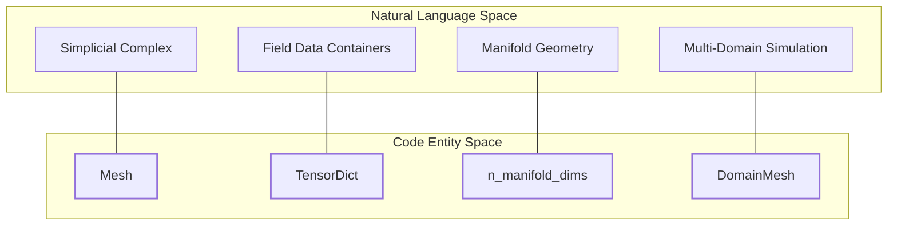
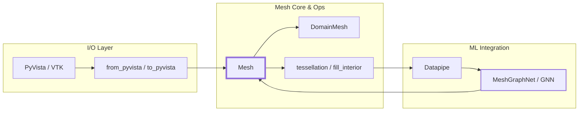

<!-- source: DeepWiki mcp.deepwiki.com · repo NVIDIA/physicsnemo · page 7 PhysicsNeMo Mesh · fetched 2026-10-21 -->

# PhysicsNeMo Mesh

Relevant source files

The following files were used as context for generating this wiki page:

- [docs/api/mesh/generate.rst](docs/api/mesh/generate.rst)
- [docs/api/mesh/index.rst](docs/api/mesh/index.rst)
- [docs/api/mesh/tessellation.rst](docs/api/mesh/tessellation.rst)
- [examples/minimal/mesh/README.md](examples/minimal/mesh/README.md)
- [examples/minimal/mesh/tutorial_8_io_interop.ipynb](examples/minimal/mesh/tutorial_8_io_interop.ipynb)
- [examples/minimal/mesh/tutorial_9_mesh_generation.ipynb](examples/minimal/mesh/tutorial_9_mesh_generation.ipynb)
- [physicsnemo/mesh/domain_mesh.py](physicsnemo/mesh/domain_mesh.py)
- [physicsnemo/mesh/mesh.py](physicsnemo/mesh/mesh.py)
- [physicsnemo/mesh/tessellation/__init__.py](physicsnemo/mesh/tessellation/__init__.py)
- [physicsnemo/mesh/tessellation/delaunay.py](physicsnemo/mesh/tessellation/delaunay.py)
- [physicsnemo/mesh/tessellation/fill_interior.py](physicsnemo/mesh/tessellation/fill_interior.py)
- [physicsnemo/mesh/transformations/geometric.py](physicsnemo/mesh/transformations/geometric.py)
- [test/mesh/deformation/test_deformation_topology.py](test/mesh/deformation/test_deformation_topology.py)
- [test/mesh/io/io_pyvista/test_pyvista_example_datasets.py](test/mesh/io/io_pyvista/test_pyvista_example_datasets.py)
- [test/mesh/io/io_pyvista/test_to_pyvista_dtypes.py](test/mesh/io/io_pyvista/test_to_pyvista_dtypes.py)
- [test/mesh/mesh/test_compile.py](test/mesh/mesh/test_compile.py)
- [test/mesh/mesh/test_init_validation.py](test/mesh/mesh/test_init_validation.py)
- [test/mesh/mesh/test_point_normals_weighting.py](test/mesh/mesh/test_point_normals_weighting.py)
- [test/mesh/tessellation/test_delaunay.py](test/mesh/tessellation/test_delaunay.py)
- [test/mesh/tessellation/test_fill_interior.py](test/mesh/tessellation/test_fill_interior.py)
- [test/mesh/test_domain_mesh_transforms.py](test/mesh/test_domain_mesh_transforms.py)
- [test/mesh/transformations/test_shrinkwrap.py](test/mesh/transformations/test_shrinkwrap.py)
- [test/mesh/transformations/test_transformations.py](test/mesh/transformations/test_transformations.py)
- [test/mesh/utilities/test_cache.py](test/mesh/utilities/test_cache.py)

The PhysicsNeMo Mesh subsystem is a GPU-accelerated framework for representing and manipulating irregular geometries. It provides a dimensionally-generic approach to simplicial complexes (points, lines, triangles, tetrahedra), allowing seamless integration with PyTorch-based neural operators and GNNs. The system is built on `TensorDict` and `tensorclass` to enable efficient batching and hardware acceleration of both geometric and field data.

### Core Architecture Overview

The mesh system bridges the gap between raw geometric data (coordinates and connectivity) and high-level physics fields. It is designed to handle manifolds of dimension $n$ embedded in spatial dimensions $m$ (where $n \le m$).

#### System Mapping: Natural Language to Code Entities

The following diagram maps high-level mesh concepts to their specific implementations within the `physicsnemo.mesh` package.

**Mesh Entity Mapping**

Sources: [physicsnemo/mesh/mesh.py:39-109](), [physicsnemo/mesh/domain_mesh.py:37-124]()

---

## Mesh Core Data Structures

The foundation of the subsystem is the `Mesh` class, implemented as a `tensorclass` [physicsnemo/mesh/mesh.py:134-135](). It stores geometry in two primary tensors: `points` (vertex coordinates) and `cells` (connectivity indices). Field data is managed via internal `TensorDict` containers: `point_data`, `cell_data`, and `global_data`. For multi-part or heterogeneous simulations, the `DomainMesh` class acts as a container grouping an interior mesh with named boundary meshes and global domain properties [physicsnemo/mesh/domain_mesh.py:37-45]().

For details, see [Mesh Core Data Structures](#7.1).

Sources: [physicsnemo/mesh/mesh.py:134-144](), [physicsnemo/mesh/domain_mesh.py:37-45]()

---

## Mesh Operations and Algorithms

PhysicsNeMo provides a suite of GPU-native operations for transforming and analyzing meshes. These operations preserve or intelligently invalidate geometric caches (such as normals, areas, and centroids) [physicsnemo/mesh/transformations/geometric.py:17-28](). Supported routines include affine transformations (`translate`, `rotate`, `scale`, `transform`), discrete differential calculus (gradients, divergence, curl via LSQ and DEC), remeshing, partitioning, smoothing, and curvature evaluation.

For details, see [Mesh Operations and Algorithms](#7.2).

Sources: [physicsnemo/mesh/transformations/geometric.py:17-28](), [physicsnemo/mesh/mesh.py:42-65]()

---

## Mesh I/O and Visualization

PhysicsNeMo integrates with `PyVista` and `Zarr` for robust I/O, memmap serialization, and visualization. Utilities are provided to convert between `physicsnemo.mesh.Mesh` and external formats, supporting automatic triangulation of polygon soups [examples/minimal/mesh/tutorial_8_io_interop.ipynb:1-32](). Visualization backends handle both interactive 3D rendering and 2D static plots [physicsnemo/mesh/mesh.py:70]().

For details, see [Mesh I/O and Visualization](#7.3).

Sources: [physicsnemo/mesh/mesh.py:70](), [examples/minimal/mesh/tutorial_8_io_interop.ipynb:1-32]()

---

## Spatial Indexing, Generation and Tessellation

The subsystem supports spatial indexing structures (BVH, LBVH, and cluster trees), signed distance function (SDF) queries, marching cubes for isosurface extraction, and implicit function domains. It also features simulation-ready mesh generation tools such as constrained Delaunay triangulation, Ruppert refinement, and interior filling [physicsnemo/mesh/tessellation/__init__.py:17-33]().

For details, see [Spatial Indexing, Generation and Tessellation](#7.4).

Sources: [physicsnemo/mesh/tessellation/__init__.py:17-33]()

---

## System Integration Diagram

This diagram illustrates how the Mesh subsystem interacts with data ingestion, spatial operations, and neural network pipelines.

**Mesh Pipeline Architecture**

Sources: [physicsnemo/mesh/mesh.py:134-140](), [physicsnemo/mesh/domain_mesh.py:37-45](), [physicsnemo/mesh/tessellation/__init__.py:35-37]()

---

