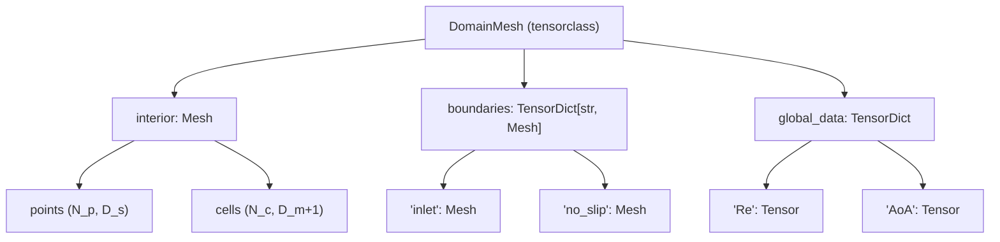
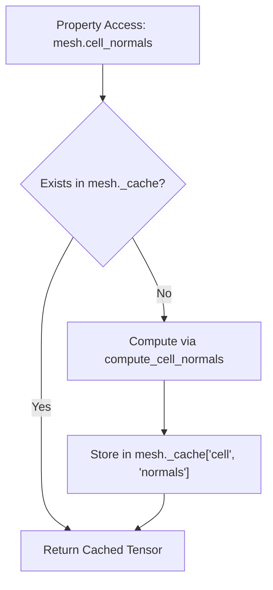

<!-- source: DeepWiki mcp.deepwiki.com · repo NVIDIA/physicsnemo · page 7.1 Mesh Core Data Structures · fetched 2026-10-21 -->

# Mesh Core Data Structures

Relevant source files

The following files were used as context for generating this wiki page:

- [physicsnemo/experimental/models/globe/utilities/__init__.py](physicsnemo/experimental/models/globe/utilities/__init__.py)
- [physicsnemo/experimental/models/globe/utilities/tensordict_utils.py](physicsnemo/experimental/models/globe/utilities/tensordict_utils.py)
- [physicsnemo/mesh/__init__.py](physicsnemo/mesh/__init__.py)
- [physicsnemo/mesh/domain_mesh.py](physicsnemo/mesh/domain_mesh.py)
- [physicsnemo/mesh/fields.py](physicsnemo/mesh/fields.py)
- [physicsnemo/mesh/mesh.py](physicsnemo/mesh/mesh.py)
- [physicsnemo/mesh/transformations/geometric.py](physicsnemo/mesh/transformations/geometric.py)
- [physicsnemo/mesh/utilities/_padding.py](physicsnemo/mesh/utilities/_padding.py)
- [test/mesh/deformation/test_deformation_topology.py](test/mesh/deformation/test_deformation_topology.py)
- [test/mesh/io/io_pyvista/test_pyvista_example_datasets.py](test/mesh/io/io_pyvista/test_pyvista_example_datasets.py)
- [test/mesh/io/io_pyvista/test_to_pyvista_dtypes.py](test/mesh/io/io_pyvista/test_to_pyvista_dtypes.py)
- [test/mesh/mesh/test_compile.py](test/mesh/mesh/test_compile.py)
- [test/mesh/mesh/test_init_validation.py](test/mesh/mesh/test_init_validation.py)
- [test/mesh/mesh/test_padding.py](test/mesh/mesh/test_padding.py)
- [test/mesh/mesh/test_point_normals_weighting.py](test/mesh/mesh/test_point_normals_weighting.py)
- [test/mesh/test_domain_mesh_transforms.py](test/mesh/test_domain_mesh_transforms.py)
- [test/mesh/test_fields.py](test/mesh/test_fields.py)
- [test/mesh/transformations/test_shrinkwrap.py](test/mesh/transformations/test_shrinkwrap.py)
- [test/mesh/transformations/test_transformations.py](test/mesh/transformations/test_transformations.py)
- [test/mesh/utilities/test_cache.py](test/mesh/utilities/test_cache.py)
- [test/mesh/utilities/test_utilities.py](test/mesh/utilities/test_utilities.py)

## Purpose and Scope

This page documents the core data structures of the PhysicsNeMo GPU-accelerated mesh subsystem (`physicsnemo.mesh`). It covers the implementation of the `Mesh` tensorclass, the `DomainMesh` multi-component container, simplicial complex representations, `TensorDict`-backed field management, lazy caching, tensor padding, and `torch.compile` safety guarantees [physicsnemo/mesh/mesh.py:39-144](), [physicsnemo/mesh/domain_mesh.py:37-125](), [test/mesh/mesh/test_compile.py:17-42]().

Sources: [physicsnemo/mesh/mesh.py:39-144](), [physicsnemo/mesh/domain_mesh.py:37-125](), [test/mesh/mesh/test_compile.py:17-42]()

---

## Simplicial Complex and Core Containers (`Mesh` and `DomainMesh`)

The `physicsnemo.mesh` package represents discrete topologies as **simplicial complexes** embedded in Euclidean space [physicsnemo/mesh/mesh.py:136-167](). 

### The `Mesh` Tensorclass
The `Mesh` class is implemented as a PyTorch `tensorclass` (`shadow=True`, `tensor_only=True`), enabling seamless device migration (`.to("cuda")`), cloning, and autograd compatibility [physicsnemo/mesh/mesh.py:134-144](). It stores:
*   `points`: A float tensor of shape `(N_p, n_spatial_dims)` representing vertex coordinates [physicsnemo/mesh/mesh.py:91-93]().
*   `cells`: An integer tensor of shape `(N_c, n_manifold_dims + 1)` defining simplicial connectivity [physicsnemo/mesh/mesh.py:95-98]().

### The `DomainMesh` Container
For multi-region simulations and complex boundary-value problems, `DomainMesh` groups an interior volumetric `Mesh` (or point cloud) with named boundary `Mesh` collections and global simulation parameters [physicsnemo/mesh/domain_mesh.py:37-75]().

*Natural Language Space to Code Entity Space: DomainMesh and Mesh Containment Hierarchy*
Sources: [physicsnemo/mesh/mesh.py:134-144](), [physicsnemo/mesh/domain_mesh.py:37-125]()

---

## Fields and `TensorDict` Integration

Field data on `Mesh` and `DomainMesh` objects is organized into three distinct `TensorDict` attributes corresponding to association levels [physicsnemo/mesh/mesh.py:82-97]().

| Association | Attribute Name | Description | Key Code Reference |
| :--- | :--- | :--- | :--- |
| **Point Data** | `point_data` | Quantities associated with vertices (e.g., temperatures, velocities) | [physicsnemo/mesh/mesh.py:82-88]() |
| **Cell Data** | `cell_data` | Quantities associated with simulation elements (e.g., pressures, material IDs) | [physicsnemo/mesh/mesh.py:82-88]() |
| **Global Data** | `global_data` | Scalar or parameter tensors constant across the entire mesh | [physicsnemo/mesh/mesh.py:82-88]() |

When geometric transformations (such as `rotate`, `scale`, or general affine transforms) are applied, vector and tensor fields in `point_data`, `cell_data`, and `global_data` are automatically transformed according to their tensorial rank using `_transform_tensordict` [physicsnemo/mesh/transformations/geometric.py:47-161](). Scalars are invariant, vectors transform via $v' = v M^T$, and rank-2 tensors transform via $T' = M T M^T$ [physicsnemo/mesh/transformations/geometric.py:88-111]().

Sources: [physicsnemo/mesh/mesh.py:82-97](), [physicsnemo/mesh/transformations/geometric.py:47-161]()

---

## Caching Infrastructure

Computed geometric quantities—such as `cell_areas`, `cell_centroids`, `cell_normals`, and `point_normals`—are managed through a nested `_cache` `TensorDict` inside each `Mesh` instance [physicsnemo/mesh/mesh.py:170-200](), [test/mesh/utilities/test_cache.py:17-21]().

*Natural Language Space to Code Entity Space: Lazy Property Caching Flow in Mesh*
Sources: [physicsnemo/mesh/mesh.py:170-200](), [test/mesh/utilities/test_cache.py:63-90]()

*   **Cache Invalidation**: Topological modifications or coordinate shifts that break geometric assumptions automatically strip or invalidate relevant cache entries in `_cache["cell"]` and `_cache["point"]` [physicsnemo/mesh/transformations/geometric.py:17-28]().
*   **Direct Access**: Downstream code can inspect or override cache entries explicitly via `mesh._cache["cell", "key"]` or `mesh._cache.get(('cell', 'key'), None)` [test/mesh/utilities/test_cache.py:92-132]().

Sources: [physicsnemo/mesh/mesh.py:170-200](), [physicsnemo/mesh/transformations/geometric.py:17-28](), [test/mesh/utilities/test_cache.py:17-132]()

---

## Padding and Batch Alignment

To support static shapes required by CUDA graphs and `torch.compile`, `Mesh` implements padding routines (`pad()` and `pad_to_next_power()`) [test/mesh/mesh/test_padding.py:17-26]().

*   **Points Padding**: Extra points are populated by tiling the last valid point coordinate (`_pad_by_tiling_last`) [physicsnemo/mesh/mesh.py:66](), [test/mesh/mesh/test_padding.py:129-139]().
*   **Cells Padding**: Padded cells reference the index of the last valid point to avoid out-of-bounds indexing errors during kernel execution [test/mesh/mesh/test_padding.py:141-152]().
*   **Data Padding**: `point_data` and `cell_data` entries are padded with `NaN` by default, or with user-specified default values, preserving feature dimension shapes [test/mesh/mesh/test_padding.py:187-197]().

Sources: [physicsnemo/mesh/mesh.py:66](), [test/mesh/mesh/test_padding.py:17-197]()

---

## `torch.Compile` Safety

The `Mesh` tensorclass integrates safely with PyTorch's `torch.compile` and Dynamo tracing. Special care is taken around `@tensorclass` initialization wrappers to ensure `__post_init__` executes correctly during compiled graph construction, avoiding missing `_cache` attributes or schema mismatch regressions [test/mesh/mesh/test_compile.py:17-42]().

*   **Eager vs. Compiled Equivalence**: Cached properties (such as `cell_normals`, `cell_areas`, and `cell_centroids`) can be evaluated inside compiled functions without graph breaks or `AttributeError` exceptions resulting from skipped post-initialization hooks [test/mesh/mesh/test_compile.py:75-104]().
*   **Fullgraph Support**: Local cell geometry computation and cache container rebuild paths support full-graph capture (`fullgraph=True`) [test/mesh/mesh/test_compile.py:158-188]().

Sources: [test/mesh/mesh/test_compile.py:17-188]()

---

