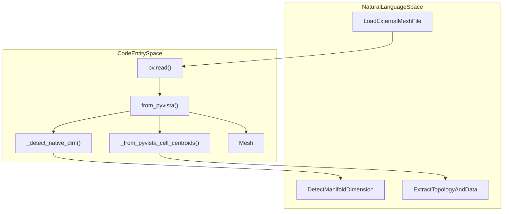
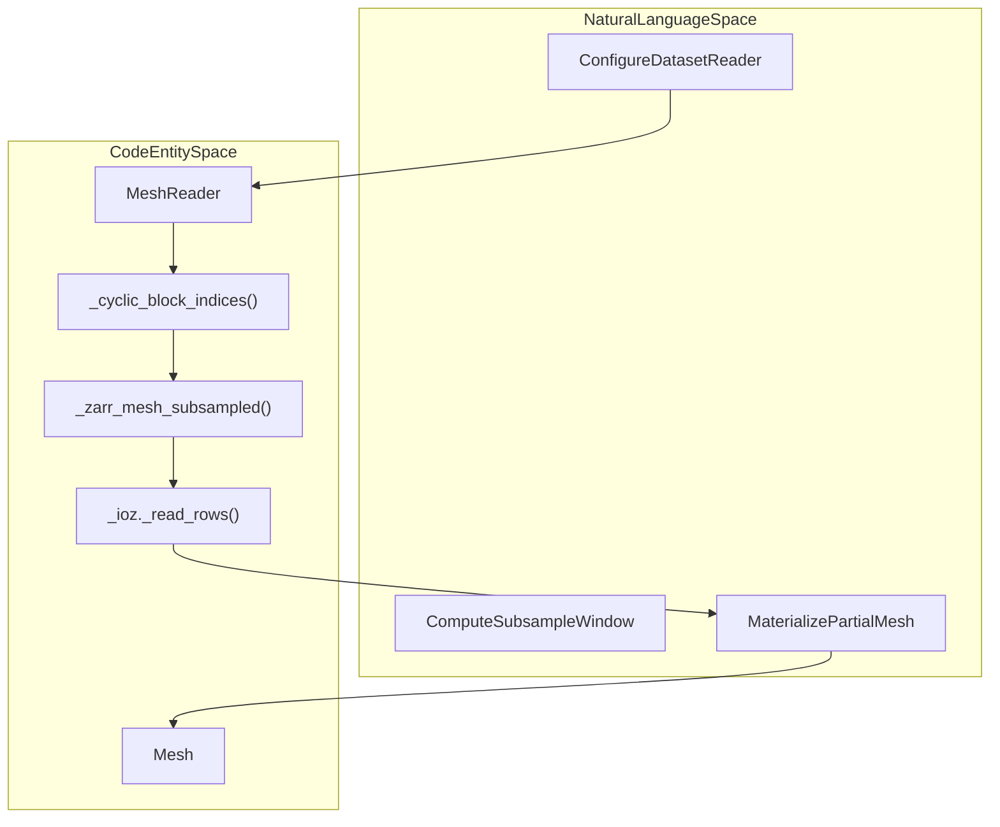

<!-- source: DeepWiki mcp.deepwiki.com · repo NVIDIA/physicsnemo · page 7.3 Mesh I/O and Visualization · fetched 2026-10-21 -->

# Mesh I/O and Visualization

Relevant source files

The following files were used as context for generating this wiki page:

- [docs/api/mesh/boundaries.rst](docs/api/mesh/boundaries.rst)
- [docs/api/mesh/calculus.rst](docs/api/mesh/calculus.rst)
- [docs/api/mesh/curvature.rst](docs/api/mesh/curvature.rst)
- [docs/api/mesh/geometry.rst](docs/api/mesh/geometry.rst)
- [docs/api/mesh/io.rst](docs/api/mesh/io.rst)
- [docs/api/mesh/neighbors.rst](docs/api/mesh/neighbors.rst)
- [physicsnemo/datapipes/readers/mesh.py](physicsnemo/datapipes/readers/mesh.py)
- [physicsnemo/mesh/geometry/_cell_areas.py](physicsnemo/mesh/geometry/_cell_areas.py)
- [physicsnemo/mesh/io/__init__.py](physicsnemo/mesh/io/__init__.py)
- [physicsnemo/mesh/io/io_pyvista.py](physicsnemo/mesh/io/io_pyvista.py)
- [physicsnemo/mesh/io/io_zarr.py](physicsnemo/mesh/io/io_zarr.py)
- [physicsnemo/mesh/sampling/sample_data.py](physicsnemo/mesh/sampling/sample_data.py)
- [physicsnemo/mesh/visualization/_matplotlib_impl.py](physicsnemo/mesh/visualization/_matplotlib_impl.py)
- [physicsnemo/mesh/visualization/_pyvista_impl.py](physicsnemo/mesh/visualization/_pyvista_impl.py)
- [physicsnemo/mesh/visualization/draw_mesh.py](physicsnemo/mesh/visualization/draw_mesh.py)
- [test/mesh/io/io_pyvista/test_data_array_shapes.py](test/mesh/io/io_pyvista/test_data_array_shapes.py)
- [test/mesh/io/io_pyvista/test_data_preservation.py](test/mesh/io/io_pyvista/test_data_preservation.py)
- [test/mesh/io/io_pyvista/test_error_handling.py](test/mesh/io/io_pyvista/test_error_handling.py)
- [test/mesh/io/io_pyvista/test_from_pyvista_0d.py](test/mesh/io/io_pyvista/test_from_pyvista_0d.py)
- [test/mesh/io/io_pyvista/test_from_pyvista_1d.py](test/mesh/io/io_pyvista/test_from_pyvista_1d.py)
- [test/mesh/io/io_pyvista/test_from_pyvista_2d.py](test/mesh/io/io_pyvista/test_from_pyvista_2d.py)
- [test/mesh/io/io_pyvista/test_from_pyvista_3d.py](test/mesh/io/io_pyvista/test_from_pyvista_3d.py)
- [test/mesh/io/io_pyvista/test_generic_cells.py](test/mesh/io/io_pyvista/test_generic_cells.py)
- [test/mesh/io/io_pyvista/test_point_source.py](test/mesh/io/io_pyvista/test_point_source.py)
- [test/mesh/io/io_pyvista/test_round_trip.py](test/mesh/io/io_pyvista/test_round_trip.py)
- [test/mesh/io/io_pyvista/test_to_pyvista.py](test/mesh/io/io_pyvista/test_to_pyvista.py)
- [test/mesh/io/io_zarr/conftest.py](test/mesh/io/io_zarr/conftest.py)
- [test/mesh/io/io_zarr/test_golden_file.py](test/mesh/io/io_zarr/test_golden_file.py)
- [test/mesh/io/io_zarr/test_reader_integration.py](test/mesh/io/io_zarr/test_reader_integration.py)
- [test/mesh/mesh/test_serialization.py](test/mesh/mesh/test_serialization.py)
- [test/mesh/remeshing/__init__.py](test/mesh/remeshing/__init__.py)
- [test/mesh/sampling/test_find_nearest_cells.py](test/mesh/sampling/test_find_nearest_cells.py)
- [test/mesh/sampling/test_sample_data.py](test/mesh/sampling/test_sample_data.py)
- [test/mesh/test_graph_extraction.py](test/mesh/test_graph_extraction.py)
- [test/mesh/visualization/test_visualization.py](test/mesh/visualization/test_visualization.py)
- [test/models/domino/test_domino_encodings.py](test/models/domino/test_domino_encodings.py)
- [test/models/domino/test_domino_geometry_rep.py](test/models/domino/test_domino_geometry_rep.py)
- [test/models/domino/test_domino_mlps.py](test/models/domino/test_domino_mlps.py)
- [test/models/domino/test_domino_solutions.py](test/models/domino/test_domino_solutions.py)

The PhysicsNeMo mesh subsystem provides a high-performance, GPU-accelerated infrastructure for handling unstructured simplicial complexes. This page documents the I/O layer—encompassing PyVista interoperability, Zarr stores, and memmap tensorclass serialization—alongside visualization backends, geometry utilities, and the mesh primitives library.

---

## 1. PyVista-based I/O (`io_pyvista`)

The primary mechanism for importing and exporting standard mesh formats (like `.vtp`, `.vtu`, `.stl`, and `.obj`) is the `physicsnemo.mesh.io.io_pyvista` module. It bridges `physicsnemo.mesh.Mesh` objects (optimized for PyTorch and GPU computation) and PyVista/VTK data structures.

### Lazy Loading and Optional Dependencies
PyVista and VTK are loaded lazily using `OptionalImport` to ensure the core library remains lightweight when visualization extras are omitted [physicsnemo/mesh/io/io_pyvista.py:34-40](). VTK arrays flattened into a single namespace are handled via `/`-separated array naming conventions (e.g., `("solution", "p")` maps to `"solution/p"`), tracked via the `__physicsnemo_nested_keys` marker in field data [physicsnemo/mesh/io/io_pyvista.py:44-58]().

### Data Flow: Natural Language to Code Entities

The following diagram illustrates how external mesh files are ingested and converted into the internal `Mesh` representation.

**Mesh Ingestion Workflow**

Sources: [physicsnemo/mesh/io/io_pyvista.py:31-102](), [physicsnemo/mesh/io/io_pyvista.py:105-131]()

### Key Functions
*   **`from_pyvista`**: Converts a `pyvista.PolyData`, `UnstructuredGrid`, or `PointSet` into a `physicsnemo.mesh.Mesh` [physicsnemo/mesh/io/io_pyvista.py:31-38](). It supports automatic manifold dimension detection (0 for point clouds, 1 for lines, 2 for surfaces, 3 for volumes) [physicsnemo/mesh/io/io_pyvista.py:41-50]().
*   **`to_pyvista`**: Performs the inverse operation, converting a tensor-based `Mesh` into a VTK-compatible PyVista container [physicsnemo/mesh/io/io_pyvista.py:31-38]().
*   **Point Source Control**: Users can specify whether `Mesh` points originate from PyVista vertices or cell centroids via `point_source` parameters [physicsnemo/mesh/io/io_pyvista.py:53-62]().

Sources: [physicsnemo/mesh/io/io_pyvista.py:31-2180](), [test/mesh/io/io_pyvista/test_data_preservation.py:17-176]()

---

## 2. Zarr I/O and Memmap Serialization (`io_zarr` and `.pmsh`)

For cloud-native workflows and large-scale dataset loading, PhysicsNeMo provides Zarr-backed I/O (`physicsnemo.mesh.io.io_zarr`) and tensorclass-based memmap serialization (`.pmsh` for meshes, `.pdmsh` for domain meshes) [physicsnemo/datapipes/readers/mesh.py:17-45]().

### Subsample Push-Down in Mesh Readers
The `MeshReader` and `DomainMeshReader` classes support partial reads from Zarr stores [physicsnemo/datapipes/readers/mesh.py:26-30](). Rather than materializing full datasets into memory before filtering, `_zarr_mesh_subsampled` fetches only the requested cyclic-block row indices, preserving Horvitz-Thompson integration measure weights [physicsnemo/datapipes/readers/mesh.py:91-171]().

### Data Flow: Natural Language to Code Entities

**Zarr Subsample Push-down Workflow**

Sources: [physicsnemo.datapipes.readers.mesh:48-171](), [test/mesh/io/io_zarr/test_reader_integration.py:53-73]()

Sources: [physicsnemo/datapipes/readers/mesh.py:1-712](), [test/mesh/io/io_zarr/test_reader_integration.py:1-111]()

---

## 3. Visualization Backends

PhysicsNeMo supports two primary visualization backends managed via `physicsnemo.mesh.visualization.draw` (`draw_mesh.py`): **PyVista** (interactive 3D rendering) and **Matplotlib** (static and publication-quality figures) [physicsnemo/mesh/visualization/draw_mesh.py:42-57]().

### Backend Capabilities
*   **Automatic Selection (`"auto"`)**: Inspects `mesh.n_spatial_dims`. 0D, 1D, and 2D meshes default to Matplotlib; 3D meshes default to PyVista [physicsnemo/mesh/visualization/draw_mesh.py:69-75]().
*   **Scalar Mapping**: Supports mapping point scalars (`point_scalars`) or cell scalars (`cell_scalars`) directly from `TensorDict` keys or explicit tensors [physicsnemo/mesh/visualization/draw_mesh.py:80-96]().
*   **Matplotlib Backend (`_matplotlib_impl.py`)**: Automatically extracts boundary facets for volumetric meshes using `get_facet_mesh` and uses `PolyCollection` or `LineCollection` for rendering [physicsnemo/mesh/visualization/_matplotlib_impl.py:32-122]().
*   **PyVista Backend (`_pyvista_impl.py`)**: Injects scalar fields directly into VTK dataset attributes and renders points as 3D glyphs/spheres [physicsnemo/mesh/visualization/_pyvista_impl.py:83-186]().

Sources: [physicsnemo/mesh/visualization/draw_mesh.py:1-315](), [test/mesh/visualization/test_visualization.py:17-192]()

---

## 4. Geometry Utilities

The geometry subsystem provides mathematical primitives for computing metric properties (areas, volumes, normals) and solving spatial containment.

### Cell Areas and Normals Summary
Simplicial measurements use dimension-specific optimized branches executing on GPU:

| Manifold Dim | Area / Volume Method | Normal / Tangent Method |
| :--- | :--- | :--- |
| **1 (Edges)** | Vector Norm [physicsnemo/mesh/geometry/_cell_areas.py:102-106]() | 90° CCW Rotation [physicsnemo/mesh/geometry/_cell_normals.py:87-93]() |
| **2 (Triangles)** | Lagrange Identity [physicsnemo/mesh/geometry/_cell_areas.py:109-124]() | Cross Product [physicsnemo/mesh/geometry/_cell_normals.py:96-101]() |
| **3 (Tetrahedra)** | Scalar Triple Product [physicsnemo/mesh/geometry/_cell_areas.py:137-146]() | Codimension-1 Facet Normals [physicsnemo/mesh/geometry/_cell_normals.py:104-135]() |
| **General (n >= 4)** | Gram Determinant [physicsnemo/mesh/geometry/_cell_areas.py:175-186]() | Signed Minor Determinants [physicsnemo/mesh/geometry/_cell_normals.py:104-135]() |

### Spatial Sampling & Barycentric Coordinates
Spatial queries and data sampling are backed by BVH acceleration and barycentric coordinate solvers (`_solve_barycentric_system`) which compute simplex weights and least-squares projections for codimension != 0 manifolds [physicsnemo/mesh/sampling/sample_data.py:19-136]().

Sources: [physicsnemo/mesh/geometry/_cell_areas.py:1-186](), [physicsnemo/mesh/geometry/_cell_normals.py:1-135](), [physicsnemo/mesh/sampling/sample_data.py:1-735]()

---

## 5. Mesh Primitives Library

PhysicsNeMo includes built-in generators for standard geometries and implicit function conversions.

### SDF to STL Conversion
The `sdf_to_stl` utility wraps marching cubes algorithms to extract surface meshes from signed distance functions [physicsnemo/utils/mesh/generate_stl.py:34-43]().
*   **Warp Backend**: Leverages GPU-accelerated `wp.MarchingCubes` [physicsnemo/utils/mesh/generate_stl.py:64-82]().
*   **Scikit-Image Backend**: Fallback CPU implementation via `skimage.measure.marching_cubes` [physicsnemo/utils/mesh/generate_stl.py:84-91]().

Sources: [test/utils/test_mesh_utils.py:1-183]()

---

