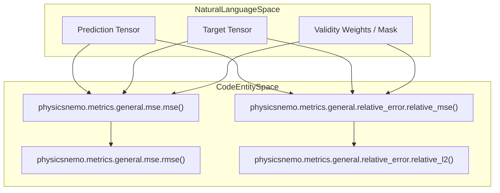
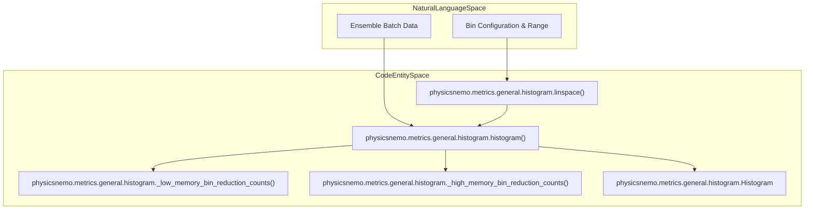

<!-- source: DeepWiki mcp.deepwiki.com · repo NVIDIA/physicsnemo · page 8.1 General Metrics · fetched 2026-10-21 -->

# General Metrics

Relevant source files

The following files were used as context for generating this wiki page:

- [physicsnemo/experimental/datapipes/healda/transforms/obs_features.py](physicsnemo/experimental/datapipes/healda/transforms/obs_features.py)
- [physicsnemo/experimental/datapipes/healda/transforms/obs_features_ext.py](physicsnemo/experimental/datapipes/healda/transforms/obs_features_ext.py)
- [physicsnemo/metrics/general/calibration.py](physicsnemo/metrics/general/calibration.py)
- [physicsnemo/metrics/general/crps.py](physicsnemo/metrics/general/crps.py)
- [physicsnemo/metrics/general/mse.py](physicsnemo/metrics/general/mse.py)
- [physicsnemo/metrics/general/relative_error.py](physicsnemo/metrics/general/relative_error.py)
- [physicsnemo/utils/logging/launch.py](physicsnemo/utils/logging/launch.py)
- [test/core/test_registry.py](test/core/test_registry.py)
- [test/datapipes/healda/test_features.py](test/datapipes/healda/test_features.py)
- [test/metrics/test_metrics_general.py](test/metrics/test_metrics_general.py)
- [test/nn/module/test_interpolation.py](test/nn/module/test_interpolation.py)
- [test/optim/test_combined_optimizer.py](test/optim/test_combined_optimizer.py)
- [test/utils/msc_config_checkpoint.yaml](test/utils/msc_config_checkpoint.yaml)
- [test/utils/msc_config_public_read.yaml](test/utils/msc_config_public_read.yaml)
- [test/utils/test_checkpoint.py](test/utils/test_checkpoint.py)
- [test/utils/test_msc_public_read.py](test/utils/test_msc_public_read.py)

## Purpose and Scope

This page documents the general-purpose statistical, probabilistic, and deterministic evaluation metrics available in PhysicsNeMo under `physicsnemo.metrics.general` and related modules. These metrics are domain-agnostic and support deterministic regression checks (mean squared error and relative errors), histogram binning, probabilistic scoring via CRPS, distributional comparisons (Wasserstein, entropy, calibration), ensemble statistics, and generative/diffusion metrics (FID).

---

## Deterministic Regression Metrics: MSE and Relative Error

PhysicsNeMo provides deterministic regression error functions supporting weighted reductions and optional dimension selection (`physicsnemo/metrics/general/mse.py` [physicsnemo/metrics/general/mse.py:26-113](), `physicsnemo/metrics/general/relative_error.py` [physicsnemo/metrics/general/relative_error.py:95-196]()).

### Key Functions

| Function | Code Entity | Purpose |
| :--- | :--- | :--- |
| `mse` | `physicsnemo.metrics.general.mse.mse` [physicsnemo/metrics/general/mse.py:26-81]() | Computes Mean Squared Error with optional weights and dimension reduction. |
| `rmse` | `physicsnemo.metrics.general.mse.rmse` [physicsnemo/metrics/general/mse.py:83-113]() | Computes Root Mean Squared Error. |
| `relative_mse` | `physicsnemo.metrics.general.relative_error.relative_mse` [physicsnemo/metrics/general/relative_error.py:95-152]() | Target-normalized relative MSE: $\sum (pred - target)^2 / \sum target^2$. |
| `relative_l2` | `physicsnemo.metrics.general.relative_error.relative_l2` [physicsnemo/metrics/general/relative_error.py:154-196]() | Target-normalized relative L2 norm ($\sqrt{\text{relative\_mse}}$). |

### Regression Metric Data Flow

**Sources:** [physicsnemo/metrics/general/mse.py:26-113](), [physicsnemo/metrics/general/relative_error.py:95-196]()

---

## Histogram Computation

The histogram system provides efficient binning and distribution estimation on CPU and GPU [test/metrics/test_metrics_general.py:70-193]().

### Key Components

| Function / Class | Code Entity | Description |
| :--- | :--- | :--- |
| `linspace` | `physicsnemo.metrics.general.histogram.linspace` [test/metrics/test_metrics_general.py:77-77]() | Creates bin edges along a specified shape. |
| `histogram` | `physicsnemo.metrics.general.histogram.histogram` [test/metrics/test_metrics_general.py:92-92]() | Computes multidimensional histogram counts and bins. |
| `Histogram` | `physicsnemo.metrics.general.histogram.Histogram` [test/metrics/test_metrics_general.py:179-179]() | Stateful accumulator for streaming or multi-batch histogram updates. |

### Histogram Architecture and Code Mapping

**Sources:** [test/metrics/test_metrics_general.py:70-193]()

---

## CRPS (Continuous Ranked Probability Score)

CRPS measures probabilistic accuracy between ensemble forecasts and observations [physicsnemo/metrics/general/crps.py:31-94]().

### Computation Methods

| Method | Code Entity | Complexity | Description |
| :--- | :--- | :--- | :--- |
| Kernel CRPS | `physicsnemo.metrics.general.crps.kcrps()` [physicsnemo/metrics/general/crps.py:51-94]() | $O(m \log m)$ | Exact sorted kernel formula supporting biased and unbiased estimators via `_kernel_crps_implementation()` [physicsnemo/metrics/general/crps.py:31-49](). |
| Gaussian CRPS | `physicsnemo.metrics.general.crps._crps_gaussian()` [physicsnemo/metrics/general/crps.py:97-97]() | $O(1)$ | Assumes normal distribution parameterized by mean and standard deviation. |
| CDF CRPS | `physicsnemo.metrics.general.crps._crps_from_cdf()` [physicsnemo/metrics/general/crps.py:159-159]() | $O(B)$ | Integrates squared difference between empirical CDF and observation step function. |

**Sources:** [physicsnemo/metrics/general/crps.py:31-191]()

---

## Wasserstein Distance and Entropy

PhysicsNeMo implements distribution distance metrics and information entropy calculations.

- **Wasserstein Distance:** Computes optimal transport costs from samples, CDFs, or normal distributions (`physicsnemo/metrics/general/wasserstein.py`).
- **Entropy Metrics:** Computes absolute entropy and relative entropy (KL divergence) from histogram counts (`physicsnemo/metrics/general/entropy.py`):
  - `entropy_from_counts(..., normalized=False)` computes $-\sum p \log p$.
  - `relative_entropy_from_counts(p_counts, q_counts, bins)` computes KL divergence $\sum p \log(p/q)$.

**Sources:** [test/metrics/test_metrics_general.py:786-852]()

---

## Calibration and Ensemble Statistics

- **Calibration & RPS:** Evaluates whether predicted probabilities match observed frequencies using rank histograms (`physicsnemo/metrics/general/calibration.py`).
- **Ensemble Statistics:** Maintains running mean and variance across batches using Welford's online algorithm (`physicsnemo/metrics/general/ensemble_metrics.py`) [test/metrics/test_metrics_general.py:614-714]().

**Sources:** [test/metrics/test_metrics_general.py:614-784]()

---

## Diffusion Losses and Generative Metrics

Generative models and diffusion frameworks in PhysicsNeMo utilize specialized loss formulations and evaluation metrics:
- **EDMLoss:** Elucidating the Design Space of Diffusion-Based Generative Models (EDM) loss formulation matching noise schedules and preconditioning.
- **FID (Fréchet Inception Distance):** `calculate_fid_from_inception_stats()` evaluates generated sample quality against reference feature statistics.

**Sources:** [test/metrics/diffusion/test_fid.py:21-33]()

---

