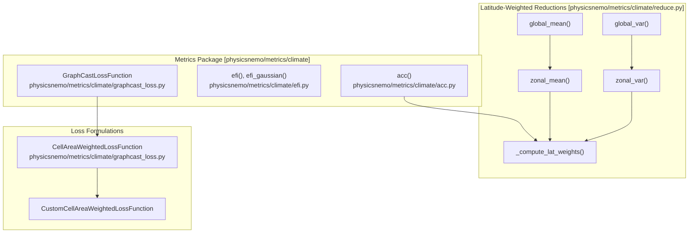
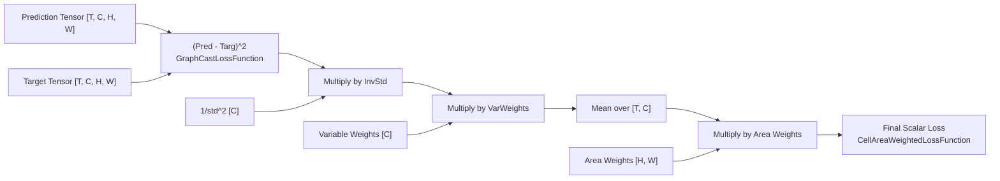

<!-- source: DeepWiki mcp.deepwiki.com · repo NVIDIA/physicsnemo · page 8.2 Climate-Specific Metrics · fetched 2026-10-21 -->

# Climate-Specific Metrics

<details>
<summary>Relevant source files</summary>

The following files were used as context for generating this wiki page:

- [examples/cfd/external_aerodynamics/domino/requirements.txt](examples/cfd/external_aerodynamics/domino/requirements.txt)
- [examples/weather/graphcast/README.md](examples/weather/graphcast/README.md)
- [examples/weather/graphcast/compute_time_diff_std.py](examples/weather/graphcast/compute_time_diff_std.py)
- [examples/weather/graphcast/conf/config.yaml](examples/weather/graphcast/conf/config.yaml)
- [examples/weather/graphcast/data_utils.py](examples/weather/graphcast/data_utils.py)
- [examples/weather/graphcast/requirements.txt](examples/weather/graphcast/requirements.txt)
- [examples/weather/graphcast/train_utils.py](examples/weather/graphcast/train_utils.py)
- [physicsnemo/metrics/climate/graphcast_loss.py](physicsnemo/metrics/climate/graphcast_loss.py)
- [physicsnemo/models/dlwp_healpix/HEALPixRecUNet.py](physicsnemo/models/dlwp_healpix/HEALPixRecUNet.py)
- [physicsnemo/models/dlwp_healpix/HEALPixUNet.py](physicsnemo/models/dlwp_healpix/HEALPixUNet.py)
- [physicsnemo/models/dlwp_healpix/layers/__init__.py](physicsnemo/models/dlwp_healpix/layers/__init__.py)
- [physicsnemo/models/dlwp_healpix/layers/healpix_blocks.py](physicsnemo/models/dlwp_healpix/layers/healpix_blocks.py)
- [physicsnemo/models/dlwp_healpix/layers/healpix_decoder.py](physicsnemo/models/dlwp_healpix/layers/healpix_decoder.py)
- [physicsnemo/models/dlwp_healpix/layers/healpix_encoder.py](physicsnemo/models/dlwp_healpix/layers/healpix_encoder.py)
- [physicsnemo/nn/module/hpx/padding.py](physicsnemo/nn/module/hpx/padding.py)
- [test/metrics/test_healpix_loss.py](test/metrics/test_healpix_loss.py)
- [test/models/dlwp_healpix/test_healpix_blocks.py](test/models/dlwp_healpix/test_healpix_blocks.py)
- [test/models/dlwp_healpix/test_healpix_encoder_decoder.py](test/models/dlwp_healpix/test_healpix_encoder_decoder.py)
- [test/models/dlwp_healpix/test_healpix_layers.py](test/models/dlwp_healpix/test_healpix_layers.py)
- [test/models/dlwp_healpix/test_healpix_recunet_model.py](test/models/dlwp_healpix/test_healpix_recunet_model.py)
- [test/models/dlwp_healpix/test_healpix_unet_model.py](test/models/dlwp_healpix/test_healpix_unet_model.py)
- [test/models/graphcast/test_concat_trick.py](test/models/graphcast/test_concat_trick.py)
- [test/models/graphcast/test_grad_checkpointing.py](test/models/graphcast/test_grad_checkpointing.py)
- [test/models/graphcast/test_graphcast.py](test/models/graphcast/test_graphcast.py)
- [test/models/graphcast/utils.py](test/models/graphcast/utils.py)
- [test/nn/module/test_healpix.py](test/nn/module/test_healpix.py)
- [test/pytest_utils.py](test/pytest_utils.py)

</details>


## Purpose and Scope

This page documents metrics specialized for climate and weather forecasting applications. These metrics account for Earth's spherical geometry through latitude weighting and evaluate forecast quality using domain-specific measures like anomaly correlations, extreme event indices, and specialized loss formulations for models like GraphCast. For general-purpose statistical metrics (CRPS, Wasserstein distance, histogram-based evaluation), see [General Metrics](8.1).

---

## Architecture Overview

Climate-specific metrics extend general statistical measures by incorporating physical properties of atmospheric data, particularly latitude-dependent grid spacing and climatological reference distributions.

Title: Climate Metrics and Loss Function Hierarchy (Natural Language to Code Entity Space)


**Sources**: [test/metrics/test_metrics_climate.py:1-308](), [physicsnemo/metrics/climate/graphcast_loss.py:118-160](), [examples/weather/graphcast/train_utils.py:22-28]()

---

## Anomaly Correlation Coefficient (ACC)

ACC measures the correlation between forecast and target anomalies (deviations from climatology), weighted by latitude to account for reduced grid spacing near the poles. This is a standard verification metric for medium-range weather forecasts.

### Mathematical Formulation

Given predictions $p$, targets $t$, time means $\bar{x}$, and latitude weights $w(\phi)$:

$$\text{ACC} = \frac{\int w(\phi) (p - \bar{x})(t - \bar{x}) \, d\phi \, d\lambda}{\sqrt{\int w(\phi) (p - \bar{x})^2 \, d\phi \, d\lambda} \sqrt{\int w(\phi) (t - \bar{x})^2 \, d\phi \, d\lambda}}$$

where $w(\phi) = \cos(\phi)$ for latitude $\phi$.

### Function Signature

```python
acc(pred: Tensor, targ: Tensor, mean: Tensor, lat: Tensor) -> Tensor
```

| Parameter | Shape | Description |
|-----------|-------|-------------|
| `pred` | `[C, H, W]` or higher | Predicted fields (channels × lat × lon) |
| `targ` | `[C, H, W]` or higher | Target fields (same shape as pred) |
| `mean` | `[C, H, W]` or higher | Climatological time means |
| `lat` | `[H]` | Latitude values in degrees |

**Returns**: Tensor of shape `[C]` containing ACC for each channel.

### Validation Requirements

The function enforces:
- All input tensors must have at least 2 dimensions (spatial fields) [test/metrics/test_metrics_climate.py:74-88]()
- Shape consistency between predictions, targets, and means [test/metrics/test_metrics_climate.py:54-56]()
- Last two dimensions represent latitude and longitude respectively [test/metrics/test_metrics_climate.py:32-46]()

**Sources**: [test/metrics/test_metrics_climate.py:49-106](), [physicsnemo/metrics/climate/acc.py:25]()

---

## Extreme Forecast Index (EFI)

EFI quantifies the shift in a forecast ensemble's probability distribution relative to climatology, highlighting the likelihood of extreme events. It integrates the difference between forecast and climatological CDFs.

### Mathematical Definition

$$\text{EFI} = \frac{2}{\pi} \int_0^1 \left[ \Phi^{-1}(p) - \Phi^{-1}(F_\text{clim}^{-1}(p)) \right] \, dp$$

where $F_\text{clim}$ is the climatological CDF, $\Phi^{-1}$ is the inverse standard normal CDF, and the integral is over cumulative probability.

### Function Variants

#### `efi_gaussian()`

For forecasts with ensemble distributions, using a Gaussian approximation for climatology:

```python
efi.efi_gaussian(
    cdf: Tensor,           # Forecast CDF from histogram
    bin_edges: Tensor,     # Histogram bin edges
    clim_mean: Tensor,     # Climatological mean
    clim_std: Tensor       # Climatological standard deviation
) -> Tensor
```

#### `efi()`

For general distributions with pre-computed climatological CDF:

```python
efi.efi(
    bin_edges: Tensor,     # Histogram bin edges
    pdf: Tensor,           # Forecast PDF (histogram counts)
    clim_cdf: Tensor       # Climatological CDF
) -> Tensor
```

### Expected Value Ranges

- **EFI = 0**: Forecast distribution matches climatology.
- **EFI > 0**: Forecast shifted toward higher values (potential extreme warm/wet event).
- **EFI < 0**: Forecast shifted toward lower values (potential extreme cold/dry event).
- **|EFI| → 1**: Very strong signal for extreme conditions.

**Sources**: [test/metrics/test_metrics_climate.py:251-308](), [physicsnemo/metrics/climate/efi.py:21]()

---

## Latitude-Weighted Reduction Operations

Climate data on regular lat-lon grids requires area weighting because grid cells near the poles cover less surface area than those at the equator. All spatial statistics apply $\cos(\phi)$ weighting.

### Core Weighting Function

The base weighting function `clim_red._compute_lat_weights(lat)` converts latitude degrees to radians and applies cosine weighting:

$$w_i = \frac{\cos(\phi_i)}{\sum_j \cos(\phi_j)}$$

**Sources**: [test/metrics/test_metrics_climate.py:111-121]()

### Zonal Statistics

Zonal operations compute statistics along lines of constant latitude (i.e., longitude circles).

#### Zonal Mean
`clim_red.zonal_mean(x: Tensor, lat: Tensor, dim: int = 1) -> Tensor` computes latitude-weighted mean along the longitude dimension [test/metrics/test_metrics_climate.py:163-170]().

#### Zonal Variance
`clim_red.zonal_var(x: Tensor, lat: Tensor, dim: int = 1, std: bool = False) -> Tensor` computes latitude-weighted variance (or standard deviation) along longitude [test/metrics/test_metrics_climate.py:191-206]().

### Global Statistics

Global operations compute single scalar values representing the entire spatial field, applying both latitude weighting and averaging over all grid points.

#### Global Mean
`clim_red.global_mean(x: Tensor, lat: Tensor) -> Tensor` computes area-weighted mean over all spatial dimensions (both lat and lon). It requires the input `x` to have at least 2 dimensions representing `(lat, lon)` [test/metrics/test_metrics_climate.py:209-222]().

#### Global Variance
`clim_red.global_var(x: Tensor, lat: Tensor, std: bool = False) -> Tensor` computes area-weighted variance over all spatial dimensions [test/metrics/test_metrics_climate.py:224-248]().

**Sources**: [test/metrics/test_metrics_climate.py:111-248]()

---

## Specialized Climate Loss Functions

The codebase provides specialized loss functions for training high-resolution weather models like GraphCast.

Title: GraphCast Loss Data Flow and Code Implementation


### GraphCastLossFunction

This loss function implements the formulation described in the GraphCast paper, combining several weighting schemes:
1. **Inverse Variance Weighting**: Weights variables by the inverse of the standard deviation of their time differences (from `time_diff_std_path`) [physicsnemo/metrics/climate/graphcast_loss.py:148-152]().
2. **Variable Weighting**: Assigns specific weights to different atmospheric and surface variables [physicsnemo/metrics/climate/graphcast_loss.py:154-155]().
3. **Cell Area Weighting**: Multiplies the loss by the normalized grid cell area to account for Earth's geometry [physicsnemo/metrics/climate/graphcast_loss.py:157-159]().

### CellAreaWeightedLossFunction

A simpler variant used when only spatial area weighting is required. It provides a standard implementation [physicsnemo/metrics/climate/graphcast_loss.py:27-58]() and a custom autograd version `CustomCellAreaWeightedLossFunction` [physicsnemo/metrics/climate/graphcast_loss.py:88-115]() for optimized gradient computation.

**Sources**: [physicsnemo/metrics/climate/graphcast_loss.py:27-160](), [examples/weather/graphcast/train_graphcast.py:36-39]()

---

## HEALPix and Grid Utilities

While many models use lat-lon grids, PhysicsNeMo also supports HEALPix grids which offer equal-area partitioning of the sphere.

### Normalized Grid Cell Area
`normalized_grid_cell_area(lat, unit="deg")` computes the area weighting factor for lat-lon grids:
$$\text{Area}(\phi) = \frac{|\cos(\phi)|}{\text{Mean}(|\cos(\phi)|)}$$
This is used during training to ensure the loss is representative of the physical surface area [examples/weather/graphcast/train_utils.py:22-28]().

### Time Difference Statistics
The utility `compute_time_diff_std.py` is used to pre-calculate the standard deviation of normalized per-variable time differences. This is a critical input for the `GraphCastLossFunction` to normalize the contribution of different variables (e.g., temperature vs. humidity) to the total loss [examples/weather/graphcast/compute_time_diff_std.py:62-86]().

**Sources**: [examples/weather/graphcast/train_utils.py:22-28](), [examples/weather/graphcast/compute_time_diff_std.py:1-91]()

---

