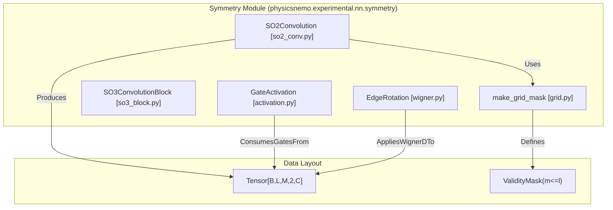
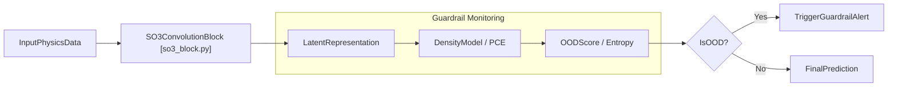

<!-- source: DeepWiki mcp.deepwiki.com · repo NVIDIA/physicsnemo · page 9.2 Experimental Guardrails and Symmetry · fetched 2026-10-21 -->

# Experimental Guardrails and Symmetry

Relevant source files

The following files were used as context for generating this wiki page:

- [docs/api/models/flare.rst](docs/api/models/flare.rst)
- [docs/api/models/geotransolver.rst](docs/api/models/geotransolver.rst)
- [examples/cfd/external_aerodynamics/active_learning_aero/src/conf/model/geotransolver.yaml](examples/cfd/external_aerodynamics/active_learning_aero/src/conf/model/geotransolver.yaml)
- [examples/cfd/external_aerodynamics/transformer_models/src/conf/model/geotransolver.yaml](examples/cfd/external_aerodynamics/transformer_models/src/conf/model/geotransolver.yaml)
- [examples/cfd/external_aerodynamics/unified_external_aero_recipe/conf/model/domino_volume.yaml](examples/cfd/external_aerodynamics/unified_external_aero_recipe/conf/model/domino_volume.yaml)
- [examples/cfd/external_aerodynamics/unified_external_aero_recipe/conf/model/flare_surface.yaml](examples/cfd/external_aerodynamics/unified_external_aero_recipe/conf/model/flare_surface.yaml)
- [examples/cfd/external_aerodynamics/unified_external_aero_recipe/conf/model/flare_volume.yaml](examples/cfd/external_aerodynamics/unified_external_aero_recipe/conf/model/flare_volume.yaml)
- [examples/cfd/external_aerodynamics/unified_external_aero_recipe/conf/model/geotransolver_surface.yaml](examples/cfd/external_aerodynamics/unified_external_aero_recipe/conf/model/geotransolver_surface.yaml)
- [examples/cfd/external_aerodynamics/unified_external_aero_recipe/conf/model/geotransolver_volume.yaml](examples/cfd/external_aerodynamics/unified_external_aero_recipe/conf/model/geotransolver_volume.yaml)
- [examples/cfd/external_aerodynamics/unified_external_aero_recipe/conf/model/geotransolver_volume_highlift.yaml](examples/cfd/external_aerodynamics/unified_external_aero_recipe/conf/model/geotransolver_volume_highlift.yaml)
- [examples/cfd/external_aerodynamics/unified_external_aero_recipe/conf/model/transolver_volume.yaml](examples/cfd/external_aerodynamics/unified_external_aero_recipe/conf/model/transolver_volume.yaml)
- [examples/cfd/external_aerodynamics/unified_external_aero_recipe/tests/test_synthetic_configs.py](examples/cfd/external_aerodynamics/unified_external_aero_recipe/tests/test_synthetic_configs.py)
- [physicsnemo/experimental/models/flare/__init__.py](physicsnemo/experimental/models/flare/__init__.py)
- [physicsnemo/experimental/models/flare/flare.py](physicsnemo/experimental/models/flare/flare.py)
- [physicsnemo/experimental/nn/__init__.py](physicsnemo/experimental/nn/__init__.py)
- [physicsnemo/experimental/nn/symmetry/__init__.py](physicsnemo/experimental/nn/symmetry/__init__.py)
- [physicsnemo/experimental/nn/symmetry/activation.py](physicsnemo/experimental/nn/symmetry/activation.py)
- [physicsnemo/experimental/nn/symmetry/grid.py](physicsnemo/experimental/nn/symmetry/grid.py)
- [physicsnemo/experimental/nn/symmetry/so2_conv.py](physicsnemo/experimental/nn/symmetry/so2_conv.py)
- [test/experimental/__init__.py](test/experimental/__init__.py)
- [test/experimental/models/__init__.py](test/experimental/models/__init__.py)
- [test/experimental/nn/__init__.py](test/experimental/nn/__init__.py)
- [test/experimental/nn/symmetry/__init__.py](test/experimental/nn/symmetry/__init__.py)
- [test/experimental/nn/symmetry/test_activation.py](test/experimental/nn/symmetry/test_activation.py)
- [test/experimental/nn/symmetry/test_so2_conv.py](test/experimental/nn/symmetry/test_so2_conv.py)
- [test/models/flare/test_flare.py](test/models/flare/test_flare.py)

This page documents the experimental geometry-based guardrails for Out-of-Distribution (OOD) detection, the SO(2)/SO(3) equivariant neural network layers (`physicsnemo.experimental.nn.symmetry`), and the experimental namespace conventions used across the codebase [physicsnemo/experimental/nn/__init__.py:17-22](), [physicsnemo/experimental/nn/symmetry/__init__.py:22-30]().

## Experimental Namespace Conventions

All experimental features are housed under `physicsnemo.experimental`. Users importing from this namespace will receive warnings for unstable APIs, allowing rapid iteration on novel physics-informed architectures—such as symmetry-equivariant layers—before stabilization in `physicsnemo.nn` or `physicsnemo.models` [physicsnemo/experimental/nn/__init__.py:17-22]().

Sources: [physicsnemo/experimental/nn/__init__.py:17-22](), [physicsnemo/experimental/nn/symmetry/__init__.py:22-30]()

## Symmetry-Equivariant Layers

The `physicsnemo.experimental.nn.symmetry` module provides specialized layers for building SO(2) and SO(3) equivariant neural networks that process spherical harmonic representations using a high-performance grid layout [physicsnemo.experimental.nn.symmetry.__init__.py:22-30]().

### Grid Layout for Spherical Harmonics
To enable efficient GPU parallelization, spherical harmonic coefficients are arranged in a regular 2D tensor indexed by degree ($l$) and order ($m$) [physicsnemo/experimental/nn/symmetry/grid.py:22-27](). Since a coefficient $Y_l^m$ only exists when $|m| \le l$, a boolean mask is used to identify valid positions [physicsnemo/experimental/nn/symmetry/grid.py:57-63]().

| Feature | Implementation Detail |
| :--- | :--- |
| **Storage** | Regular 2D Tensor $[l_{max}+1, m_{max}+1]$ |
| **Masking** | `make_grid_mask` generates `mask[l, m] = (m <= l)` [physicsnemo/experimental/nn/symmetry/grid.py:106-110]() |
| **Efficiency** | Replaces Python loops with vectorized operations [physicsnemo/experimental/nn/symmetry/so2_conv.py:36-40]() |

### SO(2) Equivariant Convolution
The `SO2Convolution` layer performs linear transformations on spherical harmonic coefficients while preserving SO(2) equivariance [physicsnemo/experimental/nn/symmetry/so2_conv.py:128-133]().

**Key Components:**
*   **Complex Weights:** Uses real and imaginary components to represent complex linear transformations [physicsnemo/experimental/nn/symmetry/so2_conv.py:169-174]().
*   **Edge Modulation:** Optionally accepts `edge_channels` to modulate features based on geometric information using an internal Radial MLP [physicsnemo/experimental/nn/symmetry/so2_conv.py:153-158]().
*   **Gate Production:** Can produce additional channels at the $(l=0, m=0)$ position to serve as invariant gates for non-linear activations [physicsnemo/experimental/nn/symmetry/so2_conv.py:159-165]().

### Gated Activations
Equivariance is maintained by applying standard non-linearities only to scalars ($l=0$) and using learned, invariant gates to scale higher-order features ($l>0$) [physicsnemo/experimental/nn/symmetry/activation.py:24-27]().

**Data Flow in `GateActivation`:**
1.  **Extract Gates:** Gates are sliced from the $(l=0, m=0, real=0)$ position of the input tensor [physicsnemo/experimental/nn/symmetry/activation.py:114-117]().
2.  **Apply SiLU:** The $l=0$ feature channels receive a pointwise SiLU activation [physicsnemo/experimental/nn/symmetry/activation.py:58-59]().
3.  **Scale $l>0$:** Higher-order degrees are multiplied by `sigmoid(gates)` [physicsnemo/experimental/nn/symmetry/activation.py:60-63]().

### Equivariant Normalization
The module includes several normalization strategies for spherical harmonic features:
*   `EquivariantRMSNorm`: RMS normalization with global scaling [physicsnemo/experimental/nn/symmetry/__init__.py:39-40]().
*   `EquivariantLayerNorm`: Per-degree normalization with independent scaling for each $l$ [physicsnemo/experimental/nn/symmetry/__init__.py:43-44]().
*   `EquivariantLayerNormTied`: Shared global scaling for $l>0$ with degree balancing weights [physicsnemo/experimental/nn/symmetry/__init__.py:41-42]().

### Symmetry Component Architecture
The following diagram bridges natural language concepts to code entities within the symmetry-equivariant module.

Title: Symmetry Neural Network Entity Map

Sources: [physicsnemo/experimental/nn/symmetry/__init__.py:22-54](), [physicsnemo/experimental/nn/symmetry/activation.py:54-65](), [physicsnemo/experimental/nn/symmetry/so2_conv.py:128-140](), [physicsnemo/experimental/nn/symmetry/grid.py:56-74]()

## Experimental Guardrails and OOD Detection

The framework includes experimental geometry-based guardrails for detecting Out-of-Distribution (OOD) samples in safety-critical physics simulations.

### Implementation Patterns
1.  **Density Models:** Estimating training data density in latent spaces.
2.  **Polynomial Chaos Expansion (PCE):** Using PCE for uncertainty quantification and OOD scoring.
3.  **Gaussian Mixture Models (GMM):** Clustering latent representations to identify anomalies.

### Guardrail Data Flow
The diagram below bridges natural language guardrail concepts to the experimental pipeline implementation.

Title: Experimental Guardrail Pipeline
2. OOD Detection Data Flow

Sources: [physicsnemo/experimental/nn/symmetry/so3_block.py:37-39](), [physicsnemo/experimental/nn/symmetry/__init__.py:22-54]()

## Numerical Precision and Testing
Symmetry-equivariant operations, particularly Wigner D-matrix computations in `EdgeRotation`, are sensitive to floating-point precision [test/experimental/nn/symmetry/conftest.py:23-26]().

*   **Half-Precision:** `float16` and `bfloat16` are supported but may exhibit orthogonality errors at high $l_{max}$ [test/experimental/nn/symmetry/conftest.py:28-30]().
*   **Tolerances:** The testing suite uses `get_rtol_atol` to scale verification thresholds based on `torch.dtype` [test/experimental/nn/symmetry/conftest.py:67-73]().
*   **Equivariance Checks:** Unit tests verify SO(2) and SO(3) equivariance by applying spatial rotations to inputs and comparing against rotated outputs [test/experimental/nn/symmetry/test_activation.py:32-33]().

Sources: [test/experimental/nn/symmetry/conftest.py:17-34](), [test/experimental/nn/symmetry/test_activation.py:22-33](), [test/experimental/nn/symmetry/test_so2_conv.py:22-46]()

---

