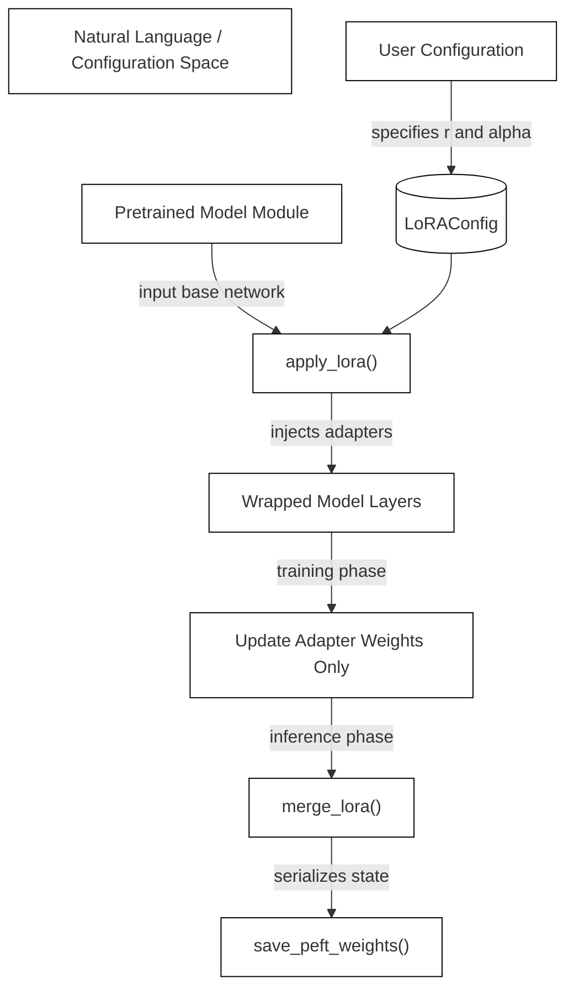
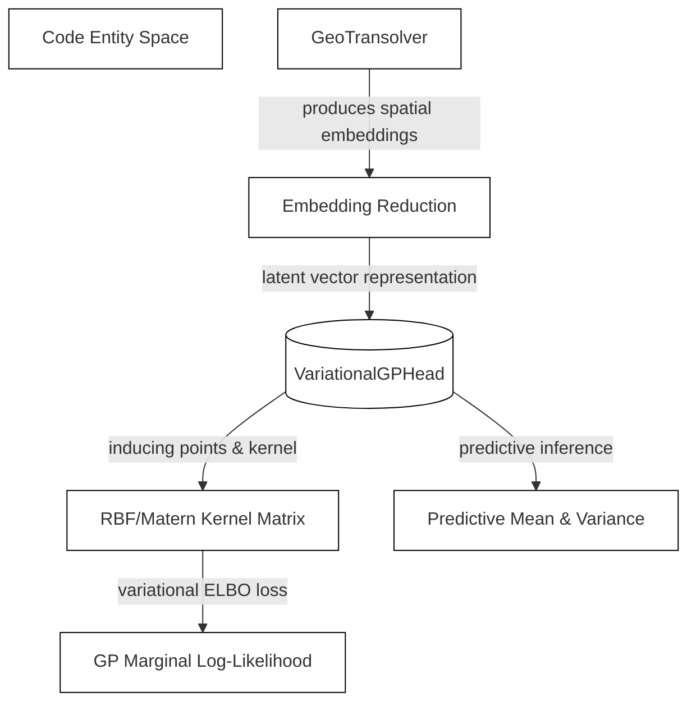
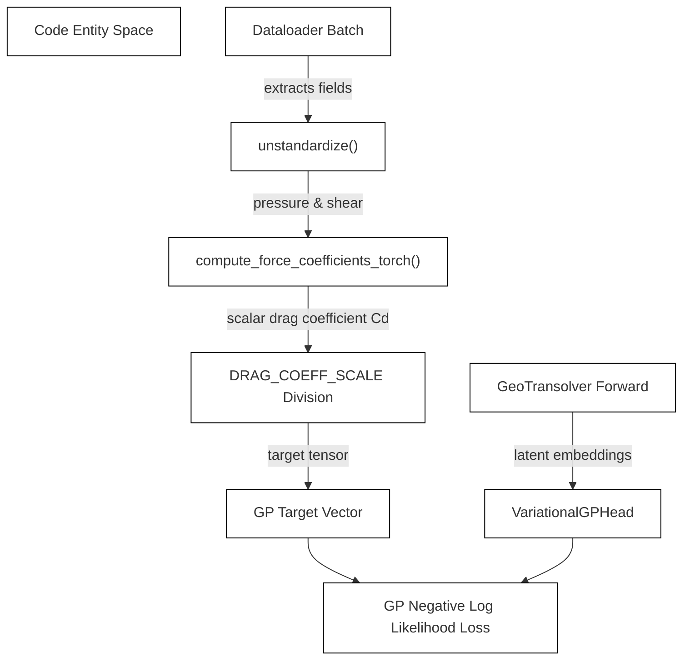

<!-- source: DeepWiki mcp.deepwiki.com · repo NVIDIA/physicsnemo · page 9.3 PEFT and Uncertainty Quantification · fetched 2026-10-21 -->

# PEFT and Uncertainty Quantification

Relevant source files

The following files were used as context for generating this wiki page:

- [docs/api/models/flare.rst](docs/api/models/flare.rst)
- [docs/api/models/geotransolver.rst](docs/api/models/geotransolver.rst)
- [docs/img/kde_id_vs_ood.png](docs/img/kde_id_vs_ood.png)
- [examples/cfd/external_aerodynamics/active_learning_aero/src/conf/model/geotransolver.yaml](examples/cfd/external_aerodynamics/active_learning_aero/src/conf/model/geotransolver.yaml)
- [examples/cfd/external_aerodynamics/transformer_models/README.md](examples/cfd/external_aerodynamics/transformer_models/README.md)
- [examples/cfd/external_aerodynamics/transformer_models/src/conf/data/core.yaml](examples/cfd/external_aerodynamics/transformer_models/src/conf/data/core.yaml)
- [examples/cfd/external_aerodynamics/transformer_models/src/conf/geotransolver_surface_gp.yaml](examples/cfd/external_aerodynamics/transformer_models/src/conf/geotransolver_surface_gp.yaml)
- [examples/cfd/external_aerodynamics/transformer_models/src/conf/model/geotransolver.yaml](examples/cfd/external_aerodynamics/transformer_models/src/conf/model/geotransolver.yaml)
- [examples/cfd/external_aerodynamics/transformer_models/src/gp_utils.py](examples/cfd/external_aerodynamics/transformer_models/src/gp_utils.py)
- [examples/cfd/external_aerodynamics/transformer_models/src/plot_embeddings.py](examples/cfd/external_aerodynamics/transformer_models/src/plot_embeddings.py)
- [examples/cfd/external_aerodynamics/transformer_models/src/plot_gp_predictions.py](examples/cfd/external_aerodynamics/transformer_models/src/plot_gp_predictions.py)
- [examples/cfd/external_aerodynamics/transformer_models/src/train.py](examples/cfd/external_aerodynamics/transformer_models/src/train.py)
- [examples/cfd/external_aerodynamics/transformer_models/src/train_gp_combined.py](examples/cfd/external_aerodynamics/transformer_models/src/train_gp_combined.py)
- [examples/cfd/external_aerodynamics/unified_external_aero_recipe/conf/model/domino_volume.yaml](examples/cfd/external_aerodynamics/unified_external_aero_recipe/conf/model/domino_volume.yaml)
- [examples/cfd/external_aerodynamics/unified_external_aero_recipe/conf/model/flare_surface.yaml](examples/cfd/external_aerodynamics/unified_external_aero_recipe/conf/model/flare_surface.yaml)
- [examples/cfd/external_aerodynamics/unified_external_aero_recipe/conf/model/flare_volume.yaml](examples/cfd/external_aerodynamics/unified_external_aero_recipe/conf/model/flare_volume.yaml)
- [examples/cfd/external_aerodynamics/unified_external_aero_recipe/conf/model/geotransolver_surface.yaml](examples/cfd/external_aerodynamics/unified_external_aero_recipe/conf/model/geotransolver_surface.yaml)
- [examples/cfd/external_aerodynamics/unified_external_aero_recipe/conf/model/geotransolver_volume.yaml](examples/cfd/external_aerodynamics/unified_external_aero_recipe/conf/model/geotransolver_volume.yaml)
- [examples/cfd/external_aerodynamics/unified_external_aero_recipe/conf/model/geotransolver_volume_highlift.yaml](examples/cfd/external_aerodynamics/unified_external_aero_recipe/conf/model/geotransolver_volume_highlift.yaml)
- [examples/cfd/external_aerodynamics/unified_external_aero_recipe/conf/model/transolver_volume.yaml](examples/cfd/external_aerodynamics/unified_external_aero_recipe/conf/model/transolver_volume.yaml)
- [examples/cfd/external_aerodynamics/unified_external_aero_recipe/tests/test_synthetic_configs.py](examples/cfd/external_aerodynamics/unified_external_aero_recipe/tests/test_synthetic_configs.py)
- [physicsnemo/experimental/models/flare/__init__.py](physicsnemo/experimental/models/flare/__init__.py)
- [physicsnemo/experimental/models/flare/flare.py](physicsnemo/experimental/models/flare/flare.py)
- [physicsnemo/experimental/nn/__init__.py](physicsnemo/experimental/nn/__init__.py)
- [physicsnemo/experimental/uq/__init__.py](physicsnemo/experimental/uq/__init__.py)
- [physicsnemo/experimental/uq/variational_gp_head.py](physicsnemo/experimental/uq/variational_gp_head.py)
- [test/experimental/models/__init__.py](test/experimental/models/__init__.py)
- [test/models/flare/test_flare.py](test/models/flare/test_flare.py)

## Purpose and Scope

This page documents PhysicsNeMo's experimental feature namespaces for Parameter-Efficient Fine-Tuning (`physicsnemo.experimental.peft`) and Uncertainty Quantification (`physicsnemo.experimental.uq`). These modules provide tools for adapting large-scale physics surrogate models with minimal trainable parameters and evaluating epistemic/aleatoric uncertainty using variational Gaussian Process (GP) heads and Dropout techniques. The architectural concepts are illustrated via the external aerodynamics transformer models and Gaussian Process integration workflows (`examples/cfd/external_aerodynamics/transformer_models/`) [examples/cfd/external_aerodynamics/transformer_models/README.md]().

Sources:
- `examples/cfd/external_aerodynamics/transformer_models/README.md` [examples/cfd/external_aerodynamics/transformer_models/README.md:1-767]()

---

## 1. Parameter-Efficient Fine-Tuning (PEFT) (`physicsnemo.experimental.peft`)

Parameter-Efficient Fine-Tuning (PEFT) allows adapting large pretrained neural operators and transformer backbones (such as `Transolver` and `GeoTransolver`) without updating all model weights. The PEFT subsystem in `physicsnemo.experimental.peft` provides Low-Rank Adaptation (LoRA) mechanisms tailored for physics surrogate models.

### LoRA Configuration and Layer Injection

The PEFT module relies on configuration classes to specify rank ($r$), scaling factors ($\alpha$), target modules, and dropout rates.

| Component / Function | Role / Description |
| :--- | :--- |
| `LoRAConfig` | Configuration data class defining rank, alpha, target projection matrices, and dropout. |
| `apply_lora(model, config)` | Traverses the model hierarchy, replacing standard linear layers with LoRA-wrapped linear layers. |
| `merge_lora(model)` | Fuses LoRA adapter weights back into the base linear layer weights for zero-overhead inference. |
| `save_peft_weights` / `load_peft_weights` | IO utilities for serializing exclusively the low-rank adapter parameters. |

**Figure 1**: PEFT architecture bridging configuration settings (`LoRAConfig`) to model adaptation and weight merging (`apply_lora`, `merge_lora`).

Sources:
- `examples/cfd/external_aerodynamics/transformer_models/README.md` [examples/cfd/external_aerodynamics/transformer_models/README.md:50-75]()

---

## 2. Uncertainty Quantification (`physicsnemo.experimental.uq`)

The uncertainty quantification namespace `physicsnemo.experimental.uq` supplies probabilistic heads and Bayesian approximation layers designed to quantify prediction confidence in safety-critical physics domains (e.g., aerodynamic drag estimation).

### Variational GP Head (`VariationalGPHead`)

The core primitive for non-parametric uncertainty estimation is `VariationalGPHead`, located in `physicsnemo.experimental.uq.variational_gp_head`. It implements sparse variational Gaussian process regression on top of deterministic neural network embeddings.

| Class / Function | Module Path | Role |
| :--- | :--- | :--- |
| `VariationalGPHead` | `physicsnemo.experimental.uq.variational_gp_head` | Sparse variational Gaussian Process head with learnable inducing points. |
| `__init__` | `physicsnemo.experimental.uq.variational_gp_head` | Initializes variational parameters, kernel functions, and prior covariance. |
| `forward` | `physicsnemo.experimental.uq.variational_gp_head` | Computes predictive mean and predictive covariance (variance) for given input features. |

**Figure 2**: Data flow from `GeoTransolver` features through `VariationalGPHead` to yield predictive uncertainty bounds and marginal log-likelihood optimization.

Sources:
- `physicsnemo/experimental/uq/__init__.py` [physicsnemo/experimental/uq/__init__.py:1-25]()
- `physicsnemo/experimental/uq/variational_gp_head.py` [physicsnemo/experimental/uq/variational_gp_head.py:1-120]()
- `examples/cfd/external_aerodynamics/transformer_models/src/gp_utils.py` [examples/cfd/external_aerodynamics/transformer_models/src/gp_utils.py:45-55]()

---

## 3. Transformer Models GP Example & Aerodynamic Workflow

The transformer models for external aerodynamics (`examples/cfd/external_aerodynamics/transformer_models/`) combine `GeoTransolver` with `VariationalGPHead` to predict aerodynamic coefficients (such as drag coefficient $C_d$) alongside epistemic uncertainty bounds [examples/cfd/external_aerodynamics/transformer_models/README.md]() [examples/cfd/external_aerodynamics/transformer_models/src/gp_utils.py]().

### Aerodynamic Force Integration and Target Extraction

To train the Gaussian Process head on integral quantities rather than pointwise fields alone, the pipeline computes surface force coefficients from predicted pressure ($p$) and wall shear stress ($\tau_w$) fields.

| Utility Function | File Path | Description |
| :--- | :--- | :--- |
| `compute_force_coefficients_torch` | `examples/cfd/external_aerodynamics/transformer_models/src/gp_utils.py` | Integrates pressure and shear stress over surface mesh normals and areas to compute $C_d$, $C_p$, and $C_f$. |
| `compute_drag_target_from_batch` | `examples/cfd/external_aerodynamics/transformer_models/src/gp_utils.py` | Unnormalizes dataloader batch fields, extracts surface geometry, and computes the scaled GP drag target. |
| `compute_drag_from_subsampled_outputs` | `examples/cfd/external_aerodynamics/transformer_models/src/gp_utils.py` | Monte-Carlo drag estimator preserving gradients through `GeoTransolver` outputs. |

**Figure 3**: Integration workflow combining `GeoTransolver` representations with force coefficient integration (`compute_force_coefficients_torch`) to supervise `VariationalGPHead`.

Sources:
- `examples/cfd/external_aerodynamics/transformer_models/src/gp_utils.py` [examples/cfd/external_aerodynamics/transformer_models/src/gp_utils.py:60-188]()

---

