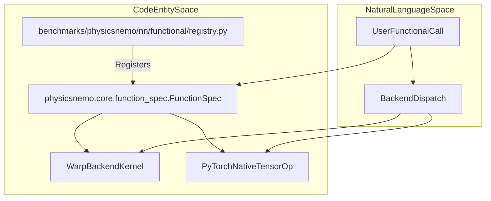
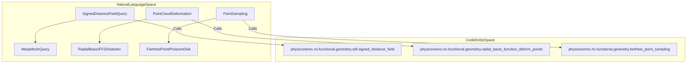

<!-- source: DeepWiki mcp.deepwiki.com · repo NVIDIA/physicsnemo · extra page Functional API (physicsnemo.nn.functional) · fetched 2026-10-21 -->

# Functional API (physicsnemo.nn.functional)

Relevant source files

The following files were used as context for generating this wiki page:

- [benchmarks/physicsnemo/nn/functional/registry.py](benchmarks/physicsnemo/nn/functional/registry.py)
- [docs/api/mesh/spatial.rst](docs/api/mesh/spatial.rst)
- [docs/api/mesh/transformations.rst](docs/api/mesh/transformations.rst)
- [docs/api/nn/functionals/geometry.rst](docs/api/nn/functionals/geometry.rst)
- [docs/api/nn/functionals/normalization.rst](docs/api/nn/functionals/normalization.rst)
- [docs/api/physicsnemo.nn.functionals.rst](docs/api/physicsnemo.nn.functionals.rst)
- [docs/img/nn/functional/geometry/mesh_poisson_disk_sample/mesh_poisson_modes.gif](docs/img/nn/functional/geometry/mesh_poisson_disk_sample/mesh_poisson_modes.gif)
- [docs/img/nn/functional/geometry/mesh_to_voxel_fraction/mesh_to_voxel_rotation.gif](docs/img/nn/functional/geometry/mesh_to_voxel_fraction/mesh_to_voxel_rotation.gif)
- [docs/img/nn/functional/geometry/sdf/sdf_slice_overview.png](docs/img/nn/functional/geometry/sdf/sdf_slice_overview.png)
- [docs/img/nn/functional/geometry/sdf/sdf_slice_sweep.gif](docs/img/nn/functional/geometry/sdf/sdf_slice_sweep.gif)
- [examples/cfd/external_aerodynamics/unified_external_aero_recipe/src/sdf.py](examples/cfd/external_aerodynamics/unified_external_aero_recipe/src/sdf.py)
- [examples/cfd/external_aerodynamics/unified_external_aero_recipe/tests/test_sdf_transform.py](examples/cfd/external_aerodynamics/unified_external_aero_recipe/tests/test_sdf_transform.py)
- [physicsnemo/core/function_spec.py](physicsnemo/core/function_spec.py)
- [physicsnemo/datapipes/cae/transolver_datapipe.py](physicsnemo/datapipes/cae/transolver_datapipe.py)
- [physicsnemo/datapipes/transforms/geometric.py](physicsnemo/datapipes/transforms/geometric.py)
- [physicsnemo/domain_parallel/shard_utils/mesh_ops.py](physicsnemo/domain_parallel/shard_utils/mesh_ops.py)
- [physicsnemo/mesh/README.md](physicsnemo/mesh/README.md)
- [physicsnemo/mesh/geometry/_cell_normals.py](physicsnemo/mesh/geometry/_cell_normals.py)
- [physicsnemo/mesh/remeshing/_partition.py](physicsnemo/mesh/remeshing/_partition.py)
- [physicsnemo/mesh/spatial/__init__.py](physicsnemo/mesh/spatial/__init__.py)
- [physicsnemo/mesh/spatial/sdf.py](physicsnemo/mesh/spatial/sdf.py)
- [physicsnemo/mesh/transformations/deform/__init__.py](physicsnemo/mesh/transformations/deform/__init__.py)
- [physicsnemo/nn/functional/__init__.py](physicsnemo/nn/functional/__init__.py)
- [physicsnemo/nn/functional/derivatives/mesh_green_gauss_gradient/_warp_impl.py](physicsnemo/nn/functional/derivatives/mesh_green_gauss_gradient/_warp_impl.py)
- [physicsnemo/nn/functional/derivatives/mesh_lsq_gradient/_warp_impl.py](physicsnemo/nn/functional/derivatives/mesh_lsq_gradient/_warp_impl.py)
- [physicsnemo/nn/functional/derivatives/uniform_grid_gradient/_warp_impl/utils.py](physicsnemo/nn/functional/derivatives/uniform_grid_gradient/_warp_impl/utils.py)
- [physicsnemo/nn/functional/geometry/__init__.py](physicsnemo/nn/functional/geometry/__init__.py)
- [physicsnemo/nn/functional/geometry/deform/__init__.py](physicsnemo/nn/functional/geometry/deform/__init__.py)
- [physicsnemo/nn/functional/geometry/deform/_warp_impl/__init__.py](physicsnemo/nn/functional/geometry/deform/_warp_impl/__init__.py)
- [physicsnemo/nn/functional/geometry/farthest_point_sampling/_warp_impl.py](physicsnemo/nn/functional/geometry/farthest_point_sampling/_warp_impl.py)
- [physicsnemo/nn/functional/geometry/mesh_poisson_disk_sample/__init__.py](physicsnemo/nn/functional/geometry/mesh_poisson_disk_sample/__init__.py)
- [physicsnemo/nn/functional/geometry/mesh_poisson_disk_sample/_warp_impl/__init__.py](physicsnemo/nn/functional/geometry/mesh_poisson_disk_sample/_warp_impl/__init__.py)
- [physicsnemo/nn/functional/geometry/mesh_poisson_disk_sample/_warp_impl/_kernels.py](physicsnemo/nn/functional/geometry/mesh_poisson_disk_sample/_warp_impl/_kernels.py)
- [physicsnemo/nn/functional/geometry/mesh_poisson_disk_sample/_warp_impl/op.py](physicsnemo/nn/functional/geometry/mesh_poisson_disk_sample/_warp_impl/op.py)
- [physicsnemo/nn/functional/geometry/mesh_to_voxel_fraction/_warp_impl/op.py](physicsnemo/nn/functional/geometry/mesh_to_voxel_fraction/_warp_impl/op.py)
- [physicsnemo/nn/functional/geometry/sdf.py](physicsnemo/nn/functional/geometry/sdf.py)
- [physicsnemo/nn/functional/neighbors/radius_search/_warp_impl.py](physicsnemo/nn/functional/neighbors/radius_search/_warp_impl.py)
- [physicsnemo/nn/functional/normalization.py](physicsnemo/nn/functional/normalization.py)
- [test/core/test_function_spec.py](test/core/test_function_spec.py)
- [test/mesh/geometry/test_cell_normals.py](test/mesh/geometry/test_cell_normals.py)
- [test/mesh/remeshing/test_partition.py](test/mesh/remeshing/test_partition.py)
- [test/mesh/spatial/test_mesh_sdf.py](test/mesh/spatial/test_mesh_sdf.py)
- [test/nn/functional/geometry/test_sdf.py](test/nn/functional/geometry/test_sdf.py)

## Purpose and Scope

The `physicsnemo.nn.functional` package provides a collection of stateless, high-performance, GPU-accelerated functionals designed following the `torch.nn.functional` convention [docs/api/physicsnemo.nn.functionals.rst:4-7](). These primitives serve as building blocks for physics-informed neural networks, neural operators, simulation data pipelines, and mesh processing routines. 

The scope encompasses differential calculus operators on grids and meshes, spatial geometry operations (signed distance fields, point cloud sampling, mesh deformations, remeshing), neighborhood queries (KNN and radius search), multidimensional interpolation, Fourier spectral transforms, normalization utilities, and scientific rendering wrappers. Execution is dual-backed by native PyTorch operations and NVIDIA Warp kernels, managed via a unified `FunctionSpec` and benchmarking registry pattern.

Sources: `physicsnemo/nn/functional/__init__.py:1-144](), [docs/api/physicsnemo.nn.functionals.rst:1-29]()

---

## Backend Integration and `FunctionSpec` Architecture

Functionals in `physicsnemo.nn.functional` abstract hardware-accelerated kernels (such as NVIDIA Warp CUDA code and optimized PyTorch routines) behind uniform Python interfaces. The execution framework relies on `FunctionSpec` to wrap forward and backward execution passes, enabling stream-safe CUDA kernel launches, auto-differentiation compatibility, and benchmarking integration.

*Figure 1: Architecture bridging functional calls to `FunctionSpec` and registered backends.*

Sources: `benchmarks/physicsnemo/nn/functional/registry.py:1-123](), [physicsnemo/mesh/spatial/sdf.py:19-30]()

---

## Derivatives and Differential Operators

The package provides discrete differential operators operating across structured grids, rectilinear grids, spectral domains, and unstructured simplicial meshes [physicsnemo/nn/functional/__init__.py:17-30]().

### Grid and Spectral Derivatives
- **Uniform Grid Operations**: `uniform_grid_gradient`, `uniform_grid_divergence`, `uniform_grid_curl`, and `uniform_grid_laplacian` compute finite-difference operators on regular structured grids.
- **Rectilinear Grid Operations**: `rectilinear_grid_gradient`, `rectilinear_grid_divergence`, `rectilinear_grid_curl`, and `rectilinear_grid_laplacian` support variable spacing along orthogonal axes.
- **Spectral Derivatives**: `spectral_grid_gradient` computes gradients directly in the frequency domain via Fourier multipliers.

### Unstructured Mesh Derivatives
- **Least-Squares Gradient**: `mesh_lsq_gradient` computes vertex or cell gradients using local least-squares linear fits over neighbor rings.
- **Green-Gauss Gradient**: `mesh_green_gauss_gradient` applies the divergence theorem over control volumes around mesh cells or vertices.
- **Meshless Finite Differences**: `meshless_fd_derivatives` computes derivative stencils for scattered point clouds using localized weighted least squares.
- **Cell Normals**: `compute_cell_normals` computes unit normal vectors for codimension-1 simplicial meshes using specialized branches for 2D rotations, 3D cross products, and general $d \ge 4$ signed minor determinants (Hodge star), disabling autocast for matrix determinants [physicsnemo/mesh/geometry/_cell_normals.py:17-32]().

Sources: `physicsnemo/nn/functional/__init__.py:17-30](), [physicsnemo/mesh/geometry/_cell_normals.py:1-144]()

---

## Geometry Operations: SDF, Deformation, Sampling, and Remeshing

The `physicsnemo.nn.functional.geometry` submodule provides GPU-accelerated geometric processing routines backed by NVIDIA Warp and PyTorch [physicsnemo/nn/functional/__init__.py:39-58]().

*Figure 2: Mapping of geometric operations to concrete backend functions.*

### Signed Distance Field (SDF)
- `signed_distance_field`: Computes signed distances, closest surface points, and nearest face indices from query points to a triangle surface mesh [docs/api/mesh/spatial.rst:33-40]().
- **Sign Resolution**: Supports angle-weighted pseudo-normals (`wp.mesh_query_point_sign_normal`) for watertight meshes and generalized winding numbers (`wp.mesh_query_point_sign_winding_number`) for non-watertight/self-intersecting geometries [docs/api/mesh/spatial.rst:42-50]().
- **Degenerate Face Repair**: Automatically repairs near-degenerate or zero-area triangles during call time via `_repair_degenerate_faces` to prevent silent query misses in Warp queries [physicsnemo/mesh/spatial/sdf.py:49-74]().

### Point Cloud and Mesh Deformation
- **Dense Displacement**: `displace_points` applies direct coordinate offsets [docs/api/mesh/transformations.rst:46-47]().
- **Sobolev Deformations**: `sobolev_deform_points` filters raw displacements using a discrete Helmholtz operator $(M + \ell^2 K)u = M d$ [docs/api/mesh/transformations.rst:48-49]().
- **Morphing and RBF**: `morph_points` and `radial_basis_function_deform_points` execute sparse control-point and global radial-basis deformations [docs/api/mesh/transformations.rst:50-54]().
- **Free-Form Deformation**: `free_form_deform_points` drives lattice-based deformations [docs/api/mesh/transformations.rst:55-56]().
- **Shrinkwrap**: `shrinkwrap_points` projects point clouds onto target surfaces [docs/api/mesh/transformations.rst:57-58]().

### Sampling and Remeshing
- **Sampling**: `farthest_point_sampling` and `mesh_poisson_disk_sample` generate uniform point distributions on meshes and point clouds.
- **Voxelization**: `mesh_to_voxel_fraction` computes intersection volume fractions for voxel grids.
- **Remeshing**: `remeshing` performs isotropic uniform and field-adaptive remeshing with barycentric data transfer [physicsnemo/mesh/README.md:92-93]().

Sources: `physicsnemo/nn/functional/__init__.py:39-58](), [docs/api/mesh/spatial.rst:33-51](), [physicsnemo/mesh/spatial/sdf.py:32-146](), [docs/api/mesh/transformations.rst:39-58]()

---

## Neighbors and Spatial Queries

Neighborhood searches are essential for graph neural networks and mesh kernel evaluations [physicsnemo/nn/functional/__init__.py:65]().
- `knn`: Computes the $k$-nearest neighbors for query points against reference points using accelerated spatial hashing or brute-force distance matrices on GPU.
- `radius_search`: Identifies all neighbors within a specified metric radius $r$, returning sparse connection indices and distance arrays.

Sources: `physicsnemo/nn/functional/__init__.py:65]()

---

## Interpolation and Fourier Spectral Primitives

### Interpolation
- `interpolation`: General scattered-data interpolation.
- `grid_to_point_interpolation` and `point_to_grid_interpolation`: Transfer fields between structured Eulerian grids and Lagrangian points or point clouds [physicsnemo/nn/functional/__init__.py:59-63]().

### Fourier Spectral Operations
- `rfft`, `rfft2`, `irfft`, `irfft2`: Real-to-complex and complex-to-real fast Fourier transforms optimized for spectral neural operators (like FNO and AFNO) [physicsnemo/nn/functional/__init__.py:38]().
- `real`, `imag`, `view_as_complex`: Tensor manipulation utilities for spectral representations [physicsnemo/nn/functional/__init__.py:38]().

Sources: `physicsnemo/nn/functional/__init__.py:38-63]()

---

## Normalization, Regularization, and Rendering

- **Normalization**: `safe_normalize` computes vector normalization with numerical epsilon guards to prevent division-by-zero on zero-magnitude vectors [physicsnemo/nn/functional/__init__.py:66]().
- **Regularization & Parameterization**: 
  - `drop_path` implements stochastic depth regularization [physicsnemo/nn/functional/__init__.py:67]().
  - `weight_fact` applies weight factorization parameterizations [physicsnemo/nn/functional/__init__.py:67]().
- **Rendering**: 
  - Primitives such as `isosurface_render`, `volume_render`, `point_cloud_render`, `scalar_field_to_rgba`, and `vector_field_to_rgba` provide visualization and image-space projection tools for scalar and vector fields [physicsnemo/nn/functional/__init__.py:68-77]().

Sources: `physicsnemo/nn/functional/__init__.py:66-77]()

---

