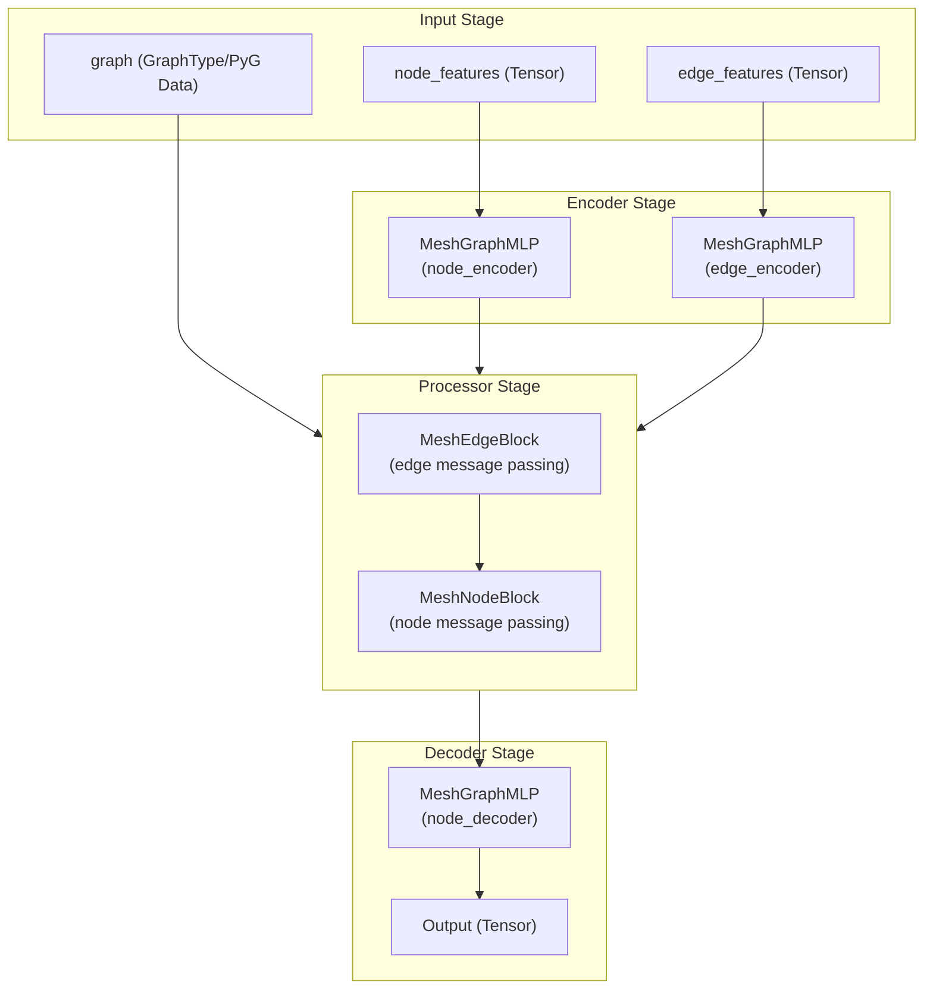
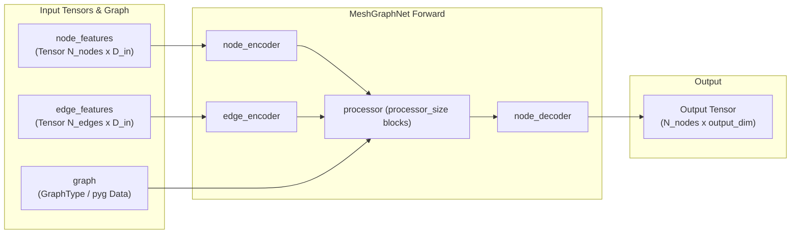

<!-- source: DeepWiki mcp.deepwiki.com · repo NVIDIA/physicsnemo · extra page MeshGraphNet · fetched 2026-10-21 -->

# MeshGraphNet

<details>
<summary>Relevant source files</summary>

The following files were used as context for generating this wiki page:

- [examples/cfd/external_aerodynamics/aero_graph_net/README.md](examples/cfd/external_aerodynamics/aero_graph_net/README.md)
- [physicsnemo/datapipes/gnn/bsms.py](physicsnemo/datapipes/gnn/bsms.py)
- [physicsnemo/deploy/__init__.py](physicsnemo/deploy/__init__.py)
- [physicsnemo/deploy/onnx/utils.py](physicsnemo/deploy/onnx/utils.py)
- [physicsnemo/models/meshgraphnet/bsms_mgn.py](physicsnemo/models/meshgraphnet/bsms_mgn.py)
- [physicsnemo/models/meshgraphnet/hybrid_meshgraphnet.py](physicsnemo/models/meshgraphnet/hybrid_meshgraphnet.py)
- [physicsnemo/models/meshgraphnet/meshgraphkan.py](physicsnemo/models/meshgraphnet/meshgraphkan.py)
- [physicsnemo/models/meshgraphnet/meshgraphnet.py](physicsnemo/models/meshgraphnet/meshgraphnet.py)
- [test/datapipes/test_bsms.py](test/datapipes/test_bsms.py)
- [test/datapipes/test_drivaernet.py](test/datapipes/test_drivaernet.py)
- [test/models/meshgraphnet/data/meshgraphkan_output.pth](test/models/meshgraphnet/data/meshgraphkan_output.pth)
- [test/models/meshgraphnet/test_bsms_mgn.py](test/models/meshgraphnet/test_bsms_mgn.py)
- [test/models/meshgraphnet/test_hybrid_meshgraphnet.py](test/models/meshgraphnet/test_hybrid_meshgraphnet.py)
- [test/models/meshgraphnet/test_meshgraphkan.py](test/models/meshgraphnet/test_meshgraphkan.py)
- [test/models/meshgraphnet/test_meshgraphnet.py](test/models/meshgraphnet/test_meshgraphnet.py)

</details>


## Purpose and Scope

This document describes the `MeshGraphNet` architecture in PhysicsNeMo, a graph neural network designed for physics simulation on unstructured meshes. MeshGraphNet implements an encoder-processor-decoder architecture that learns to predict the evolution of physical systems represented as mesh graphs. This model is particularly suited for computational fluid dynamics (CFD) simulations and structural mechanics with irregular geometries.

In addition to the standard architecture, PhysicsNeMo supports several advanced variants:
*   **HybridMeshGraphNet**: Supports multiple edge types (e.g., mesh edges and world edges) via separate edge encoders [physicsnemo/models/meshgraphnet/hybrid_meshgraphnet.py:56-61]().
*   **BiStrideMeshGraphNet**: A multiscale variant using BiStride graph pooling/unpooling for U-like hierarchical message passing [physicsnemo/models/meshgraphnet/bsms_mgn.py:44-50]().
*   **MeshGraphKAN**: A variant utilizing Kolmogorov-Arnold Networks (`KolmogorovArnoldNetwork`) in place of traditional MLPs for node encoding [physicsnemo/models/meshgraphnet/meshgraphkan.py:46-48]().

Sources: [physicsnemo/models/meshgraphnet/meshgraphnet.py:54-152](), [physicsnemo/models/meshgraphnet/hybrid_meshgraphnet.py:56-106](), [physicsnemo/models/meshgraphnet/bsms_mgn.py:44-104]()

## Architecture Overview

MeshGraphNet uses a three-stage pipeline for learning mesh-based physics:



**Diagram: MeshGraphNet Code-Level Pipeline Components**

The encoder transforms raw features into a learned latent space via `MeshGraphMLP` [physicsnemo/nn/module/gnn_layers/mesh_graph_mlp.py](), the processor performs iterative message passing via `MeshEdgeBlock` [physicsnemo/nn/module/gnn_layers/mesh_edge_block.py]() and `MeshNodeBlock` [physicsnemo/nn/module/gnn_layers/mesh_node_block.py]() to propagate information across the mesh, and the decoder produces predictions for each node.

Sources: [physicsnemo/models/meshgraphnet/meshgraphnet.py:54-152](), [physicsnemo/nn/module/gnn_layers/mesh_edge_block.py](), [physicsnemo/nn/module/gnn_layers/mesh_node_block.py]()

## Model Construction and Configuration

### Class Signature and Parameters

The `MeshGraphNet` class is defined in `physicsnemo.models.meshgraphnet.meshgraphnet` and accepts configuration parameters for feature dimensions, hidden layers, and optimization options [physicsnemo/models/meshgraphnet/meshgraphnet.py:54-152]().

| Parameter | Type | Description |
|-----------|------|-------------|
| `input_dim_nodes` | `int` | Number of node features [physicsnemo/models/meshgraphnet/meshgraphnet.py:59-60](). |
| `input_dim_edges` | `int` | Number of edge features [physicsnemo/models/meshgraphnet/meshgraphnet.py:61-62](). |
| `output_dim` | `int` | Number of outputs [physicsnemo/models/meshgraphnet/meshgraphnet.py:63-64](). |
| `processor_size` | `int` | Number of message passing blocks (default: 15) [physicsnemo/models/meshgraphnet/meshgraphnet.py:65-66](). |
| `mlp_activation_fn` | `str` | Activation function name (default: `"relu"`) [physicsnemo/models/meshgraphnet/meshgraphnet.py:67-68](). |
| `aggregation` | `Literal["sum", "mean"]` | Message aggregation type (default: `"sum"`) [physicsnemo/models/meshgraphnet/meshgraphnet.py:87-88](). |
| `do_concat_trick` | `bool` | Whether to replace concat+MLP with MLP+idx+sum (default: `False`) [physicsnemo/models/meshgraphnet/meshgraphnet.py:89-90](). |
| `num_processor_checkpoint_segments` | `int` | Number of segments for gradient checkpointing (default: 0) [physicsnemo/models/meshgraphnet/meshgraphnet.py:91-92](). |

Sources: [physicsnemo/models/meshgraphnet/meshgraphnet.py:54-152](), [test/models/meshgraphnet/test_meshgraphnet.py:72-138]()

## Advanced Variants

### HybridMeshGraphNet
`HybridMeshGraphNet` extends vanilla `MeshGraphNet` to support separate encoders for mesh edges and world edges [physicsnemo/models/meshgraphnet/hybrid_meshgraphnet.py:56-61](). It uses `HybridMeshEdgeBlock` and `HybridMeshNodeBlock` to process multi-graph connectivity [physicsnemo/models/meshgraphnet/hybrid_meshgraphnet.py:29-31]().

```python
from physicsnemo.models.meshgraphnet import HybridMeshGraphNet

model = HybridMeshGraphNet(
    input_dim_nodes=4,
    input_dim_edges=3,
    output_dim=2
)
output = model(node_features, mesh_edge_features, world_edge_features, graph)
```

Sources: [physicsnemo/models/meshgraphnet/hybrid_meshgraphnet.py:56-140](), [test/models/meshgraphnet/test_hybrid_meshgraphnet.py:38-74]()

### BiStrideMeshGraphNet
`BiStrideMeshGraphNet` integrates a U-Net-like multi-scale message passing mechanism (`BistrideGraphMessagePassing`) that alternates between coarsening and refining the mesh graph hierarchy [physicsnemo.models.meshgraphnet.bsms_mgn:44-50, physicsnemo/nn/module/gnn_layers/bsms:25](). It requires multi-scale edge indices (`ms_edges`) and node identifier mappings (`ms_ids`) provided by `BistrideMultiLayerGraphDataset` [physicsnemo/datapipes/gnn/bsms:36, physicsnemo/models/meshgraphnet/bsms_mgn.py:122-125]().

Sources: [physicsnemo/models/meshgraphnet/bsms_mgn.py:44-131](), [physicsnemo/datapipes/gnn/bsms.py]()

### MeshGraphKAN
`MeshGraphKAN` substitutes the standard multi-layer perceptron node encoder with a Kolmogorov–Arnold Network (`KolmogorovArnoldNetwork`) incorporating Fourier harmonics [physicsnemo/models/meshgraphnet/meshgraphkan.py:46-90]().

Sources: [physicsnemo/models/meshgraphnet/meshgraphkan.py:46-145](), [test/models/meshgraphnet/test_meshgraphkan.py:37-68]()

## Forward Pass and Data Flow

The forward method expects node features, edge features, and a graph topology container (PyTorch Geometric `Data` or `Batch`) [physicsnemo/models/meshgraphnet/meshgraphnet.py:100-116]().



**Diagram: MeshGraphNet Data Flow Mapping to Code Objects**

Sources: [physicsnemo/models/meshgraphnet/meshgraphnet.py:100-121](), [test/models/meshgraphnet/test_meshgraphnet.py:31-68]()

## Optimization and Performance

### Memory and Execution Controls
*   **Gradient Checkpointing**: Configured via `num_processor_checkpoint_segments` to partition message passing layers and reduce peak VRAM usage during backpropagation [physicsnemo/models/meshgraphnet/meshgraphnet.py:91-94]().
*   **Concatenation Optimization**: The `do_concat_trick` flag toggles an index-and-sum aggregation strategy instead of explicit feature concatenation [physicsnemo/models/meshgraphnet/meshgraphnet.py:89-90]().
*   **Mixed Precision & Backend Support**: Compatible with automatic mixed precision (`amp_gpu: True`) and TorchScript / CUDA graph evaluation where supported by underlying modules [physicsnemo/models/meshgraphnet/meshgraphnet.py:39-52]().

Sources: [physicsnemo/models/meshgraphnet/meshgraphnet.py:39-94](), [test/models/meshgraphnet/test_meshgraphnet.py:141-178]()

---

