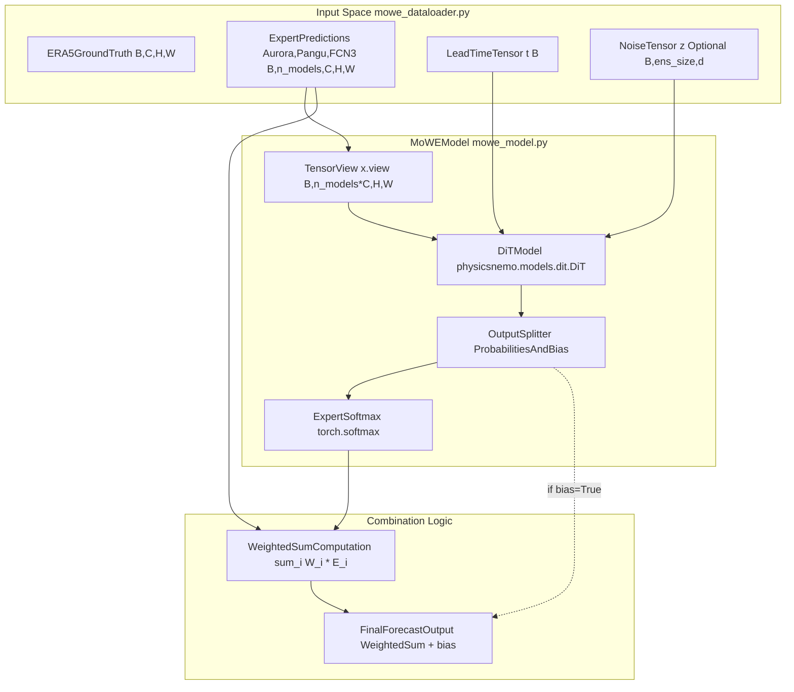
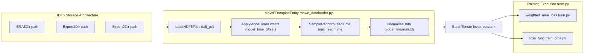

<!-- source: DeepWiki mcp.deepwiki.com · repo NVIDIA/physicsnemo · extra page MoWE (Mixture of Weather Experts) · fetched 2026-10-21 -->

# MoWE (Mixture of Weather Experts)

<details>
<summary>Relevant source files</summary>

The following files were used as context for generating this wiki page:

- [examples/weather/mixture_of_experts/conf/config_base.yaml](examples/weather/mixture_of_experts/conf/config_base.yaml)
- [examples/weather/mixture_of_experts/conf/config_base_crps.yaml](examples/weather/mixture_of_experts/conf/config_base_crps.yaml)
- [examples/weather/mixture_of_experts/data/config.yaml](examples/weather/mixture_of_experts/data/config.yaml)
- [examples/weather/mixture_of_experts/data/create_moe_dataset.py](examples/weather/mixture_of_experts/data/create_moe_dataset.py)
- [examples/weather/mixture_of_experts/data/restructure_dataset.py](examples/weather/mixture_of_experts/data/restructure_dataset.py)
- [examples/weather/mixture_of_experts/mowe_dataloader.py](examples/weather/mixture_of_experts/mowe_dataloader.py)
- [examples/weather/mixture_of_experts/mowe_model.py](examples/weather/mixture_of_experts/mowe_model.py)
- [examples/weather/mixture_of_experts/readme.md](examples/weather/mixture_of_experts/readme.md)
- [examples/weather/mixture_of_experts/train.py](examples/weather/mixture_of_experts/train.py)
- [examples/weather/mixture_of_experts/train_crps.py](examples/weather/mixture_of_experts/train_crps.py)

</details>


## Purpose and Scope

MoWE (Mixture of Weather Experts) is a mixture-of-experts architecture for weather forecasting that combines predictions from multiple pre-trained weather models (experts) to produce improved, synthesized forecasts. The model learns to weight expert predictions adaptively based on lead time and atmospheric conditions using a gating network built on the **Diffusion Transformer (DiT)** architecture.

This page documents the MoWE implementation, the data pipeline for multi-model forecasts, and the training strategies including deterministic (`weighted_mse_loss`) and probabilistic (`crps`) approaches.

**Sources:** [examples/weather/mixture_of_experts/mowe_model.py:23-30](), [examples/weather/mixture_of_experts/readme.md:1-24]()

---

## Architecture Overview

MoWE operates as a wrapper around the experimental `DiT` model (`physicsnemo.models.dit.DiT`). It treats stacked expert forecasts as a multi-channel image input. The gating network predicts a set of weights ($W_i$) and an optional bias ($b$) for each expert, which are then used to compute the final forecast $\hat{Y} = \sum_{i=1}^{N} (W_i \cdot E_i) + b$.



**Diagram: MoWE Architecture - Data flow from multiple expert predictions through DiT to ensemble weights**

**Sources:** [examples/weather/mixture_of_experts/mowe_model.py:23-87](), [examples/weather/mixture_of_experts/readme.md:28-63]()

---

## Core Components

### MoWE Class

The `MoWE` class inherits from `DiT` and reconfigures the input/output channels to accommodate multiple experts.

| Parameter | Type | Description |
|-----------|------|-------------|
| `n_models` | `int` | Number of expert models (e.g., 3 for Aurora, Pangu, FCN3). [examples/weather/mixture_of_experts/mowe_model.py:37-38]() |
| `in_channels` | `int` | Number of input channels per expert. [examples/weather/mixture_of_experts/mowe_model.py:35-36]() |
| `noise_dim` | `int` | Dimensionality of noise for probabilistic ensemble generation. [examples/weather/mixture_of_experts/mowe_model.py:56-57]() |
| `return_probabilities` | `bool` | If `True`, returns expert weights. If `False`, returns output directly. [examples/weather/mixture_of_experts/mowe_model.py:58-60]() |
| `bias` | `bool` | If `True`, learns an additive bias term for the linear combination. [examples/weather/mixture_of_experts/mowe_model.py:61-62]() |

**Initialization Logic:**
The model calculates the total required channels for the underlying DiT:
- `net_in_channels = n_models * in_channels` [examples/weather/mixture_of_experts/mowe_model.py:134-134]()
- `out_channels = (n_models + 1) * out_channels` (if `bias` is True) [examples/weather/mixture_of_experts/mowe_model.py:137-137]()

**Sources:** [examples/weather/mixture_of_experts/mowe_model.py:112-164]()

### Forward Pass Implementation

The `forward` method handles the transformation of multi-expert inputs and optional ensemble generation:

1. **Reshaping**: Merges the expert and channel dimensions: `x.view(b, n_models * ch, h, w)`. [examples/weather/mixture_of_experts/mowe_model.py:173-174]()
2. **Ensemble Handling**: If `noise_dim` is active, it expands the batch to accommodate `n_ens` members. [examples/weather/mixture_of_experts/mowe_model.py:175-179]()
3. **DiT Execution**: Calls the parent `DiT.forward`. [examples/weather/mixture_of_experts/mowe_model.py:182-182]()
4. **Probability Extraction**: If `return_probabilities` is set, it splits the DiT output into `probabilities` and `bias`. [examples/weather/mixture_of_experts/mowe_model.py:192-205]()
5. **Normalization**: Applies `torch.softmax` over the expert dimension to ensure weights sum to 1. [examples/weather/mixture_of_experts/mowe_model.py:207-207]()

**Sources:** [examples/weather/mixture_of_experts/mowe_model.py:165-210]()

---

## Data Pipeline

### MoWEDatapipe

The `MoWEDatapipe` is a specialized DALI-based pipeline designed to load ground truth (ERA5) and multiple expert forecasts simultaneously.



**Diagram: Data loading pipeline and loss computation mapping to training entities**

**Key Features:**
- **Time Alignment**: Uses `model_time_offsets` to account for delays in model initialization relative to ERA5. [examples/weather/mixture_of_experts/mowe_dataloader.py:76-78]()
- **Lead Time Sampling**: Randomly samples lead times between 1 and `max_lead_time` during training. [examples/weather/mixture_of_experts/mowe_dataloader.py:79-81]()
- **Channel Mapping**: Uses `orig_index` to align disparate channel orderings across different expert models. [examples/weather/mixture_of_experts/mowe_dataloader.py:72-75]()

**Sources:** [examples/weather/mixture_of_experts/mowe_dataloader.py:54-154]()

---

## Training Strategies

PhysicsNeMo provides two primary training scripts for MoWE:

### 1. Deterministic Training (`train.py`)
Uses a lead-time weighted Mean Squared Error (`weighted_mse_loss`) loss. The loss is scaled by `1/t`, where `t` is the lead time, to prioritize accuracy at shorter horizons.

```python
def weighted_mse_loss(x, y, t):
    mse_per_item = torch.mean((x - y) ** 2, dim=(1, 2, 3))
    l2_loss = (mse_per_item / t.detach()).mean()
    return l2_loss
```
**Sources:** [examples/weather/mixture_of_experts/train.py:42-51]()

### 2. Probabilistic Training (`train_crps.py`)
Trains the model to produce ensemble forecasts by minimizing the Continuous Ranked Probability Score (`loss_func` using `crps`). This utilizes the `noise_dim` and `ens_size` parameters.

```python
def loss_func(pred, target, t):
    crps_per_item = torch.mean(crps(pred, target, dim=1), dim=(1, 2, 3))
    crps_loss = (crps_per_item / t.detach()).mean()
    return crps_loss
```
**Sources:** [examples/weather/mixture_of_experts/train_crps.py:44-53]()

---

## Configuration

The model and training are configured via Hydra. Key parameters in `config_base.yaml` and `config_base_crps.yaml` include:

| Category | Key | Description |
|-----------|-----|-------------|
| **Data** | `data_dirs` | List of paths: [ERA5, Expert1, Expert2, ...]. [examples/weather/mixture_of_experts/conf/config_base.yaml:25-29]() |
| **Data** | `model_time_offsets` | Steps to align each expert with ERA5. [examples/weather/mixture_of_experts/conf/config_base.yaml:34-34]() |
| **Model** | `n_models` | Number of expert models. [examples/weather/mixture_of_experts/conf/config_base.yaml:50-50]() |
| **Model** | `noise_dim` | Dimension of noise vector (32 for CRPS). [examples/weather/mixture_of_experts/conf/config_base_crps.yaml:56-56]() |
| **Training**| `ens_size` | Number of ensemble members per sample. [examples/weather/mixture_of_experts/conf/config_base_crps.yaml:74-74]() |

**Sources:** [examples/weather/mixture_of_experts/conf/config_base.yaml:17-75](), [examples/weather/mixture_of_experts/conf/config_base_crps.yaml:17-78]()

---

## Key Code Entities

| Entity | Location | Role |
|--------|----------|------|
| `MoWE` | [examples/weather/mixture_of_experts/mowe_model.py:23-110]() | Main model class implementing the expert gating logic. |
| `MoWEDatapipe` | [examples/weather/mixture_of_experts/mowe_dataloader.py:54-154]() | DALI datapipe for multi-expert HDF5 data. |
| `weighted_mse_loss` | [examples/weather/mixture_of_experts/train.py:42-51]() | Lead-time aware loss function for deterministic training. |
| `crps` | [physicsnemo/metrics/general/crps.py]() | Metric used as a loss function in probabilistic training. |
| `AsyncDataFetcher` | [examples/weather/mixture_of_experts/data/create_moe_dataset.py:139-186]() | Utility for background streaming of batches during dataset creation. |

**Sources:** [examples/weather/mixture_of_experts/mowe_model.py:1-210](), [examples/weather/mixture_of_experts/train.py:1-398](), [examples/weather/mixture_of_experts/train_crps.py:1-150]()

---

