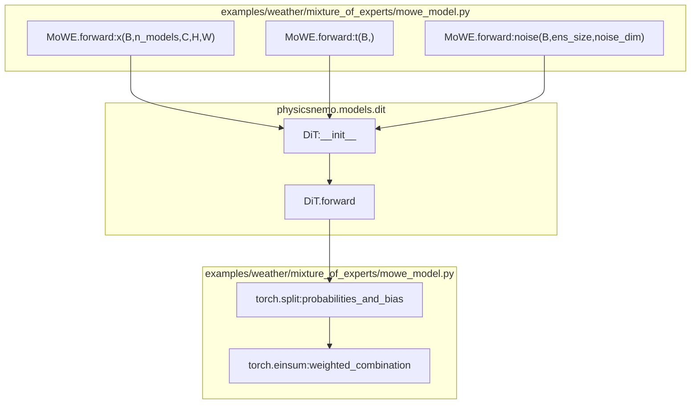
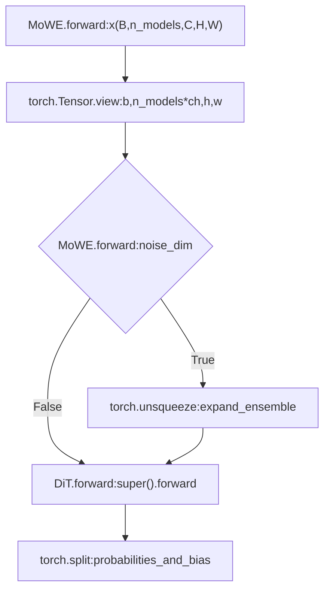

<!-- source: DeepWiki mcp.deepwiki.com · repo NVIDIA/physicsnemo · extra page MoWE Ensemble Prediction · fetched 2026-10-21 -->

# MoWE Ensemble Prediction

<details>
<summary>Relevant source files</summary>

The following files were used as context for generating this wiki page:

- [examples/weather/mixture_of_experts/conf/config_base.yaml](examples/weather/mixture_of_experts/conf/config_base.yaml)
- [examples/weather/mixture_of_experts/conf/config_base_crps.yaml](examples/weather/mixture_of_experts/conf/config_base_crps.yaml)
- [examples/weather/mixture_of_experts/data/config.yaml](examples/weather/mixture_of_experts/data/config.yaml)
- [examples/weather/mixture_of_experts/data/create_moe_dataset.py](examples/weather/mixture_of_experts/data/create_moe_dataset.py)
- [examples/weather/mixture_of_experts/data/restructure_dataset.py](examples/weather/mixture_of_experts/data/restructure_dataset.py)
- [examples/weather/mixture_of_experts/mowe_dataloader.py](examples/weather/mixture_of_experts/mowe_dataloader.py)
- [examples/weather/mixture_of_experts/mowe_model.py](examples/weather/mixture_of_experts/mowe_model.py)
- [examples/weather/mixture_of_experts/readme.md](examples/weather/mixture_of_experts/readme.md)
- [examples/weather/mixture_of_experts/train.py](examples/weather/mixture_of_experts/train.py)
- [examples/weather/mixture_of_experts/train_crps.py](examples/weather/mixture_of_experts/train_crps.py)

</details>


This page describes the Mixture of Weather Experts (MoWE) model for ensemble weather prediction, detailing its DiT-based architecture, dataset creation pipelines, expert weighting mechanisms, and CRPS-based training workflows. MoWE synthesizes predictions from multiple expert weather forecast models using a learned gating network to generate robust ensemble forecasts.

For details on the underlying diffusion transformer backbone, see [DiT (Diffusion Transformer)](__L1__)`. For evaluation metrics including CRPS, see [General Metrics](__L1__)[examples/weather/mixture_of_experts/mowe_model.py:20-21]().

---

## Architecture Overview

MoWE is implemented as a wrapper around the `DiT` model class defined in `physicsnemo.models.dit`. It processes stacked predictions from multiple forecast models as a multi-channel input tensor.

### MoWE Model Structure and Code Mapping

The diagram below bridges the conceptual expert-combination workflow to the concrete code entities within `examples/weather/mixture_of_experts/mowe_model.py` and `physicsnemo.models.dit`.



Sources: `[examples/weather/mixture_of_experts/mowe_model.py:23-211]`, `[physicsnemo/models/dit.py]()`

---

## Model Implementation

### MoWE Class

The `MoWE` class inherits from `DiT` and adjusts network input and output channels based on the number of expert models (`n_models`) and whether probabilities or direct predictions are requested [examples/weather/mixture_of_experts/mowe_model.py:23-164]().

*   `net_in_channels`: Calculated as `n_models * in_channels` to accommodate concatenated expert forecasts [examples/weather/mixture_of_experts/mowe_model.py:134-134]().
*   `out_channels`: Set to `(n_models + 1) * out_channels` when `return_probabilities` and `bias` are enabled [examples/weather/mixture_of_experts/mowe_model.py:137-137]().

Sources: `[examples/weather/mixture_of_experts/mowe_model.py:23-164]`

### Forward Pass and Ensemble Expansion

The forward pass reshapes the input tensor to merge the model and channel dimensions, optionally expands dimensions for ensemble noise sampling, and invokes the parent `DiT` forward pass [examples/weather/mixture_of_experts/mowe_model.py:165-210]().



Sources: `[examples/weather/mixture_of_experts/mowe_model.py:165-211]`

---

## Dataset Creation

Training MoWE requires pre-generated expert model forecasts alongside ERA5 ground truth data structured into yearly HDF5 files [examples/weather/mixture_of_experts/readme.md:67-120]().

### Data Curation Pipeline

1.  **Generation (`create_moe_dataset.py`)**: Utilizes `earth2studio` data sources and models (such as Pangu-Weather, Aurora, or FCN3) to generate multi-step forecasts saved in Zarr format [examples/weather/mixture_of_experts/data/create_moe_dataset.py:20-44](), [examples/weather/mixture_of_experts/data/config.yaml:19-38]().
2.  **Restructuring (`restructure_dataset.py`)**: Converts Zarr files into yearly HDF5 archives (`[year].h5`) containing stacked data variables under the `/fields` array [examples/weather/mixture_of_experts/data/restructure_dataset.py:31-66]().

Sources: `[examples/weather/mixture_of_experts/data/create_moe_dataset.py:20-44]`, `[examples/weather/mixture_of_experts/data/restructure_dataset.py:31-66]`

### DALI Data Pipeline (`MoWEDatapipe`)

The `MoWEDatapipe` class subclasses `physicsnemo.datapipes.datapipe.Datapipe` to stream multi-model forecasts and ERA5 targets efficiently using NVIDIA DALI [examples/weather/mixture_of_experts/mowe_dataloader.py:54-154](). It manages temporal offsets via `model_time_offsets` and samples lead times up to `max_lead_time` [examples/weather/mixture_of_experts/mowe_dataloader.py:76-81]().

Sources: `[examples/weather/mixture_of_experts/mowe_dataloader.py:54-154]`

---

## Expert Weighting and CRPS-Based Training

### Training Loss Functions

MoWE supports deterministic training using weighted MSE and probabilistic training using Continuous Ranked Probability Score (CRPS).

*   **Weighted MSE (`train.py`)**: Scales item-wise mean squared error by inverse lead time `1 / t` [examples/weather/mixture_of_experts/train.py:42-51]().
*   **CRPS Loss (`train_crps.py`)**: Computes probabilistic loss using `physicsnemo.metrics.general.crps.crps` across ensemble realizations generated via noise conditioning [examples/weather/mixture_of_experts/train_crps.py:39-53]().

Sources: `[examples/weather/mixture_of_experts/train.py:42-51]`, `[examples/weather/mixture_of_experts/train_crps.py:39-53]`

### Expert Weighting Formula

When `return_probabilities=True`, the gating network outputs expert weights $W_i$ and an additive bias $b$. The final synthesized forecast $\hat{Y}$ is computed as a weighted combination of expert forecasts $E_i$:

$$\hat{Y} = \sum_{i=1}^{N} (W_i \cdot E_i) + b$$

Sources: `[examples/weather/mixture_of_experts/readme.md:11-24]`, `[examples/weather/mixture_of_experts/train.py:270-280]`

---

## Configuration and Execution

Training jobs are configured using Hydra config files (`config_base.yaml` and `config_base_crps.yaml`) [examples/weather/mixture_of_experts/conf/config_base.yaml:1-75](), [examples/weather/mixture_of_experts/conf/config_base_crps.yaml:1-78]().

### Key Model Hyperparameters

| Parameter | Default / Example | Description |
|-----------|-------------------|-------------|
| `n_models` | `3` | Number of expert models combined (e.g., Aurora, Pangu, FCN3) [examples/weather/mixture_of_experts/conf/config_base.yaml:50-50]() |
| `hidden_size` | `384` | Transformer embedding dimensionality [examples/weather/mixture_of_experts/conf/config_base.yaml:51-51]() |
| `depth` | `6` | Number of DiT transformer blocks [examples/weather/mixture_of_experts/conf/config_base.yaml:52-52]() |
| `noise_dim` | `32` | Noise vector dimensionality for probabilistic CRPS training [examples/weather/mixture_of_experts/conf/config_base_crps.yaml:56-56]() |
| `attention_backend` | `"transformer_engine"` | Attention mechanism backend [examples/weather/mixture_of_experts/conf/config_base.yaml:58-58]() |

Sources: `[examples/weather/mixture_of_experts/conf/config_base.yaml:45-60]`, `[examples/weather/mixture_of_experts/conf/config_base_crps.yaml:46-60]`

### Training Commands

Run distributed training across multiple GPUs using `torchrun`:

```bash
# Deterministic training with weighted MSE
torchrun --standalone --nproc_per_node=8 train.py --config-name=config_base.yaml

# Probabilistic training with CRPS loss
torchrun --standalone --nproc_per_node=8 train_crps.py --config-name=config_base_crps.yaml
```

Sources: `[examples/weather/mixture_of_experts/readme.md:121-135]`

---

