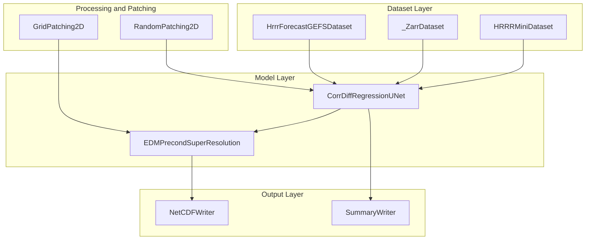
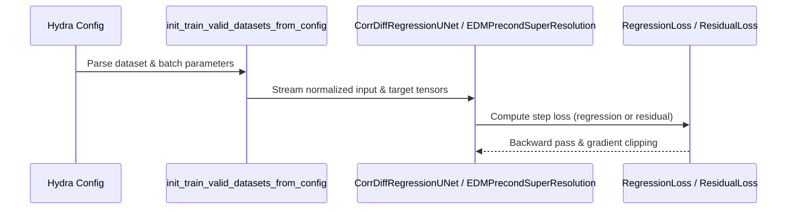
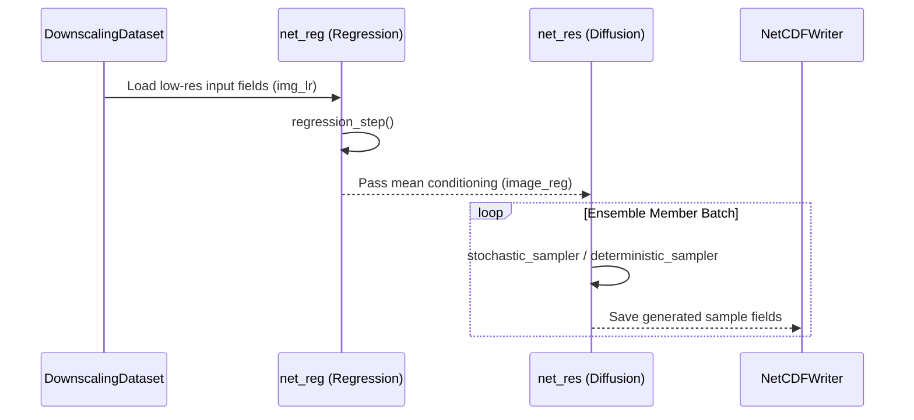

<!-- source: DeepWiki mcp.deepwiki.com · repo NVIDIA/physicsnemo · extra page CorrDiff Super-resolution · fetched 2026-10-21 -->

# CorrDiff Super-resolution

Relevant source files

The following files were used as context for generating this wiki page:

- [examples/generative/corrdiff/README.md](examples/generative/corrdiff/README.md)
- [examples/weather/corrdiff/README.md](examples/weather/corrdiff/README.md)
- [examples/weather/corrdiff/conf/base/generation/base_all.yaml](examples/weather/corrdiff/conf/base/generation/base_all.yaml)
- [examples/weather/corrdiff/conf/base/generation/sampler/stochastic.yaml](examples/weather/corrdiff/conf/base/generation/sampler/stochastic.yaml)
- [examples/weather/corrdiff/datasets/cwb.py](examples/weather/corrdiff/datasets/cwb.py)
- [examples/weather/corrdiff/datasets/dataset.py](examples/weather/corrdiff/datasets/dataset.py)
- [examples/weather/corrdiff/datasets/gefs_hrrr.py](examples/weather/corrdiff/datasets/gefs_hrrr.py)
- [examples/weather/corrdiff/datasets/hrrrmini.py](examples/weather/corrdiff/datasets/hrrrmini.py)
- [examples/weather/corrdiff/generate.py](examples/weather/corrdiff/generate.py)
- [examples/weather/corrdiff/helpers/generate_helpers.py](examples/weather/corrdiff/helpers/generate_helpers.py)
- [examples/weather/corrdiff/helpers/train_helpers.py](examples/weather/corrdiff/helpers/train_helpers.py)
- [examples/weather/corrdiff/inference/plot_multiple_samples.py](examples/weather/corrdiff/inference/plot_multiple_samples.py)
- [examples/weather/corrdiff/inference/plot_single_sample.py](examples/weather/corrdiff/inference/plot_single_sample.py)
- [examples/weather/corrdiff/inference/power_spectra.py](examples/weather/corrdiff/inference/power_spectra.py)
- [examples/weather/corrdiff/score_samples.py](examples/weather/corrdiff/score_samples.py)
- [examples/weather/corrdiff/train.py](examples/weather/corrdiff/train.py)

## Purpose and Scope

This document details the CorrDiff (Correction Diffusion) super-resolution system for kilometer-scale atmospheric downscaling. CorrDiff combines a deterministic regression network with a stochastic diffusion model to generate high-resolution weather fields from coarse-resolution inputs [examples/weather/corrdiff/README.md:1-18](). 

> **Note:** The CorrDiff example in `examples/weather/corrdiff` is deprecated and maintained for reference only. New projects should use the regional high-resolution weather model located in `examples/weather/regional_weather_diffusion` [examples/weather/corrdiff/README.md:4-11]().

The CorrDiff pipeline operates in two distinct phases:
1. **Regression Stage**: A deterministic network (`CorrDiffRegressionUNet`) predicts high-resolution atmospheric fields from low-resolution inputs and static invariants [examples/weather/corrdiff/README.md:92-98]().
2. **Diffusion Stage**: A generative residual model conditioned on the regression output uses an EDM preconditioning scheme (`EDMPrecondSuperResolution`) to model small-scale turbulent fluctuations and extremes [examples/weather/corrdiff/README.md:92-98]().

Sources: [examples/weather/corrdiff/README.md:1-22](), [examples/weather/corrdiff/train.py:17-19](), [examples/weather/corrdiff/generate.py:17-19]()

---

## System Architecture

The CorrDiff system integrates dataset loaders, neural network modules, patching algorithms, and writers into a unified execution graph.

**CorrDiff Code Architecture and Data Flow**

Sources: [examples/weather/corrdiff/generate.py:104-164](), [examples/weather/corrdiff/train.py:36-54]()

---

## Model Components and Core Classes

The core architecture relies on specialized UNet wrappers and EDM preconditioners tailored for high-resolution meteorological image-to-image translation.

| Class Name | File Path | Role and Description |
|------------|-----------|----------------------|
| `CorrDiffRegressionUNet` | `physicsnemo/models/diffusion_unets.py:33-33` | Specialized UNet configured for the deterministic regression pass. |
| `EDMPrecondSuperResolution` | `physicsnemo/diffusion/preconditioners.py:34-34` | Implements Elucidating Diffusion Models (EDM) preconditioning specifically for super-resolution conditioning. |
| `tEDMPrecondSuperRes` | `physicsnemo/experimental/models/diffusion/preconditioning.py:47-49` | Experimental student-t distributed noise variant of the EDM super-resolution preconditioner. |
| `GridPatching2D` | `physicsnemo/diffusion/multi_diffusion.py:41-41` | Slices large evaluation domains into overlapping patches to fit in GPU memory during generation. |
| `RandomPatching2D` | `physicsnemo/diffusion/multi_diffusion.py:38-38` | Samples random spatial sub-crops during training to match memory budgets. |

Sources: [examples/weather/corrdiff/train.py:36-54](), [examples/weather/corrdiff/generate.py:43-52]()

---

## Data Management and Dataset Infrastructure

CorrDiff supports multiple dataset backends registered dynamically via `register_dataset` [examples/weather/corrdiff/datasets/dataset.py:38-88]().

### Supported Dataset Backends
- **CWB (`cwb.get_zarr_dataset`)**: Zarr-backed dataset for Central Weather Administration of Taiwan data, parsing consolidated metadata and scaling parameters [examples/weather/corrdiff/datasets/cwb.py:56-118]().
- **HRRR-Mini (`HRRRMiniDataset`)**: Reduced-size dataset for rapid prototyping and educational use [examples/weather/corrdiff/README.md:26-36](). It incorporates Numba-accelerated bilinear zoom extrapolation (`_zoom_extrapolate`) to upscale low-resolution inputs [examples/weather/corrdiff/datasets/hrrrmini.py:30-84](), [examples/weather/corrdiff/datasets/hrrrmini.py:166-180]().
- **GEFS-HRRR (`HrrrForecastGEFSDataset`)**: Paired GEFS ensemble forecasts (low-resolution surface and isobaric levels) with HRRR target observations (high-resolution surface fields) [examples/weather/corrdiff/datasets/gefs_hrrr.py:46-149]().

Sources: [examples/weather/corrdiff/datasets/dataset.py:31-35](), [examples/weather/corrdiff/datasets/cwb.py:56-68](), [examples/weather/corrdiff/datasets/hrrrmini.py:30-58](), [examples/weather/corrdiff/datasets/gefs_hrrr.py:120-149]()

---

## Training Workflow

Training is orchestrated via `train.py` using Hydra configuration structures (`conf/config_training.yaml`) [examples/weather/corrdiff/train.py:116-117]().

**Training Pipeline Control Flow**

### Training Steps
1. **Dataset Initialization**: `init_train_valid_datasets_from_config` initializes loaders with `InfiniteSampler` to distribute shards across ranks [examples/weather/corrdiff/datasets/dataset.py:91-138]().
2. **Loss Formulation**:
   - `RegressionLoss` and `RegressionLossCE` optimize the deterministic regression UNet [examples/weather/corrdiff/train.py:41]()
   - `ResidualLoss` or `tEDMResidualLoss` optimize the diffusion model against error residuals [examples/weather/corrdiff/train.py:41-50]()
3. **Precision and Optimization**: Supports `fp16`, `amp-fp16`, and `amp-bf16` precision configurations with gradient clipping and accumulation handlers [examples/weather/corrdiff/train.py:162-166]()

Sources: [examples/weather/corrdiff/train.py:115-184](), [examples/weather/corrdiff/datasets/dataset.py:91-138]()

---

## Generation and Sampling Infrastructure

Inference and ensemble generation are handled by `generate.py` [examples/weather/corrdiff/generate.py:57-61]().

**Inference and Ensemble Generation Pipeline**

### Inference Execution Modes
- **Regression Mode**: Evaluates only the deterministic UNet (`load_net_reg=True`, `load_net_res=False`) [examples/weather/corrdiff/generate.py:142-143]().
- **Diffusion Mode**: Evaluates only the generative model (`load_net_reg=False`, `load_net_res=True`) [examples/weather/corrdiff/generate.py:144-145]().
- **All Mode**: Runs the complete cascaded pipeline combining regression output and diffusion residuals (`load_net_reg=True`, `load_net_res=True`) [examples/weather/corrdiff/generate.py:146-147]().

Sampling uses either `stochastic_sampler` (SDE-based with noise injection) or `deterministic_sampler` (ODE-based Heun/Euler solvers) [examples/weather/corrdiff/generate.py:46-49]().

Sources: [examples/weather/corrdiff/generate.py:44-49](), [examples/weather/corrdiff/generate.py:141-185]()

---

## Patching, Distributed Execution, and Performance

### Spatial Patching
For high-resolution domains that exceed GPU memory limits, `GridPatching2D` divides grids into overlapping windows during inference, governed by `patch_shape`, `overlap_pix`, and `boundary_pix` parameters [examples/weather/corrdiff/generate.py:122-135]().

### Distributed Scaling
`DistributedManager` initializes multi-GPU environments (`DistributedManager.initialize()`) [examples/weather/corrdiff/train.py:130](). Ensemble seeds are split across ranks using tensor splitting (`torch.as_tensor(seeds).tensor_split(num_batches)`) to ensure non-overlapping parallel generation [examples/weather/corrdiff/generate.py:85-90]().

### Performance Optimizations
- **Channels Last Layout**: Models are cast to `memory_format=torch.channels_last` to utilize Tensor Cores efficiently [examples/weather/corrdiff/generate.py:163]().
- **Torch Compile**: Optional `torch.compile` is supported on the diffusion model via `cfg.generation.perf.use_torch_compile` [examples/weather/corrdiff/conf/base/generation/base_all.yaml:38-41]().

Sources: [examples/weather/corrdiff/generate.py:74-90](), [examples/weather/corrdiff/generate.py:129-139](), [examples/weather/corrdiff/generate.py:161-164](), [examples/weather/corrdiff/conf/base/generation/base_all.yaml:34-51]()

---

## Output Storage and Visualization

The generation script logs outputs through `NetCDFWriter`, structuring NetCDF files into distinct groups (`truth`, `prediction`, `input`) with multidimensional coordinate layouts (`ensemble`, `time`, `y`, `x`) [examples/weather/corrdiff/helpers/generate_helpers.py:119-190]().

Post-processing scripts analyze the output datasets:
- `plot_samples` in `examples/weather/corrdiff/inference/plot_multiple_samples.py`: Creates parallelized multi-sample comparisons between ground truth, ensemble means, and individual ensemble members using `joblib` and `xarray` [examples/weather/corrdiff/inference/plot_multiple_samples.py:25-60]().
- `power_spectra` in `examples/weather/corrdiff/inference/power_spectra.py`: Computes spatial power spectra to evaluate energy distributions across scales [examples/weather/corrdiff/README.md:1-10]().

Sources: [examples/weather/corrdiff/helpers/generate_helpers.py:119-190](), [examples/weather/corrdiff/inference/plot_multiple_samples.py:25-60]()

---

