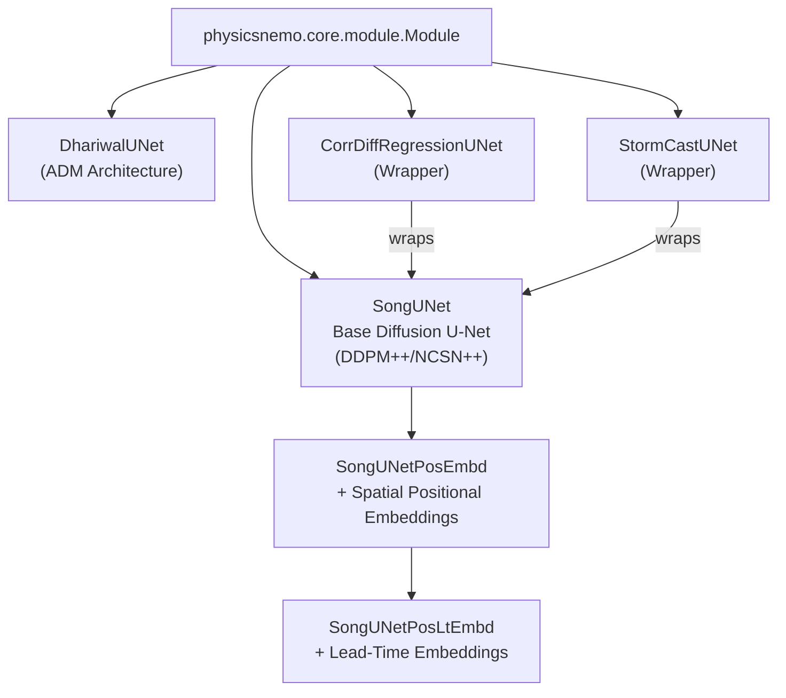
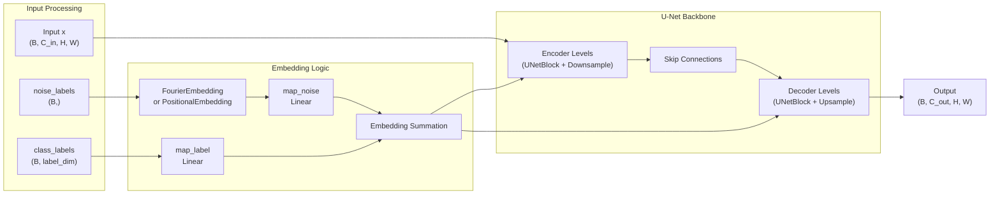
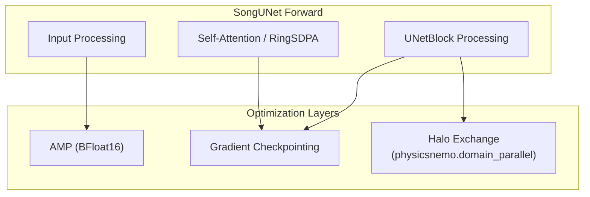

<!-- source: DeepWiki mcp.deepwiki.com · repo NVIDIA/physicsnemo · extra page SongUNet and Variants · fetched 2026-10-21 -->

# SongUNet and Variants

Relevant source files

The following files were used as context for generating this wiki page:

- [physicsnemo/models/diffusion_unets/dhariwal_unet.py](physicsnemo/models/diffusion_unets/dhariwal_unet.py)
- [physicsnemo/models/diffusion_unets/song_unet.py](physicsnemo/models/diffusion_unets/song_unet.py)
- [physicsnemo/models/diffusion_unets/unet.py](physicsnemo/models/diffusion_unets/unet.py)
- [test/metrics/diffusion/test_losses.py](test/metrics/diffusion/test_losses.py)
- [test/models/diffusion/test_dhariwal_unet.py](test/models/diffusion/test_dhariwal_unet.py)
- [test/models/diffusion/test_preconditioning.py](test/models/diffusion/test_preconditioning.py)
- [test/models/diffusion/test_song_unet.py](test/models/diffusion/test_song_unet.py)
- [test/models/diffusion/test_song_unet_pos_embd.py](test/models/diffusion/test_song_unet_pos_embd.py)
- [test/models/diffusion/test_song_unet_pos_lt_embd.py](test/models/diffusion/test_song_unet_pos_lt_embd.py)
- [test/models/diffusion/test_unet_wrappers.py](test/models/diffusion/test_unet_wrappers.py)

## Purpose and Scope

This page documents the SongUNet family of U-Net architectures for diffusion-based generative modeling and deterministic regression in PhysicsNeMo. These models implement DDPM++ and NCSN++ style networks with specialized extensions for weather forecasting, spatial awareness, and physics-informed applications. The variants and wrappers covered include:

- **SongUNet**: Base U-Net diffusion architecture supporting noise level and class conditioning [physicsnemo/models/diffusion_unets/song_unet.py:64-628]().
- **SongUNetPosEmbd**: Extension adding spatial positional embeddings for patch-based generation and global coordinate awareness [physicsnemo/models/diffusion_unets/song_unet.py:635-799]().
- **SongUNetPosLtEmbd**: Further extension adding temporal lead-time embeddings and probabilistic channel masking [physicsnemo/models/diffusion_unets/song_unet.py:802-1470]().
- **DhariwalUNet**: Reimplementation of the ADM architecture utilizing adaptive group normalization scaling for conditioning [physicsnemo/models/diffusion_unets/dhariwal_unet.py:62-250]().
- **CorrDiffRegressionUNet / StormCastUNet**: U-Net wrappers providing deterministic regression and specialized diffusion backbones for atmospheric downscaling [physicsnemo/models/diffusion_unets/unet.py:50-192]().

**Sources:** [physicsnemo/models/diffusion_unets/song_unet.py:1-1470](), [physicsnemo/models/diffusion_unets/dhariwal_unet.py:1-250](), [physicsnemo/models/diffusion_unets/unet.py:1-192]()

---

## Architecture Hierarchy

The SongUNet variants form a structured module inheritance and composition hierarchy within PhysicsNeMo, sharing common blocks while specializing for weather and diffusion pipelines.

**Sources:** [physicsnemo/models/diffusion_unets/song_unet.py:64-802](), [physicsnemo/models/diffusion_unets/dhariwal_unet.py:62-62](), [physicsnemo/models/diffusion_unets/unet.py:50-192]()

---

## SongUNet: Base Architecture

### Overview
`SongUNet` implements the core U-Net architecture for 2D diffusion models, derived from DDPM++ and NCSN++ [physicsnemo/models/diffusion_unets/song_unet.py:64-75](). It supports conditional and unconditional setups, conditioning on noise levels (`noise_labels`), vector-valued class labels (`class_labels`), and augmentation labels [physicsnemo/models/diffusion_unets/song_unet.py:73-82]().

### Core Components and Data Flow

**Sources:** [physicsnemo/models/diffusion_unets/song_unet.py:519-627]()

### Configuration Parameters
- `img_resolution`: Base resolution for building the network [physicsnemo/models/diffusion_unets/song_unet.py:110-118]().
- `in_channels` / `out_channels`: Number of input and output channels [physicsnemo/models/diffusion_unets/song_unet.py:121-126]().
- `embedding_type`: Diffusion timestep embedding type: `"positional"`, `"fourier"`, or `"zero"` [physicsnemo/models/diffusion_unets/song_unet.py:155-157]().
- `encoder_type` / `decoder_type`: Architectural blocks like `"standard"`, `"skip"`, or `"residual"` [physicsnemo/models/diffusion_unets/song_unet.py:161-168]().
- `num_blocks`: Number of `UNetBlock` instances at each level [physicsnemo/models/diffusion_unets/song_unet.py:142-143]().

**Sources:** [physicsnemo/models/diffusion_unets/song_unet.py:108-252]()

---

## SongUNetPosEmbd: Spatial Positional Embeddings

### Purpose
`SongUNetPosEmbd` extends the base model by incorporating spatial positional embeddings directly into the input tensor [physicsnemo/models/diffusion_unets/song_unet.py:635-645](). This is essential for regional weather and patch-based modeling where absolute coordinates on a global grid must be preserved.

### Grid Types
The `gridtype` parameter configures how coordinates are encoded:
- `"sinusoidal"`: Multi-frequency sine/cosine coordinate encoding.
- `"learnable"`: Learned `torch.nn.Parameter` grid.
- `"linear"`: Normalized linear coordinates in `[-1, 1]`.

### Patch Selection and Indexing
When evaluating sub-patches, the model supports flexible index selection:
- `global_index`: Direct coordinate tensor mapping patch pixels to global grid indices [test/models/diffusion/test_song_unet_pos_embd.py:64-92]().
- `embedding_selector`: A callable function slicing or expanding positional embeddings dynamically [test/models/diffusion/test_song_unet_pos_embd.py:95-142]().

**Sources:** [physicsnemo/models/diffusion_unets/song_unet.py:635-799](), [test/models/diffusion/test_song_unet_pos_embd.py:64-142]()

---

## SongUNetPosLtEmbd: Lead-Time Forecasting

### Purpose
Designed for forecasting systems (e.g., CorrDiff and regional weather diffusion), `SongUNetPosLtEmbd` adds temporal lead-time embeddings (`lead_time_labels`) [physicsnemo/models/diffusion_unets/song_unet.py:802-812](). This enables a single model to condition predictions on forecast lead times.

### Probabilistic Channel Masking
It supports `prob_channels`, controlling which output channels receive lead-time embeddings:
- **Deterministic Channels**: Lead-time embedding is masked out (zeroed).
- **Probabilistic Channels**: Lead-time embedding is concatenated normally to condition the generation.

**Sources:** [physicsnemo/models/diffusion_unets/song_unet.py:802-1470](), [test/models/diffusion/test_song_unet_pos_lt_embd.py:25-54]()

---

## DhariwalUNet and Wrappers

### DhariwalUNet (ADM)
`DhariwalUNet` reimplements the ADM architecture [physicsnemo/models/diffusion_unets/dhariwal_unet.py:62-66](). It differs from `SongUNet` primarily through:
- **Adaptive Normalization Scaling**: Conditioning embeddings modulate group normalization layers via adaptive scale and bias.
- **Initialization**: Uses Kaiming uniform weight initialization [physicsnemo/models/diffusion_unets/dhariwal_unet.py:72-75]().

**Sources:** [physicsnemo/models/diffusion_unets/dhariwal_unet.py:62-155]()

### CorrDiffRegressionUNet and StormCastUNet Wrappers
- **`CorrDiffRegressionUNet`**: Wraps any supported U-Net architecture (`SongUNet`, `SongUNetPosEmbd`, `SongUNetPosLtEmbd`, or `DhariwalUNet`) to perform deterministic image-to-image regression [physicsnemo/models/diffusion_unets/unet.py:50-85](). It concatenates the condition image to a zero-filled latent state and sets noise and class conditioning labels to zero.
- **`StormCastUNet`**: Specialized wrapper tailored for regional weather forecasting workflows, handling EDM preconditioners and pre-processing contracts.

**Sources:** [physicsnemo/models/diffusion_unets/unet.py:50-192](), [test/models/diffusion/test_unet_wrappers.py:24-161]()

---

## Distributed and Optimization Features

The SongUNet family integrates natively with PhysicsNeMo's distributed and optimization primitives:
- **Halo Exchange**: Supports distributed convolutions and spatial overlap via `halo_padding` [physicsnemo/domain_parallel/shard_utils/halo.py:104-131]().
- **Ring Attention**: Integrates with `RingSDPA` within self-attention blocks to overlap communication and compute [physicsnemo/domain_parallel/shard_utils/attention_patches.py:128-188]().
- **Gradient Checkpointing**: Configurable checkpointing levels reduce memory footprints during high-resolution backpropagation.

**Sources:** [physicsnemo/models/diffusion_unets/song_unet.py:580-593](), [physicsnemo/domain_parallel/shard_utils/halo.py:104-131](), [physicsnemo/domain_parallel/shard_utils/attention_patches.py:128-143]()

---

