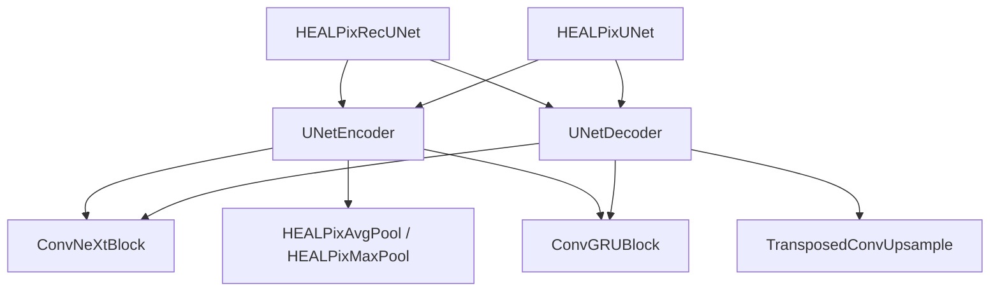
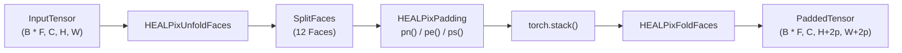

<!-- source: DeepWiki mcp.deepwiki.com · repo NVIDIA/physicsnemo · extra page DLWP and SwinRNN · fetched 2026-10-21 -->

# DLWP and SwinRNN

Relevant source files

The following files were used as context for generating this wiki page:

- [physicsnemo/models/dlwp_healpix/HEALPixRecUNet.py](physicsnemo/models/dlwp_healpix/HEALPixRecUNet.py)
- [physicsnemo/models/dlwp_healpix/HEALPixUNet.py](physicsnemo/models/dlwp_healpix/HEALPixUNet.py)
- [physicsnemo/models/dlwp_healpix/layers/__init__.py](physicsnemo/models/dlwp_healpix/layers/__init__.py)
- [physicsnemo/models/dlwp_healpix/layers/healpix_blocks.py](physicsnemo/models/dlwp_healpix/layers/healpix_blocks.py)
- [physicsnemo/models/dlwp_healpix/layers/healpix_decoder.py](physicsnemo/models/dlwp_healpix/layers/healpix_decoder.py)
- [physicsnemo/models/dlwp_healpix/layers/healpix_encoder.py](physicsnemo/models/dlwp_healpix/layers/healpix_encoder.py)
- [physicsnemo/nn/module/hpx/padding.py](physicsnemo/nn/module/hpx/padding.py)
- [test/metrics/test_healpix_loss.py](test/metrics/test_healpix_loss.py)
- [test/models/dlwp_healpix/test_healpix_blocks.py](test/models/dlwp_healpix/test_healpix_blocks.py)
- [test/models/dlwp_healpix/test_healpix_encoder_decoder.py](test/models/dlwp_healpix/test_healpix_encoder_decoder.py)
- [test/models/dlwp_healpix/test_healpix_layers.py](test/models/dlwp_healpix/test_healpix_layers.py)
- [test/models/dlwp_healpix/test_healpix_recunet_model.py](test/models/dlwp_healpix/test_healpix_recunet_model.py)
- [test/models/dlwp_healpix/test_healpix_unet_model.py](test/models/dlwp_healpix/test_healpix_unet_model.py)
- [test/nn/module/test_healpix.py](test/nn/module/test_healpix.py)

## Purpose and Scope

This page documents the Deep Learning Weather Prediction (DLWP) cubed-sphere models (`HEALPixUNet` and `HEALPixRecUNet`), the associated HEALPix layers and padded spherical convolutions, and the SwinRNN architecture within PhysicsNeMo. These models are engineered for multi-step spatio-temporal sequence forecasting on the sphere, eliminating polar coordinate singularities using Hierarchical Equal Area isoLatitude Pixelization (HEALPix).

---

## 1. DLWP Cubed-Sphere and HEALPix Models

The DLWP model family relies on HEALPix discretization to map global weather data onto 12 equal-area faces of a cubed sphere. PhysicsNeMo provides two primary top-level `Module` variants for this architecture: `HEALPixUNet` and `HEALPixRecUNet`.

### Core Classes and Metadata

*   **`HEALPixUNet`**: Standard U-Net architecture adapted for HEALPix grid layouts, supporting multi-step prediction, constant fields, and auxiliary couplings [physicsnemo/models/dlwp_healpix/HEALPixUNet.py:64-121]().
*   **`HEALPixRecUNet`**: Recurrent U-Net incorporating convolutional gated recurrent unit (`ConvGRUBlock`) modules for hidden state evolution over time steps [physicsnemo/models/dlwp_healpix/HEALPixRecUNet.py:66-126]().
*   **`MetaData`**: Standard metadata dataclass tracking optimization properties (JIT, CUDA graphs, automatic mixed precision) and inference characteristics [physicsnemo/models/dlwp_healpix/HEALPixUNet.py:48-63](), [physicsnemo/models/dlwp_healpix/HEALPixRecUNet.py:50-65]().

Below is a diagram mapping the high-level DLWP model system components to their concrete code entities:

Title: "DLWP Component Architecture Mapping"

Sources: [physicsnemo/models/dlwp_healpix/HEALPixUNet.py:64-121](), [physicsnemo/models/dlwp_healpix/HEALPixRecUNet.py:66-126](), [physicsnemo/models/dlwp_healpix/layers/__init__.py:33-45]()

---

## 2. HEALPix Layers and Padding

Spatial convolutions on HEALPix grids require specialized face handling and boundary padding to maintain continuity across adjacent cubed-sphere faces.

### Key Layer Modules

*   **`HEALPixLayer`**: A wrapper module that wraps standard 2D convolution or functional layers, automatically inserting padding submodules and managing channels/faces [test/models/dlwp_healpix/test_healpix_layers.py:50-95]().
*   **`HEALPixPadding`**: Reference spherical padding layer that unfolds the 12 cubed-sphere faces, stitches neighbor boundaries, and refolds them [physicsnemo/nn/module/hpx/padding.py:46-75]().
*   **`HEALPixFoldFaces` / `HEALPixUnfoldFaces`**: Reshaping utilities that convert between folded batch-face tensors `(B * 12, C, H, W)` and unrolled tensors `(B, 12, C, H, W)` [test/nn/module/test_healpix.py:83-146]().

The following diagram details the data flow through the face unfolding, neighborhood stitching, and refolding stages in the padding layer:

Title: "HEALPix Padding and Face Handling Data Flow"

Sources: [physicsnemo/nn/module/hpx/padding.py:77-190]()

---

## 3. Convolutional and Recurrent Blocks

The encoder and decoder are constructed using specialized sub-blocks tailored for spherical grids and deep residual learning.

*   **`ConvGRUBlock`**: Implements a convolutional gated recurrent unit on HEALPix geometry, maintaining internal temporal hidden state tensor `self.h` [physicsnemo/models/dlwp_healpix/layers/healpix_blocks.py:45-130]().
*   **`ConvNeXtBlock` / `Multi_SymmetricConvNeXtBlock`**: Modernized residual blocks utilizing depthwise convolutions and pointwise expansions, optionally integrated with `ConditionalLayerNorm` [physicsnemo/models/dlwp_healpix/layers/__init__.py:33-46]().
*   **`UNetEncoder` / `UNetDecoder`**: Multilevel encoder-decoder backbones that manage feature downsampling and upsampling across spatial resolutions [physicsnemo/models/dlwp_healpix/layers/healpix_encoder.py](), [physicsnemo/models/dlwp_healpix/layers/healpix_decoder.py]().

Sources: [physicsnemo/models/dlwp_healpix/layers/__init__.py:33-68](), [physicsnemo/models/dlwp_healpix/layers/healpix_blocks.py:45-188]()

---

## 4. SwinRNN Architecture

SwinRNN integrates hierarchical Swin Transformer blocks with recurrent hidden units to capture multi-scale spatial dependencies and temporal evolution for sequential atmospheric modeling.

*   **Swin Transformer Integration**: Processes flattened latent representations using shifted window self-attention to maintain efficiency over large global grids.
*   **Recurrent Wrapper**: Combines spatial encoder outputs with internal GRU/LSTM recurrent state transitions for multi-step autoregressive rollouts.

Sources: [physicsnemo/__init__.py:20]()

---

## 5. Data Flow, Coupling, and Loss Functions

### Input Data Layouts
DLWP models ingest tensors formatted as `(B, F, T_in, C, H, W)` where `F = 12` represents the cubed-sphere faces [test/models/dlwp_healpix/test_healpix_unet_model.py:88-93](). Auxiliary inputs include:
*   **Constants**: Static surface properties like land-sea mask and orography [test/models/dlwp_healpix/test_healpix_unet_model.py:99-106]().
*   **Couplings / Insolation**: External time-dependent forcing fields (e.g., top-of-atmosphere solar insolation) [test/models/dlwp_healpix/test_healpix_unet_model.py:110-117]().

### Loss Formulations
Evaluation and training loss functions account for spherical surface areas and masked domains using specialized metrics:
*   **`WeightedMSE` / `BaseMSE`**: Computes channel-weighted mean squared errors across grid points [test/metrics/test_healpix_loss.py:62-145]().
*   **`OceanMSE` / `WeightedOceanMSE`**: Domain-masked MSE variants isolating ocean or land grid points [test/metrics/test_healpix_loss.py:25-30]().

Sources: [test/models/dlwp_healpix/test_healpix_unet_model.py:88-117](), [test/metrics/test_healpix_loss.py:25-145]()

---

## 6. Legacy Checkpoint Compatibility

PhysicsNeMo provides automated remapping utilities to ensure backward compatibility when loading legacy checkpoints from earlier package versions.

*   **`_remap_target(target: str) -> str`**: Translates deprecated import paths (such as `physicsnemo.models.dlwp_healpix_layers`) to current `physicsnemo.models.dlwp_healpix.layers` or `physicsnemo.nn` namespaces [physicsnemo/models/dlwp_healpix/layers/__init__.py:71-140]().
*   **`_remap_obj(obj)`**: Recursively inspects OmegaConf `DictConfig` and standard dictionaries, rewriting `_target_` paths during checkpoint ingestion [physicsnemo/models/dlwp_healpix/layers/__init__.py:143-163]().

Sources: [physicsnemo/models/dlwp_healpix/layers/__init__.py:71-163]()

---

