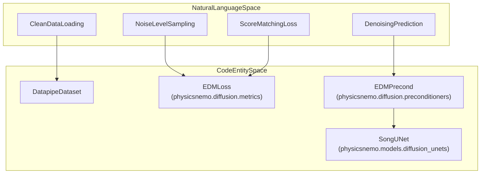
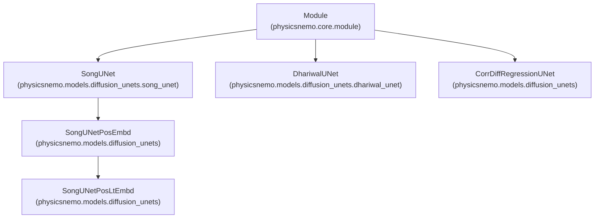

<!-- source: DeepWiki mcp.deepwiki.com · repo NVIDIA/physicsnemo · extra page Diffusion Model Training · fetched 2026-10-21 -->

# Diffusion Model Training

Relevant source files

The following files were used as context for generating this wiki page:

- [examples/additive_manufacturing/sintering_physics/README.md](examples/additive_manufacturing/sintering_physics/README.md)
- [examples/cfd/flow_reconstruction_diffusion/README.md](examples/cfd/flow_reconstruction_diffusion/README.md)
- [examples/cfd/flow_reconstruction_diffusion/generate_dfsr.py](examples/cfd/flow_reconstruction_diffusion/generate_dfsr.py)
- [examples/cfd/flow_reconstruction_diffusion/requirements.txt](examples/cfd/flow_reconstruction_diffusion/requirements.txt)
- [examples/healthcare/bloodflow_1d_mgn/README.md](examples/healthcare/bloodflow_1d_mgn/README.md)
- [examples/healthcare/bloodflow_1d_mgn/generate_dataset.py](examples/healthcare/bloodflow_1d_mgn/generate_dataset.py)
- [examples/healthcare/bloodflow_1d_mgn/generate_graphs.py](examples/healthcare/bloodflow_1d_mgn/generate_graphs.py)
- [examples/healthcare/bloodflow_1d_mgn/graph_tools.py](examples/healthcare/bloodflow_1d_mgn/graph_tools.py)
- [examples/healthcare/bloodflow_1d_mgn/requirements.txt](examples/healthcare/bloodflow_1d_mgn/requirements.txt)
- [physicsnemo/models/diffusion_unets/dhariwal_unet.py](physicsnemo/models/diffusion_unets/dhariwal_unet.py)
- [physicsnemo/models/diffusion_unets/song_unet.py](physicsnemo/models/diffusion_unets/song_unet.py)
- [physicsnemo/models/diffusion_unets/unet.py](physicsnemo/models/diffusion_unets/unet.py)
- [test/metrics/diffusion/test_losses.py](test/metrics/diffusion/test_losses.py)
- [test/models/diffusion/test_dhariwal_unet.py](test/models/diffusion/test_dhariwal_unet.py)
- [test/models/diffusion/test_preconditioning.py](test/models/diffusion/test_preconditioning.py)
- [test/models/diffusion/test_song_unet.py](test/models/diffusion/test_song_unet.py)
- [test/models/diffusion/test_song_unet_pos_embd.py](test/models/diffusion/test_song_unet_pos_embd.py)
- [test/models/diffusion/test_song_unet_pos_lt_embd.py](test/models/diffusion/test_song_unet_pos_lt_embd.py)
- [test/models/diffusion/test_unet_wrappers.py](test/models/diffusion/test_unet_wrappers.py)

## Purpose and Scope

This page covers the complete technical workflow for training diffusion models within PhysicsNeMo, spanning architecture selection, preconditioning schemes, loss functions, sampling strategies, and conditional generation. It focuses on the practical implementation details of generative models applied to physics domains, including atmospheric super-resolution, regional weather forecasting, and flow reconstruction.

For foundational network definitions, see [physicsnemo/models/diffusion_unets/song_unet.py:65-156]() and [physicsnemo/models/diffusion_unets/dhariwal_unet.py:21-37](). For preconditioning wrappers and loss formulas, consult [test/models/diffusion/test_preconditioning.py:21-28]() and [test/metrics/diffusion/test_losses.py:21-30]().

Sources: [physicsnemo/models/diffusion_unets/song_unet.py:65-156](), [test/models/diffusion/test_preconditioning.py:21-28]()

## Training Workflow Overview

Diffusion training involves learning to reverse a forward diffusion process by predicting either the added noise or the clean target image across various noise scales ($\sigma$). In PhysicsNeMo, models are typically wrapped in preconditioning modules that normalize inputs and outputs across noise levels.

### Diagram: Diffusion Training Pipeline to Code Entities

Sources: [physicsnemo/models/diffusion_unets/song_unet.py:65-100](), [test/metrics/diffusion/test_losses.py:21-30]()

## Architecture Selection

PhysicsNeMo provides several U-Net and transformer-based backbones specialized for diffusion tasks. The primary backbone family is `SongUNet` and its specialized positional and lead-time embedding variants, alongside `DhariwalUNet` [physicsnemo/models/diffusion_unets/song_unet.py:65-156](), [physicsnemo/models/diffusion_unets/dhariwal_unet.py:21-37]().

### Diagram: Diffusion Backbone Hierarchy to Code Entities

### Architectural Classes and Parameters

- `SongUNet`: Implements DDPM++ and NCSN++ backbones supporting noise level, class, and augmentation conditioning [physicsnemo/models/diffusion_unets/song_unet.py:65-156]().
- `SongUNetPosEmbd`: Extends `SongUNet` with configurable spatial positional embeddings (`gridtype="sinusoidal"`, `learnable`, or `linear`) for patch-based and high-resolution generation [test/models/diffusion/test_song_unet_pos_embd.py:24-32]().
- `SongUNetPosLtEmbd`: Further extends spatial positioning with lead-time embedding support for multi-step temporal forecasting [test/models/diffusion/test_song_unet_pos_lt_embd.py:21-54]().
- `CorrDiffRegressionUNet` & `StormCastUNet`: Specialized wrappers combining deterministic regression paths with generative diffusion modules [test/models/diffusion/test_unet_wrappers.py:24-25]().

Sources: [physicsnemo/models/diffusion_unets/song_unet.py:65-156](), [test/models/diffusion/test_song_unet_pos_embd.py:24-32](), [test/models/diffusion/test_song_unet_pos_lt_embd.py:21-54](), [test/models/diffusion/test_unet_wrappers.py:24-25]()

## Preconditioning Schemes

Preconditioning is essential for stabilizing diffusion training across wide ranges of noise scales ($\sigma$). PhysicsNeMo implements EDM-based preconditioning wrappers that scale network inputs and outputs dynamically [test/models/diffusion/test_preconditioning.py:21-27]().

- `EDMPrecond`: Standard Elucidating Diffusion Models (EDM) wrapper providing skip connections $c_{skip}(\sigma)$, output scaling $c_{out}(\sigma)$, input scaling $c_{in}(\sigma)$, and noise embedding $c_{noise}(\sigma)$ [test/models/diffusion/test_preconditioning.py:21-23]().
- `EDMPrecondSuperResolution`: Adaptation for downscaled-to-high-resolution mapping, accepting low-resolution conditioning images (`img_lr`) alongside target latents [test/models/diffusion/test_preconditioning.py:23-24]().
- `VEPrecond_dfsr` & `VEPrecond_dfsr_cond`: Variance-Exploding preconditioning variants tailored for flow reconstruction and vorticity residual constraints [test/models/diffusion/test_preconditioning.py:25-27]().

Sources: [test/models/diffusion/test_preconditioning.py:21-27]()

## Loss Functions

Training diffusion models relies on weighted denoising score matching objectives [test/metrics/diffusion/test_losses.py:21-30]().

- `EDMLoss` & `EDMLossLogUniform`: Implements the log-normal and log-uniform noise sampling strategies with $\sigma_{data}$ scaling, computing mean squared error between the preconditioned network output and clean targets [test/metrics/diffusion/test_losses.py:21-23]().
- `VELoss` & `VPLoss`: Variance-Exploding and Variance-Preserving score matching loss formulations [test/metrics/diffusion/test_losses.py:27-29]().
- `RegressionLoss` & `ResidualLoss`: Auxiliary losses used in regression-diffusion hybrid architectures like CorrDiff [test/metrics/diffusion/test_losses.py:24-26]().

Sources: [test/metrics/diffusion/test_losses.py:21-30]()

## Sampling Strategies

Inference and evaluation leverage stochastic and deterministic sampling algorithms to integrate the learned score or velocity fields [test/models/diffusion/test_preconditioning.py:21-27](). Stochastic samplers (SDE-based) introduce Langevin dynamics for diversity, while deterministic samplers (ODE-based) offer faster convergence and reproducibility.

Sources: [test/models/diffusion/test_preconditioning.py:21-27]()

## Conditional Generation

PhysicsNeMo diffusion frameworks support multi-modal conditioning:
1. **Class and Augmentation Labels**: Vector conditioning via embedding layers integrated into U-Net blocks [physicsnemo/models/diffusion_unets/song_unet.py:78-87]().
2. **Spatial Positional Embeddings**: Provided via `SongUNetPosEmbd` using sinusoidal or learnable coordinate grids to maintain spatial coherence across patches [test/models/diffusion/test_song_unet_pos_embd.py:64-92]().
3. **Lead-Time Embeddings**: Managed by `SongUNetPosLtEmbd` for meteorological forecasting across different forecast horizons [test/models/diffusion/test_song_unet_pos_lt_embd.py:92-134]().

Sources: [physicsnemo/models/diffusion_unets/song_unet.py:78-87](), [test/models/diffusion/test_song_unet_pos_embd.py:64-92](), [test/models/diffusion/test_song_unet_pos_lt_embd.py:92-134]()

## Advanced Topics: Flow Reconstruction and Physical Constraints

Specialized diffusion workflows incorporate physics-informed residuals and super-resolution constraints. For instance, `VEPrecond_dfsr_cond` includes vorticity residual evaluations (`voriticity_residual`) to constrain fluid flow generation to satisfy governing physical laws [test/models/diffusion/test_preconditioning.py:191-228]().

Sources: [test/models/diffusion/test_preconditioning.py:191-228]()

---

