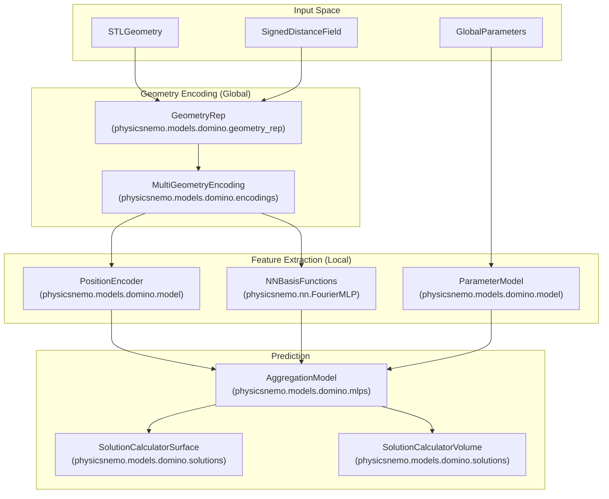
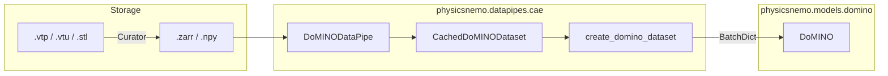

<!-- source: DeepWiki mcp.deepwiki.com · repo NVIDIA/physicsnemo · extra page DoMINO · fetched 2026-10-21 -->

# DoMINO

Relevant source files

The following files were used as context for generating this wiki page:

- [docs/img/domino_result_rtwt.jpg](docs/img/domino_result_rtwt.jpg)
- [examples/cfd/external_aerodynamics/domino/README.md](examples/cfd/external_aerodynamics/domino/README.md)
- [examples/cfd/external_aerodynamics/domino/src/conf/config.yaml](examples/cfd/external_aerodynamics/domino/src/conf/config.yaml)
- [examples/cfd/external_aerodynamics/domino/src/inference_on_stl.py](examples/cfd/external_aerodynamics/domino/src/inference_on_stl.py)
- [examples/cfd/external_aerodynamics/domino/src/test.py](examples/cfd/external_aerodynamics/domino/src/test.py)
- [examples/cfd/external_aerodynamics/domino/src/train.py](examples/cfd/external_aerodynamics/domino/src/train.py)
- [examples/cfd/external_aerodynamics/domino/src/utils.py](examples/cfd/external_aerodynamics/domino/src/utils.py)
- [examples/cfd/external_aerodynamics/transformer_models/src/inference_on_zarr.py](examples/cfd/external_aerodynamics/transformer_models/src/inference_on_zarr.py)
- [examples/cfd/external_aerodynamics/transformer_models/src/metrics.py](examples/cfd/external_aerodynamics/transformer_models/src/metrics.py)
- [physicsnemo/datapipes/cae/domino_datapipe.py](physicsnemo/datapipes/cae/domino_datapipe.py)
- [physicsnemo/models/domino/__init__.py](physicsnemo/models/domino/__init__.py)
- [physicsnemo/models/domino/config.py](physicsnemo/models/domino/config.py)
- [physicsnemo/models/domino/encodings.py](physicsnemo/models/domino/encodings.py)
- [physicsnemo/models/domino/geometry_rep.py](physicsnemo/models/domino/geometry_rep.py)
- [physicsnemo/models/domino/mlps.py](physicsnemo/models/domino/mlps.py)
- [physicsnemo/models/domino/model.py](physicsnemo/models/domino/model.py)
- [physicsnemo/models/domino/solutions.py](physicsnemo/models/domino/solutions.py)
- [physicsnemo/models/domino/utils/__init__.py](physicsnemo/models/domino/utils/__init__.py)
- [physicsnemo/models/domino/utils/vtk_file_utils.py](physicsnemo/models/domino/utils/vtk_file_utils.py)
- [physicsnemo/nn/functional/neighbors/radius_search/_torch_impl.py](physicsnemo/nn/functional/neighbors/radius_search/_torch_impl.py)
- [physicsnemo/nn/functional/neighbors/radius_search/kernels.py](physicsnemo/nn/functional/neighbors/radius_search/kernels.py)
- [physicsnemo/nn/functional/neighbors/radius_search/radius_search.py](physicsnemo/nn/functional/neighbors/radius_search/radius_search.py)
- [physicsnemo/nn/functional/neighbors/radius_search/utils.py](physicsnemo/nn/functional/neighbors/radius_search/utils.py)
- [physicsnemo/nn/module/ball_query.py](physicsnemo/nn/module/ball_query.py)
- [physicsnemo/utils/memory.py](physicsnemo/utils/memory.py)
- [test/datapipes/test_domino_datapipe.py](test/datapipes/test_domino_datapipe.py)
- [test/models/domino/test_domino.py](test/models/domino/test_domino.py)
- [test/utils/test_mesh_utils.py](test/utils/test_mesh_utils.py)

DoMINO (Decomposable Multi-scale Iterative Neural Operator) is a local, multi-scale, point-cloud based model architecture designed to model large-scale physics problems, specifically external aerodynamics [examples/cfd/external_aerodynamics/domino/README.md:1-8](). The model takes STL geometries as input and evaluates flow quantities such as pressure, velocity fields, and wall shear stress on both the surface of objects and in the surrounding volume [examples/cfd/external_aerodynamics/domino/README.md:4-8]().

## Architecture Overview

DoMINO utilizes local geometric information to predict solutions on discrete points [examples/cfd/external_aerodynamics/domino/README.md:10-10](). It first learns a global geometry encoding from point clouds using a multi-scale, iterative approach that accounts for both short- and long-range dependencies [examples/cfd/external_aerodynamics/domino/README.md:10-13](). Discrete points are then sampled, and local geometry encodings are extracted from the global representation using dynamic point convolution kernels [examples/cfd/external_aerodynamics/domino/README.md:15-17]().

### DoMINO Component Mapping

The following diagram maps the conceptual stages of the DoMINO architecture to the specific classes and functions implemented in the codebase.

Sources: [physicsnemo/models/domino/model.py:45-112](), [physicsnemo/models/domino/model.py:37-42]()

## Core Implementation

The primary model entry point is the `DoMINO` class, which inherits from `physicsnemo.core.Module` [physicsnemo/models/domino/model.py:45-45](). It supports three operational modes: surface-only, volume-only, or combined [physicsnemo/models/domino/model.py:51-55]().

### Key Classes and Functions

| Component | Class/Function | Description |
|:---|:---|:---|
| **Geometry Representation** | `GeometryRep` | Processes point clouds and SDFs into grid-based latent representations [physicsnemo/models/domino/model.py:59-59](). |
| **Basis Functions** | `NNBasisFunctions` | Implements neural network basis functions using `FourierMLP` [physicsnemo/models/domino/model.py:60-60](). |
| **Aggregation** | `AggregationModel` | Final MLP layers that aggregate local geometry and basis features to predict fields [physicsnemo/models/domino/model.py:63-63](). |
| **Solution Calculation** | `SolutionCalculatorSurface` / `SolutionCalculatorVolume` | Specialized logic for evaluating quantities on surface meshes and volumetric domains [physicsnemo/models/domino/model.py:42-42](). |

Sources: [physicsnemo/models/domino/model.py:45-78]()

## Data Pipeline and Processing

The `DoMINODataPipe` handles the complex task of preparing CFD data for the model [physicsnemo/datapipes/cae/domino_datapipe.py:63-66](). It processes raw simulation files (`vtp`, `vtu`, `stl`) into training-ready formats like Zarr or NumPy [examples/cfd/external_aerodynamics/domino/README.md:89-91]().

### Data Flow Diagram

This diagram illustrates the flow from raw data files through the `DoMINODataPipe` to the `DoMINO` model during training.

Sources: [physicsnemo/datapipes/cae/domino_datapipe.py:63-66](), [examples/cfd/external_aerodynamics/domino/README.md:96-102](), [examples/cfd/external_aerodynamics/domino/src/train.py:63-67]()

### Preprocessing Features
* **Signed Distance Field (SDF)**: Calculated on-the-fly or cached for large surface meshes [examples/cfd/external_aerodynamics/domino/README.md:99-102]().
* **Normalization**: Output fields are normalized to zero mean and unit variance [examples/cfd/external_aerodynamics/domino/README.md:114-115]().
* **Coordinate Scaling**: Input locations are scaled and optionally cropped to user-defined bounding boxes [examples/cfd/external_aerodynamics/domino/README.md:118-121]().

Sources: [examples/cfd/external_aerodynamics/domino/README.md:96-123]()

## Distributed Training and Domain Parallelism

DoMINO is designed for high-performance distributed training using `DistributedDataParallel` (DDP) or Fully Sharded Data Parallel (FSDP) [examples/cfd/external_aerodynamics/domino/src/train.py:18-22]().

### Domain Parallelism Support
The architecture supports domain parallelism via `ShardTensor` and 2D device meshes initialized via `coordinate_distributed_environment` [physicsnemo/datapipes/cae/domino_datapipe.py:46-46](), [examples/cfd/external_aerodynamics/domino/src/utils.py:147-183]().
* **Grid Sharding**: The `shard_grid` configuration parameter allows partitioning the latent grid across GPUs [physicsnemo/datapipes/cae/domino_datapipe.py:128-129]().
* **Point Sharding**: The `shard_points` configuration parameter enables sharding volume and surface field tensors [physicsnemo/datapipes/cae/domino_datapipe.py:130-131]().

Sources: [physicsnemo/datapipes/cae/domino_datapipe.py:128-132](), [examples/cfd/external_aerodynamics/domino/src/conf/config.yaml:94-97](), [examples/cfd/external_aerodynamics/domino/src/utils.py:147-183]()

## NIM Fine-tuning and External Aerodynamics Workflow

The DoMINO workflow integrates with the NVIDIA simulation and inference pipelines for fine-tuning on custom geometries [examples/cfd/external_aerodynamics/domino/README.md:139-148]().

1. **Data Curation**: Use `PhysicsNeMo-Curator` to process raw CFD results into the required format [examples/cfd/external_aerodynamics/domino/README.md:80-85]().
2. **Configuration**: Define project details, variables, and model hyperparameters in `config.yaml` [examples/cfd/external_aerodynamics/domino/src/conf/config.yaml:17-101]().
3. **Training**: Execute `train.py` which handles distributed environment coordination, checkpoint loading, and mixed-precision training [examples/cfd/external_aerodynamics/domino/src/train.py:18-28]().
4. **Validation**: Automated validation steps compute L2 metrics and log results to TensorBoard [examples/cfd/external_aerodynamics/domino/src/train.py:88-107]().
5. **Testing**: Run `test.py` to evaluate on raw `vtp`/`vtu` files and save predictions back into visualization-ready formats [examples/cfd/external_aerodynamics/domino/src/test.py:18-27]().

Sources: [examples/cfd/external_aerodynamics/domino/README.md:1-25](), [examples/cfd/external_aerodynamics/domino/src/train.py:17-28](), [examples/cfd/external_aerodynamics/domino/src/test.py:17-27]()

---

